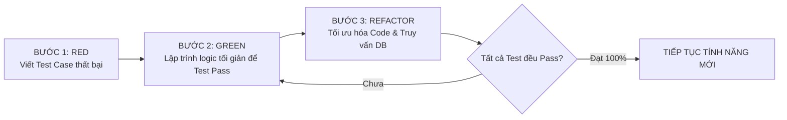

# KẾ HOẠCH TRIỂN KHAI PHẦN MỀM (SOFTWARE IMPLEMENTATION PLAN)
## PHÂN HỆ: TỔNG QUAN KHO & ĐIỀU PHỐI DÒNG HÀNG (MODULE 01)
### Dự án: Hệ thống Quản lý Kho hàng Điện máy Thông minh - Stock Sense
#### Phương pháp luận: Test-Driven Development (TDD) | Framework: Streamlit & SQLite

---

## BẢNG KIỂM SOÁT TÀI LIỆU (DOCUMENT CONTROL)

| Mục | Nội dung |
| :--- | :--- |
| **Mã tài liệu** | `PLAN-MOD01-INVENTORY-OVERVIEW-TDD` |
| **Tài liệu tham chiếu** | [docs/SRS_01_TONG_QUAN_KHO.md](file:///Users/doanphambaothu/Documents/gsj_project/docs/SRS_01_TONG_QUAN_KHO.md) & [docs/URD_01_TONG_QUAN_KHO.md](file:///Users/doanphambaothu/Documents/gsj_project/docs/URD_01_TONG_QUAN_KHO.md) |
| **Phiên bản** | `1.0.0` |
| **Ngày lập kế hoạch** | 04/11/2026 |
| **Tác giả** | Nhóm Phân tích Nghiệp vụ & Kỹ thuật Phần mềm (BA & Tech Lead) |
| **Mô hình phát triển** | Test-Driven Development (Red $\rightarrow$ Green $\rightarrow$ Refactor) |
| **Môi trường thực thi** | Python 3.10+, Streamlit, Plotly, SQLite 3 |

---

## 1. TỔNG QUAN & MỤC TIÊU KẾ HOẠCH (OBJECTIVES & SCOPE)

### 1.1. Mục tiêu kế hoạch
Kế hoạch này vạch ra lộ trình kỹ thuật chi tiết từng bước (step-by-step) để lập trình hoàn chỉnh màn hình **Dashboard Tổng quan kho** theo đúng đặc tả yêu cầu phần mềm trong SRS. Quá trình lập trình được thực hiện theo nguyên tắc **Test-Driven Development (TDD)**:
* **Viết Test trước (Red):** Định nghĩa rõ các kỳ vọng đầu ra (Expected Output), kiểm tra tính toàn vẹn dữ liệu, các điều kiện biên và bảo mật trước khi viết logic thực thi.
* **Lập trình chức năng (Green):** Viết mã nguồn tối giản để tất cả các ca kiểm thử chuyển sang trạng thái Pass.
* **Tối ưu hóa (Refactor):** Cải tiến cấu trúc mã nguồn, tối ưu hóa truy vấn CSDL, tăng tốc độ phản hồi mà không làm phá vỡ các bài kiểm thử đã Pass.

### 1.2. Phạm vi chức năng triển khai
Kế hoạch bao phủ 100% các yêu cầu kỹ thuật của Phân hệ Tổng quan kho:
1. **Phân hệ 1 - Quản lý Danh mục & Tồn kho Thiết bị (US-1.1):**
   - `FR-INV-01`: 4 Thẻ chỉ số KPI vĩ mô (Tổng SKU, SOH, Tổng vốn tồn kho $\sum SOH \times Cost$, Cảnh báo rủi ro).
   - `FR-INV-02`: Bộ lọc đa chiều (Nhóm hàng 3 cấp, Thương hiệu, Khoảng giá, Trạng thái tồn kho).
   - `FR-INV-03`: Modal tra cứu chi tiết Serial/IMEI kèm kiểm tra toàn vẹn $\Delta = SOH - \text{COUNT}(Serial)$.
   - `FR-INV-04`: Ma trận phân tán Tồn kho vs. Tốc độ bán (Plotly 4 góc phần tư) phát hiện hàng chôn vốn và hàng cháy.
   - `FR-INV-05`: Cơ chế che giấu dữ liệu giá vốn (Data Masking) theo vai trò `ROLE_SALES` vs `ROLE_OWNER`.
2. **Phân hệ 2 - Điều phối Đơn hàng & Dòng hàng 4 Trạng thái (US-1.2):**
   - `FR-ORD-01`: Quản lý Đơn giữ cọc & tính Tồn khả dụng: $AVL = SOH - RES$.
   - `FR-ORD-02`: Cơ chế khóa tương tranh kiểm soát chống bán âm kho (Overselling).
   - `FR-ORD-03`: Phát hiện & cảnh báo đơn giữ chỗ quá hạn 48 giờ (Hold Time Policy).
   - `FR-ORD-04`: Theo dõi luồng hàng đang trên đường về kho ($INC$) từ Nhà cung cấp.
   - `FR-ORD-05`: Phân loại & giám sát cơ cấu thanh toán (Trả toàn phần vs. Trả góp qua Công ty tài chính / Thẻ tín dụng).
   - `FR-ORD-06`: Quy trình điều phối xuất kho, quét gán Serial thực tế và kích hoạt bảo hành điện tử.

---

## 2. KIẾN TRÚC MÃ NGUỒN & CẤU TRÚC THƯ MỤC (SOFTWARE ARCHITECTURE)

Để đảm bảo khả năng viết Unit Test độc lập và giao diện Streamlit gọn gàng, mã nguồn được tổ chức theo kiến trúc phân tầng (Layered Architecture):

```
gsj_project/
├── data/
│   └── retail_dienmay.db           # SQLite Data Warehouse chứa dữ liệu Master, Invoices, Orders, POs
├── docs/
│   ├── URD_01_TONG_QUAN_KHO.md     # Tài liệu Yêu cầu Người sử dụng
│   ├── SRS_01_TONG_QUAN_KHO.md     # Tài liệu Đặc tả Yêu cầu Phần mềm
│   └── IMPLEMENTATION_PLAN_01_TONG_QUAN_KHO.md # Kế hoạch triển khai TDD chi tiết (File này)
├── src/
│   ├── database/
│   │   ├── __init__.py
│   │   └── connection.py           # Quản lý kết nối SQLite & Transaction helper
│   ├── services/                   # TẦNG NGHIỆP VỤ (Core Business Logic - Mục tiêu chính của TDD)
│   │   ├── __init__.py
│   │   ├── inventory_service.py    # Xử lý tính toán KPI, định giá vốn, kiểm tra Serial, lọc SKU
│   │   └── order_service.py        # Xử lý dòng hàng 4 trạng thái, kiểm tra quá hạn 48h, phân loại trả góp
│   ├── views/                      # TẦNG TRỰC QUAN HÓA STREAMLIT (UI Presentation Layer)
│   │   ├── __init__.py
│   │   ├── tab_inventory_view.py   # Render Tab 1: Danh mục sản phẩm, Biểu đồ Scatter & Modal Serial
│   │   └── tab_order_flow_view.py  # Render Tab 2: Bảng điều phối Đơn hàng, Trả góp & Dòng hàng đang về
│   ├── app_dashboard.py            # Entry point chính của ứng dụng Streamlit
│   ├── generate_synthetic_data.py  # Pipeline sinh dữ liệu giả lập chuẩn hóa
│   └── schema_dienmay_kiotviet.sql # Định nghĩa CSDL SQLite & Views phân tích
└── tests/                          # TẦNG KIỂM THỬ TDD (Pytest Test Suites)
    ├── __init__.py
    ├── conftest.py                 # Fixtures tạo Database giả lập cho Testing
    ├── test_inventory_service.py   # Test Suite kiểm thử Phân hệ 1 (US-1.1)
    ├── test_order_service.py       # Test Suite kiểm thử Phân hệ 2 (US-1.2)
    └── test_dashboard_integration.py # Test Suite kiểm thử tích hợp giao diện & luồng dữ liệu
```

---

## 3. QUY TRÌNH THỰC THI THEO MÔ HÌNH TDD (TEST-DRIVEN DEVELOPMENT WORKFLOW)

Mỗi tính năng trong kế hoạch bắt buộc phải trải qua chu trình 3 bước khép kín:



1. **Giai đoạn ĐỎ (Red):**
   - Viết các hàm kiểm thử trong thư mục `tests/` trước khi tạo hàm thực thi trong `src/services/`.
   - Chạy lệnh `pytest`: Xác nhận bài kiểm thử **báo lỗi (Fail/Error)** do hàm chức năng chưa tồn tại hoặc chưa trả về kết quả mong đợi.
2. **Giai đoạn XANH (Green):**
   - Hiện thực hóa logic trong `src/services/` với lượng code vừa đủ để thỏa mãn yêu cầu của bài test.
   - Chạy lệnh `pytest`: Xác nhận tất cả test case chuyển sang **màu xanh (Passed)**.
3. **Giai đoạn TỐI ƯU (Refactor):**
   - Chuẩn hóa mã nguồn, bổ sung Type Hinting, Docstrings, tối ưu hóa câu lệnh SQL (chuyển sang View hoặc Index) để thời gian phản hồi $< 200\text{ms}$.
   - Chạy lại toàn bộ `pytest`: Đảm bảo 100% bài test vẫn tiếp tục Passed.

---

## 4. CHI TIẾT TỪNG BƯỚC THỰC THI (DETAILED STEP-BY-STEP PLAN)

---

### GIAI ĐOẠN 1: CHUẨN BỊ DỮ LIỆU NỀN TẢNG & MÔI TRƯỜNG KIỂM THỬ
**Thời lượng dự kiến:** 0.5 ngày làm việc

#### Bước 1.1: Nâng cấp Schema CSDL & View phân tích dòng hàng
* **Mục tiêu:** Cung cấp đầy đủ bảng `PURCHASE_ORDERS`, `PO_ITEMS`, các cột thanh toán trong `FACT_ORDERS`, và View `VW_INVENTORY_FLOW_OVERVIEW`.
* **Cách thức triển khai (How-to):**
  - Cập nhật [`src/schema_dienmay_kiotviet.sql`](file:///Users/doanphambaothu/Documents/gsj_project/src/schema_dienmay_kiotviet.sql).
  - Tích hợp View `VW_INVENTORY_FLOW_OVERVIEW` tính toán động 4 chỉ số $SOH, RES, AVL, INC$.
* **Definition of Done (DoD):**
  - Chạy file SQL không báo lỗi; SQLite tạo thành công 13 bảng và 4 View.

#### Bước 1.2: Sinh dữ liệu giả lập cho Đơn đặt hàng & Đơn nhập hàng
* **Mục tiêu:** Nạp 35 đơn hàng mẫu vào `FACT_ORDERS` và 3 đơn nhập vào `PURCHASE_ORDERS`.
* **Cách thức triển khai (How-to):**
  - Thực thi hàm `generate_purchase_orders()` và `generate_orders_with_sdv(num_orders=35)` trong [`src/generate_synthetic_data.py`](file:///Users/doanphambaothu/Documents/gsj_project/src/generate_synthetic_data.py).
  - Mô phỏng 18 đơn Đã xác nhận, 10 đơn Chờ xử lý (có 6 đơn trả góp), 4 đơn quá hạn 48h, và 3 đơn đã hủy.
* **Definition of Done (DoD):**
  - Kiểm tra `SELECT COUNT(*) FROM FACT_ORDERS` trả về $\ge 35$.
  - Kiểm tra `SELECT COUNT(*) FROM PURCHASE_ORDERS` trả về $\ge 3$.
  - Truy vấn `VW_INVENTORY_FLOW_OVERVIEW` hiển thị đầy đủ $SOH, RES, AVL, INC$ cho tất cả các SKU.

---

### GIAI ĐOẠN 2: TDD PHÂN HỆ 1 - DANH MỤC & TỒN KHO THIẾT BỊ (US-1.1)
**Thời lượng dự kiến:** 1.5 ngày làm việc

#### Bước 2.1: Viết Test Suite cho Inventory Service (Giai đoạn RED)
* **Tệp kiểm thử:** `tests/test_inventory_service.py`
* **Các ca kiểm thử cần viết:**
  1. `test_calculate_inventory_summary_metrics()`: Kiểm tra tính toán Tổng số SKU, Tổng tồn kho vật lý (91 máy), Tổng giá trị vốn kho (**1.227.600.000 đ**), và Tổng số mặt hàng rủi ro (3 Overstock, 6 Cần nhập gấp).
  2. `test_role_based_cost_masking_owner()`: Kiểm tra khi vai trò là `ROLE_OWNER` thì trường `total_capital` và cột `cost_price` hiển thị đầy đủ số tiền thực tế.
  3. `test_role_based_cost_masking_sales()`: Kiểm tra khi vai trò là `ROLE_SALES` thì trường `total_capital` bị che giấu thành `****** đ` hoặc `None`, và cột `cost_price` bị ẩn.
  4. `test_serial_integrity_check()`: Kiểm tra với mọi SKU, số lượng Serial có trạng thái `IN_STOCK` phải bằng chính xác giá trị `stock_on_hand`.
  5. `test_filter_products_by_category_and_status()`: Kiểm tra bộ lọc theo nhóm hàng 3 cấp và trạng thái rủi ro tồn kho.

#### Bước 2.2: Lập trình Logic `inventory_service.py` (Giai đoạn GREEN)
* **Tệp mã nguồn:** `src/services/inventory_service.py`
* **Cách thức triển khai (How-to):**
  - Hàm `get_inventory_kpis(user_role: str) -> dict`: Truy vấn View `VW_PRODUCT_PERFORMANCE`, tính toán tổng vốn, áp dụng logic masking giá vốn dựa trên `user_role`.
  - Hàm `get_product_catalog(category: str, brand: str, status: str, search: str, user_role: str) -> pd.DataFrame`: Lọc dữ liệu động theo điều kiện SQL parameterized.
  - Hàm `get_serial_drilldown(product_code: str) -> dict`: Trả về danh sách Serial và cờ cảnh báo toàn vẹn `is_integrity_ok`.
* **Definition of Done (DoD):**
  - Chạy `pytest tests/test_inventory_service.py` đạt **100% Passed**.

#### Bước 2.3: Lập trình Giao diện Tab 1 trên Streamlit
* **Tệp mã nguồn:** `src/views/tab_inventory_view.py`
* **Cách thức triển khai (How-to):**
  - Sử dụng `st.columns(4)` để render 4 Metric cards với định dạng tiền tệ Việt Nam.
  - Sử dụng `plotly.express.scatter` render Ma trận phân tán Tồn kho vs. Tốc độ bán (phân biệt màu sắc: Đỏ - Tồn cao kẹt vốn, Cam - Cần nhập gấp, Xanh - Tồn an toàn).
  - Sử dụng `st.dataframe` với tính năng highlight màu sắc theo trạng thái tồn kho.
  - Sử dụng `@st.dialog` (hoặc popover) hiển thị Modal danh sách Serial/IMEI kèm nút sao chép nhanh khi người dùng click vào nút `[Serial]`.
* **Definition of Done (DoD):**
  - Giao diện hiển thị đúng 100% theo wireframe trong SRS Mục 5.2.
  - Thao tác chuyển bộ lọc phản hồi tức thì $\le 300\text{ms}$.

---

### GIAI ĐOẠN 3: TDD PHÂN HỆ 2 - ĐIỀU PHỐI ĐƠN HÀNG & DÒNG HÀNG (US-1.2)
**Thời lượng dự kiến:** 1.5 ngày làm việc

#### Bước 3.1: Viết Test Suite cho Order & Flow Service (Giai đoạn RED)
* **Tệp kiểm thử:** `tests/test_order_service.py`
* **Các ca kiểm thử cần viết:**
  1. `test_flow_equation_balance()`: Kiểm tra công thức bảo toàn dòng kho:
     $$\text{Available (AVL)} = \text{Stock On Hand (SOH)} - \text{Reserved (RES)}$$
     $$\text{Projected Stock} = \text{Available (AVL)} + \text{In-Transit (INC)}$$
  2. `test_detect_expired_orders_48h()`: Kiểm tra hàm phát hiện chính xác 4 đơn hàng quá hạn 48h và gắn nhãn cảnh báo đỏ `is_expired = True`.
  3. `test_payment_structure_metrics()`: Kiểm tra tỷ lệ đơn Trả toàn phần vs. Trả góp (xác nhận có 6 đơn đăng ký trả góp qua FE Credit, Home Credit, HD Saison).
  4. `test_in_transit_pipeline_tracking()`: Kiểm tra hàng đang về ($INC$) ghi nhận đúng 47 thiết bị từ 3 đơn nhập `PURCHASE_ORDERS`.
  5. `test_concurrency_reserve_stock()`: Kiểm tra logic chặn đặt cọc khi số lượng yêu cầu vượt quá $AVL$.

#### Bước 3.2: Lập trình Logic `order_service.py` (Giai đoạn GREEN)
* **Tệp mã nguồn:** `src/services/order_service.py`
* **Cách thức triển khai (How-to):**
  - Hàm `get_order_flow_kpis() -> dict`: Thống kê số đơn giữ hàng, số máy đang về, tỷ lệ đơn trả góp, số đơn cần giao hôm nay.
  - Hàm `get_order_list(order_status, payment_type, flow_status) -> pd.DataFrame`: Lọc danh sách đơn hàng kèm tính toán số ngày lưu giữ `dwell_hours` để kích hoạt cảnh báo quá hạn 48h.
  - Hàm `get_inventory_flow_matrix() -> pd.DataFrame`: Truy vấn View `VW_INVENTORY_FLOW_OVERVIEW` trả về ma trận 4 cột: $SOH, RES, AVL, INC$.
* **Definition of Done (DoD):**
  - Chạy `pytest tests/test_order_service.py` đạt **100% Passed**.

#### Bước 3.3: Lập trình Giao diện Tab 2 trên Streamlit
* **Tệp mã nguồn:** `src/views/tab_order_flow_view.py`
* **Cách thức triển khai (How-to):**
  - Render 4 Thẻ KPI dòng đơn: Đơn đang giữ chỗ, Máy đang trên đường về, Cơ cấu đơn trả góp, Đơn cần xuất giao hôm nay.
  - Bảng dữ liệu đơn hàng hiển thị badge phân loại:
    - Trạng thái dòng hàng: `[Sẵn sàng kho]` (Xanh dương), `[Hàng đang về]` (Tím).
    - Trạng thái thanh toán: `Trả đủ`, `Cọc (COD)`, `Trả góp`.
    - Cảnh báo trễ hạn: Tô màu đỏ rực cho các đơn có cờ `is_expired = True`.
  - Hộp thoại Modal quét Serial xuất kho giao hàng (`MDL-SERIAL-DISPATCH`).
* **Definition of Done (DoD):**
  - Giao diện hiển thị đúng 100% theo wireframe trong SRS Mục 5.3 & 5.4.

---

### GIAI ĐOẠN 4: TÍCH HỢP TOÀN DIỆN, TỐI ƯU HIỆU NĂNG & UAT
**Thời lượng dự kiến:** 0.5 ngày làm việc

#### Bước 4.1: Tích hợp Entry Point Dashboard
* **Tệp mã nguồn:** `src/app_dashboard.py`
* **Cách thức triển khai (How-to):**
  - Sử dụng `st.set_page_config(layout="wide")`.
  - Sidebar: Lựa chọn vai trò người dùng (Chủ cửa hàng vs. Nhân viên bán hàng) để test ngay lập tức cơ chế bảo mật Role-based Masking.
  - Bộ Tabs: `tab1, tab2 = st.tabs(["📦 1. Danh mục & Tồn kho thiết bị", "🚚 2. Điều phối Đơn hàng & Dòng hàng"])`.
  - Tích hợp bộ nhớ đệm Streamlit `@st.cache_data(ttl=60)` để đảm bảo hiệu năng tải trang $\le 1.2\text{ giây}$.

#### Bước 4.2: Chạy kiểm thử tích hợp toàn diện (Integration Testing)
* **Tệp kiểm thử:** `tests/test_dashboard_integration.py`
* **Nội dung kiểm tra:**
  - Chạy toàn bộ Test Suites: `pytest -v --cov=src`.
  - Đo lường độ trễ truy vấn CSDL và tính nhất quán giữa 2 Tab.
* **Definition of Done (DoD):**
  - Độ phủ kiểm thử (Test Coverage) $\ge 90\%$.
  - 100% Test cases Passed.
  - Thời gian load trang đo lường thực tế $< 1.5$ giây.

---

## 5. ĐỊNH NGHĨA TIÊU CHÍ HOÀN THÀNH (DEFINITION OF DONE - DOD)

Dự án chỉ được nghiệm thu và bàn giao khi đáp ứng đầy đủ bảng tiêu chí DoD định lượng sau:

| Mã tiêu chí | Hạng mục kiểm tra | Tiêu chuẩn chất lượng bắt buộc (Pass Criteria) | Phương thức xác minh |
| :--- | :--- | :--- | :--- |
| **DoD-TDD-01** | **Độ phủ Unit Test** | Đạt $\ge 90\%$ code coverage trên toàn bộ các service logic trong `src/services/`. | `pytest --cov=src/services` |
| **DoD-TDD-02** | **Trạng thái Test Suite**| 100% Test cases trong thư mục `tests/` Passed, không có warning hoặc error. | `pytest -v` |
| **DoD-DATA-01** | **Toàn vẹn Dòng hàng** | $SOH - RES = AVL$ trên toàn bộ 16 SKU sản phẩm. | Test tự động & SQL assertion |
| **DoD-DATA-02** | **Toàn vẹn Serial** | Số Serial có status `IN_STOCK` bằng đúng $SOH$ với 100% SKU có `has_serial = 1`. | Test tự động & Modal UI |
| **DoD-SEC-01** | **Bảo mật Giá vốn** | Role Sales tuyệt đối không nhìn thấy giá vốn hoặc tổng tài sản kho (Masked thành `****** đ`). | Kiểm tra trên UI với tài khoản Sales |
| **DoD-UX-01** | **Ra quyết định 3 phút**| Dashboard làm nổi bật ngay 3 SKU đọng vốn nặng nhất và các SKU cháy hàng (SOH = 0). | Đánh giá trực quan của PO/Lãnh đạo |
| **DoD-PERF-01** | **Hiệu năng Đáp ứng** | Tốc độ tải trang lần đầu $\le 1.2\text{s}$; tốc độ phản hồi lọc hoặc chuyển tab $\le 300\text{ms}$. | Chrome DevTools Network Tab |

---

## 6. MA TRẬN RỦI RO & PHƯƠNG ÁN XỬ LÝ (RISK MITIGATION)

| Rủi ro phát sinh | Khả năng | Tác động | Phương án dự phòng / Xử lý kỹ thuật |
| :--- | :---: | :---: | :--- |
| **Lệch tồn kho khi nhiều đơn cọc cùng lúc** | Thấp | Cao | Sử dụng SQLite Transaction nguyên tử (`BEGIN IMMEDIATE TRANSACTION`) và kiểm tra $AVL \ge Qty$ trước khi commit. |
| **Dữ liệu giả lập không khớp quy tắc nghiệp vụ** | Thấp | Trung bình | Tích hợp script `verify_data()` tự động kiểm tra tổng hợp và kích hoạt assertions trong `test_business_rules.py`. |
| **Streamlit bị tải lại chậm khi dữ liệu lớn** | Trung bình | Trung bình | Sử dụng `@st.cache_data(ttl=60)` cho các câu truy vấn nặng; chuyển các tính toán phức tạp vào Views CSDL. |

---

*Tài liệu Kế hoạch Triển khai theo mô hình TDD cho Phân hệ Tổng quan kho đã được hoàn thiện và sẵn sàng để đội ngũ bắt tay vào lập trình.*
