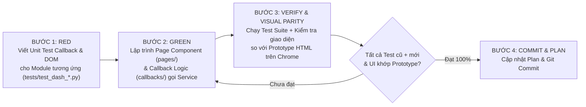

# KẾ HOẠCH TRIỂN KHAI PHẦN MỀM (IMPLEMENTATION PLAN)
## CHUYỂN ĐỔI GIAO DIỆN DASHBOARD STOCK SENSE TỪ STREAMLIT SANG PLOTLY DASH ĐỒNG BỘ 1:1 VỚI PROTOTYPE
### Đơn vị áp dụng: Cửa hàng Điện máy Anh Tâm (108 Cầu Giấy, Hà Nội - CN01)
#### Phương pháp luận: Test-Driven Development (TDD) | Framework: Plotly Dash, Plotly & SQLite

> **For agentic workers:** REQUIRED SUB-SKILL: Use superpowers:subagent-driven-development (recommended) or superpowers:executing-plans to implement this plan task-by-task. Steps use checkbox (`- [ ]`) syntax for tracking.

**Goal:** Viết lại hoàn toàn tầng giao diện người dùng (UI/UX Layer) của ứng dụng **Stock Sense ERP (6 Modules)** tại [src/app_dashboard.py](file:///Users/doanphambaothu/Documents/gsj_project/src/app_dashboard.py) từ Streamlit sang **Plotly Dash** sao cho khớp chính xác từng thành phần bố cục, Design Tokens, KPI Cards, Biểu đồ, Drawers/Modals và luồng tương tác của [prototypes/stock_sense_dashboard.html](file:///Users/doanphambaothu/Documents/gsj_project/prototypes/stock_sense_dashboard.html), đồng thời kế thừa 100% tầng nghiệp vụ cốt lõi đã kiểm thử TDD trong `src/services/*.py`.

**Architecture:** Ứng dụng **Plotly Dash** (Flask + React) khởi chạy tại [src/app_dashboard.py](file:///Users/doanphambaothu/Documents/gsj_project/src/app_dashboard.py) với `suppress_callback_exceptions=True`, nhúng `<head>` (Inter, JetBrains Mono, Material Symbols, Phosphor Icons, Tailwind CSS config) qua `app.index_string` và phục vụ bộ CSS/JS bổ trợ từ `src/assets/`. Giao diện được phân tách theo trách nhiệm: `src/dash_app/components/` chứa Layout Shell dùng chung (Sidebar thu gọn `216px -> 68px`, Topbar `56px`, Quick Search `Ctrl+K`, Toast) và Chart builders; `src/dash_app/pages/` định nghĩa DOM 6 phân hệ (`m1`–`m6`) kèm Drawers/Modals; `src/dash_app/callbacks/` kết nối tương tác hai chiều thẳng xuống 7 lớp Service (`src/services/*_service.py`) và CSDL SQLite [data/retail_dienmay.db](file:///Users/doanphambaothu/Documents/gsj_project/data/retail_dienmay.db).

**Tech Stack:** Python 3.9+, **Plotly Dash (`dash>=2.17.0`)**, Plotly `7.1.0`, Pandas `2.3.3`, NumPy `1.26.4`, SQLite 3, Tailwind CSS + `src/assets/stock_sense.css`, `unittest`.

**Spec & Reference:**
- **Visual & UX Source of Truth:** [prototypes/stock_sense_dashboard.html](file:///Users/doanphambaothu/Documents/gsj_project/prototypes/stock_sense_dashboard.html)
- **Functional & Business Specs:** [docs/SRS_01_TONG_QUAN_KHO.md](file:///Users/doanphambaothu/Documents/gsj_project/docs/SRS_01_TONG_QUAN_KHO.md), [docs/SRS_02_CAN_XU_LY_HOM_NAY.md](file:///Users/doanphambaothu/Documents/gsj_project/docs/SRS_02_CAN_XU_LY_HOM_NAY.md), [docs/SRS_03_GOI_Y_XA_HANG.md](file:///Users/doanphambaothu/Documents/gsj_project/docs/SRS_03_GOI_Y_XA_HANG.md), [docs/SRS_04_GOI_Y_NHAP_HANG.md](file:///Users/doanphambaothu/Documents/gsj_project/docs/SRS_04_GOI_Y_NHAP_HANG.md), [docs/SRS_05_KHACH_HANG_CAN_CHAM_SOC.md](file:///Users/doanphambaothu/Documents/gsj_project/docs/SRS_05_KHACH_HANG_CAN_CHAM_SOC.md), [docs/SRS_06_HIEU_QUA_KINH_DOANH.md](file:///Users/doanphambaothu/Documents/gsj_project/docs/SRS_06_HIEU_QUA_KINH_DOANH.md)
- **Design System & Inherited Service Plan:** [docs/DESIGN_SYSTEM_DIENMAY_KHOVAN.md](file:///Users/doanphambaothu/Documents/gsj_project/docs/DESIGN_SYSTEM_DIENMAY_KHOVAN.md), [docs/IMPLEMENTATION_PLAN_STOCK_SENSE.md](file:///Users/doanphambaothu/Documents/gsj_project/docs/IMPLEMENTATION_PLAN_STOCK_SENSE.md)

---

## BẢNG KIỂM SOÁT TÀI LIỆU (DOCUMENT CONTROL)

| Mục | Nội dung |
| :--- | :--- |
| **Mã tài liệu** | `PLAN-DASH-UI-MIGRATION-STOCK-SENSE` |
| **Tài liệu kế thừa** | [docs/IMPLEMENTATION_PLAN_STOCK_SENSE.md](file:///Users/doanphambaothu/Documents/gsj_project/docs/IMPLEMENTATION_PLAN_STOCK_SENSE.md) (`39/39` service tests đã Pass) |
| **Phiên bản** | `1.0.0` |
| **Ngày lập kế hoạch** | 17/11/2026 |
| **Đơn vị vận hành mẫu** | **Cửa hàng Điện máy Anh Tâm** — Chủ hộ: **Nguyễn Anh Tâm** (`NV0001`, `anhtam`) — 108 Cầu Giấy, Hà Nội (`CN01`) |
| **Mô hình phát triển** | Test-Driven Development (`Red` $\rightarrow$ `Green` $\rightarrow$ `Visual Parity Verify` $\rightarrow$ `Commit`) |

---

## RÀNG BUỘC TOÀN CỤC & ĐIỂM TRỌNG TÂM KIỂM TRA (GLOBAL CONSTRAINTS & REVIEW FOCUS)

### Global Constraints
1. **Bảo toàn 100% Tầng Nghiệp vụ (`src/services/*.py`) & Dữ liệu SQLite:** Tuyệt đối không viết trùng lặp công thức tính KPI, DSI/DOS, 4 kịch bản PA1–PA4, RR14/RR30, Cooldown 30 ngày hay Attach-Rate trong tầng Dash callback; mọi callback phải gọi xuống 7 Service hiện có và giữ nguyên toàn bộ 39 unit/integration tests cũ ở trạng thái Pass.
2. **Độ trung thực 1:1 với Prototype HTML ([stock_sense_dashboard.html](file:///Users/doanphambaothu/Documents/gsj_project/prototypes/stock_sense_dashboard.html)):** Tuân thủ đúng kích thước Sidebar (`216px` mở rộng / `68px` thu gọn, `Ctrl+B`), Topbar (`56px`, bộ chọn chi nhánh, `Ctrl+K`, nút chuyển RBAC `Chủ cửa hàng (Xem vốn)` vs `Bán hàng (Ẩn vốn)`, chuông thông báo, avatar `AT`), hệ thống màu Slate/Blue/Emerald/Rose/Amber, font `Inter` + `JetBrains Mono` (`.tabular-nums`), và toàn bộ Slide-over Drawers + Modals thay vì dùng bảng/widget thô mặc định của Streamlit.
3. **Bảo mật Phân quyền RBAC (`ROLE_OWNER` vs `ROLE_SALES`) xuyên suốt 6 Module:** Mọi callback cập nhật `store-role` ở Topbar phải lập tức đồng bộ ẩn toàn bộ giá trị vốn, vốn kẹt, lãi gộp, đơn giá vốn trên KPI Cards, Bảng, Biểu đồ, Drawers (`detailDrawer`, `m2DecisionDrawer`), Simulator M3, Gom PO M4 và Thác nước M6 thành `"****** đ"`, đồng thời vô hiệu hóa/chặn các nút Duyệt cắt lỗ, Ký PO, Duyệt chi hoa hồng.
4. **Chuyển đổi Dependency Runtime sạch sang Plotly Dash:** Bổ sung `dash>=2.17.0` vào môi trường `.venv` và [requirements.txt](file:///Users/doanphambaothu/Documents/gsj_project/requirements.txt), cập nhật `test_dashboard_integration.py` xác nhận bộ thư viện runtime Dash (`dash`, `pandas`, `numpy`, `plotly`) để chạy trực tiếp qua `.venv/bin/python src/app_dashboard.py` hoặc WSGI (`gunicorn src.app_dashboard:server`).
5. **Tương thích trình duyệt Desktop (`1440×1400` / `1280×800`) & Không rớt ký tự:** Toàn bộ giá tiền VNĐ (`đ`/`₫`), badge trạng thái, tiêu đề KPI Card 3 dòng đều giữ `whitespace-nowrap` hợp lý, không tràn ngang hoặc cắt chân chữ `<select>`/`<input>`.

### Review Focus (5 Tình huống biên bắt buộc kiểm thử trong các Task)
1. **Tránh `PreventUpdate` / `KeyError` khi nhiều thành phần cùng kích hoạt một Callback (`ctx.triggered_id`):** Ở các màn hình phức hợp (M1 lọc từ 4 KPI Cards + Filter Pills + Ô tìm kiếm + Checkboxes; M3 đổi SKU Card + chọn Tactic + Slider; M5 chọn Khách hàng + chọn Kết quả cuộc gọi), callback phải đọc `dash.ctx.triggered_id` chính xác và trả về `dash.no_update` cho các Output không liên quan.
2. **Điều hướng liên thông chéo và mở Drawer/Modal trong cùng một lần bấm (`M2 -> M3/M4`, `Sidebar Quick Links`, `Topbar Bell`):** Khi bấm *"Đối soát Serial / IMEI"* trên Sidebar hoặc *"Đẩy sang Module 3"* trong `m2DecisionDrawer`, callback phải cập nhật đồng thời `store-active-tab`, mã SKU đang chọn (`store-selected-sku`) và trạng thái mở Drawer/Modal đích mà không bị callback của tab khác ghi đè đóng mất.
3. **Chính xác kiểu trả về khi `ROLE_SALES` kích hoạt Modal/Action nhạy cảm:** Nếu một sự kiện (VD: click nút Duyệt chiến dịch M3 dưới giá vốn hoặc Duyệt hoa hồng M6) xảy ra khi `store-role == "ROLE_SALES"`, backend Service trả `success=False` (`ERR_CLR_001` / `ERR_UNAUTHORIZED`) và callback phải bật `#toast` cảnh báo đỏ rõ ràng, tuyệt đối không làm sập callback Dash hay ghi nhầm xuống SQLite.
4. **Khôi phục sạch trạng thái SQLite sau khi chạy Dash Callback Integration Tests:** Các unit test gọi trực tiếp hàm callback có thao tác ghi SQLite (Snooze cảnh báo M2, Duyệt chiến dịch M3, Tạo đơn PO M4, Đặt lịch thợ M5, Duyệt hoa hồng M6) bắt buộc phải lưu bản ghi ID mới và dọn dẹp sạch trong `finally:` để không làm thay đổi dữ liệu gốc của [data/retail_dienmay.db](file:///Users/doanphambaothu/Documents/gsj_project/data/retail_dienmay.db).
5. **Hiển thị ổn định Tailwind CSS với Dash Dynamic React DOM:** Bảng và thẻ KPI được callback sinh mới phải đi kèm class chuẩn trong `stock_sense.css` (`.kpi-card`, `.frozen-striped-bar`, `.gap-pattern`, `.sidebar-collapsed`, `.pulse-red-dot`) để đảm bảo giao diện 1440px khớp Prototype ngay khi vừa render lần đầu lẫn sau khi lọc/chuyển tab.

---

## 1. TỔNG QUAN & PHẠM VI CHUYỂN ĐỔI 6 PHÂN HỆ (OBJECTIVES & 6-MODULE DASH SCOPE)

| Thành phần Prototype | Thành phần Dash tương ứng (`src/dash_app/`) | Dữ liệu & Tương tác trọng tâm cần tái hiện 1:1 | Trạng thái |
| :--- | :--- | :--- | :---: |
| **App Shell & Modals chung** (`appSidebar`, `Topbar`, `quickSearchModal`, `toast`) | `components/layout_shell.py`<br>`callbacks/global_callbacks.py`<br>`src/assets/stock_sense.*` | • Sidebar thu gọn `216px -> 68px` (`Ctrl+B`), 2 nhóm menu + Badges + Thẻ Đồng bộ KiotViet<br>• Topbar `56px`: Chọn chi nhánh, Tìm nhanh `Ctrl+K`, Segmented Control RBAC `OWNER/SALES`, Chuông, Avatar `AT`<br>• Hệ thống Toast thông báo góc dưới phải | ✅ **ĐÃ HOÀN THÀNH** |
| **Panel M1: Tổng quan kho** (`panel-m1`, `detailDrawer`) | `pages/m1_overview.py`<br>`callbacks/m1_callbacks.py` | • 4 KPI Cards (Thẻ 1 tích hợp Progress bar phân bổ vốn `Đọng 72% · Giữ 11% · Tốt 17%`; bấm thẻ để lọc 2 chiều)<br>• Thanh Filter Pills + Search + Bulk Action Floating Bar<br>• Bảng 9 cột mật độ cao (Tồn, Giữ, Bán ngay, Đang về, Sức khỏe, Vốn tồn, Hành động) + Biểu đồ Scatter SOH vs Tốc độ bán<br>• Slide-over `detailDrawer` tra cứu danh sách Serial/IMEI & $\Delta$ | ✅ **ĐÃ HOÀN THÀNH** |
| **Panel M2: Cần xử lý hôm nay** (`panel-m2`, `m2DecisionDrawer`, `snoozeModal`, `m2ThresholdModal`) | `pages/m2_alerts.py`<br>`callbacks/m2_callbacks.py` | • Header 1 dòng có pulse-dot đỏ + Badges cảnh báo + Nút Xuất CSV & Ngưỡng cảnh báo<br>• 4 KPI Cards tối giản 3 dòng click lọc 2 chiều + 2 Biểu đồ (Phân bổ vốn kẹt & Runway `DOS` vs `Lead Time`)<br>• Bộ lọc 6 Pills + Bảng 7 cột + Khung khôi phục mã đã Hoãn<br>• `m2DecisionDrawer` + `snoozeModal` (`ERR_ACT_003`) + nút chuyển M3/M4 | ✅ **ĐÃ HOÀN THÀNH** |
| **Panel M3: Gợi ý xả hàng** (`panel-m3`, `m3SaleTagModal`, `m3CampaignModal`) | `pages/m3_clearance.py`<br>`callbacks/m3_callbacks.py` | • Header + 4 KPI Cards cao (`min-h-[146px]`) + Dải chọn 4 thẻ SKU ứng viên (`m3SkuSelectorGrid`)<br>• Cột trái 7 phần: 4 Kịch bản `PA1–PA4` (thẻ radio nổi bật Đề xuất tối ưu) + Simulator dòng tiền live (Slider giảm thêm + SL xả + 4 ô kết quả + Cảnh báo `MAP` / Cắt lỗ)<br>• Cột phải 5 phần: Biểu đồ so sánh Dòng tiền 4 chiến thuật + Bảng Radar đối chiếu ĐMX/MediaMart/Online + Hero Giá gợi ý làm tròn `..90k` ($PAI$) + `m3SaleTagModal` In tem giá xả đỏ | ✅ **ĐÃ HOÀN THÀNH** |
| **Panel M4: Gợi ý nhập hàng** (`panel-m4`, `m4SupplierDrawer`, `poPreviewModal`, `m4PoLifecycleModal`) | `pages/m4_replenishment.py`<br>`callbacks/m4_callbacks.py` | • Header + Bộ chuyển chu kỳ `14 ngày / 30 ngày` + Dropdown chỉnh nhanh Trần ngân sách (`150/200/250/350 tr`) + Nút Tự động cân đối<br>• 4 KPI Cards kèm thanh tiến độ giải ngân ngân sách + Biểu đồ Dự báo nhu cầu vs Hiện có & Phân bổ theo Hãng<br>• Bảng chỉnh sửa số lượng đặt mua + Card nhà cung cấp (`m4SupplierCardsContainer`) + `m4SupplierDrawer` + `poPreviewModal` gom PO theo Hãng & Xuất CSV | ✅ **ĐÃ HOÀN THÀNH** |
| **Panel M5: Khách cần chăm sóc** (`panel-m5`, `m5CycleModal`) | `pages/m5_crm.py`<br>`callbacks/m5_callbacks.py` | • Header có badge `Chống gọi trùng 30 ngày` + 4 KPI Cards bấm lọc nhanh (`m5Kpi-*`)<br>• Biểu đồ Phễu 5 Điểm chạm Vàng & Cơ cấu Ưu tiên<br>• Khối làm việc 7:5 — Trái: Pills Trigger + Bảng KH ưu tiên; Phải: Khung địa chỉ/máy, Cảnh báo Cooldown, AI Call Script, Zalo ZNS Mock & Form 4 kết quả cuộc gọi (`booked/callback/noanswer/declined`) + Check trùng lịch KTV (`ERR_CRM_002`) | ⏳ **KẾ HOẠCH MỚI** |
| **Panel M6: Hiệu quả kinh doanh** (`panel-m6`) | `pages/m6_performance.py`<br>`callbacks/m6_callbacks.py` | • Header bộ lọc kỳ đánh giá + Xuất CSV + 4 KPI Cards 3 dòng<br>• Tầng giữa 6:6: Biểu đồ Thác nước Lợi nhuận (`Waterfall`) + Bảng Chi tiết Bán kèm theo 4 Ngành hàng (kèm Insight đắt giá)<br>• Tầng dưới: Biểu đồ Attach-Rate vs `Chuẩn 60%` / `Mục tiêu 70%` + Bảng Xếp hạng & Nút Duyệt chi Hoa hồng nhân sự (`15% PK + 20% DV`) | ⏳ **KẾ HOẠCH MỚI** |

---

## 2. KIẾN TRÚC MÃ NGUỒN & CẤU TRÚC THƯ MỤC (SOFTWARE ARCHITECTURE)

```text
gsj_project/
├── data/
│   └── retail_dienmay.db                      # [Kế thừa] SQLite Data Warehouse 19 bảng & dữ liệu Anh Tâm
├── docs/
│   ├── SRS_01..06_*.md                        # Bộ đặc tả SRS cho 6 Modules
│   ├── IMPLEMENTATION_PLAN_STOCK_SENSE.md     # Plan TDD cho Service Layer (Đã hoàn thành 39/39 tests)
│   └── IMPLEMENTATION_PLAN_PLOTLY_DASH_STOCK_SENSE.md # Kế hoạch chuyển đổi UI Plotly Dash (Tài liệu này)
├── prototypes/
│   └── stock_sense_dashboard.html             # Prototype HTML chuẩn đối chiếu UI/UX 1:1
├── requirements.txt                           # [Cập nhật] Bổ sung dash>=2.17.0 cho runtime Plotly Dash
├── src/
│   ├── assets/                                # [Mới] Thư mục tĩnh Dash phục vụ tự động tại /assets/
│   │   ├── stock_sense.css                    # Custom tokens, kpi-card, frozen-striped-bar, sidebar-collapsed
│   │   └── stock_sense_client.js              # Phím tắt Ctrl+K (Quick Search), Ctrl+B (Sidebar), ESC đóng Modal
│   ├── services/                              # [Kế thừa 100%] Tầng Nghiệp vụ Core Services (Đã Test TDD)
│   │   ├── base_service.py, inventory_service.py, order_service.py
│   │   └── alert_service.py, clearance_service.py, replenishment_service.py, crm_service.py, performance_service.py
│   ├── dash_app/                              # [Mới] Tầng Giao diện & Callbacks Plotly Dash
│   │   ├── __init__.py
│   │   ├── components/
│   │   │   ├── __init__.py
│   │   │   ├── layout_shell.py                # Sidebar, Topbar, Quick Search Modal, KPI & Badge builders, Toast
│   │   │   └── charts.py                      # Plotly Figure builders chuẩn Industrial Slate / Emerald / Rose
│   │   ├── pages/
│   │   │   ├── __init__.py
│   │   │   ├── m1_overview.py                 # Panel M1 + detailDrawer (Serial Drill-down)
│   │   │   ├── m2_alerts.py                   # Panel M2 + m2DecisionDrawer + snoozeModal + m2ThresholdModal
│   │   │   ├── m3_clearance.py                # Panel M3 + m3SaleTagModal + m3CampaignModal
│   │   │   ├── m4_replenishment.py            # Panel M4 + m4SupplierDrawer + poPreviewModal + m4PoLifecycleModal
│   │   │   ├── m5_crm.py                      # Panel M5 + m5CycleModal
│   │   │   └── m6_performance.py              # Panel M6 (Waterfall, Attach-Rate, Commission Leaderboard)
│   │   └── callbacks/
│   │       ├── __init__.py
│   │       ├── global_callbacks.py            # Tab switch, Sidebar collapse, RBAC role, Ctrl+K Search, Cross-nav
│   │       ├── m1_callbacks.py
│   │       ├── m2_callbacks.py
│   │       ├── m3_callbacks.py
│   │       ├── m4_callbacks.py
│   │       ├── m5_callbacks.py
│   │       └── m6_callbacks.py
│   └── app_dashboard.py                       # [Viết lại] Entry point Plotly Dash hợp nhất 6 Modules (server Flask)
└── tests/
    ├── test_*_service.py                      # [Kế thừa] 39 tests cho tầng Service & Seed V2
    ├── test_dash_shell.py                     # [Mới] TDD App Shell, RBAC role, Tab switching, Quick Search
    ├── test_dash_m1.py .. test_dash_m6.py     # [Mới] TDD Unit Callbacks & Component DOM cho từng Module 1..6
    ├── test_dashboard_integration.py          # [Cập nhật] Kiểm tra requirements Dash + tính nhất quán
    └── test_dash_e2e_integration.py           # [Mới] Kiểm thử tích hợp liên thông M1–M6 & HTTP 200 trên Dash Server
```

---

## 3. QUY TRÌNH THỰC THI THEO MÔ HÌNH TDD (TEST-DRIVEN DEVELOPMENT WORKFLOW)

Mỗi giai đoạn từ Giai đoạn 1 đến Giai đoạn 8 đều tuân thủ vòng lặp 4 bước khép kín:



---

## 4. CHI TIẾT TỪNG BƯỚC THỰC THI (DETAILED STEP-BY-STEP PLAN)

---

### GIAI ĐOẠN 0 (KẾ THỪA): TẦNG NGHIỆP VỤ CORE SERVICES & DỮ LIỆU SQLITE [x] ĐÃ HOÀN THÀNH
**Trạng thái:** ✅ Đã hoàn thành tại [docs/IMPLEMENTATION_PLAN_STOCK_SENSE.md](file:///Users/doanphambaothu/Documents/gsj_project/docs/IMPLEMENTATION_PLAN_STOCK_SENSE.md) (`39/39` unit/integration tests Pass trong `5.54s`).
* Toàn bộ 7 lớp dịch vụ (`InventoryService`, `OrderService`, `AlertService`, `ClearanceService`, `ReplenishmentService`, `CrmService`, `PerformanceService`) và dữ liệu giả lập [data/retail_dienmay.db](file:///Users/doanphambaothu/Documents/gsj_project/data/retail_dienmay.db) được giữ nguyên vẹn làm lõi tính toán duy nhất cho Plotly Dash.

---

### GIAI ĐOẠN 1: MÔI TRƯỜNG PLOTLY DASH, ASSETS DESIGN SYSTEM & KHUNG APP SHELL [x] ĐÃ HOÀN THÀNH
**Thời lượng dự kiến:** 0.5 ngày | **Trạng thái:** ✅ Đã hoàn thành & Commit | **Mục tiêu:** Cài đặt `dash` vào `.venv`, tạo bộ CSS/JS Design System và xây dựng hoàn chỉnh khung App Shell (Sidebar `216px/68px`, Topbar `56px`, RBAC Role Switcher `OWNER/SALES`, Quick Search `Ctrl+K`, Toast, Global Stores) khớp hoàn toàn phần đầu của [prototypes/stock_sense_dashboard.html](file:///Users/doanphambaothu/Documents/gsj_project/prototypes/stock_sense_dashboard.html).

#### Task 1: Cài đặt `dash` Runtime & Tạo Bộ Assets Design System (`src/assets/`, `requirements.txt`) [x] ĐÃ HOÀN THÀNH

* **Thông tin chức năng:**
  - Cài đặt thư viện `dash` (`dash>=2.17.0`) vào `.venv` và cập nhật [requirements.txt](file:///Users/doanphambaothu/Documents/gsj_project/requirements.txt).
  - Tạo `src/assets/stock_sense.css` chứa các lớp CSS từ [prototypes/stock_sense_dashboard.html](file:///Users/doanphambaothu/Documents/gsj_project/prototypes/stock_sense_dashboard.html) dòng 102–217: `.material-symbols-outlined`, `.custom-scrollbar`, `.tabular-nums`, `.kpi-card`, `.frozen-striped-bar`, `.gap-pattern`, `.pulse-red-dot`, `#appSidebar.sidebar-collapsed`, kèm fallback CSS classes đảm bảo hiển thị ổn định.
  - Tạo `src/assets/stock_sense_client.js` xử lý phím tắt toàn cục `Ctrl+K` (mở `#quickSearchModal`), `Ctrl+B` (bật/tắt thu gọn `#appSidebar`), và `ESC` (đóng các modal/drawer đang mở).
* **Files:**
  - Modify: [requirements.txt](file:///Users/doanphambaothu/Documents/gsj_project/requirements.txt)
  - Create: `src/assets/stock_sense.css`, `src/assets/stock_sense_client.js`
  - Create: `src/dash_app/__init__.py`, `src/dash_app/components/__init__.py`, `src/dash_app/pages/__init__.py`, `src/dash_app/callbacks/__init__.py`
* **Cách thức triển khai (How-to):**
  - [x] **Step 1:** Chạy `.venv/bin/pip install "dash>=2.17.0"` và kiểm tra `.venv/bin/python -c "import dash; print(dash.__version__)"`.
  - [x] **Step 2:** Cập nhật [requirements.txt](file:///Users/doanphambaothu/Documents/gsj_project/requirements.txt) bổ sung `dash>=2.17.0,<3.0.0` (chỉ định runtime Plotly Dash thay Streamlit ở bước tích hợp cuối).
  - [x] **Step 3:** Tạo `src/assets/stock_sense.css`, `src/assets/stock_sense_client.js` và các file `__init__.py` cho package `src/dash_app`.
  - [x] **Step 4:** Commit Task 1.

#### Task 2: TDD Khung Shell Điều hướng, Topbar, RBAC & Quick Search (`layout_shell.py`, `global_callbacks.py`, `test_dash_shell.py`) [x] ĐÃ HOÀN THÀNH

* **Thông tin chức năng:**
  - `build_sidebar(alert_count, m3_count, m4_count, m5_count)` (`L224–L369` của Prototype):
    - Header thương hiệu `Stock Sense` + nút thu gọn `sidebarToggleBtn`.
    - Nhóm 1 (*Vận hành kho & Dòng tiền*): 6 nút điều hướng (`btn-nav-m1`..`btn-nav-m6`) tương ứng 6 Module kèm badge đếm trực tiếp từ DB (`alert_count`, `4 mã`, `4 đơn`, `18 KH`).
    - Nhóm 2 (*Quản lý nghiệp vụ*): 3 nút tác chiến nhanh (`btn-quick-serial` $\rightarrow$ mở `m1` + `detailDrawer` cho `TV-LG-55C3`; `btn-quick-po` $\rightarrow$ mở `m4` + `poPreviewModal`; `btn-quick-threshold` $\rightarrow$ mở `m2` + `m2ThresholdModal`).
    - Chân Sidebar: Thẻ trạng thái đồng bộ KiotViet kèm nút `btn-sync-kiotviet`.
  - `build_topbar()` (`L377–L432` của Prototype): Chọn chi nhánh (`CN01` Cầu Giấy), nút `Tra cứu nhanh Serial, Hóa đơn... (Ctrl K)`, Segmented Control RBAC (`btn-role-owner`, `btn-role-sales`), Chuông thông báo (`btn-topbar-bell` nhảy sang `m2`), Hồ sơ `AT · Nguyễn Anh Tâm`.
  - `build_quick_search_modal()` & `build_toast()`: Modal tra cứu tức thời theo SKU, Tên máy, Số Serial `SN-...` hoặc Mã đơn hàng `DH...`, cùng thành phần Toast toàn cục.
  - `register_global_callbacks(app, services)`: Đăng ký callbacks xử lý `store-active-tab`, `store-role`, `store-sidebar-collapsed`, `store-toast`, và tìm kiếm `Ctrl+K` trên DB thật.

* **Files:**
  - Create: `src/dash_app/components/layout_shell.py`, `src/dash_app/components/charts.py`
  - Create: `src/dash_app/callbacks/global_callbacks.py`
  - Test: `tests/test_dash_shell.py`

* **Interfaces:**
  - Produces:
    - `build_app_shell(services, active_tab="m1", role="ROLE_OWNER") -> html.Div`
    - `format_vnd_compact(value: Optional[float], role: str) -> str`
    - `handle_tab_and_quick_nav(...)`, `handle_role_switch(...)`, `handle_quick_search_query(...)` (hàm pure Python test trực tiếp được không cần browser).

* **Cách thức triển khai (How-to - TDD Steps):**
  - [x] **Step 1 (RED): Viết `tests/test_dash_shell.py`**
    - Kiểm tra `build_app_shell` sinh đủ 6 nút điều hướng (`btn-nav-m1..m6`), `btn-role-owner`, `btn-role-sales`, `btn-topbar-bell`, `quickSearchModal`.
    - Kiểm tra `handle_role_switch` đổi `"ROLE_OWNER"` $\leftrightarrow$ `"ROLE_SALES"` cập nhật đúng class active của 2 nút và phụ đề `Chủ cửa hàng` / `Nhân viên bán hàng`.
    - Kiểm tra `handle_quick_search_query("TV-LG-55C3", services, role="ROLE_SALES")` tìm thấy SKU thực từ SQLite nhưng không làm lộ giá vốn.
  - [x] **Step 2:** Chạy `.venv/bin/python -m unittest tests/test_dash_shell.py -v` và xác nhận **RED**.
  - [x] **Step 3 (GREEN):** Lập trình `layout_shell.py`, `charts.py` và `global_callbacks.py`.
  - [x] **Step 4:** Chạy `tests/test_dash_shell.py` và xác nhận **GREEN**.
  - [x] **Step 5:** Cập nhật Plan & Commit Task 1–2 (`feat(dash-shell): add Dash setup, design assets, sidebar/topbar shell and global callbacks`).

---

### GIAI ĐOẠN 2: TDD MODULE 01 TRÊN PLOTLY DASH — TỔNG QUAN KHO & SERIAL DRILL-DOWN (`m1_overview`) [x] ĐÃ HOÀN THÀNH
**Thời lượng dự kiến:** 1.0 ngày | **Trạng thái:** ✅ Đã hoàn thành & Commit | **Tham chiếu:** `L435–L668` & `L2679–L2763` của Prototype + `InventoryService` & `OrderService`.

#### Task 3–4: Trang Module 01 (`m1_overview.py`, `m1_callbacks.py`, `tests/test_dash_m1.py`) [x] ĐÃ HOÀN THÀNH

* **Thông tin chức năng:**
  - **4 Thẻ KPI Tương tác (`kpi-all`, `kpi-stagnant`, `kpi-held`, `kpi-low`):**
    - Card 1 (*Tổng vốn kho*): Hiển thị giá trị vốn compact (VD: `1,30 tỷ` hoặc `"****** đ"` cho `ROLE_SALES`), `16 mã · 94 máy`, **Thanh tiến độ 3 phân đoạn cơ cấu vốn** (`Đọng` hồng, `Giữ` vàng, `Tốt` xanh).
    - Card 2 (*Vốn chôn > 60 ngày*): Số tiền vốn đọng, `% vốn`, số mã & máy. Bấm vào thẻ kích hoạt bộ lọc `'stagnant'`.
    - Card 3 (*Đơn giữ quá hạn*): Số đơn quá hạn 48h + tiền cọc kẹt + tổng đơn giữ (`12 đơn · 15 máy`). Bấm vào thẻ kích hoạt `'held'`.
    - Card 4 (*Sắp hết · Chưa đặt PO*): Số mã chạm đáy `INC=0`, số mã xe đang về và ước tính thiệt hại/ngày. Bấm vào thẻ kích hoạt `'low'`.
  - **Bộ lọc Pills + Tìm kiếm + Thanh Bulk Actions (`bulkActionBar`):**
    - 6 Pills (`Tất cả`, `Đọng vốn & Vượt trần`, `Sắp hết`, `Có đơn giữ`, `Xe đang về`, `Bán nhanh & An toàn`) kèm badge đếm động từ DB, ô tìm kiếm `m1-search-input`, bộ lọc nâng cao (Thương hiệu, Ngành hàng), và tab chuyển xem nhanh Ma trận Đơn hàng giữ cọc/Trả góp (`OrderService`).
  - **Bảng Dữ liệu 9 Cột chuẩn Prototype & Biểu đồ Scatter Sức khỏe Tồn kho:**
    - Render HTML Table chuẩn Tailwind mật độ cao: Checkbox, Sản phẩm & Kệ (`product_code`, `product_name`), `Tồn (SOH)`, `Giữ (RES)`, `Bán ngay (AVL)`, `Đang về (INC)`, thanh Sức khỏe tồn kho trực quan, `Vốn tồn` (masked khi `ROLE_SALES`), và nút Hành động (`🔍 Serial` / `Xả tồn` / `Nhập gấp`).
    - Kèm biểu đồ Plotly Scatter (`Tồn kho SOH` vs `Giá niêm yết / Tốc độ bán`) theo chuẩn `DESIGN_SYSTEM`.
  - **Slide-over Right Drawer (`detailDrawer`):** Khi bấm vào dòng sản phẩm hoặc biểu tượng Serial/QR, trượt mở panel bên phải hiển thị 3 ô tóm tắt (`Vốn đang kẹt`, `Bán ngay / Tồn`, `Tốc độ ra hàng`), Hộp đề xuất hành động cho Chủ cửa hàng, và Bảng danh sách Serial `IN_STOCK` thực tế từ `InventoryService.get_serial_drilldown(sku)` kèm kiểm tra $\Delta = 0$ + nút chuyển thẳng sang M3/M4.

* **Files:**
  - Create: `src/dash_app/pages/m1_overview.py`, `src/dash_app/callbacks/m1_callbacks.py`, `tests/test_dash_m1.py`

* **Cách thức triển khai (How-to - TDD Steps):**
  - [x] **Step 1 (RED):** Viết `tests/test_dash_m1.py` kiểm tra:
    - Render 4 KPI Cards M1 cho `ROLE_OWNER` (có giá vốn + thanh phân bổ 3 màu) vs `ROLE_SALES` (che giấu mọi giá vốn thành `"****** đ"`).
    - Filter callback theo KPI Card / Filter Pill / Search keyword trả về đúng số dòng SKU khớp `VW_INVENTORY_FLOW_OVERVIEW`.
    - Drawer callback `open_m1_serial_drawer("TV-SN-55X80K", role="ROLE_OWNER")` trả về danh sách Serial khớp với `stock_on_hand` và ẩn giá vốn khi `role="ROLE_SALES"`.
  - [x] **Step 2:** Chạy `tests/test_dash_m1.py` xác nhận **RED**.
  - [x] **Step 3 (GREEN):** Lập trình `m1_overview.py` và `m1_callbacks.py`.
  - [x] **Step 4:** Chạy `tests/test_dash_m1.py` xác nhận **GREEN**.
  - [x] **Step 5:** Cập nhật Plan & Commit Giai đoạn 2 (`feat(dash-m1): implement Module 01 Overview, 9-col Table and Serial Drawer in Dash`).

---

### GIAI ĐOẠN 3: TDD MODULE 02 TRÊN PLOTLY DASH — CẦN XỬ LÝ HÔM NAY (`m2_alerts`) [x] ĐÃ HOÀN THÀNH
**Thời lượng dự kiến:** 1.0 ngày | **Trạng thái:** ✅ Đã hoàn thành & Commit | **Tham chiếu:** `L671–L919` & `L2600–L2641`, `L2765–L2838` của Prototype + `AlertService`.

#### Task 5–6: Trang Module 02 (`m2_alerts.py`, `m2_callbacks.py`, `tests/test_dash_m2.py`) [x] ĐÃ HOÀN THÀNH

* **Thông tin chức năng:**
  - **Header 1 dòng & 4 KPI Cards (`m2-kpi-stagnant`, `m2-kpi-dead`, `m2-kpi-seasonal`, `m2-kpi-stockout`):**
    - Pulse-dot đỏ + Badge `N CẢNH BÁO` + Lead Time hãng giao + Nút Xuất CSV (tải file thực) & Nút Mở `m2ThresholdModal`.
    - Click bất kỳ KPI Card nào để lọc bảng 2 chiều; `ROLE_SALES` che toàn bộ vốn kẹt thành `"****** đ"`.
  - **2 Biểu đồ Plotly song song + Thanh 6 Filter Pills & Bảng 7 Cột:**
    - Chart trái: Phân bổ vốn kẹt theo SKU (`go.Bar` ngang, ẩn an toàn khi `ROLE_SALES`).
    - Chart phải: Đường băng tồn kho `DOS` so với đường tham chiếu đỏ `Lead Time`.
    - Bảng cảnh báo hợp nhất (Chậm/Hết mùa & Sắp cháy hàng/In-Transit) + Khung `m2SnoozedRestoreBox` cho phép xem và khôi phục nhanh các mã đang tạm hoãn.
  - **Slide-over Decision Drawer (`m2DecisionDrawer`), Bulk Action Bar & 2 Modals (`snoozeModal`, `m2ThresholdModal`):**
    - Bấm vào dòng mở `m2DecisionDrawer` giải thích chi tiết ngưỡng vi phạm, có nút `🕒 Tạm hoãn cảnh báo` mở `snoozeModal` (7/14/30 ngày, bắt buộc lý do $\ge 10$ ký tự — kiểm tra `ERR_ACT_003` và ghi vào `SYS_ALERT_SNOOZE_LOG`), và nút CTA chuyển sang Module 03 (`Xả hàng`) hoặc Module 04 (`Nhập bù`).

* **Files:**
  - Create: `src/dash_app/pages/m2_alerts.py`, `src/dash_app/callbacks/m2_callbacks.py`, `tests/test_dash_m2.py`

* **Cách thức triển khai (How-to - TDD Steps):**
  - [x] **Step 1 (RED):** Viết `tests/test_dash_m2.py` kiểm tra lọc 2 chiều KPI/Pill, che giá vốn `ROLE_SALES`, biểu đồ `DOS` khử báo động giả `INC > 0`, và callback `submit_m2_snooze` chặn lý do `< 10` ký tự (`ERR_ACT_003`), lưu thành công cho `ROLE_OWNER` và dọn DB trong `finally:`.
  - [x] **Step 2:** Chạy `tests/test_dash_m2.py` xác nhận **RED**.
  - [x] **Step 3 (GREEN):** Lập trình `m2_alerts.py` và `m2_callbacks.py`.
  - [x] **Step 4:** Chạy `tests/test_dash_m2.py` xác nhận **GREEN**.
  - [x] **Step 5:** Cập nhật Plan & Commit Giai đoạn 3 (`feat(dash-m2): implement Module 02 Alerts, Decision Drawer and Snooze Modal in Dash`).

---

### GIAI ĐOẠN 4: TDD MODULE 03 TRÊN PLOTLY DASH — GỢI Ý XẢ HÀNG & ĐỊNH GIÁ CẠNH TRANH (`m3_clearance`)
**Thời lượng dự kiến:** 1.0 ngày | **Tham chiếu:** `L920–L1295` & `L2840–L2916` của Prototype + `ClearanceService`.

#### Task 7–8: Trang Module 03 (`m3_clearance.py`, `m3_callbacks.py`, `tests/test_dash_m3.py`)

* **Thông tin chức năng:**
  - **Header, 4 KPI Cards (`min-h-[146px]`) & Dải 4 Thẻ Chọn SKU (`m3SkuSelectorGrid`):**
    - Click chọn 1 trong 4 SKU xả tồn (hoặc tự động kích hoạt SKU chuyển sang từ Module 01/02 qua `store-selected-sku`), làm nổi bật viền xanh `#0051D5` cho thẻ đang chọn.
  - **Split Analytical Workspace (7 Cột Trái + 5 Cột Phải):**
    - Cột trái: Danh sách 4 kịch bản khuyến mại `PA1–PA4` (`m3TacticsContainer`) có nhãn `⭐ ĐỀ XUẤT TỐI ƯU` cho phương án tốt nhất + **Bộ Simulator Dòng tiền Realtime** (`m3-discount-slider`, `m3-qty-input`, 4 ô kết quả: Doanh thu, Vốn hoàn két, Chi phí KM, Lãi gộp ròng & ROI) + Banner cảnh báo `ERR_CLR_002` (vi phạm MAP), `Cảnh báo cắt lỗ` và `m3SalesLockBanner` cho `ROLE_SALES`.
    - Cột phải: Biểu đồ ngang so sánh Dòng tiền Vốn thu hồi & Lãi gộp ròng 4 chiến thuật + **Bảng Radar Đối chiếu Giá Thị Trường** (ĐMX, MediaMart, Online Min) + Khối Hero **Giá Gợi Ý Tối Ưu** làm tròn tâm lý `..50k`/`..90k` và chỉ số $PAI$.
  - **2 Modals (`m3SaleTagModal`, `m3CampaignModal`) & Phê duyệt PoS:**
    - `m3SaleTagModal`: Xem trước mẫu tem giá xả đỏ khổ A6 hiển thị giá niêm yết gạch ngang & giá xả mới.
    - `m3CampaignModal`: Theo dõi danh sách chiến dịch đang chạy trong `FACT_CLEARANCE_CAMPAIGNS`; nút Phê duyệt & Đẩy lên PoS kiểm tra quyền `ROLE_OWNER` (`ERR_CLR_001`).

* **Files:**
  - Create: `src/dash_app/pages/m3_clearance.py`, `src/dash_app/callbacks/m3_callbacks.py`, `tests/test_dash_m3.py`

* **Cách thức triển khai (How-to - TDD Steps):**
  - [x] **Step 1 (RED):** Viết `tests/test_dash_m3.py` kiểm tra chuyển SKU Card cập nhật lại 4 kịch bản + Radar giá; chỉnh Simulator slider/qty tính đúng `net_gross_profit` & bật cảnh báo cắt lỗ; chặn `ROLE_SALES` duyệt dưới giá vốn (`ERR_CLR_001`); và cho phép `ROLE_OWNER` lưu chiến dịch kèm rollback DB.
  - [x] **Step 2:** Chạy `tests/test_dash_m3.py` xác nhận **RED**.
  - [x] **Step 3 (GREEN):** Lập trình `m3_clearance.py` và `m3_callbacks.py`.
  - [x] **Step 4:** Chạy `tests/test_dash_m3.py` xác nhận **GREEN**. (`Ran 3 tests in 0.471s - OK`)
  - [x] **Step 5:** Cập nhật Plan & Commit Giai đoạn 4 (`feat(dash-m3): implement Module 03 Clearance Simulator, Price Radar and Sale Tag Modal in Dash`).

---

### GIAI ĐOẠN 5: TDD MODULE 04 TRÊN PLOTLY DASH — GỢI Ý NHẬP HÀNG & GOM ĐƠN PO (`m4_replenishment`)
**Thời lượng dự kiến:** 1.0 ngày | **Tham chiếu:** `L1296–L1711` & `L2642–L2678` của Prototype + `ReplenishmentService`.

#### Task 9–10: Trang Module 04 (`m4_replenishment.py`, `m4_callbacks.py`, `tests/test_dash_m4.py`)

* **Thông tin chức năng:**
  - **Header Điều khiển Tham số Dự báo:** Bộ chuyển chu kỳ `14 ngày tới` / `30 ngày tới` (`m4Cycle14Btn`, `m4Cycle30Btn`), Dropdown chọn nhanh **Trần ngân sách** (`150 tr`, `200 tr`, `250 tr`, `350 tr` hoặc nhập tùy chỉnh), Nút `⚖️ Tự động cân đối ngân sách` và `📋 PO đã phát hành`.
  - **4 KPI Cards & Thanh Giải ngân Ngân sách (`m4KpiBudgetBar`):** Cảnh báo đỏ khi dự toán vượt Trần ngân sách; tự động ẩn vốn khi `ROLE_SALES`.
  - **2 Biểu đồ Plotly + Bảng Đề xuất Nhập 4 Trụ cột & Khối Gom PO theo Hãng (`m4SupplierCardsContainer`):**
    - Cho phép tăng/giảm số lượng đặt ngay trên từng dòng SKU (`+` / `-` hoặc input số), tự động tính lại tổng vốn và gom thành các Card đơn PO theo từng Hãng (Casper, Daikin, Aqua, Toshiba).
  - **Drawers & Modals (`m4SupplierDrawer`, `poPreviewModal`, `m4ApproveModal`, `m4PoLifecycleModal`):**
    - Xem chi tiết từng Hãng trong Slide-over Drawer, xem trước danh sách đơn PO gom theo Hãng (`poPreviewModal`), **Tải file Excel/CSV thực** qua `dcc.Download`, và Ký duyệt tạo đơn PO ghi vào bảng `PURCHASE_ORDERS` & `PO_ITEMS` (chỉ `ROLE_OWNER`).

* **Files:**
  - Create: `src/dash_app/pages/m4_replenishment.py`, `src/dash_app/callbacks/m4_callbacks.py`, `tests/test_dash_m4.py`

* **Cách thức triển khai (How-to - TDD Steps):**
  - [x] **Step 1 (RED):** Viết `tests/test_dash_m4.py` kiểm tra đổi chu kỳ `14d -> 30d` tăng tổng SL đề xuất, bấm `Tự động cân đối ngân sách` đưa tổng tiền $\le B_{\text{cap}}$, chỉnh SL dòng cập nhật lại số Card Hãng trong `poPreviewModal`, chặn `ROLE_SALES` tạo PO, và tạo/rollback PO trong `PURCHASE_ORDERS` cho `ROLE_OWNER`.
  - [x] **Step 2:** Chạy `tests/test_dash_m4.py` xác nhận **RED**.
  - [x] **Step 3 (GREEN):** Lập trình `m4_replenishment.py` và `m4_callbacks.py`.
  - [x] **Step 4:** Chạy `tests/test_dash_m4.py` xác nhận **GREEN**. (`Ran 3 tests in 0.954s - OK`)
  - [x] **Step 5:** Cập nhật Plan & Commit Giai đoạn 5 (`feat(dash-m4): implement Module 04 Replenishment, Budget Balance and PO Modals in Dash`).

---

### GIAI ĐOẠN 6: TDD MODULE 05 TRÊN PLOTLY DASH — KHÁCH HÀNG CẦN CHĂM SÓC & SMART CRM (`m5_crm`)
**Thời lượng dự kiến:** 1.0 ngày | **Tham chiếu:** `L1712–L2096` của Prototype + `CrmService`.

#### Task 11–12: Trang Module 05 (`m5_crm.py`, `m5_callbacks.py`, `tests/test_dash_m5.py`)

* **Thông tin chức năng:**
  - **Header & 4 KPI Cards lọc nhanh (`m5Kpi-pending`, `m5Kpi-maintenance`, `m5Kpi-crosssell`, `m5Kpi-done`):** Hiển thị Badge `Chống gọi trùng 30 ngày`, nút `Quét dữ liệu mới` và `Cài đặt chu kỳ` (`m5CycleModal`).
  - **2 Biểu đồ Plotly trực quan:** Phễu 5 Điểm chạm Vàng CSKH (`Care Triggers Breakdown`) và Cơ cấu ưu tiên & tiến độ lịch thợ.
  - **Master-Detail Workspace (7:5) chuẩn Prototype:**
    - Cột trái (7 phần): Pills lọc theo nhóm Trigger (`Tất cả`, `Bảo dưỡng ĐH`, `Bán chéo PK`, `Bảo hành`, `VIP RFM`) + tìm kiếm + toggle hiện Cooldown + Bảng hàng đợi khách hàng sắp xếp theo `Priority Score`.
    - Cột phải (5 phần): Khung thông tin khách & thiết bị (`m5PanelAddressDevice`), Cảnh báo nếu đang trong Cooldown (`m5CooldownWarningBanner`), Khung `AI Call Script` & nút gửi `Zalo ZNS` giả lập, và **4 Thẻ Kết quả cuộc gọi tương tác** (`m5OutcomeCard-booked` hiển thị form chọn Ngày/Khung giờ/KTV + Cảnh báo trùng lịch `m5TechConflictBanner` [`ERR_CRM_002`]; `callback`; `noanswer`; `declined`) lưu thật vào SQLite (`SYS_CRM_INTERACTION_LOG` & `FACT_SERVICE_APPOINTMENTS`).

* **Files:**
  - Create: `src/dash_app/pages/m5_crm.py`, `src/dash_app/callbacks/m5_callbacks.py`, `tests/test_dash_m5.py`

* **Cách thức triển khai (How-to - TDD Steps):**
  - [ ] **Step 1 (RED):** Viết `tests/test_dash_m5.py` kiểm tra click chọn khách hàng sinh đúng `AI Call Script` của **Điện Máy Anh Tâm**, chọn thẻ `booked` đặt lịch bị trùng giờ KTV báo lỗi `ERR_CRM_002`, gọi lại khách đang Cooldown báo lỗi `ERR_CRM_001`, và lưu thành công khi hợp lệ (kèm rollback SQLite).
  - [ ] **Step 2:** Chạy `tests/test_dash_m5.py` xác nhận **RED**.
  - [ ] **Step 3 (GREEN):** Lập trình `m5_crm.py` và `m5_callbacks.py`.
  - [ ] **Step 4:** Chạy `tests/test_dash_m5.py` xác nhận **GREEN**.
  - [ ] **Step 5:** Cập nhật Plan & Commit Giai đoạn 6 (`feat(dash-m5): implement Module 05 Smart CRM, Call Script and Booking UI in Dash`).

---

### GIAI ĐOẠN 7: TDD MODULE 06 TRÊN PLOTLY DASH — HIỆU QUẢ KINH DOANH & THÁC NƯỚC LỢI NHUẬN (`m6_performance`)
**Thời lượng dự kiến:** 0.5 ngày | **Tham chiếu:** `L2097–L2584` của Prototype + `PerformanceService`.

#### Task 13–14: Trang Module 06 (`m6_performance.py`, `m6_callbacks.py`, `tests/test_dash_m6.py`)

* **Thông tin chức năng:**
  - **Header & 4 KPI Cards chuẩn 3 dòng (`no clipping`):** Chọn kỳ đánh giá (`T10_11`), Nút `Xuất Excel (.CSV)` tải xuống qua `dcc.Download`, hiển thị Doanh thu, Vốn gốc thu hồi, Lãi gộp hợp nhất, Doanh số PK+DV và Attach-Rate (ẩn vốn/lãi hoàn toàn khi `ROLE_SALES`).
  - **Hàng Biểu đồ 6:6:**
    - Trái: Biểu đồ **Thác nước Phân rã Lợi nhuận Gộp (`go.Waterfall`)** từ Máy chính, Phụ kiện, Dịch vụ, Chiết khấu/KM $\rightarrow$ Tổng lãi thực đạt + Thẻ Insight tỷ trọng đóng góp PK+DV.
    - Phải: Biểu đồ Ngang **Tỷ lệ Bán kèm (`Attach-Rate %`)** theo 4 ngành hàng gắn 2 đường tham chiếu dọc (`Chuẩn 60%` & `Mục tiêu 70%`).
  - **Hàng Bảng Chi tiết & Hoa hồng Bán kèm (`15% PK + 20% DV`):**
    - Bảng hiệu quả bán kèm 4 ngành hàng (loại trừ đơn lẻ phụ kiện `ERR_PRF_002`).
    - Bảng xếp hạng 3 nhân sự (`Nguyễn Anh Tâm`, `Nguyễn Tuấn Long`, `Trần Đình Khang`) với nút `✓ Duyệt chi` ghi thật vào `FACT_COMMISSION_LEDGER` (khóa khi `ROLE_SALES`).

* **Files:**
  - Create: `src/dash_app/pages/m6_performance.py`, `src/dash_app/callbacks/m6_callbacks.py`, `tests/test_dash_m6.py`

* **Cách thức triển khai (How-to - TDD Steps):**
  - [ ] **Step 1 (RED):** Viết `tests/test_dash_m6.py` kiểm tra render biểu đồ Waterfall khớp `net_gross_profit`, ẩn an toàn khi `ROLE_SALES`, duyệt hoa hồng chỉ cho `ROLE_OWNER` kèm rollback, và xuất file CSV có dữ liệu `Attach_Rate_Pct`.
  - [ ] **Step 2:** Chạy `tests/test_dash_m6.py` xác nhận **RED**.
  - [ ] **Step 3 (GREEN):** Lập trình `m6_performance.py` và `m6_callbacks.py`.
  - [ ] **Step 4:** Chạy `tests/test_dash_m6.py` xác nhận **GREEN**.
  - [ ] **Step 5:** Cập nhật Plan & Commit Giai đoạn 7 (`feat(dash-m6): implement Module 06 Waterfall, Attach-Rate and Commission Approval in Dash`).

---

### GIAI ĐOẠN 8: LẮP GHÉP `src/app_dashboard.py`, KIỂM THỬ E2E & ĐỐI CHIẾU THỊ GIÁC 1:1 VỚI PROTOTYPE
**Thời lượng dự kiến:** 0.5 ngày | **Mục tiêu:** Thay thế hoàn toàn runtime Streamlit trong [src/app_dashboard.py](file:///Users/doanphambaothu/Documents/gsj_project/src/app_dashboard.py) bằng Plotly Dash App hợp nhất 6 Modules, xác minh tất cả unit/integration tests + HTTP 200 + kiểm tra ảnh chụp màn hình trên Chrome headless (`1440×1400`) khớp với [prototypes/stock_sense_dashboard.html](file:///Users/doanphambaothu/Documents/gsj_project/prototypes/stock_sense_dashboard.html).

#### Task 15: Lắp ghép Entry Point `src/app_dashboard.py` & Dọn dẹp Legacy Streamlit

* **Thông tin chức năng:**
  - Viết lại [src/app_dashboard.py](file:///Users/doanphambaothu/Documents/gsj_project/src/app_dashboard.py): khởi tạo `Dash(__name__, suppress_callback_exceptions=True, assets_folder=...)`, expose `server = app.server`, gán `app.index_string` chuẩn Fonts + Tailwind config, khởi tạo 7 Services với `data/retail_dienmay.db`, gắn layout tổng hợp 6 Module (`build_app_shell` + `panel-m1`..`panel-m6` + Drawers/Modals), và đăng ký đủ `global` + `m1..m6` callbacks. Hỗ trợ chạy trực tiếp `.venv/bin/python src/app_dashboard.py` (`port=8050`).
  - Xóa/gỡ bỏ phụ thuộc Streamlit cũ trong [tests/test_dashboard_integration.py](file:///Users/doanphambaothu/Documents/gsj_project/tests/test_dashboard_integration.py) (kiểm tra `dash`, `pandas`, `numpy`, `plotly` trong [requirements.txt](file:///Users/doanphambaothu/Documents/gsj_project/requirements.txt)) và dọn thư mục views Streamlit cũ (`src/views/tab_*_view.py`, `src/views/styles.py`) sau khi toàn bộ Dash views hoạt động hoàn chỉnh.
* **Files:**
  - Rewrite: [src/app_dashboard.py](file:///Users/doanphambaothu/Documents/gsj_project/src/app_dashboard.py)
  - Modify: [tests/test_dashboard_integration.py](file:///Users/doanphambaothu/Documents/gsj_project/tests/test_dashboard_integration.py)
  - Cleanup: `src/views/` (xóa/archive file Streamlit cũ nếu không còn tham chiếu)

#### Task 16: Kiểm thử E2E Dash Server & Đối chiếu Thị giác Chrome 1440px vs Prototype (`tests/test_dash_e2e_integration.py`)

* **Cách thức triển khai (How-to - Verification Steps):**
  - [ ] **Step 1 (RED -> GREEN):** Viết `tests/test_dash_e2e_integration.py` sử dụng Flask `test_client()` của `app.server` để kiểm tra:
    - `GET /` trả HTTP 200, chứa tiêu đề `Stock Sense` và cấu hình Tailwind/Dash.
    - `GET /_dash-layout` trả HTTP 200 JSON hợp lệ chứa đầy đủ 6 Panel IDs (`panel-m1`..`panel-m6`), `appSidebar`, `quickSearchModal`, `detailDrawer`, `m2DecisionDrawer`, `poPreviewModal`.
    - `POST /_dash-update-component` mô phỏng chuyển đổi RBAC sang `ROLE_SALES` và chuyển tab `m1` $\rightarrow$ `m3` hoạt động bình thường không lỗi `500`.
  - [ ] **Step 2:** Chạy toàn bộ Test Suite `.venv/bin/python -m unittest discover tests -v` — tất cả các file test cũ (39 tests) và test Dash mới (`test_dash_*`) phải **PASS 100%**.
  - [ ] **Step 3:** Khởi động server `.venv/bin/python src/app_dashboard.py`, dùng Google Chrome headless (`--headless=new --window-size=1440,1400`) chụp 6 ảnh thực tế cho M1–M6 tại `http://127.0.0.1:8050/` và inspect bằng `view_file` để đối chiếu trực tiếp với `prototypes/stock_sense_dashboard.html` (đảm bảo không vỡ layout, không mất Tailwind CSS, không cắt chữ).
  - [ ] **Step 4:** Cập nhật hoàn tất tất cả checkbox trong Plan và Commit Giai đoạn 8 (`feat(dash-master): complete Plotly Dash UI rewrite matching prototype 1:1`).

---

## 5. ĐỊNH NGHĨA TIÊU CHÍ HOÀN THÀNH TOÀN DỰ ÁN (MASTER DEFINITION OF DONE - DOD)

Đợt nâng cấp giao diện sang **Plotly Dash** chỉ được nghiệm thu khi đạt 100% các tiêu chí định lượng sau:

| Mã tiêu chí | Hạng mục kiểm tra | Tiêu chuẩn chất lượng bắt buộc (Pass Criteria) | Phương thức xác minh |
| :--- | :--- | :--- | :--- |
| **DoD-TDD-01** | **Test Suite Service + Dash** | 100% bài kiểm thử tầng Service (`39` tests cũ) và tầng Dash Callback/DOM (`tests/test_dash_*.py`) đạt **Pass**, 0 lỗi, 0 rác SQLite sau test. | `.venv/bin/python -m unittest discover tests -v` |
| **DoD-DASH-01** | **Khởi chạy Flask/Dash Server** | `GET /` và `GET /_dash-layout` tại `src/app_dashboard.py` trả về HTTP 200 hợp lệ; không có lỗi React/Dash Callback Duplicate Output hay Console 500 error. | `test_dash_e2e_integration.py` & Server log |
| **DoD-VIS-01** | **Khớp 1:1 với Prototype HTML** | Ảnh render Chrome `1440×1400` trên cả 6 Module khớp cấu trúc Sidebar (`216px/68px`), Topbar (`56px`), KPI cards 3 dòng/Progress bar, Bảng mật độ cao, Biểu đồ và Drawers/Modals của [stock_sense_dashboard.html](file:///Users/doanphambaothu/Documents/gsj_project/prototypes/stock_sense_dashboard.html). | Kiểm tra ảnh chụp Chrome headless via `view_file` |
| **DoD-INT-01** | **Tương tác & Ghi DB thực** | Đóng/mở được mọi Drawer/Modal (`detailDrawer`, `m2DecisionDrawer`, `snoozeModal`, `m3SaleTagModal`, `m4SupplierDrawer`, `poPreviewModal`, `m5CycleModal`); ghi/rollback thành công xuống SQLite và tải được file `.csv`. | Tests M1–M6 + Kiểm thử tay trên trình duyệt |
| **DoD-SEC-01** | **Bảo mật RBAC toàn cục** | Chuyển nút RBAC Topbar sang `Bán hàng (Ẩn vốn)` lập tức che `"****** đ"` ở toàn bộ 6 Modules, Drawers, Biểu đồ vốn và chặn duyệt giá lỗ / ký PO / duyệt hoa hồng. | `test_dash_shell.py` & `test_dash_e2e_integration.py` |
| **DoD-DEP-01** | **Sạch sẽ Runtime & Requirements** | [requirements.txt](file:///Users/doanphambaothu/Documents/gsj_project/requirements.txt) khai báo đủ `dash`, `plotly`, `pandas`, `numpy`; không còn phụ thuộc thừa của Streamlit làm kẹt build. | `test_dashboard_integration.py` |

---

## 6. MA TRẬN QUẢN TRỊ RỦI RO KỸ THUẬT (RISK MITIGATION MATRIX)

| Rủi ro kỹ thuật | Mức độ | Giải pháp phòng ngừa trong thiết kế |
| :--- | :---: | :--- |
| **Xung đột `Duplicate Output` khi nhiều callback cập nhật cùng vùng nội dung (`toast`, `store-active-tab`, `detailDrawer`)** | Cao | Sử dụng `dash>=2.17.0` hỗ trợ `allow_duplicate=True` (kèm `prevent_initial_call=True`) hoặc gom chung luồng điều hướng chéo vào `global_callbacks.py` theo mô hình một nguồn sự thật (Single Source of Truth `dcc.Store`). |
| **Tailwind Play CDN chậm hoặc chưa style kịp các DOM node mới do Dash Callback sinh ra** | Trung bình | Khai báo `tailwind.config` đồng bộ ngay trong `app.index_string` và định nghĩa thêm lớp CSS cốt lõi (layout flex, width sidebar, badge màu, scrollbar, stripes) trong `src/assets/stock_sense.css` để hiển thị chuẩn kể cả khi mất mạng. |
| **`test_dashboard_integration.py` hiện tại vẫn kiểm tra chuỗi `'streamlit'` và `'jinja2'` trong `requirements.txt`** | Cao | Lập kế hoạch cập nhật đồng bộ `requirements.txt` và `test_dashboard_integration.py` tại Task 1 & Task 15 sao cho phản ánh đúng stack mới (`dash`, `plotly`, `pandas`, `numpy`). |
| **Callback test trong unittest bị phụ thuộc vào `dash.ctx` (Flask request context)** | Trung bình | Tách phần logic xử lý của mỗi callback thành hàm thuần có nhận `triggered_id` (hoặc gọi test qua `dash._callback_context` / `app.server.test_client()`), giúp chạy test TDD cực nhanh mà không cần khởi động trình duyệt ở mọi unit test. |

---
*Tài liệu Kế hoạch Triển khai chuyển đổi Giao diện Stock Sense sang Plotly Dash đã được tự rà soát theo đặc tả SRS & Prototype và sẵn sàng để thực thi khi bạn xác nhận.*
