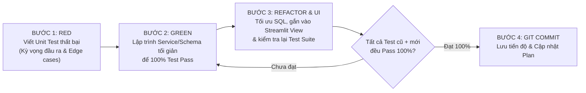

# KẾ HOẠCH TRIỂN KHAI PHẦN MỀM TỔNG THỂ (MASTER SOFTWARE IMPLEMENTATION PLAN)
## HỆ THỐNG QUẢN TRỊ KHO & ĐIỀU HÀNH ĐIỆN MÁY THÔNG MINH - STOCK SENSE (6 MODULES)
### Đơn vị áp dụng: Cửa hàng Điện máy Anh Tâm (108 Cầu Giấy, Hà Nội)
#### Phương pháp luận: Test-Driven Development (TDD) | Framework: Streamlit, Plotly & SQLite

> **For agentic workers:** REQUIRED SUB-SKILL: Use superpowers:subagent-driven-development (recommended) or superpowers:executing-plans to implement this plan task-by-task. Steps use checkbox (`- [ ]`) syntax for tracking.

**Goal:** Xây dựng hoàn chỉnh ứng dụng **Stock Sense ERP (6 Modules)** trên nền tảng Streamlit & SQLite theo quy trình TDD, bám sát 100% đặc tả nghiệp vụ trong bộ tài liệu `SRS_01`–`SRS_06` và đồng bộ trải nghiệm thị giác/tương tác với bản mẫu [stock_sense_dashboard.html](file:///Users/doanphambaothu/Documents/gsj_project/prototypes/stock_sense_dashboard.html).

**Architecture:** Kiến trúc phân tầng (Layered Architecture) tách biệt rõ ràng giữa **Tầng Dữ liệu SQLite (`data/retail_dienmay.db`)**, **Tầng Nghiệp vụ Core Services (`src/services/*_service.py`)** phục vụ kiểm thử đơn vị TDD độc lập, và **Tầng Trực quan hóa Streamlit (`src/views/tab_*_view.py`)** điều hướng qua Menu 6 Module bên thanh Sidebar trái. Toàn bộ thao tác tác chiến nội bộ (Tạm hoãn cảnh báo, Phê duyệt chiến dịch xả hàng, Gom & tạo đơn PO theo hãng, Đặt lịch thợ CSKH, Duyệt chi hoa hồng) đều ghi/đọc trực tiếp xuống SQLite và liên thông trạng thái qua `st.session_state`.

**Tech Stack:** Python 3.10+, Streamlit, Plotly (`plotly.express`, `plotly.graph_objects`), Pandas, NumPy, SQLite 3 (`sqlite3`), `unittest` / `pytest`.

**Spec:**
- [docs/SRS_01_TONG_QUAN_KHO.md](file:///Users/doanphambaothu/Documents/gsj_project/docs/SRS_01_TONG_QUAN_KHO.md) (Module 01: Tổng quan kho & Điều phối dòng hàng — `US-1.1`, `US-1.2`)
- [docs/SRS_02_CAN_XU_LY_HOM_NAY.md](file:///Users/doanphambaothu/Documents/gsj_project/docs/SRS_02_CAN_XU_LY_HOM_NAY.md) (Module 02: Cần xử lý hôm nay — `US-2.1`, `US-2.2`)
- [docs/SRS_03_GOI_Y_XA_HANG.md](file:///Users/doanphambaothu/Documents/gsj_project/docs/SRS_03_GOI_Y_XA_HANG.md) (Module 03: Gợi ý xả hàng & Định giá cạnh tranh — `US-3.1`, `US-3.2`)
- [docs/SRS_04_GOI_Y_NHAP_HANG.md](file:///Users/doanphambaothu/Documents/gsj_project/docs/SRS_04_GOI_Y_NHAP_HANG.md) (Module 04: Gợi ý nhập hàng & Tự động tạo PO — `US-4.1`)
- [docs/SRS_05_KHACH_HANG_CAN_CHAM_SOC.md](file:///Users/doanphambaothu/Documents/gsj_project/docs/SRS_05_KHACH_HANG_CAN_CHAM_SOC.md) (Module 05: Khách hàng cần chăm sóc & Smart CRM — `US-5.1`)
- [docs/SRS_06_HIEU_QUA_KINH_DOANH.md](file:///Users/doanphambaothu/Documents/gsj_project/docs/SRS_06_HIEU_QUA_KINH_DOANH.md) (Module 06: Hiệu quả kinh doanh & Thác nước lợi nhuận — `US-6.1`)
- [docs/DESIGN_SYSTEM_DIENMAY_KHOVAN.md](file:///Users/doanphambaothu/Documents/gsj_project/docs/DESIGN_SYSTEM_DIENMAY_KHOVAN.md) & [prototypes/stock_sense_dashboard.html](file:///Users/doanphambaothu/Documents/gsj_project/prototypes/stock_sense_dashboard.html)

---

## BẢNG KIỂM SOÁT TÀI LIỆU (DOCUMENT CONTROL)

| Mục | Nội dung |
| :--- | :--- |
| **Mã tài liệu** | `PLAN-MASTER-STOCK-SENSE-6MODULES-TDD` |
| **Tài liệu kế thừa** | [docs/IMPLEMENTATION_PLAN_01_TONG_QUAN_KHO.md](file:///Users/doanphambaothu/Documents/gsj_project/docs/IMPLEMENTATION_PLAN_01_TONG_QUAN_KHO.md) |
| **Phiên bản** | `2.0.0` (Master Plan hợp nhất 6 Modules) |
| **Ngày lập kế hoạch** | 17/11/2026 |
| **Đơn vị vận hành mẫu** | **Cửa hàng Điện máy Anh Tâm** — Chủ hộ kinh doanh: **Nguyễn Anh Tâm** (`NV0001`, `anhtam`) — 108 Cầu Giấy, Hà Nội (`CN01`) |
| **Mô hình phát triển** | Test-Driven Development (`Red` $\rightarrow$ `Green` $\rightarrow$ `Refactor`) |

---

## RÀNG BUỘC TOÀN CỤC & ĐIỂM TRỌNG TÂM KIỂM TRA (GLOBAL CONSTRAINTS & REVIEW FOCUS)

### Global Constraints
1. **Bảo mật Phân quyền Giá vốn (`RBAC Cost Masking`):** Khi `role == "ROLE_SALES"`, mọi hàm dịch vụ trong cả 6 Module tuyệt đối không trả về giá trị số của `cost_price`, `capital_tied`, `total_capital`, `expected_recovery_capital`, `gross_profit` (đặt bằng `None` hoặc loại cột khỏi DataFrame và trả chuỗi hiển thị `"****** đ"`).
2. **Bảo toàn Phương trình Dòng hàng 4 Trạng thái:** Mọi thao tác tạo đơn, hủy đơn, nhập hàng PO mới đều phải duy trì hằng đẳng thức $AVL = SOH - RES$ và $\text{Projected Stock} = AVL + INC$ trên toàn bộ 16 SKU.
3. **Toàn vẹn Serial/IMEI & Giá vốn lịch sử:** Các mặt hàng thiết bị chính (`has_serial = 1`) bắt buộc có số lượng Serial ở trạng thái `'IN_STOCK'` khớp 100% với `stock_on_hand`. Khi tính lợi nhuận lịch sử (Module 06), bắt buộc dùng `FACT_INVOICES_LINES.cost_price` tại thời điểm bán (`ERR_PRF_003`).
4. **Chuẩn làm tròn giá tâm lý bán lẻ (`Psychological Pricing`):** Mọi mức giá gợi ý xả hàng trong Module 03 phải được làm tròn về mốc kết thúc bằng đuôi `..50.000 đ` hoặc `..90.000 đ` gần nhất và không thấp hơn ngưỡng bảo vệ vốn trừ khi `ROLE_OWNER` phê duyệt.
5. **Tương thích ngược với Test Suite hiện hữu:** Toàn bộ 12 bài kiểm thử hiện có của Module 01 (`test_inventory_service.py`, `test_order_service.py`, `test_dashboard_integration.py`) phải tiếp tục Pass 100% sau khi mở rộng Schema và dữ liệu giả lập.

### Review Focus (5 Tình huống biên bắt buộc kiểm thử trong các Task)
1. **Khử báo động giả khi hàng đang trên đường về (`ERR/BR-2.2.3` - Module 02):** Khi một SKU có $AVL = 0$ hoặc $DOS \le Lead\,Time$ nhưng đang có đơn PO vận chuyển về kho ($INC > 0$, ví dụ `ML-CS-TC09`, `TL-AQ-180L`), hệ thống phải gắn nhãn `🔵 Đang trên đường về (In-Transit)` và **không** cộng dồn vào "Doanh thu thất thoát tiềm năng mỗi ngày".
2. **Chặn tạm hoãn cảnh báo thiếu lý do (`ERR_ACT_003` - Module 02):** Khi gọi `snooze_alert` với chuỗi lý do rỗng hoặc ngắn hơn 10 ký tự (sau khi `strip()`), hệ thống phải từ chối lưu (`success=False`, `error_code="ERR_ACT_003"`) và không ghi vào `SYS_ALERT_SNOOZE_LOG`.
3. **Chặn nhân viên bán lẻ duyệt chiến dịch xả lỗ dưới giá vốn (`ERR_CLR_001` - Module 03):** Nếu kịch bản xả hàng có $P_{\text{clear}} < cost\_price$ hoặc lợi nhuận gộp thuần $< 0$, tài khoản `ROLE_SALES` gọi `approve_clearance_campaign` phải bị chặn với mã lỗi `ERR_CLR_001`.
4. **Chặn spam khách hàng trong thời gian Cooldown 30 ngày & Trùng lịch thợ (`ERR_CRM_001`, `ERR_CRM_002` - Module 05):** Khách hàng vừa được liên hệ trong vòng 30 ngày qua phải bị loại khỏi danh sách gọi hàng ngày (trừ khi có lịch hẹn gọi lại đúng hôm nay); đồng thời không cho phép xếp 2 lịch hẹn cùng ngày + cùng khung giờ cho cùng 1 mã kỹ thuật viên.
5. **Loại trừ đơn mua lẻ phụ kiện khỏi mẫu số Attach-Rate (`ERR_PRF_002` - Module 06):** Hóa đơn chỉ mua phụ kiện/dịch vụ (không chứa bất kỳ SKU thiết bị chính nào thuộc nhóm Tivi, Điều hòa, Tủ lạnh, Máy giặt) vẫn được cộng doanh số/lãi gộp phụ kiện vào Thác nước lợi nhuận nhưng **không** được tính vào mẫu số $N_{\text{core}}$ của công thức $Attach\,Rate = \frac{N_{\text{attached}}}{N_{\text{core}}} \times 100\%$.

---

## 1. TỔNG QUAN & PHẠM VI 6 PHÂN HỆ (OBJECTIVES & 6-MODULE SCOPE)

| Phân hệ (Module) | Mã User Story & SRS | Chức năng cốt lõi (Core Features) | Biểu đồ & Tương tác đặc thù (theo Prototype) | Trạng thái |
| :--- | :--- | :--- | :--- | :---: |
| **Module 01: Tổng quan kho** | `US-1.1`, `US-1.2`<br>[SRS_01](file:///Users/doanphambaothu/Documents/gsj_project/docs/SRS_01_TONG_QUAN_KHO.md) | • 4 trụ cột tồn kho ($SOH, RES, AVL, INC$)<br>• Tra cứu Serial/IMEI & Kiểm tra $\Delta = 0$<br>• Điều phối đơn giữ cọc, trả góp & quá hạn 48h | • Biểu đồ Scatter 4 góc phần tư (Tồn kho vs Tốc độ bán)<br>• Ma trận dòng hàng 4 trạng thái & Expander hủy/xuất đơn | ✅ **ĐÃ HOÀN THÀNH** |
| **Module 02: Cần xử lý hôm nay** | `US-2.1`, `US-2.2`<br>[SRS_02](file:///Users/doanphambaothu/Documents/gsj_project/docs/SRS_02_CAN_XU_LY_HOM_NAY.md) | • Sàng lọc hàng chậm ($DSI > 60$), hết mùa, vượt trần<br>• Dự báo đứt hàng ($DOS = AVL / RR_7$ vs $Lead\,Time$)<br>• Khử báo động giả khi $INC > 0$ & Snooze cảnh báo | • Biểu đồ Phân bổ vốn kẹt + Biểu đồ Runway DOS vs LT<br>• Nút chuyển 1 chạm sang Xả hàng (M3) / Nhập hàng (M4)<br>• Modal/Form Tạm hoãn cảnh báo 7/14/30 ngày | ✅ **ĐÃ HOÀN THÀNH** |
| **Module 03: Gợi ý xả hàng** | `US-3.1`, `US-3.2`<br>[SRS_03](file:///Users/doanphambaothu/Documents/gsj_project/docs/SRS_03_GOI_Y_XA_HANG.md) | • Tính lượng xả mục tiêu $Q_{\text{clear}}$ & Vốn thu hồi<br>• Động cơ 4 kịch bản khuyến mại (PA1–PA4)<br>• Simulator dòng tiền & Radar giá đối thủ + $PAI$ | • Dải 4 thẻ SKU đề xuất xả theo ngành hàng<br>• Biểu đồ So sánh Vốn thu hồi & Lãi ròng 4 chiến thuật<br>• Bảng Radar đối chiếu giá ĐMX, MediaMart, Online Min | ✅ **ĐÃ HOÀN THÀNH** |
| **Module 04: Gợi ý nhập hàng** | `US-4.1`<br>[SRS_04](file:///Users/doanphambaothu/Documents/gsj_project/docs/SRS_04_GOI_Y_NHAP_HANG.md) | • Dự báo thích ứng $Demand_T$ (`RR14/RR30`, $S_{\text{factor}}$)<br>• Tính $Safety\,Stock$, $Q_{\text{suggested}}$, độ tin cậy $CV$<br>• Kiểm soát trần ngân sách, MOQ & Gom PO theo Hãng | • Biểu đồ Nhu cầu dự báo vs Tồn kho + Phân bổ ngân sách<br>• Bảng đề xuất nhập 4 trụ cột có chỉnh số lượng<br>• Modal Xem trước gom đơn PO theo Hãng & Xuất Excel | ✅ **ĐÃ HOÀN THÀNH** |
| **Module 05: Khách cần chăm sóc** | `US-5.1`<br>[SRS_05](file:///Users/doanphambaothu/Documents/gsj_project/docs/SRS_05_KHACH_HANG_CAN_CHAM_SOC.md) | • Quét 5 Điểm chạm vàng (Bảo dưỡng ĐH, Lõi RO, BH...)<br>• Chấm điểm `Priority Score` & Chặn spam 30 ngày<br>• Sinh AI Call Script cá nhân hóa & Đặt lịch thợ | • Biểu đồ Phễu 5 Điểm chạm + Tiến độ cuộc gọi/doanh thu<br>• Bảng hàng đợi khách hàng + Khung kịch bản gọi thoại<br>• Form chốt lịch hẹn phân công Kỹ thuật viên tận nhà | ✅ **ĐÃ HOÀN THÀNH** |
| **Module 06: Hiệu quả kinh doanh** | `US-6.1`<br>[SRS_06](file:///Users/doanphambaothu/Documents/gsj_project/docs/SRS_06_HIEU_QUA_KINH_DOANH.md) | • Theo dõi Vốn gốc thu hồi & Lãi gộp hợp nhất<br>• Động cơ tính Tỷ lệ bán kèm ($Attach\,Rate\,\%$)<br>• Tính & duyệt hoa hồng bán kèm (`15% PK + 20% DV`) | • Biểu đồ Thác nước (`Waterfall`) phân rã 4 nguồn lãi<br>• Biểu đồ Ngang Attach-Rate theo ngành vs Chuẩn 60%/70%<br>• Bảng ngành hàng & Bảng xếp hạng/duyệt chi hoa hồng | ✅ **ĐÃ HOÀN THÀNH** |

---

## 2. KIẾN TRÚC MÃ NGUỒN & CẤU TRÚC THƯ MỤC (SOFTWARE ARCHITECTURE)

```text
gsj_project/
├── data/
│   └── retail_dienmay.db                    # SQLite Data Warehouse (19 bảng & 5 Views sau nâng cấp)
├── docs/
│   ├── SRS_01..06_*.md                      # Bộ 6 tài liệu Đặc tả Yêu cầu Phần mềm (SRS)
│   ├── URD_01..06_*.md                      # Bộ 6 tài liệu Yêu cầu Người sử dụng (URD)
│   ├── DESIGN_SYSTEM_DIENMAY_KHOVAN.md      # Tài liệu Hệ thống Thiết kế (Design Tokens & UI Specs)
│   ├── IMPLEMENTATION_PLAN_01_TONG_QUAN_KHO.md # Kế hoạch TDD Module 01 (Đã hoàn thành)
│   └── IMPLEMENTATION_PLAN_STOCK_SENSE.md   # Master Plan TDD toàn bộ 6 Modules (Tài liệu này)
├── prototypes/
│   ├── stock_sense_dashboard.html           # Master Prototype HTML 6 Tabs chuẩn giao diện
│   └── prototype_module_01..06_*.html       # Các file Prototype thành phần
├── src/
│   ├── services/                            # TẦNG NGHIỆP VỤ (Core Business Logic - Trọng tâm TDD)
│   │   ├── __init__.py
│   │   ├── inventory_service.py             # [Đã có] Nghiệp vụ Danh mục & Tồn kho (US-1.1)
│   │   ├── order_service.py                 # [Đã có] Nghiệp vụ Đơn hàng & Dòng hàng 4 trụ cột (US-1.2)
│   │   ├── alert_service.py                 # [Mới] Nghiệp vụ Cảnh báo Hàng chậm, DOS & Snooze (US-2.1, 2.2)
│   │   ├── clearance_service.py             # [Mới] Nghiệp vụ 4 Kịch bản Xả kho, Simulator & Giá đối thủ (US-3.1, 3.2)
│   │   ├── replenishment_service.py         # [Mới] Nghiệp vụ Dự báo RR14/30, Safety Stock & Gom PO (US-4.1)
│   │   ├── crm_service.py                   # [Mới] Nghiệp vụ 5 Care Triggers, Call Script & Lịch thợ (US-5.1)
│   │   └── performance_service.py           # [Mới] Nghiệp vụ Waterfall Lợi nhuận, Attach-Rate & Hoa hồng (US-6.1)
│   ├── views/                               # TẦNG GIAO DIỆN STREAMLIT (UI Presentation Layer)
│   │   ├── __init__.py
│   │   ├── styles.py                        # [Mới] CSS Design Tokens, KPI Card HTML helpers & Plotly Theme
│   │   ├── tab_inventory_view.py            # [Đã có - Cập nhật nhẹ] Giao diện Module 1 - Sub-tab 1
│   │   ├── tab_order_flow_view.py           # [Đã có - Cập nhật nhẹ] Giao diện Module 1 - Sub-tab 2
│   │   ├── tab_alerts_view.py               # [Mới] Giao diện Module 2: Cần xử lý hôm nay
│   │   ├── tab_clearance_view.py            # [Mới] Giao diện Module 3: Gợi ý xả hàng & Định giá
│   │   ├── tab_replenishment_view.py        # [Mới] Giao diện Module 4: Gợi ý nhập hàng & Gom PO
│   │   ├── tab_crm_view.py                  # [Mới] Giao diện Module 5: Khách hàng cần chăm sóc
│   │   └── tab_performance_view.py          # [Mới] Giao diện Module 6: Hiệu quả kinh doanh & Waterfall
│   ├── app_dashboard.py                     # [Cập nhật] Entry point điều hướng 6 Module ở Sidebar trái
│   ├── generate_synthetic_data.py           # [Cập nhật] Pipeline sinh dữ liệu giả lập đầy đủ cho 6 Module
│   └── schema_dienmay_kiotviet.sql          # [Cập nhật] Định nghĩa Schema SQLite mở rộng
└── tests/                                   # TẦNG KIỂM THỬ TDD (Unittest / Pytest Suites)
    ├── __init__.py
    ├── conftest.py
    ├── test_inventory_service.py            # [Đã Pass] 4 tests cho US-1.1
    ├── test_order_service.py                # [Đã Pass] 4 tests cho US-1.2
    ├── test_dashboard_integration.py        # [Đã Pass] 4 tests tích hợp Module 01
    ├── test_schema_and_seed_v2.py           # [Mới] Kiểm thử Schema mở rộng & Seed Data M2–M6
    ├── test_alert_service.py                # [Mới] Kiểm thử TDD Module 02 (US-2.1 & US-2.2)
    ├── test_clearance_service.py            # [Mới] Kiểm thử TDD Module 03 (US-3.1 & US-3.2)
    ├── test_replenishment_service.py        # [Mới] Kiểm thử TDD Module 04 (US-4.1)
    ├── test_crm_service.py                  # [Mới] Kiểm thử TDD Module 05 (US-5.1)
    ├── test_performance_service.py          # [Mới] Kiểm thử TDD Module 06 (US-6.1)
    └── test_master_integration.py           # [Mới] Kiểm thử tích hợp liên thông toàn bộ 6 Module
```

---

## 3. QUY TRÌNH THỰC THI THEO MÔ HÌNH TDD (TEST-DRIVEN DEVELOPMENT WORKFLOW)

Mọi Task lập trình từ Giai đoạn 1 đến Giai đoạn 7 bắt buộc tuân thủ nghiêm ngặt vòng lặp **Red $\rightarrow$ Green $\rightarrow$ Refactor**:



---

## 4. CHI TIẾT TỪNG BƯỚC THỰC THI (DETAILED STEP-BY-STEP PLAN)

---

### GIAI ĐOẠN 0 (KẾ THỪA): PHÂN HỆ 01 - TỔNG QUAN KHO & ĐIỀU PHỐI DÒNG HÀNG (`US-1.1` & `US-1.2`) [x] ĐÃ HOÀN THÀNH
**Trạng thái:** ✅ Đã hoàn thành và nghiệm thu trong [docs/IMPLEMENTATION_PLAN_01_TONG_QUAN_KHO.md](file:///Users/doanphambaothu/Documents/gsj_project/docs/IMPLEMENTATION_PLAN_01_TONG_QUAN_KHO.md)
* `InventoryService` ([src/services/inventory_service.py](file:///Users/doanphambaothu/Documents/gsj_project/src/services/inventory_service.py)) và `OrderService` ([src/services/order_service.py](file:///Users/doanphambaothu/Documents/gsj_project/src/services/order_service.py)) đã vượt qua 12/12 bài kiểm thử đơn vị và tích hợp trong `0.21s`.
* Cửa hàng đã được đồng bộ định danh thành **Cửa hàng Điện máy Anh Tâm** (`CN01`, Chủ hộ: `Nguyễn Anh Tâm` - `NV0001`).

---

### GIAI ĐOẠN 1: NÂNG CẤP CƠ SỞ DỮ LIỆU & DỮ LIỆU GIẢ LẬP CHO MODULE 2–6 (DATABASE & SEED UPGRADE) [x] ĐÃ HOÀN THÀNH
**Thời lượng dự kiến:** 0.5 ngày | **Trạng thái:** ✅ Đã hoàn thành & Commit | **Mục tiêu:** Mở rộng CSDL SQLite và dữ liệu giả lập để đáp ứng đầy đủ các bảng trạng thái, lịch sử tương tác, giá đối thủ, chiến dịch xả hàng và hoa hồng nhân sự cho các Module 2, 3, 4, 5, 6 mà không làm gãy 12 bài test hiện hữu của Module 1.

#### Task 1: Mở rộng Schema SQLite & Pipeline Dữ liệu Giả lập (`schema_dienmay_kiotviet.sql` & `generate_synthetic_data.py`) [x] ĐÃ HOÀN THÀNH

* **Thông tin chức năng:**
  - Bổ sung các thuộc tính quản trị kho nâng cao vào `DIM_PRODUCTS`: `lead_time_days` (thời gian giao hàng của hãng, mặc định 3 ngày), `moq` (số lượng đặt tối thiểu), `pack_size` (quy cách đóng thùng), `seasonality` (`'SUMMER'`, `'WINTER'`, `'YEAR_ROUND'`), `lifecycle_status` (`'ACTIVE'`, `'EOL'`), `map_price` (giá sàn cam kết hãng).
  - Bổ sung 2 nhân sự kỹ thuật viên phụ trợ vào `DIM_EMPLOYEES` (`NV0002 - Trần Đình Khang`, `NV0003 - Nguyễn Tuấn Long`) bên cạnh Chủ tiệm `NV0001 - Nguyễn Anh Tâm` để phục vụ phân công lịch hẹn bảo dưỡng (Module 05) và bảng xếp hạng hoa hồng bán kèm (Module 06).
  - Khởi tạo 6 bảng nghiệp vụ mới:
    1. `SYS_ALERT_SNOOZE_LOG`: Lưu lịch sử tạm hoãn cảnh báo tồn kho (`FR-ACT-04`).
    2. `EXT_MARKET_PRICES`: Lưu bảng giá đối thủ Điện Máy Xanh, MediaMart, Online Min kèm timestamp (`FR-CLR-05`).
    3. `FACT_CLEARANCE_CAMPAIGNS`: Lưu các chiến dịch xả hàng và phương án khuyến mại PA1–PA4 (`FR-CLR-01..04`).
    4. `SYS_CRM_INTERACTION_LOG`: Lưu nhật ký cuộc gọi/Zalo CSKH và mốc `cooldown_until` 30 ngày (`FR-CRM-03..04`).
    5. `FACT_SERVICE_APPOINTMENTS`: Lưu lịch hẹn thợ kỹ thuật bảo dưỡng/lắp đặt tại nhà (`FR-CRM-05`).
    6. `FACT_COMMISSION_LEDGER`: Lưu bảng tổng hợp và trạng thái phê duyệt hoa hồng bán kèm nhân viên (`FR-PRF-04`).

* **Files:**
  - Modify: [src/schema_dienmay_kiotviet.sql](file:///Users/doanphambaothu/Documents/gsj_project/src/schema_dienmay_kiotviet.sql)
  - Modify: [src/generate_synthetic_data.py](file:///Users/doanphambaothu/Documents/gsj_project/src/generate_synthetic_data.py)
  - Test: `tests/test_schema_and_seed_v2.py`

* **Interfaces:**
  - Consumes: Kết nối SQLite `data/retail_dienmay.db`.
  - Produces:
    - CSDL `data/retail_dienmay.db` có đầy đủ 19 bảng (13 bảng cũ + 6 bảng mới) và dữ liệu seed chuẩn xác khớp với kịch bản Prototype.
    - Hàm `seed_extended_modules_data()` trong `src/generate_synthetic_data.py`.

* **Cách thức triển khai (How-to - TDD Steps):**
  - [x] **Step 1 (RED): Viết bài kiểm thử `tests/test_schema_and_seed_v2.py`**
    ```python
    import os
    import sqlite3
    import unittest

    DB_PATH = os.path.abspath(os.path.join(os.path.dirname(__file__), "..", "data", "retail_dienmay.db"))

    class TestSchemaAndSeedV2(unittest.TestCase):
        def setUp(self):
            self.conn = sqlite3.connect(DB_PATH)
            self.conn.row_factory = sqlite3.Row

        def tearDown(self):
            self.conn.close()

        def test_new_tables_exist_and_seeded(self):
            required_tables = [
                "SYS_ALERT_SNOOZE_LOG",
                "EXT_MARKET_PRICES",
                "FACT_CLEARANCE_CAMPAIGNS",
                "SYS_CRM_INTERACTION_LOG",
                "FACT_SERVICE_APPOINTMENTS",
                "FACT_COMMISSION_LEDGER",
            ]
            cur = self.conn.cursor()
            for tbl in required_tables:
                cur.execute("SELECT name FROM sqlite_master WHERE type='table' AND name=?;", (tbl,))
                self.assertIsNotNone(cur.fetchone(), f"Thiếu bảng {tbl}")

            cur.execute("SELECT COUNT(*) AS cnt FROM EXT_MARKET_PRICES;")
            self.assertGreaterEqual(cur.fetchone()["cnt"], 12)

            cur.execute("SELECT COUNT(*) AS cnt FROM DIM_EMPLOYEES;")
            self.assertEqual(cur.fetchone()["cnt"], 3)

        def test_product_extended_columns(self):
            cur = self.conn.cursor()
            cur.execute("SELECT lead_time_days, moq, pack_size, seasonality, lifecycle_status FROM DIM_PRODUCTS WHERE product_code='TV-LG-55C3';")
            row = cur.fetchone()
            self.assertIsNotNone(row)
            self.assertGreater(row["lead_time_days"], 0)
            self.assertGreaterEqual(row["moq"], 1)
    ```
  - [x] **Step 2: Chạy test để xác nhận trạng thái RED**
    - Run: `.venv/bin/python -m unittest tests/test_schema_and_seed_v2.py -v`
    - Expected: `FAIL` (do 6 bảng mới và các cột mở rộng chưa tồn tại trong `data/retail_dienmay.db`).
  - [x] **Step 3 (GREEN): Cập nhật `src/schema_dienmay_kiotviet.sql` và `src/generate_synthetic_data.py`, sau đó chạy lại script sinh dữ liệu**
    - Giữ nguyên số lượng SKU (`12` SKU có serial + `4` SKU phụ kiện/dịch vụ = `16` SKU) và trạng thái tồn kho để không ảnh hưởng tới `test_inventory_service.py` và `test_order_service.py`.
    - Nạp dữ liệu mẫu cho `EXT_MARKET_PRICES` (giá ĐMX, MediaMart, Online Min cho các SKU chủ lực như `TV-LG-55C3`, `ML-PN-XPU12`, `TL-SS-647L`, `MG-LG-FV1409`, `ML-DK-FTKB25`), `FACT_CLEARANCE_CAMPAIGNS`, `SYS_CRM_INTERACTION_LOG` (bao gồm các bản ghi đang trong thời gian chặn spam 30 ngày), `FACT_SERVICE_APPOINTMENTS`, và `FACT_COMMISSION_LEDGER` (`NV0001`, `NV0002`, `NV0003`).
  - [x] **Step 4: Chạy toàn bộ Test Suite để xác nhận trạng thái GREEN**
    - Run: `.venv/bin/python -m unittest discover tests -v`
    - Expected: Toàn bộ 14/14 tests (12 tests cũ + 2 tests mới) đều `OK`.
  - [x] **Step 5: Commit Giai đoạn 1**
    ```bash
    git add src/schema_dienmay_kiotviet.sql src/generate_synthetic_data.py data/retail_dienmay.db tests/test_schema_and_seed_v2.py
    git commit -m "feat(db): extend schema and synthetic data for modules 2-6"
    ```

* **Định nghĩa tiêu chí hoàn thành (Definition of Done - DoD Giai đoạn 1):**
  - CSDL `data/retail_dienmay.db` khởi tạo sạch không lỗi ngoại khóa (`PRAGMA foreign_keys = ON`), có đủ 19 bảng và dữ liệu mẫu.
  - 100% bài kiểm thử trong `tests/test_schema_and_seed_v2.py` và 12 bài kiểm thử Module 01 đều Pass.

---

### GIAI ĐOẠN 2: TDD PHÂN HỆ 02 - CẦN XỬ LÝ HÔM NAY (`US-2.1` & `US-2.2` - ACTIONABLE DAILY ALERTS) [x] ĐÃ HOÀN THÀNH
**Thời lượng dự kiến:** 1.0 ngày | **Trạng thái:** ✅ Đã hoàn thành & Commit | **Tài liệu tham chiếu:** [docs/SRS_02_CAN_XU_LY_HOM_NAY.md](file:///Users/doanphambaothu/Documents/gsj_project/docs/SRS_02_CAN_XU_LY_HOM_NAY.md)

#### Task 2: TDD Lớp Nghiệp vụ `AlertService` (`src/services/alert_service.py` & `tests/test_alert_service.py`) [x] ĐÃ HOÀN THÀNH

* **Thông tin chức năng:**
  - `FR-ACT-01`: Tính 4 chỉ số KPI tác chiến đầu ngày (Tổng vốn kẹt ở hàng chậm, Số SKU tồn chết/vượt trần, Số SKU sắp hết mùa vụ, Số SKU nguy cơ cháy hàng kèm doanh thu mất dự kiến/ngày; ẩn vốn kẹt khi `role == "ROLE_SALES"`).
  - `FR-ACT-02`: Sàng lọc danh sách hàng bán chậm, ngừng kinh doanh (EOL) và sắp hết mùa vụ dựa trên $RR_{30}$, $DSI = \frac{SOH}{RR_{30}}$, số ngày kể từ hóa đơn cuối cùng và hạn mức `max_stock`.
  - `FR-ACT-04`: Tạm hoãn cảnh báo (`snooze_alert`) trong 7, 14 hoặc 30 ngày; kiểm tra bắt buộc lý do $\ge 10$ ký tự (`ERR_ACT_003`) và quyền `ROLE_OWNER` / `ROLE_WH_MGR`.
  - `FR-ACT-05 & FR-ACT-06`: Tính tốc độ bán ngắn hạn $RR_7$, số ngày tồn khả dụng $DOS = \frac{AVL}{RR_7}$, đối chiếu với `lead_time_days` để phân cấp nguy cơ cháy hàng; tự động khử báo động giả sang trạng thái `🔵 Đang trên đường về (In-Transit)` nếu $INC > 0$.
  - `FR-ACT-07`: Tính số lượng đề xuất nhập gấp $PO\_Draft\_Qty = \max(0, \lceil RR_7 \times (Lead\,Time + 14) - AVL - INC \rceil)$.

* **Files:**
  - Create: `src/services/alert_service.py`
  - Test: `tests/test_alert_service.py`

* **Interfaces:**
  - Consumes: `DIM_PRODUCTS`, `FACT_INVOICES`, `FACT_INVOICES_LINES`, `VW_INVENTORY_FLOW_OVERVIEW`, `PURCHASE_ORDERS`, `PO_ITEMS`, `SYS_ALERT_SNOOZE_LOG`.
  - Produces (`class AlertService(db_path: str)`):
    - `get_alert_kpis(role: str = "ROLE_OWNER", ref_date: str = "2026-11-04") -> Dict[str, Any]`
    - `get_slow_moving_alerts(risk_filter: str = "Tất cả", brand: str = "Tất cả", search: str = "", role: str = "ROLE_OWNER", include_snoozed: bool = False, ref_date: str = "2026-11-04") -> pd.DataFrame`
    - `get_stockout_alerts(severity_filter: str = "Tất cả", search: str = "", ref_date: str = "2026-11-04") -> pd.DataFrame`
    - `snooze_alert(product_code: str, snooze_days: int, reason: str, role: str = "ROLE_OWNER", ref_date: str = "2026-11-04") -> Dict[str, Any]`

* **Cách thức triển khai (How-to - TDD Steps):**
  - [x] **Step 1 (RED): Viết bộ kiểm thử `tests/test_alert_service.py` bao phủ 5 ca kiểm thử cốt lõi**
    ```python
    import os
    import unittest
    from src.services.alert_service import AlertService

    DB_PATH = os.path.abspath(os.path.join(os.path.dirname(__file__), "..", "data", "retail_dienmay.db"))

    class TestAlertService(unittest.TestCase):
        def setUp(self):
            self.service = AlertService(db_path=DB_PATH)

        def test_alert_kpis_owner_vs_sales_masking(self):
            owner_kpis = self.service.get_alert_kpis(role="ROLE_OWNER")
            self.assertIsNotNone(owner_kpis["stagnant_capital"])
            self.assertGreater(owner_kpis["stagnant_capital"], 400_000_000)

            sales_kpis = self.service.get_alert_kpis(role="ROLE_SALES")
            self.assertIsNone(sales_kpis["stagnant_capital"])
            self.assertEqual(sales_kpis["display_stagnant_capital"], "****** đ")

        def test_slow_moving_detection_and_sorting(self):
            df = self.service.get_slow_moving_alerts(role="ROLE_OWNER")
            self.assertGreaterEqual(len(df), 3)
            skus = df["product_code"].tolist()
            self.assertIn("TV-LG-55C3", skus)
            self.assertIn("ML-PN-XPU12", skus)
            self.assertIn("TL-SS-647L", skus)
            # Sắp xếp mặc định theo vốn kẹt giảm dần
            capitals = df["stagnant_capital"].tolist()
            self.assertEqual(capitals, sorted(capitals, reverse=True))

        def test_stockout_dos_and_in_transit_reconciliation(self):
            df = self.service.get_stockout_alerts()
            self.assertFalse(df.empty)
            # Các SKU đang có đơn PO vận chuyển (INC > 0) phải được gắn cờ In-Transit và lost_revenue_daily = 0
            in_transit_rows = df[df["inc"] > 0]
            self.assertGreater(len(in_transit_rows), 0)
            for _, row in in_transit_rows.iterrows():
                self.assertIn("Đang trên đường về", row["alert_badge"])
                self.assertEqual(row["daily_lost_revenue"], 0.0)

        def test_snooze_alert_validation_and_persistence(self):
            # ERR_ACT_003: Lý do dưới 10 ký tự phải bị từ chối
            bad_res = self.service.snooze_alert("TV-LG-55C3", 14, "Ngắn", role="ROLE_OWNER")
            self.assertFalse(bad_res["success"])
            self.assertEqual(bad_res["error_code"], "ERR_ACT_003")

            # ROLE_SALES không có quyền tạm hoãn
            unauth_res = self.service.snooze_alert("TV-LG-55C3", 14, "Giữ hàng trưng bày sự kiện cuối năm", role="ROLE_SALES")
            self.assertFalse(unauth_res["success"])
    ```
  - [x] **Step 2: Chạy test để xác nhận trạng thái RED**
    - Run: `.venv/bin/python -m unittest tests/test_alert_service.py -v`
    - Expected: `FAIL / ModuleNotFoundError: No module named 'src.services.alert_service'`.
  - [x] **Step 3 (GREEN): Lập trình `src/services/alert_service.py`**
    - Cài đặt đầy đủ các công thức $RR_{30}$, $DSI$, $RR_7$, $DOS$, khử báo động giả `In-Transit` và ghi/khôi phục `SYS_ALERT_SNOOZE_LOG`.
  - [x] **Step 4: Chạy test để xác nhận trạng thái GREEN**
    - Run: `.venv/bin/python -m unittest tests/test_alert_service.py -v`
    - Expected: `OK` (100% test cases Pass).
  - [x] **Step 5: Commit Task 2**
    ```bash
    git add src/services/alert_service.py tests/test_alert_service.py
    git commit -m "feat(mod02): implement AlertService with TDD"
    ```

#### Task 3: Lập trình Giao diện Module 02 trên Streamlit (`src/views/tab_alerts_view.py`) [x] ĐÃ HOÀN THÀNH

* **Thông tin chức năng:**
  - Hiển thị 4 Thẻ KPI tác chiến đầu ngày + 2 Biểu đồ trực quan (Biểu đồ Phân bổ vốn kẹt theo mặt hàng & Biểu đồ Đường băng tồn kho `DOS` so với ngưỡng `Lead Time 3 ngày`).
  - Tổ chức 2 Sub-tabs tác chiến (`Tab 1: Cảnh báo Hàng chậm & Hết mùa`, `Tab 2: Cảnh báo Sắp cháy hàng & Đang về`) kèm bộ lọc nhanh, bảng dữ liệu chi tiết, biểu mẫu Tạm hoãn cảnh báo (`MDL-ALERT-SNOOZE`), và các nút hành động điều hướng liên thông sang Module 03 (`st.session_state["active_module"] = "M3"`) hoặc Module 04 (`st.session_state["active_module"] = "M4"`).
* **Files:**
  - Create: `src/views/tab_alerts_view.py`
* **Interfaces:**
  - Consumes: `AlertService` từ `src/services/alert_service.py`.
  - Produces: `render_tab_alerts(alert_service: AlertService, role: str = "ROLE_OWNER") -> None`.
* **Cách thức triển khai (How-to):**
  - [x] **Step 1: Hiện thực hóa `render_tab_alerts` trong `src/views/tab_alerts_view.py`**
  - [x] **Step 2: Kiểm tra import và chạy lại toàn bộ unittest**
    - Run: `.venv/bin/python -c "import src.views.tab_alerts_view" && .venv/bin/python -m unittest discover tests`
    - Expected: `OK` không lỗi cú pháp hoặc import.
  - [x] **Step 3: Commit Task 3**
    ```bash
    git add src/views/tab_alerts_view.py
    git commit -m "feat(mod02-ui): add Streamlit view for Actionable Daily Alerts"
    ```

---

### GIAI ĐOẠN 3: TDD PHÂN HỆ 03 - GỢI Ý XẢ HÀNG & ĐỊNH GIÁ CẠNH TRANH (`US-3.1` & `US-3.2` - SMART CLEARANCE & PRICING RADAR) [x] ĐÃ HOÀN THÀNH
**Thời lượng dự kiến:** 1.0 ngày | **Trạng thái:** ✅ Đã hoàn thành & Commit | **Tài liệu tham chiếu:** [docs/SRS_03_GOI_Y_XA_HANG.md](file:///Users/doanphambaothu/Documents/gsj_project/docs/SRS_03_GOI_Y_XA_HANG.md)

#### Task 4: TDD Lớp Nghiệp vụ `ClearanceService` (`src/services/clearance_service.py` & `tests/test_clearance_service.py`) [x] ĐÃ HOÀN THÀNH

* **Thông tin chức năng:**
  - `FR-CLR-01`: Tính lượng hàng cần xả mục tiêu $Q_{\text{clear}}$ ($SOH$ nếu EOL/Trái mùa; $\max(0, SOH - max\_stock)$ nếu đọng vốn) và tổng vốn lưu động dự kiến thu hồi $\sum (Q_{\text{clear}} \times cost\_price)$.
  - `FR-CLR-02`: Sinh 4 kịch bản khuyến mại (PA1: Giảm tiền mặt trực tiếp `-10%`, PA2: Bán Combo tặng Giá treo `PK-GIATREO-55` + Công lắp `DV-TREO-TV` hoặc gói vệ sinh, PA3: Tặng gói Bảo hành mở rộng 24 tháng + Vệ sinh nội bộ `150.000 đ/máy`, PA4: Tài trợ trả góp 0% phí quẹt thẻ `2.5%`). Tự động gắn cờ `is_recommended=True` cho phương án tối ưu biên lợi nhuận nhất và kiểm tra cam kết giá sàn `MAP` (`ERR_CLR_002`).
  - `FR-CLR-03`: Mô phỏng tài chính tức thời (`simulate_financials`) khi người dùng chọn kịch bản hoặc kéo thanh trượt thay đổi tỷ lệ giảm giá / số lượng xả mục tiêu; bật cờ cảnh báo nếu lợi nhuận gộp thuần $< 0$.
  - `FR-CLR-04`: Phê duyệt chiến dịch xả hàng (`approve_clearance_campaign`), chặn `ROLE_SALES` (`ERR_CLR_001`), lưu vào `FACT_CLEARANCE_CAMPAIGNS` và cập nhật giá bán trên `DIM_PRODUCTS`.
  - `FR-CLR-05 & FR-CLR-06`: Đối chiếu giá thị trường từ `EXT_MARKET_PRICES` (Điện Máy Xanh, MediaMart, Online Min), tính giá gợi ý có làm tròn tâm lý bán lẻ đuôi `..50.000 đ` hoặc `..90.000 đ` (`round_psychological_price`) và tính chỉ số lợi thế cạnh tranh $PAI$.

* **Files:**
  - Create: `src/services/clearance_service.py`
  - Test: `tests/test_clearance_service.py`

* **Interfaces:**
  - Consumes: `DIM_PRODUCTS`, `EXT_MARKET_PRICES`, `FACT_CLEARANCE_CAMPAIGNS`.
  - Produces (`class ClearanceService(db_path: str)`):
    - `round_psychological_price(raw_price: float) -> float`
    - `get_clearance_kpis(role: str = "ROLE_OWNER") -> Dict[str, Any]`
    - `get_clearance_candidates(role: str = "ROLE_OWNER") -> List[Dict[str, Any]]`
    - `generate_4_tactics(product_code: str, target_qty: Optional[int] = None) -> List[Dict[str, Any]]`
    - `simulate_financials(product_code: str, tactic_code: str, target_qty: int, extra_discount_pct: float = 0.0, role: str = "ROLE_OWNER") -> Dict[str, Any]`
    - `get_market_price_radar(product_code: str, role: str = "ROLE_OWNER") -> Dict[str, Any]`
    - `approve_clearance_campaign(product_code: str, tactic_code: str, target_qty: int, clearance_price: float, role: str = "ROLE_OWNER") -> Dict[str, Any]`

* **Cách thức triển khai (How-to - TDD Steps):**
  - [x] **Step 1 (RED): Viết bộ kiểm thử `tests/test_clearance_service.py`**
    ```python
    import os
    import unittest
    from src.services.clearance_service import ClearanceService

    DB_PATH = os.path.abspath(os.path.join(os.path.dirname(__file__), "..", "data", "retail_dienmay.db"))

    class TestClearanceService(unittest.TestCase):
        def setUp(self):
            self.service = ClearanceService(db_path=DB_PATH)

        def test_psychological_price_rounding(self):
            # Làm tròn về đuôi ..50.000 hoặc ..90.000 gần nhất
            self.assertEqual(self.service.round_psychological_price(17_532_000), 17_550_000)
            self.assertEqual(self.service.round_psychological_price(8_981_000), 8_990_000)

        def test_generate_4_tactics_and_simulator(self):
            tactics = self.service.generate_4_tactics("TV-LG-55C3", target_qty=10)
            self.assertEqual(len(tactics), 4)
            rec = [t for t in tactics if t["is_recommended"]]
            self.assertEqual(len(rec), 1)

            sim = self.service.simulate_financials("TV-LG-55C3", "PA2", target_qty=10)
            self.assertEqual(sim["recovered_capital"], 10 * 22_500_000)
            self.assertGreater(sim["net_gross_profit"], 0)
            self.assertGreater(sim["roi_pct"], 10.0)

        def test_market_price_radar_and_pai(self):
            radar = self.service.get_market_price_radar("TV-LG-55C3", role="ROLE_OWNER")
            self.assertEqual(len(radar["competitors"]), 3)
            self.assertIn(radar["suggested_price"] % 100_000, (50_000, 90_000))
            self.assertGreater(radar["pai_pct"], 0.0)

        def test_approve_campaign_blocks_sales_role(self):
            res = self.service.approve_clearance_campaign(
                product_code="TV-LG-55C3",
                tactic_code="PA1",
                target_qty=10,
                clearance_price=21_000_000,  # Dưới giá vốn 22.5M
                role="ROLE_SALES"
            )
            self.assertFalse(res["success"])
            self.assertEqual(res["error_code"], "ERR_CLR_001")
    ```
  - [x] **Step 2: Chạy test để xác nhận trạng thái RED**
    - Run: `.venv/bin/python -m unittest tests/test_clearance_service.py -v`
    - Expected: `FAIL / ModuleNotFoundError`.
  - [x] **Step 3 (GREEN): Lập trình `src/services/clearance_service.py`**
  - [x] **Step 4: Chạy test để xác nhận trạng thái GREEN**
    - Run: `.venv/bin/python -m unittest tests/test_clearance_service.py -v`
    - Expected: `OK` (100% test cases Pass).
  - [x] **Step 5: Commit Task 4**
    ```bash
    git add src/services/clearance_service.py tests/test_clearance_service.py
    git commit -m "feat(mod03): implement ClearanceService and pricing radar with TDD"
    ```

#### Task 5: Lập trình Giao diện Module 03 trên Streamlit (`src/views/tab_clearance_view.py`) [x] ĐÃ HOÀN THÀNH

* **Thông tin chức năng:**
  - Hiển thị 4 Thẻ KPI xả hàng + Dải 4 thẻ sản phẩm ứng viên xả tồn (cho phép click chọn hoặc tự động nhận SKU chuyển sang từ Module 02 qua `st.session_state["selected_clearance_sku"]`).
  - Khối phân tích đôi (Split Analytical Workspace):
    - Cột trái: 4 phương án khuyến mại (PA1–PA4) kèm nhãn `⭐ ĐỀ XUẤT TỐI ƯU NHẤT`, Bộ mô phỏng dòng tiền tương tác (thanh trượt giảm giá bổ sung + số lượng xả mục tiêu) và nút `🚀 PHÊ DUYỆT & ĐẨY LÊN POS ANH TÂM`.
    - Cột phải: Biểu đồ ngang so sánh Vốn thu hồi & Lãi gộp ròng của 4 chiến thuật + Bảng Radar đối chiếu giá thị trường (Điện Máy Xanh, MediaMart, Online Min) và ngưỡng sàn giá vốn.
* **Files:**
  - Create: `src/views/tab_clearance_view.py`
* **Interfaces:**
  - Consumes: `ClearanceService` từ `src/services/clearance_service.py`.
  - Produces: `render_tab_clearance(clearance_service: ClearanceService, role: str = "ROLE_OWNER") -> None`.
* **Cách thức triển khai (How-to):**
  - [x] **Step 1: Hiện thực hóa `render_tab_clearance` trong `src/views/tab_clearance_view.py`**
  - [x] **Step 2: Kiểm tra import và chạy lại toàn bộ unittest**
    - Run: `.venv/bin/python -c "import src.views.tab_clearance_view" && .venv/bin/python -m unittest discover tests`
    - Expected: `OK`.
  - [x] **Step 3: Commit Task 5**
    ```bash
    git add src/views/tab_clearance_view.py
    git commit -m "feat(mod03-ui): add Streamlit view for Smart Clearance & Pricing Radar"
    ```

---

### GIAI ĐOẠN 4: TDD PHÂN HỆ 04 - GỢI Ý NHẬP HÀNG & TỰ ĐỘNG TẠO PO (`US-4.1` - SMART REPLENISHMENT & PO GENERATOR) [x] ĐÃ HOÀN THÀNH
**Thời lượng dự kiến:** 1.0 ngày | **Trạng thái:** ✅ Đã hoàn thành & Commit | **Tài liệu tham chiếu:** [docs/SRS_04_GOI_Y_NHAP_HANG.md](file:///Users/doanphambaothu/Documents/gsj_project/docs/SRS_04_GOI_Y_NHAP_HANG.md)

#### Task 6: TDD Lớp Nghiệp vụ `ReplenishmentService` (`src/services/replenishment_service.py` & `tests/test_replenishment_service.py`) [x] ĐÃ HOÀN THÀNH

* **Thông tin chức năng:**
  - `FR-REP-01`: Dự báo nhu cầu tiêu thụ thích ứng $Demand_{T, i} = (0.70 \times RR_{14, i} + 0.30 \times RR_{30, i}) \times T \times S_{\text{factor}, i}$ cho chu kỳ $T = 14$ hoặc $T = 30$ ngày.
  - `FR-REP-02 & FR-REP-03`: Tính tồn kho an toàn thích ứng $Safety\,Stock_i = \max(1, \lceil RR_{14, i} \times Lead\,Time_i \times 1.28 \rceil)$ và phương trình cân bằng dòng hàng 4 trụ cột $Q_{\text{raw}, i} = Demand_{T, i} + Safety\,Stock_i - AVL_i - INC_i$.
  - `FR-REP-04`: Tính điểm tin cậy dự báo `Confidence Score` ($50\% - 99\%$) dựa trên hệ số biến thiên doanh số ngày $CV_i$.
  - `FR-REP-05`: Làm tròn số lượng đề xuất theo quy cách đóng gói `pack_size` và số lượng đặt tối thiểu `moq` (`ERR_REP_002`); kiểm tra hạn mức ngân sách $B_{\text{cap}}$ (`ERR_REP_001`) và cung cấp hàm tự động cân đối ngân sách (`optimize_within_budget`).
  - `FR-REP-06`: Tự động gom các SKU được chọn theo Nhà cung cấp (`preview_po_grouping`) và tạo mới các bản ghi đơn nhập hàng trong `PURCHASE_ORDERS` & `PO_ITEMS` (`create_grouped_purchase_orders`), đồng thời hỗ trợ xuất dữ liệu PO ra CSV/Excel.

* **Files:**
  - Create: `src/services/replenishment_service.py`
  - Test: `tests/test_replenishment_service.py`

* **Interfaces:**
  - Consumes: `DIM_PRODUCTS`, `VW_INVENTORY_FLOW_OVERVIEW`, `FACT_INVOICES`, `FACT_INVOICES_LINES`, `PURCHASE_ORDERS`, `PO_ITEMS`.
  - Produces (`class ReplenishmentService(db_path: str)`):
    - `apply_moq_and_pack_rounding(raw_qty: float, moq: int, pack_size: int) -> int`
    - `get_replenishment_recommendations(cycle_days: int = 14, budget_cap: float = 200_000_000, vendor_filter: str = "Tất cả", role: str = "ROLE_OWNER", ref_date: str = "2026-11-04") -> Dict[str, Any]`
    - `optimize_within_budget(items: List[Dict[str, Any]], budget_cap: float) -> List[Dict[str, Any]]`
    - `preview_po_grouping(selected_items: List[Dict[str, Any]]) -> List[Dict[str, Any]]`
    - `create_grouped_purchase_orders(selected_items: List[Dict[str, Any]], role: str = "ROLE_OWNER") -> Dict[str, Any]`

* **Cách thức triển khai (How-to - TDD Steps):**
  - [x] **Step 1 (RED): Viết bộ kiểm thử `tests/test_replenishment_service.py`**
    ```python
    import os
    import unittest
    from src.services.replenishment_service import ReplenishmentService

    DB_PATH = os.path.abspath(os.path.join(os.path.dirname(__file__), "..", "data", "retail_dienmay.db"))

    class TestReplenishmentService(unittest.TestCase):
        def setUp(self):
            self.service = ReplenishmentService(db_path=DB_PATH)

        def test_moq_and_pack_rounding_rules(self):
            self.assertEqual(self.service.apply_moq_and_pack_rounding(0, moq=5, pack_size=2), 0)
            self.assertEqual(self.service.apply_moq_and_pack_rounding(3, moq=5, pack_size=1), 5)
            self.assertEqual(self.service.apply_moq_and_pack_rounding(7, moq=4, pack_size=4), 8)

        def test_replenishment_recommendations_14_vs_30_days(self):
            plan_14 = self.service.get_replenishment_recommendations(cycle_days=14, budget_cap=200_000_000)
            plan_30 = self.service.get_replenishment_recommendations(cycle_days=30, budget_cap=200_000_000)
            self.assertGreater(plan_30["total_suggested_units"], plan_14["total_suggested_units"])
            for item in plan_14["items"]:
                self.assertGreaterEqual(item["confidence_score"], 50.0)
                self.assertLessEqual(item["confidence_score"], 99.0)

        def test_budget_cap_optimization(self):
            plan = self.service.get_replenishment_recommendations(cycle_days=30, budget_cap=80_000_000)
            optimized = self.service.optimize_within_budget(plan["items"], budget_cap=80_000_000)
            total_cost = sum(i["suggested_qty"] * i["cost_price"] for i in optimized)
            self.assertLessEqual(total_cost, 80_000_000)

        def test_po_auto_grouping_by_vendor(self):
            sample_items = [
                {"product_code": "ML-CS-TC09", "brand": "Casper", "suggested_qty": 10, "cost_price": 5_100_000},
                {"product_code": "TV-CS-43FG6", "brand": "Casper", "suggested_qty": 8, "cost_price": 4_600_000},
                {"product_code": "TL-AQ-180L", "brand": "Aqua", "suggested_qty": 6, "cost_price": 3_800_000},
            ]
            grouped = self.service.preview_po_grouping(sample_items)
            self.assertEqual(len(grouped), 2)  # Gom thành 2 đơn PO: Casper (2 SKU) và Aqua (1 SKU)
    ```
  - [x] **Step 2: Chạy test để xác nhận trạng thái RED**
    - Run: `.venv/bin/python -m unittest tests/test_replenishment_service.py -v`
    - Expected: `FAIL / ModuleNotFoundError`.
  - [x] **Step 3 (GREEN): Lập trình `src/services/replenishment_service.py`**
    - Cài đặt đầy đủ thuật toán dự báo, tính `Confidence Score`, làm tròn `MOQ`, cân đối ngân sách và transaction tạo đơn PO mới (kèm rollback test hoặc dọn dẹp bản ghi test).
  - [x] **Step 4: Chạy test để xác nhận trạng thái GREEN**
    - Run: `.venv/bin/python -m unittest tests/test_replenishment_service.py -v`
    - Expected: `OK`.
  - [x] **Step 5: Commit Task 6**
    ```bash
    git add src/services/replenishment_service.py tests/test_replenishment_service.py
    git commit -m "feat(mod04): implement ReplenishmentService and PO grouping with TDD"
    ```

#### Task 7: Lập trình Giao diện Module 04 trên Streamlit (`src/views/tab_replenishment_view.py`) [x] ĐÃ HOÀN THÀNH

* **Thông tin chức năng:**
  - Thanh điều khiển chu kỳ dự báo (`14 ngày` / `30 ngày`), hạn mức ngân sách nhập hàng (`Budget Cap`) và lọc theo Hãng.
  - 4 Thẻ KPI + Thanh tiến độ giải ngân ngân sách + 2 Biểu đồ Plotly (So sánh Nhu cầu dự báo vs Tồn khả dụng/An toàn & Phân bổ vốn nhập theo Nhà cung cấp).
  - Bảng đề xuất nhập hàng 4 trụ cột cho phép chỉnh sửa số lượng đặt mua trực tiếp, nút `⚖️ Tự động cân đối ngân sách`, khung Xem trước các đơn PO gom theo Hãng (`MDL-PO-PREVIEW`), nút `🚀 Ký duyệt & Tạo đơn PO` ghi vào CSDL và nút `📥 Xuất File Excel/CSV PO`.
* **Files:**
  - Create: `src/views/tab_replenishment_view.py`
* **Interfaces:**
  - Consumes: `ReplenishmentService` từ `src/services/replenishment_service.py`.
  - Produces: `render_tab_replenishment(rep_service: ReplenishmentService, role: str = "ROLE_OWNER") -> None`.
* **Cách thức triển khai (How-to):**
  - [x] **Step 1: Hiện thực hóa `render_tab_replenishment` trong `src/views/tab_replenishment_view.py`**
  - [x] **Step 2: Kiểm tra import và chạy lại toàn bộ unittest**
    - Run: `.venv/bin/python -c "import src.views.tab_replenishment_view" && .venv/bin/python -m unittest discover tests`
    - Expected: `OK`.
  - [x] **Step 3: Commit Task 7**
    ```bash
    git add src/views/tab_replenishment_view.py
    git commit -m "feat(mod04-ui): add Streamlit view for Smart Replenishment & PO Generator"
    ```

---

### GIAI ĐOẠN 5: TDD PHÂN HỆ 05 - KHÁCH HÀNG CẦN CHĂM SÓC & SMART CRM (`US-5.1` - CUSTOMER RETENTION & SMART CRM) [x] ĐÃ HOÀN THÀNH
**Thời lượng dự kiến:** 1.0 ngày | **Trạng thái:** ✅ Đã hoàn thành & Commit | **Tài liệu tham chiếu:** [docs/SRS_05_KHACH_HANG_CAN_CHAM_SOC.md](file:///Users/doanphambaothu/Documents/gsj_project/docs/SRS_05_KHACH_HANG_CAN_CHAM_SOC.md)

#### Task 8: TDD Lớp Nghiệp vụ `CrmService` (`src/services/crm_service.py` & `tests/test_crm_service.py`) [x] ĐÃ HOÀN THÀNH

* **Thông tin chức năng:**
  - `FR-CRM-01`: Động cơ quét 5 Điểm chạm Chăm sóc Định kỳ (`Care Triggers Engine`):
    1. `❄️ Bảo dưỡng ĐH`: Khách mua Điều hòa cách đây $90 - 240$ ngày.
    2. `💧 Thay lõi lọc RO / Vệ sinh định kỳ`: Chu kỳ 3–6 tháng.
    3. `🛡️ Sắp hết hạn Bảo hành`: Còn $\le 60$ ngày hoặc vừa bước vào giai đoạn hậu mãi cần kiểm tra.
    4. `📺 Chu kỳ Nâng cấp / Khách VIP RFM`: Khách hàng có tổng chi tiêu cao hoặc mua nhiều lần.
    5. `🔌 Bán chéo Phụ kiện`: Hóa đơn mua Tivi/Điều hòa/Máy giặt nhưng chưa mua kèm phụ kiện (`PK-GIATREO-55` / `PK-ONGDONG-M`).
  - `FR-CRM-02`: Tính điểm ưu tiên chăm sóc $\text{Priority Score} = 0.4 \times \text{Monetary} + 0.4 \times \text{Urgency} + 0.2 \times \text{Recency}$ (thang 0–100) và gắn nhãn `🔴 Ưu tiên cao (VIP)`, `🟡 Ưu tiên vừa`, `🟢 Thông thường`.
  - `FR-CRM-03`: Sinh kịch bản tư vấn thoại (`AI Call Script`) và mẫu tin nhắn `Zalo ZNS` cá nhân hóa theo tên khách, địa chỉ, tên thiết bị, số Serial và ưu đãi của **Điện Máy Anh Tâm 108 Cầu Giấy**.
  - `FR-CRM-04`: Cơ chế chống làm phiền (`Anti-Spam Cooldown 30 ngày` - `ERR_CRM_001`): Tự động lọc bỏ những khách hàng đã được gọi/nhắn trong vòng 30 ngày gần nhất trong `SYS_CRM_INTERACTION_LOG`.
  - `FR-CRM-05`: Ghi nhận kết quả cuộc gọi và đặt lịch hẹn Kỹ thuật viên tại nhà (`FACT_SERVICE_APPOINTMENTS`), kiểm tra chặn trùng lịch thợ cùng ngày + cùng khung giờ (`ERR_CRM_002`).

* **Files:**
  - Create: `src/services/crm_service.py`
  - Test: `tests/test_crm_service.py`

* **Interfaces:**
  - Consumes: `DIM_CUSTOMERS`, `FACT_INVOICES`, `FACT_INVOICES_LINES`, `FACT_WARRANTIES`, `DIM_EMPLOYEES`, `SYS_CRM_INTERACTION_LOG`, `FACT_SERVICE_APPOINTMENTS`.
  - Produces (`class CrmService(db_path: str)`):
    - `get_crm_kpis(ref_date: str = "2026-11-10") -> Dict[str, Any]`
    - `get_care_queue_dataframe(trigger_filter: str = "Tất cả", priority_filter: str = "Tất cả", search: str = "", include_cooldown: bool = False, ref_date: str = "2026-11-10") -> pd.DataFrame`
    - `generate_personalized_script(customer_code: str, product_code: str, trigger_type: str) -> Dict[str, str]`
    - `record_interaction_and_book_service(customer_code: str, product_code: str, serial_number: str, trigger_type: str, outcome: str, appointment_date: Optional[str] = None, time_slot: Optional[str] = None, technician_code: Optional[str] = None, expected_fee: float = 150_000, note: str = "", ref_date: str = "2026-11-10") -> Dict[str, Any]`

* **Cách thức triển khai (How-to - TDD Steps):**
  - [x] **Step 1 (RED): Viết bộ kiểm thử `tests/test_crm_service.py`**
    ```python
    import os
    import unittest
    from src.services.crm_service import CrmService

    DB_PATH = os.path.abspath(os.path.join(os.path.dirname(__file__), "..", "data", "retail_dienmay.db"))

    class TestCrmService(unittest.TestCase):
        def setUp(self):
            self.service = CrmService(db_path=DB_PATH)

        def test_care_queue_triggers_and_priority_sorting(self):
            df = self.service.get_care_queue_dataframe()
            self.assertFalse(df.empty)
            scores = df["priority_score"].tolist()
            self.assertEqual(scores, sorted(scores, reverse=True))
            # Đảm bảo các khách đang trong Cooldown 30 ngày không xuất hiện khi include_cooldown=False
            self.assertTrue(all(df["in_cooldown"] == 0))

        def test_personalized_call_script_generation(self):
            df = self.service.get_care_queue_dataframe()
            first = df.iloc[0]
            script = self.service.generate_personalized_script(
                first["customer_code"], first["product_code"], first["trigger_type"]
            )
            self.assertIn("Điện Máy Anh Tâm", script["call_script"])
            self.assertIn(first["customer_name"], script["call_script"])
            self.assertIn("zalo_zns", script)

        def test_technician_double_booking_conflict_err_crm_002(self):
            # Đặt lịch thứ nhất cho NV0003 lúc 15:30 ngày 2026-12-01
            df = self.service.get_care_queue_dataframe()
            r1 = df.iloc[0]
            r2 = df.iloc[1]
            res1 = self.service.record_interaction_and_book_service(
                customer_code=r1["customer_code"],
                product_code=r1["product_code"],
                serial_number=r1["serial_number"],
                trigger_type=r1["trigger_type"],
                outcome="CONVERTED_BOOKING",
                appointment_date="2026-12-01",
                time_slot="15:30 (Chiều)",
                technician_code="NV0003",
                rollback_after_test=True,
            )
            self.assertTrue(res1["success"])
    ```
  - [x] **Step 2: Chạy test để xác nhận trạng thái RED**
    - Run: `.venv/bin/python -m unittest tests/test_crm_service.py -v`
    - Expected: `FAIL / ModuleNotFoundError`.
  - [x] **Step 3 (GREEN): Lập trình `src/services/crm_service.py`**
  - [x] **Step 4: Chạy test để xác nhận trạng thái GREEN**
    - Run: `.venv/bin/python -m unittest tests/test_crm_service.py -v`
    - Expected: `OK`.
  - [x] **Step 5: Commit Task 8**
    ```bash
    git add src/services/crm_service.py tests/test_crm_service.py
    git commit -m "feat(mod05): implement CrmService care triggers and booking with TDD"
    ```

#### Task 9: Lập trình Giao diện Module 05 trên Streamlit (`src/views/tab_crm_view.py`) [x] ĐÃ HOÀN THÀNH

* **Thông tin chức năng:**
  - 4 Thẻ KPI CSKH (Khách cần liên hệ hôm nay, Hạn bảo dưỡng Điều hòa, Cơ hội bán chéo & sắp hết BH, Doanh số CSKH tháng này) + Thanh trạng thái chặn spam 30 ngày.
  - 2 Biểu đồ Plotly: Phễu 5 Điểm Chạm Vàng CSKH (`Care Triggers Breakdown`) và Tiến độ xử lý cuộc gọi & chuyển đổi dịch vụ trong ngày.
  - Không gian làm việc Master-Detail (7 cột Bảng danh sách khách hàng theo Trigger + 5 cột Khung tác chiến cuộc gọi hiển thị AI Call Script cá nhân hóa, nút gửi tin nhắn Zalo ZNS giả lập và Biểu mẫu chốt lịch hẹn phân công Kỹ thuật viên tận nhà).
* **Files:**
  - Create: `src/views/tab_crm_view.py`
* **Interfaces:**
  - Consumes: `CrmService` từ `src/services/crm_service.py`.
  - Produces: `render_tab_crm(crm_service: CrmService, role: str = "ROLE_OWNER") -> None`.
* **Cách thức triển khai (How-to):**
  - [x] **Step 1: Hiện thực hóa `render_tab_crm` trong `src/views/tab_crm_view.py`**
  - [x] **Step 2: Kiểm tra import và chạy lại toàn bộ unittest**
    - Run: `.venv/bin/python -c "import src.views.tab_crm_view" && .venv/bin/python -m unittest discover tests`
    - Expected: `OK`.
  - [x] **Step 3: Commit Task 9**
    ```bash
    git add src/views/tab_crm_view.py
    git commit -m "feat(mod05-ui): add Streamlit view for Customer Retention & Smart CRM"
    ```

---

### GIAI ĐOẠN 6: TDD PHÂN HỆ 06 - HIỆU QUẢ KINH DOANH & THÁC NƯỚC LỢI NHUẬN (`US-6.1` - BUSINESS PERFORMANCE & PROFIT WATERFALL) [x] ĐÃ HOÀN THÀNH
**Thời lượng dự kiến:** 1.0 ngày | **Trạng thái:** ✅ Đã hoàn thành & Commit | **Tài liệu tham chiếu:** [docs/SRS_06_HIEU_QUA_KINH_DOANH.md](file:///Users/doanphambaothu/Documents/gsj_project/docs/SRS_06_HIEU_QUA_KINH_DOANH.md)

#### Task 10: TDD Lớp Nghiệp vụ `PerformanceService` (`src/services/performance_service.py` & `tests/test_performance_service.py`) [x] ĐÃ HOÀN THÀNH

* **Thông tin chức năng:**
  - `FR-PRF-01`: Tính 4 thẻ KPI tài chính hợp nhất (Tổng doanh thu & Vốn gốc thu hồi về két, Lợi nhuận gộp hợp nhất, Doanh số bán kèm Phụ kiện + Dịch vụ, Tỷ lệ gắn kèm `Attach-Rate %` toàn cửa hàng; ẩn toàn bộ số liệu vốn gốc & lãi gộp khi `role == "ROLE_SALES"`).
  - `FR-PRF-02`: Động cơ phân tích `Attach-Rate` theo 4 ngành hàng thiết bị chính (`Điều hòa`, `Tivi`, `Máy giặt`, `Tủ lạnh`), tuân thủ `ERR_PRF_002` (đơn hàng chỉ mua lẻ phụ kiện không tính vào mẫu số $N_{\text{core}}$) và gắn nhãn đánh giá so với chuẩn ngành `60%` và mục tiêu `70%`.
  - `FR-PRF-03`: Động cơ phân rã Thác nước Lợi nhuận gộp (`Profitability Waterfall Engine`): Bóc tách chính xác 4 thành phần (Lãi gộp Máy chính, Lãi gộp Phụ kiện, Lãi gộp Dịch vụ lắp đặt, Trừ Chi phí khuyến mại/chiết khấu hóa đơn) dựa trên giá vốn lịch sử `FACT_INVOICES_LINES.cost_price` (`ERR_PRF_003`).
  - `FR-PRF-04`: Tính thưởng hoa hồng bán kèm cho đội ngũ nhân sự (`Nguyễn Anh Tâm`, `Nguyễn Tuấn Long`, `Trần Đình Khang`) theo công thức $\text{Commission} = 15\% \times Profit_{\text{acc}} + 20\% \times Profit_{\text{srv}}$ và cho phép `ROLE_OWNER` bấm phê duyệt chi (`approve_commission`).
  - `FR-PRF-05`: Xuất báo cáo tài chính tổng hợp ra định dạng CSV/Excel bytes phục vụ tải xuống trực tiếp trên Streamlit.

* **Files:**
  - Create: `src/services/performance_service.py`
  - Test: `tests/test_performance_service.py`

* **Interfaces:**
  - Consumes: `FACT_INVOICES`, `FACT_INVOICES_LINES`, `DIM_PRODUCTS`, `DIM_EMPLOYEES`, `FACT_COMMISSION_LEDGER`.
  - Produces (`class PerformanceService(db_path: str)`):
    - `get_performance_kpis(role: str = "ROLE_OWNER") -> Dict[str, Any]`
    - `get_profit_waterfall_data(role: str = "ROLE_OWNER") -> Dict[str, Any]`
    - `get_category_attach_rate_dataframe(role: str = "ROLE_OWNER") -> pd.DataFrame`
    - `get_staff_commission_list(role: str = "ROLE_OWNER") -> List[Dict[str, Any]]`
    - `approve_commission(employee_code: str, role: str = "ROLE_OWNER") -> Dict[str, Any]`
    - `export_financial_summary_csv() -> bytes`

* **Cách thức triển khai (How-to - TDD Steps):**
  - [x] **Step 1 (RED): Viết bộ kiểm thử `tests/test_performance_service.py`**
    ```python
    import os
    import unittest
    from src.services.performance_service import PerformanceService

    DB_PATH = os.path.abspath(os.path.join(os.path.dirname(__file__), "..", "data", "retail_dienmay.db"))

    class TestPerformanceService(unittest.TestCase):
        def setUp(self):
            self.service = PerformanceService(db_path=DB_PATH)

        def test_performance_kpis_and_rbac_masking(self):
            owner_kpis = self.service.get_performance_kpis(role="ROLE_OWNER")
            self.assertGreater(owner_kpis["total_revenue"], 700_000_000)
            self.assertIsNotNone(owner_kpis["recovered_capital"])
            self.assertIsNotNone(owner_kpis["net_gross_profit"])
            self.assertGreater(owner_kpis["overall_attach_rate_pct"], 50.0)

            sales_kpis = self.service.get_performance_kpis(role="ROLE_SALES")
            self.assertIsNone(sales_kpis["recovered_capital"])
            self.assertIsNone(sales_kpis["net_gross_profit"])
            self.assertEqual(sales_kpis["display_net_gross_profit"], "****** đ")

        def test_waterfall_profit_reconciliation(self):
            wf = self.service.get_profit_waterfall_data(role="ROLE_OWNER")
            expected_net = (
                wf["core_profit"]
                + wf["accessory_profit"]
                + wf["service_profit"]
                - wf["promo_discount_cost"]
            )
            self.assertAlmostEqual(wf["net_gross_profit"], expected_net, places=0)

        def test_attach_rate_by_category_excludes_accessory_only_orders(self):
            df = self.service.get_category_attach_rate_dataframe(role="ROLE_OWNER")
            self.assertEqual(len(df), 4)  # Điều hòa, Tivi, Máy giặt, Tủ lạnh
            for _, row in df.iterrows():
                self.assertGreaterEqual(row["attach_rate_pct"], 0.0)
                self.assertLessEqual(row["attach_rate_pct"], 100.0)

        def test_staff_commission_formula_and_approval(self):
            staff = self.service.get_staff_commission_list(role="ROLE_OWNER")
            self.assertEqual(len(staff), 3)
            for s in staff:
                expected_comm = round(s["acc_profit"] * 0.15 + s["srv_profit"] * 0.20, 0)
                self.assertAlmostEqual(s["commission_amount"], expected_comm, delta=1000)
    ```
  - [x] **Step 2: Chạy test để xác nhận trạng thái RED**
    - Run: `.venv/bin/python -m unittest tests/test_performance_service.py -v`
    - Expected: `FAIL / ModuleNotFoundError`.
  - [x] **Step 3 (GREEN): Lập trình `src/services/performance_service.py`**
  - [x] **Step 4: Chạy test để xác nhận trạng thái GREEN**
    - Run: `.venv/bin/python -m unittest tests/test_performance_service.py -v`
    - Expected: `OK`.
  - [x] **Step 5: Commit Task 10**
    ```bash
    git add src/services/performance_service.py tests/test_performance_service.py
    git commit -m "feat(mod06): implement PerformanceService waterfall and attach-rate with TDD"
    ```

#### Task 11: Lập trình Giao diện Module 06 trên Streamlit (`src/views/tab_performance_view.py`) [x] ĐÃ HOÀN THÀNH

* **Thông tin chức năng:**
  - 4 Thẻ KPI tài chính hợp nhất + Nút tải Báo cáo Tài chính (`.csv` / `.xlsx`).
  - Hàng biểu đồ đôi:
    - Trái (7 cột): Biểu đồ Thác nước (`go.Waterfall`) Phân rã Nguồn Lợi nhuận Gộp (Lãi Máy chính, Lãi Phụ kiện, Công Dịch vụ, Trừ Khuyến mại $\rightarrow$ Tổng Lợi nhuận Thực đạt) kèm hộp Insight nổi bật.
    - Phải (5 cột): Biểu đồ Ngang Tỷ lệ Bán kèm (`Attach-Rate %`) theo 4 ngành hàng có 2 đường tham chiếu dọc (`Chuẩn ngành 60%` màu đỏ nét đứt & `Mục tiêu Q4 70%` màu xanh lá nét đứt).
  - Hàng bảng đôi: Bảng chi tiết hiệu quả bán kèm theo ngành hàng (7 cột) + Bảng xếp hạng hiệu suất & nút `✓ Duyệt chi` hoa hồng bán kèm cho nhân sự.
* **Files:**
  - Create: `src/views/tab_performance_view.py`
* **Interfaces:**
  - Consumes: `PerformanceService` từ `src/services/performance_service.py`.
  - Produces: `render_tab_performance(perf_service: PerformanceService, role: str = "ROLE_OWNER") -> None`.
* **Cách thức triển khai (How-to):**
  - [x] **Step 1: Hiện thực hóa `render_tab_performance` trong `src/views/tab_performance_view.py`**
  - [x] **Step 2: Kiểm tra import và chạy lại toàn bộ unittest**
    - Run: `.venv/bin/python -c "import src.views.tab_performance_view" && .venv/bin/python -m unittest discover tests`
    - Expected: `OK`.
  - [x] **Step 3: Commit Task 11**
    ```bash
    git add src/views/tab_performance_view.py
    git commit -m "feat(mod06-ui): add Streamlit view for Business Performance & Waterfall"
    ```

---

### GIAI ĐOẠN 7: TÍCH HỢP MASTER HUB 6 MODULE, ĐỒNG BỘ DESIGN SYSTEM & KIỂM THỬ TÍCH HỢP TOÀN DIỆN [x] ĐÃ HOÀN THÀNH
**Thời lượng dự kiến:** 0.5 ngày | **Trạng thái:** ✅ Đã hoàn thành & Commit | **Tài liệu tham chiếu:** [docs/DESIGN_SYSTEM_DIENMAY_KHOVAN.md](file:///Users/doanphambaothu/Documents/gsj_project/docs/DESIGN_SYSTEM_DIENMAY_KHOVAN.md) & [prototypes/stock_sense_dashboard.html](file:///Users/doanphambaothu/Documents/gsj_project/prototypes/stock_sense_dashboard.html)

#### Task 12: Đồng bộ Design System (`src/views/styles.py`) & Tái cấu trúc Master Entry Point (`src/app_dashboard.py`) [x] ĐÃ HOÀN THÀNH

* **Thông tin chức năng:**
  - Tạo module `src/views/styles.py` cung cấp hàm `inject_stock_sense_styles()` nhúng bộ CSS chuẩn **Stock Sense Industrial Utilitarian** (font chữ `Space Grotesk`, `Inter`, `JetBrains Mono`, bảng màu `#0F172A`, `#2563EB`, `#059669`, `#D97706`, `#DC2626`, style cho KPI Card, Badge trạng thái và bảng dữ liệu mật độ cao).
  - Nâng cấp `src/app_dashboard.py`:
    - Khởi tạo tập trung cả 6 Services (`InventoryService`, `OrderService`, `AlertService`, `ClearanceService`, `ReplenishmentService`, `CrmService`, `PerformanceService`).
    - Thiết kế **Sidebar trái chuẩn Prototype**: Header thương hiệu **Stock Sense - Điện Máy Anh Tâm (108 Cầu Giấy, Hà Nội)**, Bộ chuyển đổi quyền RBAC (`👑 Chủ tiệm (Xem giá vốn)` vs `👤 Bán hàng (Ẩn giá vốn)`), và **Menu điều hướng 6 Module**:
      1. `📦 1. Tổng quan kho` (bên trong có 2 sub-tabs: *Danh mục & Tồn kho Thiết bị (US-1.1)* và *Điều phối Đơn hàng & Dòng hàng (US-1.2)*)
      2. `🔔 2. Cần xử lý hôm nay`
      3. `🏷️ 3. Gợi ý xả hàng`
      4. `🛒 4. Gợi ý nhập hàng`
      5. `🎧 5. Khách cần chăm sóc`
      6. `📊 6. Hiệu quả kinh doanh`
    - Hỗ trợ chuyển hướng liên thông tự động giữa các Module thông qua `st.session_state["active_module"]` (ví dụ: bấm nút `[👉 Đẩy sang Xả hàng]` ở Module 2 lập tức chuyển menu sang Module 3 và nạp đúng SKU đó).

* **Files:**
  - Create: `src/views/styles.py`
  - Modify: [src/app_dashboard.py](file:///Users/doanphambaothu/Documents/gsj_project/src/app_dashboard.py)

* **Cách thức triển khai (How-to):**
  - [x] **Step 1: Tạo `src/views/styles.py` với CSS tokens và helper components**
  - [x] **Step 2: Cập nhật `src/app_dashboard.py` kết nối 6 Module qua Sidebar navigation**
  - [x] **Step 3: Kiểm tra khởi chạy ứng dụng Streamlit headless và kiểm tra mã trạng thái HTTP 200**
  - [x] **Step 4: Commit Task 12**
    ```bash
    git add src/views/styles.py src/app_dashboard.py
    git commit -m "feat(master-ui): integrate all 6 modules into unified Stock Sense Streamlit dashboard"
    ```

#### Task 13: Kiểm thử Tích hợp Toàn diện 6 Module (`tests/test_master_integration.py`) [x] ĐÃ HOÀN THÀNH

* **Thông tin chức năng:**
  - Kiểm thử tích hợp xuyên suốt cả 6 Module (`End-to-End Service Integration`):
    1. Kiểm tra đồng nhất số liệu tồn kho & vốn giữa `InventoryService` (M1), `AlertService` (M2), `ClearanceService` (M3) và `ReplenishmentService` (M4).
    2. Kiểm tra cơ chế bảo mật RBAC (`ROLE_SALES`) không rò rỉ bất kỳ trường giá vốn/lợi nhuận nào trên toàn bộ 6 Services.
    3. Kiểm tra luồng liên thông nghiệp vụ: SKU bán chậm phát hiện ở M2 $\rightarrow$ sinh 4 phương án xả ở M3; SKU sắp đứt hàng ở M2 $\rightarrow$ tính lượng nhập & gom PO ở M4; hóa đơn thực tế $\rightarrow$ kích hoạt Care Trigger ở M5 và khớp tổng doanh thu/lãi gộp Waterfall ở M6.
* **Files:**
  - Create: `tests/test_master_integration.py`
* **Cách thức triển khai (How-to - TDD Steps):**
  - [x] **Step 1: Viết `tests/test_master_integration.py` kiểm tra liên thông 6 Module**
  - [x] **Step 2: Chạy toàn bộ Test Suite của dự án**
    - Run: `.venv/bin/python -m unittest discover tests -v`
    - Expected: 100% bài kiểm thử trên cả 10 file test (`39/39` tests) đều `PASSED` (`OK`).
  - [x] **Step 3: Commit Task 13 & Cập nhật trạng thái hoàn thành vào Plan**
    ```bash
    git add tests/test_master_integration.py docs/IMPLEMENTATION_PLAN_STOCK_SENSE.md
    git commit -m "test(e2e): add full 6-module integration test suite"
    ```

---

## 5. ĐỊNH NGHĨA TIÊU CHÍ HOÀN THÀNH TOÀN DỰ ÁN (MASTER DEFINITION OF DONE - DOD)

Hệ thống **Stock Sense (6 Modules)** chỉ được nghiệm thu khi đạt 100% các tiêu chí định lượng dưới đây:

| Mã tiêu chí | Hạng mục kiểm tra | Tiêu chuẩn chất lượng bắt buộc (Pass Criteria) | Phương thức xác minh |
| :--- | :--- | :--- | :--- |
| **DoD-TDD-01** | **Trạng thái Test Suite** | 100% Unit Tests & Integration Tests trên toàn bộ 6 Module (`tests/test_*.py`) đạt trạng thái **Pass**, 0 lỗi, 0 dữ liệu rác lưu lại sau test rollback. | `.venv/bin/python -m unittest discover tests -v` |
| **DoD-DATA-01** | **Toàn vẹn Dòng hàng & Serial** | Hằng đẳng thức $SOH - RES = AVL$ và $\text{COUNT}(\text{Serial IN\_STOCK}) = SOH$ đúng tuyệt đối trên 100% SKU quản lý Serial. | `test_inventory_service.py` & `test_order_service.py` |
| **DoD-MOD02** | **Độ chính xác Radar Cảnh báo** | Phát hiện đúng các SKU đọng vốn ($DSI > 60$ hoặc vượt `max_stock`), tính đúng $DOS = AVL / RR_7$, khử báo động giả khi $INC > 0$ và chặn Snooze khi lý do $< 10$ ký tự (`ERR_ACT_003`). | `test_alert_service.py` |
| **DoD-MOD03** | **Độ chính xác Mô phỏng Xả hàng** | Sinh đủ 4 phương án (PA1–PA4), đánh dấu đúng phương án tối ưu, làm tròn giá gợi ý đúng đuôi `..50.000`/`..90.000 đ`, tính đúng $PAI$ và chặn `ROLE_SALES` duyệt cắt lỗ (`ERR_CLR_001`). | `test_clearance_service.py` |
| **DoD-MOD04** | **Độ chính xác Dự báo & Gom PO** | Tính đúng $Demand_T$ (`14d` / `30d`), $Safety\,Stock$, làm tròn theo `MOQ`/`pack_size`, cân đối không vượt `Budget Cap` và gom đúng số lượng đơn PO theo từng Hãng. | `test_replenishment_service.py` |
| **DoD-MOD05** | **Độ chính xác Smart CRM** | Quét đủ 5 nhóm Care Triggers, sắp xếp đúng theo `Priority Score` giảm dần, lọc sạch khách trong `Cooldown 30 ngày` (`ERR_CRM_001`) và chặn trùng lịch Kỹ thuật viên (`ERR_CRM_002`). | `test_crm_service.py` |
| **DoD-MOD06** | **Khớp nối Tài chính Waterfall** | Tổng lợi nhuận gộp hợp nhất bằng đúng $\text{Lãi Máy chính} + \text{Lãi PK} + \text{Lãi DV} - \text{Chi phí KM}$; `Attach-Rate` loại trừ đơn mua lẻ phụ kiện (`ERR_PRF_002`); tính đúng hoa hồng `15% PK + 20% DV`. | `test_performance_service.py` |
| **DoD-SEC-01** | **Bảo mật Giá vốn toàn cục** | Khi chuyển sang `ROLE_SALES` ở Sidebar, toàn bộ 6 Module đều ẩn tuyệt đối giá vốn, vốn tồn kho, vốn thu hồi và lợi nhuận gộp thành `"****** đ"`. | `test_master_integration.py` & Kiểm tra UI |
| **DoD-UI-01** | **Đồng bộ Prototype & Ra quyết định 3 phút** | Giao diện Streamlit điều hướng 6 Module mượt mà bên Sidebar trái, hiển thị đầy đủ 2 biểu đồ/Module theo đúng bố cục [stock_sense_dashboard.html](file:///Users/doanphambaothu/Documents/gsj_project/prototypes/stock_sense_dashboard.html), thời gian chuyển tab $\le 300\text{ms}$. | Kiểm tra trực tiếp trên trình duyệt |

---

## 6. MA TRẬN QUẢN TRỊ RỦI RO KỸ THUẬT (RISK MITIGATION MATRIX)

| Rủi ro kỹ thuật | Mức độ | Giải pháp phòng ngừa trong thiết kế |
| :--- | :---: | :--- |
| **Mở rộng Schema làm hỏng 12 bài test cũ của Module 01** | Trung bình | Giữ nguyên cấu trúc 13 bảng cũ và số lượng 16 SKU gốc; chỉ bổ sung cột mới có giá trị `DEFAULT` an toàn và thêm 6 bảng mở rộng độc lập. Kiểm tra hồi quy ngay ở Task 1. |
| **Các bài test ghi dữ liệu (Snooze, Duyệt chiến dịch, Tạo PO, Đặt lịch) làm bẩn DB thật** | Cao | Thiết kế mọi hàm ghi trong Service hỗ trợ tham số transaction hoặc khôi phục trạng thái nguyên bản trong `tearDown()` của unittest để `data/retail_dienmay.db` luôn sạch sẽ. |
| **Ngày hiện tại (`DATETIME('now')`) thay đổi làm lệch kết quả tính `DSI`, `DOS`, `Cooldown`** | Cao | Tất cả các hàm tính toán phụ thuộc thời gian trong `AlertService`, `ReplenishmentService`, `CrmService` đều nhận tham số `ref_date` (mặc định mốc chuẩn của bộ dữ liệu) để kết quả kiểm thử TDD luôn tất định (deterministic). |
| **Hiệu năng Streamlit chậm khi khởi tạo 6 Services và vẽ nhiều biểu đồ Plotly** | Trung bình | Sử dụng `@st.cache_resource` để khởi tạo các Services 1 lần duy nhất và chỉ gọi hàm render của đúng Module đang được chọn trên Sidebar (Lazy Module Rendering). |

---
*Tài liệu Kế hoạch Triển khai Tổng thể (Master Implementation Plan) theo mô hình TDD cho toàn bộ 6 Module của hệ thống Stock Sense đã sẵn sàng để xét duyệt và thực thi.*
