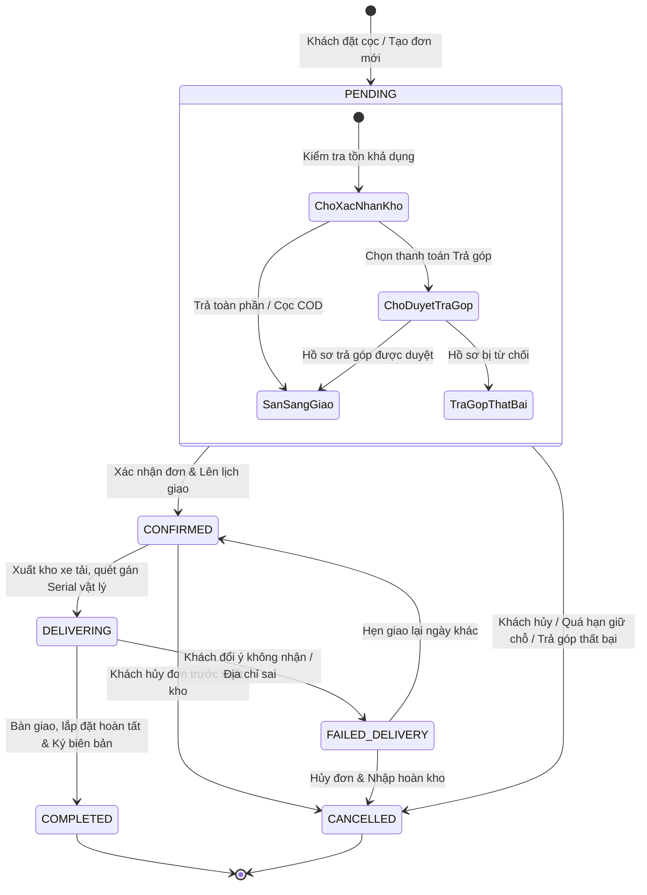

# TÀI LIỆU ĐẶC TẢ YÊU CẦU PHẦN MỀM (SOFTWARE REQUIREMENTS SPECIFICATION - SRS)
## HỆ THỐNG QUẢN LÝ KHO HÀNG ĐIỆN MÁY THÔNG MINH - STOCK SENSE
### PHÂN HỆ: TỔNG QUAN KHO & ĐIỀU PHỐI DÒNG HÀNG (INVENTORY OVERVIEW & ORDER FLOW)
#### Ánh xạ nghiệp vụ từ User Stories: US-1.1 & US-1.2

---

## THÔNG TIN KIỂM SOÁT TÀI LIỆU (DOCUMENT CONTROL)

| Mục | Nội dung |
| :--- | :--- |
| **Mã tài liệu** | `SRS-MOD01-INVENTORY-OVERVIEW` |
| **Tên sản phẩm** | Hệ thống Quản lý Kho hàng Điện máy Thông minh - **Stock Sense** |
| **Phân hệ (Module)** | Module 01: Tổng quan kho (Inventory Overview) |
| **Tài liệu tham chiếu** | [URD_01_TONG_QUAN_KHO.md](file:///Users/doanphambaothu/Documents/gsj_project/docs/URD_01_TONG_QUAN_KHO.md) |
| **Phiên bản** | `1.0.0` |
| **Trạng thái** | Sẵn sàng triển khai phát triển (Ready for Development) |
| **Ngày ban hành** | 21/10/2026 |
| **Tác giả** | Nhóm Phân tích Nghiệp vụ & Kiến trúc Phần mềm (BA & System Architecture Team) |

---

### BẢNG THEO DÕI THAY ĐỔI TÀI LIỆU (REVISION HISTORY)

| Phiên bản | Ngày | Người thực hiện | Tóm tắt nội dung thay đổi |
| :---: | :---: | :---: | :--- |
| **1.0.0** | 21/10/2026 | BA Team | Khởi tạo tài liệu SRS chi tiết: tập trung phân tích chức năng (FR), quy tắc nghiệp vụ dòng hàng điện máy, máy trạng thái đơn hàng, giao diện đặc thù (Wireframe & Component Specs) và ma trận truy vết. |

---

## 1. GIỚI THIỆU & PHẠM VI (INTRODUCTION & SCOPE)

### 1.1. Mục đích tài liệu (Purpose)
Tài liệu Đặc tả Yêu cầu Phần mềm (SRS) này được xây dựng nhằm mục đích:
1. Chuyển hóa toàn bộ các nhu cầu nghiệp vụ được thống nhất trong [URD_01_TONG_QUAN_KHO.md](file:///Users/doanphambaothu/Documents/gsj_project/docs/URD_01_TONG_QUAN_KHO.md) thành các đặc tả kỹ thuật chi tiết, chính xác và không nhập nhằng (unambiguous).
2. Định nghĩa rõ ràng luồng dữ liệu (Input - Process - Output), thuật toán xử lý tồn kho, ma trận trạng thái đơn hàng, và cấu trúc giao diện đặc thù cho Đội ngũ Phát triển phần mềm (Developers) tiến hành lập trình.
3. Thiết lập bộ tiêu chí nghiệm thu (Acceptance Criteria) và ma trận kiểm thử (Test Matrix) cho Đội ngũ Đảm bảo Chất lượng (QA/QC) xây dựng kịch bản kiểm thử.

### 1.2. Phạm vi phân hệ (Scope of Module)
Module **Tổng quan kho (Inventory Overview)** bao gồm 2 nhóm năng lực kỹ thuật chính:
* **Năng lực 1 - Quản lý Danh mục & Tồn kho Thiết bị (Kế thừa US-1.1):** Đo lường và hiển thị thời gian thực giá trị tài sản kho, phân loại trạng thái sức khỏe tồn kho (thiếu hụt / dư thừa / an toàn), tra cứu SKU đa chiều và quản lý chi tiết từng cá thể thiết bị qua mã định danh duy nhất (**Serial/IMEI**).
* **Năng lực 2 - Kiểm soát Vòng đời Đơn hàng & Điều phối Dòng hàng (Kế thừa US-1.2):** Kiểm soát cơ chế khóa giữ tồn (**Reservation Engine**), theo dõi 4 trạng thái dòng hàng (*Tồn thực tế*, *Hàng đã giữ đơn*, *Hàng khả dụng để bán*, *Hàng đang trên đường về*), và phân loại dòng tiền theo các hình thức thanh toán (*Trả toàn phần*, *Đặt cọc COD*, *Trả góp qua Công ty tài chính / Thẻ tín dụng*).

### 1.3. Bảng thuật ngữ chuyên ngành & Ký hiệu quy ước (Glossary & Conventions)

| Thuật ngữ / Ký hiệu | Tên đầy đủ | Định nghĩa và Quy chuẩn kỹ thuật trong hệ thống |
| :--- | :--- | :--- |
| **SKU** | Stock Keeping Unit | Mã định danh phân loại sản phẩm cấp thấp nhất (VD: `TV-SN-55X80K`, `ML-DK-FTKB25`). |
| **Serial / IMEI** | Serial Number / IMEI | Chuỗi ký tự định danh phần cứng duy nhất của từng máy vật lý (VD: `SN-SNY55-20261001-098`). |
| **SOH** | Stock On Hand | Số lượng tồn kho vật lý thực tế đang hiện diện trong kho hàng (`DIM_PRODUCTS.stock_on_hand`). |
| **RES** | Reserved Stock | Số lượng hàng đã được giữ chỗ cho các đơn đặt hàng chưa xuất kho giao (`FACT_ORDERS` có status `Chờ xử lý` hoặc `Đã xác nhận`). |
| **AVL** | Available Stock | Lượng hàng thực tế còn khả dụng để mở bán tiếp: $\text{AVL} = \text{SOH} - \text{RES}$. |
| **INC** | In-Transit Stock | Lượng hàng đã đặt từ Nhà cung cấp / Hãng điện máy đang trong quá trình vận chuyển về kho. |
| **ROP** | Reorder Point | Điểm đặt hàng lại tối thiểu (`min_stock`) kích hoạt cảnh báo cần nhập gấp. |
| **Overstock Cap** | Trần tồn kho tối đa | Ngưỡng tồn kho tối đa (`max_stock`) kích hoạt cảnh báo đọng vốn quá cao. |
| **Installment** | Trả góp | Hình thức thanh toán qua ngân hàng đối tác hoặc công ty tài chính (Home Credit, FE Credit, HD Saison,...). |

---

## 2. TỔNG QUAN PHÂN HỆ & CHÂN DUNG NGƯỜI DÙNG (MODULE OVERVIEW & ACTORS)

### 2.1. Bối cảnh nghiệp vụ dòng chảy hàng điện máy
Khác với mô hình bán lẻ thông thường (FMCG/Tạp hóa), ngành điện máy sở hữu 3 đặc thù nghiệp vụ cốt lõi mà phần mềm phải xử lý:
1. **Giá trị đơn vị lớn & Quản lý định danh cá thể:** Mỗi thiết bị (Tivi, Tủ lạnh, Điều hòa) khi nhập kho đều gắn với 1 số **Serial/IMEI** cố định để phục vụ kích hoạt bảo hành điện tử (e-Warranty) và truy xuất nguồn gốc.
2. **Độ trễ giữa Đặt hàng và Giao hàng:** Khách hàng thường đặt cọc giữ chỗ trước (chờ ngày tân gia, chờ thợ lắp đặt, hoặc chờ duyệt hồ sơ trả góp). Do đó, sản phẩm vẫn nằm trong kho vật lý nhưng **tuyệt đối không được bán cho khách khác**.
3. **Mô hình Dòng hàng 4 trạng thái (4-Pillar Inventory Flow):**

```
+---------------------------------------------------------------------------------------------------+
|                                TÀI SẢN HÀNG HÓA CỦA CỬA HÀNG                                      |
+-----------------------------------------------------------------+---------------------------------+
|                   TỒN KHO VẬT LÝ TẠI KHO (SOH)                  |     HÀNG ĐANG TRÊN ĐƯỜNG VỀ     |
+--------------------------------+--------------------------------+             (INC)               |
|      HÀNG KHẢ DỤNG ĐỂ BÁN      |       HÀNG ĐÃ GIỮ ĐƠN          |  (Đang vận chuyển từ Nhà CC)    |
|             (AVL)              |            (RES)               |                                 |
|  [Có thể chốt bán cho khách]   | [Đã cọc / Chờ hồ sơ trả góp]   |                                 |
+--------------------------------+--------------------------------+---------------------------------+
```

### 2.2. Ma trận tác nhân & Phân quyền chức năng kỹ thuật

| Mã chức năng (FR ID) | Tên chức năng kỹ thuật | Chủ cửa hàng (`ROLE_OWNER`) | Quản lý kho (`ROLE_WH_MGR`) | Nhân viên bán hàng (`ROLE_SALES`) |
| :--- | :--- | :---: | :---: | :---: |
| **FR-INV-01** | Xem Dashboard Tổng vốn & Chỉ số tồn kho | **Toàn quyền** (Full View) | **Toàn quyền** (Full View) | **Ẩn giá vốn** (Masked View) |
| **FR-INV-02** | Tra cứu & Lọc đa chiều danh mục SKU | **Xem** | **Xem** | **Xem** |
| **FR-INV-03** | Tra cứu danh sách Serial/IMEI thiết bị | **Toàn quyền** | **Toàn quyền** | **Chỉ đọc trạng thái** |
| **FR-INV-04** | Giám sát cảnh báo tồn kho (Min/Max ROP) | **Toàn quyền** | **Toàn quyền** | **Không áp dụng** |
| **FR-ORD-01** | Tạo đơn hàng & Khóa giữ hàng (Reservation) | **Toàn quyền** | **Xem** | **Toàn quyền thực thi** |
| **FR-ORD-02** | Hủy đơn hàng & Giải phóng tồn giữ | **Toàn quyền** | **Không** | **Theo quyền giới hạn** |
| **FR-ORD-03** | Theo dõi hàng đang về (In-Transit Pipeline)| **Toàn quyền** | **Toàn quyền** | **Xem để hẹn lịch khách** |
| **FR-ORD-04** | Theo dõi cơ cấu thanh toán & Trả góp | **Toàn quyền** | **Không** | **Toàn quyền thực thi** |
| **FR-ORD-05** | Xác nhận xuất kho giao hàng & Gán Serial | **Toàn quyền** | **Toàn quyền thực thi** | **Xem trạng thái giao** |

---

## 3. MÔ HÌNH TRẠNG THÁI & DÒNG CHẢY NGHIỆP VỤ (STATE MACHINE & BUSINESS FLOWS)

### 3.1. Sơ đồ máy trạng thái Đơn hàng (Order State Machine)

Mọi đơn hàng trong hệ thống bắt buộc phải tuân thủ nghiêm ngặt chu trình luân chuyển trạng thái sau:



### 3.2. Ma trận tác động biến động dòng kho theo trạng thái đơn hàng

Mỗi sự chuyển đổi trạng thái của Đơn hàng sẽ tác động trực tiếp lên các chỉ số kho theo bảng quy tắc toán học sau:

| Sự kiện chuyển đổi trạng thái | Trạng thái Đơn (`FACT_ORDERS.status`) | Tồn thực tế (`SOH`) | Hàng đã giữ đơn (`RES`) | Hàng khả dụng (`AVL`) | Trạng thái Serial (`DIM_PRODUCT_SERIALS.status`) |
| :--- | :--- | :---: | :---: | :---: | :--- |
| **Khởi tạo đơn cọc/giữ hàng** | Chuyển sang `Chờ xử lý` | Không đổi | **+ Qty** | **- Qty** | Khóa giữ (Tạm thời) |
| **Xác nhận giao hàng** | Chuyển sang `Đã xác nhận` | Không đổi | Giữ nguyên | Giữ nguyên | Giữ nguyên |
| **Xuất xe giao hàng** | Chuyển sang `Đang giao hàng` | **- Qty** | **- Qty** | Không đổi | Chuyển sang `SOLD` |
| **Khách hủy đơn** | Chuyển sang `Đã hủy` | Không đổi | **- Qty** | **+ Qty** | Mở khóa về `IN_STOCK` |
| **Giao hàng thất bại (Hoàn kho)**| Từ `Đang giao` sang `Đã hủy` | **+ Qty** | Không đổi | **+ Qty** | Hoàn trả về `IN_STOCK` |

---

## 4. ĐẶC TẢ YÊU CẦU CHỨC NĂNG CHI TIẾT (FUNCTIONAL REQUIREMENTS)

---

### PHÂN HỆ 1: QUẢN LÝ & TRA CỨU TỒN KHO THIẾT BỊ (ÁNH XẠ US-1.1)

#### 4.1. FR-INV-01: Bảng chỉ số điều hành kho (Dashboard Metric Cards)
* **Mô tả chức năng:** Tính toán và kết xuất các chỉ số tài chính và khối lượng tồn kho trọng yếu theo thời gian thực tại thời điểm truy cập.
* **Đầu vào (Inputs):**
  - Chi nhánh/Kho được chọn (`branch_code` hoặc `ALL` cho toàn chuỗi).
  - Trạng thái kinh doanh sản phẩm (`is_active = 1`).
* **Quy trình xử lý & Thuật toán (Processing Logic):**
  1. **Tính Tổng số lượng SKU kinh doanh:**
     $$\text{Total SKU} = \text{COUNT}(\text{DISTINCT } product\_code) \quad \text{với } is\_active = 1$$
  2. **Tính Tổng tồn kho vật lý thực tế (Total SOH):**
     $$\text{Total SOH} = \sum_{i=1}^{M} stock\_on\_hand_i$$
  3. **Tính Tổng giá trị vốn tồn kho (Total Inventory Capital Tied):**
     $$\text{Total Capital} = \sum_{i=1}^{M} \left( stock\_on\_hand_i \times cost\_price_i \right)$$
  4. **Tính Tổng số mặt hàng rủi ro (Risk Count):**
     - Đếm các sản phẩm có $stock\_on\_hand \le min\_stock$ (Nguy cơ đứt hàng).
     - Đếm các sản phẩm có $stock\_on\_hand > max\_stock$ (Nguy cơ ứ đọng vốn).
* **Đầu ra (Outputs):**
  - 4 khối thẻ KPI hiển thị trực quan ở phần đầu màn hình:
    - *Thẻ 1:* Tổng số lượng SKU kinh doanh.
    - *Thẻ 2:* Tổng số lượng thiết bị tồn kho thực tế (kèm đơn vị: Chiếc / Máy).
    - *Thẻ 3:* Tổng giá trị tài sản kho theo giá vốn (VNĐ).
    - *Thẻ 4:* Số lượng SKU nằm trong diện cảnh báo rủi ro (Cần nhập / Tồn quá cao).
* **Quy tắc nghiệp vụ liên quan:**
  - **BR-INV-01.1 (Kiểm soát hiển thị giá vốn):** Nếu người dùng đăng nhập có vai trò `ROLE_SALES`, Thẻ 3 (Tổng giá trị vốn) bắt buộc phải bị ẩn hoàn toàn hoặc hiển thị dạng che giấu (`***.***.*** đ`).
  - **BR-INV-01.2 (Định dạng hiển thị):** Số tiền được định dạng theo chuẩn tiền tệ Việt Nam (phân tách hàng nghìn bằng dấu chấm `.`, hậu tố `đ` hoặc `VNĐ`).

---

#### 4.2. FR-INV-02: Tra cứu, Phân loại & Lọc đa chiều danh mục sản phẩm
* **Mô tả chức năng:** Cung cấp công cụ tìm kiếm và lọc dữ liệu danh mục hàng hóa điện máy linh hoạt theo nhiều chiều tiêu chí đồng thời.
* **Đầu vào (Inputs):**
  - Từ khóa tìm kiếm tự do: Tìm tương đối (`LIKE %keyword%`) theo Mã SKU (`product_code`), Tên thiết bị (`product_name`), Mã vạch (`barcode`), Model (`model_code`).
  - Bộ lọc Nhóm hàng 3 cấp (`category_path`): Cấp 1 (VD: Điện tử), Cấp 2 (VD: Tivi), Cấp 3 (VD: Tivi Sony 55 inch).
  - Bộ lọc Thương hiệu (`brand`): Daikin, Panasonic, Sony, Samsung, LG, Toshiba,...
  - Bộ lọc Trạng thái tồn kho (`inventory_status`): Tất cả / Cảnh báo cần nhập gấp / Cảnh báo tồn quá cao / Tồn an toàn / Đã hết sạch hàng (OOS).
  - Bộ lọc Khoảng giá bán lẻ / Khoảng giá vốn.
* **Quy trình xử lý & Thuật toán (Processing Logic):**
  1. Xây dựng câu truy vấn lọc dữ liệu động kết hợp các điều kiện theo toán tử logic `AND`.
  2. Tính toán lượng tồn khả dụng cho từng dòng sản phẩm:
     $$AVL_i = stock\_on\_hand_i - \text{COALESCE}(\sum \text{quantity giữ đơn}, 0)$$
  3. Gán nhãn Badge trạng thái sức khỏe tồn kho cho từng sản phẩm:
     - Nếu $stock\_on\_hand = 0$: Nhãn `Hết hàng (OOS)` (Màu xám/đỏ đậm).
     - Nếu $0 < stock\_on\_hand \le min\_stock$: Nhãn `Cần nhập gấp` (Màu cam cảnh báo).
     - Nếu $stock\_on\_hand > max\_stock$: Nhãn `Tồn quá cao` (Màu đỏ cảnh báo).
     - Trường hợp còn lại: Nhãn `Tồn an toàn` (Màu xanh lá cây).
* **Đầu ra (Outputs):**
  - Bảng dữ liệu sản phẩm hỗ trợ phân trang (20 / 50 / 100 dòng mỗi trang), hỗ trợ sắp xếp tăng/giảm theo các cột: Mã SKU, Tên, Giá vốn, Giá bán, Tồn thực tế, Tồn khả dụng, Vốn đọng.

---

#### 4.3. FR-INV-03: Quản lý chi tiết Serial/IMEI thiết bị điện máy
* **Mô tả chức năng:** Cho phép người dùng bấm vào một sản phẩm có cờ `has_serial = 1` để mở danh sách chi tiết các số Serial/IMEI thực tế đang nằm trong kho.
* **Đầu vào (Inputs):**
  - `product_code` được người dùng click chọn từ bảng sản phẩm.
* **Quy trình xử lý & Thuật toán (Processing Logic):**
  1. Truy vấn bảng `DIM_PRODUCT_SERIALS` theo điều kiện:
     `product_code = :product_code AND branch_code = :selected_branch AND status = 'IN_STOCK'`.
  2. Kiểm tra tính toàn vẹn dữ liệu:
     $$\Delta = stock\_on\_hand - \text{COUNT}(\text{Serial có status = 'IN\_STOCK'})$$
  3. Nếu $\Delta \ne 0$: Hệ thống ghi nhận cảnh báo vi phạm tính toàn vẹn (Data Discrepancy) và kích hoạt biểu tượng cảnh báo kiểm kê.
* **Đầu ra (Outputs):**
  - Modal/Drawer trượt hiển thị bảng danh sách Serial gồm các thông tin:
    - *Số Serial/IMEI:* Dạng chữ in hoa, có nút bấm sao chép nhanh (Copy to clipboard).
    - *Ngày nhập kho:* Định dạng `DD/MM/YYYY HH:mm`.
    - *Thời gian lưu kho (Dwell Time):* Tính bằng $\text{Ngày hiện tại} - \text{Ngày nhập kho}$. Nếu thời gian lưu kho $> 90$ ngày, gắn nhãn `Lưu kho lâu ngày`.
    - *Vị trí kệ/ngăn trong kho (nếu có).*

---

#### 4.4. FR-INV-04: Cảnh báo tự động sức khỏe tồn kho (Min/Max ROP Rules)
* **Mô tả chức năng:** Tự động phát hiện và gom nhóm các sản phẩm có sự mất cân đối tồn kho nghiêm trọng (hậu quả của việc nhập hàng theo cảm tính - Gut-feeling inventory bias).
* **Quy tắc nghiệp vụ chi tiết:**
  - **BR-INV-04.1 (Ngưỡng tồn sàn - Stockout Alert):** Kích hoạt khi số lượng tồn vật lý nhỏ hơn hoặc bằng ngưỡng tái đặt hàng được cấu hình trong bảng `DIM_PRODUCTS.min_stock`.
  - **BR-INV-04.2 (Ngưỡng tồn trần - Overstock Alert):** Kích hoạt khi số lượng tồn vật lý vượt quá ngưỡng dung lượng kho tối đa `DIM_PRODUCTS.max_stock`.
  - **BR-INV-04.3 (Phân tích vốn kẹt):** Tính toán riêng tổng giá trị tiền vốn nằm trong nhóm sản phẩm bị cảnh báo tồn quá cao:
    $$\text{Overstock Capital Tied} = \sum_{k \in \text{Overstock}} \left( stock\_on\_hand_k \times cost\_price_k \right)$$
    và tỷ trọng: $\frac{\text{Overstock Capital Tied}}{\text{Total Inventory Capital}} \times 100\%$.

---

### PHÂN HỆ 2: THEO DÕI ĐƠN HÀNG & DÒNG HÀNG LINH HOẠT (ÁNH XẠ US-1.2)

#### 4.5. FR-ORD-01: Quản lý tiếp nhận & Đặt cọc giữ hàng (Reservation Engine)
* **Mô tả chức năng:** Kiểm soát việc tạo mới đơn hàng, trừ trực tiếp tồn khả dụng và khóa giữ số lượng máy cho khách hàng để chống bán vượt tồn kho.
* **Đầu vào (Inputs):**
  - Thông tin khách hàng: `customer_name`, `phone`, `address` giao hàng.
  - Danh sách thiết bị đặt mua: Danh sách `product_code`, `quantity`, `unit_price`, `discount_amount`.
  - Thông tin thanh toán ban đầu: Số tiền cọc/trả trước (`amount_paid`), Phương thức (`pay_cash`, `pay_transfer`, `pay_card`, `pay_installment`).
  - Ghi chú lịch hẹn kỹ thuật giao lắp (`delivery_note`).
* **Quy trình xử lý & Thuật toán (Processing Logic):**
  1. **Bước 1 - Kiểm tra tính khả dụng (Availability Check):**
     Với mỗi sản phẩm trong đơn, kiểm tra điều kiện:
     $$quantity_{\text{đặt}} \le AVL (\text{Tồn khả dụng hiện tại})$$
     - *Nếu không thỏa mãn:* Trả về lỗi `ERR_INSUFFICIENT_STOCK` (Thông báo rõ: *"Mặt hàng [Tên SKU] chỉ còn [AVL] chiếc khả dụng, không đủ số lượng [Qty] yêu cầu"*). Chặn giao dịch.
  2. **Bước 2 - Tạo bản ghi đơn hàng (`FACT_ORDERS`):**
     - Sinh mã đơn hàng tự động theo định dạng: `DH` + chuỗi số tăng dần 5 chữ số (VD: `DH00105`).
     - Gán trạng thái ban đầu: `status = 'Chờ xử lý'`.
  3. **Bước 3 - Cập nhật tăng Lượng giữ đơn:**
     $$RES_{\text{mới}} = RES_{\text{cũ}} + quantity_{\text{đặt}}$$
     $$AVL_{\text{mới}} = SOH - RES_{\text{mới}}$$
  4. **Bước 4 - Ghi nhận thanh toán / Trả góp:**
     - Nếu có chọn Trả góp (`pay_installment > 0`): Gắn cờ đơn hàng `is_installment = 1`, lưu tên đối tác tài chính (VD: FE Credit, Home Credit) và mã số tham chiếu hợp đồng.
* **Đầu ra (Outputs):**
  - Đơn hàng được tạo thành công với trạng thái `Chờ xử lý`.
  - Số lượng giữ đơn của SKU tự động tăng, ngăn chặn bất kỳ nhân viên bán hàng nào khác bán mất chiếc máy này.

---

#### 4.6. FR-ORD-02: Cơ chế khóa tương tranh & Chống bán âm kho (Concurrency Control)
* **Mô tả chức năng:** Đảm bảo khi có 2 nhân viên bán hàng tại 2 quầy cùng lúc bấm tạo đơn giữ 1 chiếc Tivi cuối cùng trong kho, hệ thống không bao giờ xảy ra tình trạng bán âm kho (Overselling).
* **Quy trình kỹ thuật (Technical Concurrency Handling):**
  1. Thao tác kiểm tra tồn khả dụng và tạo đơn giữ hàng bắt buộc phải nằm trong một **Cặp Transaction nguyên tử (ACID Transaction)**.
  2. Sử dụng cơ chế khóa bi quan (Pessimistic Row-level Locking) hoặc Kiểm tra tương tranh lạc quan (Optimistic Concurrency Control with Versioning):
     ```sql
     -- Giả mã logic kiểm soát khóa
     BEGIN TRANSACTION;
     SELECT stock_on_hand, (SELECT COALESCE(SUM(quantity), 0) 
                            FROM FACT_ORDERS_LINES fol 
                            JOIN FACT_ORDERS fo ON fol.order_code = fo.order_code 
                            WHERE fol.product_code = :sku AND fo.status IN ('Chờ xử lý', 'Đã xác nhận')) AS reserved_qty
     FROM DIM_PRODUCTS 
     WHERE product_code = :sku;

     -- Kiểm tra nếu (stock_on_hand - reserved_qty) < requested_qty thì ROLLBACK và trả về lỗi
     -- Nếu hợp lệ thì INSERT đơn hàng và COMMIT TRANSACTION.
     COMMIT;
     ```

---

#### 4.7. FR-ORD-03: Tự động giải phóng tồn giữ chỗ khi hủy đơn / Quá hạn giữ chỗ
* **Mô tả chức năng:** Đảm bảo lượng hàng giữ chỗ ảo không bị chiếm dụng vĩnh viễn khi giao dịch không thành công hoặc khách hàng không đến nhận.
* **Quy tắc nghiệp vụ chi tiết:**
  - **BR-ORD-03.1 (Hủy đơn thủ công):** Khi nhân viên hoặc quản lý chọn thao tác **"Hủy đơn hàng"**:
    1. Yêu cầu nhập lý do hủy bắt buộc (Khách đổi ý, Hồ sơ trả góp bị từ chối, Hết thời gian giữ cọc, Khác).
    2. Chuyển trạng thái đơn sang `Đã hủy`.
    3. Tự động giải phóng số lượng giữ đơn của sản phẩm:
       $$RES_{\text{mới}} = RES_{\text{cũ}} - quantity_{\text{hủy}}$$
       $$AVL_{\text{mới}} = SOH - RES_{\text{mới}}$$
  - **BR-ORD-03.2 (Chính sách thời gian giữ đơn tối đa - Hold Time Policy):**
    - Đơn hàng ở trạng thái `Chờ xử lý` được phép lưu giữ tối đa **48 giờ** kể từ thời điểm tạo đơn (`order_time`).
    - Khi thời gian trôi qua $> 36$ giờ: Hệ thống tự động gắn nhãn cảnh báo vàng: `Sắp hết hạn giữ chỗ (Còn 12h)`.
    - Khi thời gian vượt quá 48 giờ: Hệ thống gắn nhãn cảnh báo đỏ: `Đơn giữ hàng quá hạn`. Nhân viên có 2 lựa chọn: Bấm nút **"Gia hạn thêm 24h"** (kèm lý do) hoặc bấm **"Hủy đơn & Nhả tồn"**.

---

#### 4.8. FR-ORD-04: Giám sát hàng đang trên đường về kho (In-Transit Pipeline Tracking)
* **Mô tả chức năng:** Cho phép theo dõi số lượng máy móc đang được vận chuyển từ Nhà cung cấp/Hãng về kho để phục vụ việc chốt bán cho các đơn đặt trước (Back-orders).
* **Đầu vào (Inputs):**
  - Dữ liệu từ bảng đơn nhập hàng `PURCHASE_ORDERS` và `PO_ITEMS` có trạng thái: `Đang vận chuyển` hoặc `Đã xác nhận đặt hàng`.
* **Quy trình xử lý & Thuật toán (Processing Logic):**
  1. Tính toán lượng hàng đang về cho từng SKU:
     $$INC_i = \sum \text{quantity trong các đơn nhập hàng chưa hoàn tất}$$
  2. Tính toán Lượng tồn dự kiến trong tương lai gần (Projected Available Stock):
     $$\text{Projected Available} = AVL_i + INC_i$$
  3. Cho phép nhân viên tiếp nhận đơn đặt trước đối với các sản phẩm đang có $SOH = 0$ nhưng $INC > 0$, hệ thống tự động gắn nhãn đơn hàng: `Chờ hàng về kho - Dự kiến giao: [Ngày hẹn nhập kho + 1 ngày]`.
* **Đầu ra (Outputs):**
  - Cột `Đang trên đường về` trên bảng dòng hàng kèm chi tiết: Số lượng, Mã đơn nhập hàng (PO), và Ngày dự kiến cập kho.

---

#### 4.9. FR-ORD-05: Phân loại & Kiểm soát dòng tiền đơn hàng
* **Mô tả chức năng:** Thống kê và bóc tách cấu trúc dòng tiền của toàn bộ các đơn hàng lưu thông trong phân hệ.
* **Quy tắc phân loại hình thức thanh toán:**
  - **Loại 1 - Trả toàn phần (Full Upfront Payment):**
    - Điều kiện: `pay_installment = 0` VÀ $\text{amount\_paid} = \text{amount\_due}$.
    - Kênh thanh toán: Tiền mặt (`pay_cash`), Chuyển khoản VietQR (`pay_transfer`), Quẹt thẻ POS (`pay_card`).
    - Hành vi dòng hàng: Đơn đủ điều kiện xuất kho giao ngay.
  - **Loại 2 - Đặt cọc giao thu tiền (Partial Deposit / COD):**
    - Điều kiện: $0 < \text{amount\_paid} < \text{amount\_due}$.
    - Khách cọc một khoản tiền giữ máy, phần còn lại thu tiền mặt hoặc quẹt thẻ khi kỹ thuật viên giao và lắp đặt xong tại nhà.
  - **Loại 3 - Mua trả góp (Installment Scheme):**
    - Điều kiện: `pay_installment > 0`.
    - Trạng thái dòng tiền chia làm 2 giai đoạn:
      + *Giai đoạn 1 (Chờ thẩm định):* Đơn hàng ở trạng thái `Chờ xử lý`, giữ máy tại kho.
      + *Giai đoạn 2 (Đã duyệt vay):* Công ty tài chính gửi thông báo duyệt thành công $\rightarrow$ Chuyển sang `Đã xác nhận` $\rightarrow$ Tiến hành xuất kho giao lắp.

---

#### 4.10. FR-ORD-06: Điều phối xuất kho, gán Serial thực tế & Giao lắp tận nhà
* **Mô tả chức năng:** Quy trình chuyển giao từ Đơn đặt hàng sang Hóa đơn thực tế xuất khỏi cửa hàng và bàn giao cho khách.
* **Quy trình xử lý nghiệp vụ:**
  1. Khi kỹ thuật viên chuẩn bị bốc hàng lên xe tải để đi giao, nhân viên chuyển trạng thái đơn hàng sang `Đang giao hàng`.
  2. **Quét gán số Serial/IMEI thực tế:** Hệ thống hiển thị ô quét mã vạch (Barcode/QR Scanner). Nhân viên quét đúng số Serial vật lý của máy lấy từ kho.
  3. Hệ thống kiểm tra: Số Serial vừa quét phải tồn tại trong bảng `DIM_PRODUCT_SERIALS`, đúng mã `product_code` của đơn và đang có `status = 'IN_STOCK'`.
  4. Thực hiện chuỗi tác vụ cập nhật tự động:
     - Chuyển trạng thái số Serial đó sang `SOLD`.
     - Trừ tồn kho vật lý của SKU: $SOH = SOH - 1$.
     - Trừ số lượng giữ đơn của SKU: $RES = RES - 1$.
     - Sinh mã hóa đơn bán hàng (`FACT_INVOICES`).
     - Tự động kích hoạt bản ghi bảo hành điện tử chính hãng trong bảng `FACT_WARRANTIES` với thời hạn bảo hành tương ứng của model.

---

## 5. ĐẶC TẢ GIAO DIỆN & TƯƠNG TÁC NGƯỜI DÙNG (UI/UX SPECIFICATIONS)

### 5.1. Bố cục tổng thể (Global Layout)
Màn hình phân hệ **Tổng quan kho** được tổ chức theo cấu trúc Tab kép cố định:
- **Thanh tiêu đề (Header):** Tên cửa hàng, Bộ chọn chi nhánh kho, Thông tin ca làm việc / Tài khoản đăng nhập.
- **Vùng thẻ KPI tóm tắt (Top Metric Bar):** 4 thẻ chỉ số thống kê tức thời.
- **Bộ điều hướng phân hệ (Tab Navigation):**
  - **Tab 1: Danh mục sản phẩm & Tồn kho** (Giao diện tra cứu tài sản và kiểm kê thiết bị).
  - **Tab 2: Theo dõi Đơn hàng & Dòng hàng** (Giao diện điều phối vận đơn và thanh toán).

---

### 5.2. Màn hình Tab 1: Danh mục sản phẩm & Tồn kho (Wireframe & Component Specs)

```
========================================================================================================================
[🏪 ĐIỆN MÁY STOCK SENSE]   | Phân hệ: TỔNG QUAN KHO                                 [Chi nhánh: Kho Tổng Cầu Giấy v]
========================================================================================================================
+--------------------------+ +--------------------------+ +--------------------------+ +-------------------------------+
| TỔNG SỐ LƯỢNG SKU        | | TỔNG TỒN THỰC TẾ (SOH)   | | TỔNG GIÁ VỐN TỒN KHO     | | CẢNH BÁO MẤT CÂN ĐỐI KHO      |
| 145 SKU                  | | 1.820 Thiết bị           | | 14.280.500.000 đ         | | ⚠️ 14 Cần nhập | 🛑 9 Tồn cao |
| (Đang kinh doanh)        | | (Đang có trong kho)      | | (Tài sản lưu kho)        | | (Vốn kẹt: 1.850.000.000 đ)    |
+--------------------------+ +--------------------------+ +--------------------------+ +-------------------------------+

------------------------------------------------------------------------------------------------------------------------
[ BỘ LỌC TÌM KIẾM ĐA CHIỀU ]
[🔍 Nhập tên, mã SKU, Serial, Model...] [Nhóm hàng: Tất cả v] [Hãng: Tất cả v] [Trạng thái tồn: Tất cả v] [Nút: Lọc dữ liệu]
------------------------------------------------------------------------------------------------------------------------
BẢNG CHI TIẾT SẢN PHẨM & TỒN KHO
+---------------+-----------------------------+----------+--------------+--------------+-----+-----+-----+------------+---------+
| Mã SKU        | Tên sản phẩm                | Hãng     | Giá vốn (đ)  | Giá bán (đ)  | SOH | RES | AVL | Trạng thái | Thao tác|
+---------------+-----------------------------+----------+--------------+--------------+-----+-----+-----+------------+---------+
| ML-DK-FTKB25  | Điều hòa Daikin Inverter 1HP| Daikin   |    8.200.000 |   10.490.000 |  45 |   7 |  38 | [An toàn]  | [Serial]|
| TV-SN-55X80K  | Smart Tivi Sony 4K 55 inch  | Sony     |   12.500.000 |   15.900.000 |   2 |   2 |   0 | [Cần nhập] | [Serial]|
| TL-SS-RT38    | Tủ lạnh Samsung Inverter    | Samsung  |    9.100.000 |   11.890.000 |  65 |   3 |  62 | [Tồn cao]  | [Serial]|
| MG-LG-FV1409  | Máy giặt LG lồng ngang 9kg  | LG       |    7.600.000 |    9.990.000 |  18 |   4 |  14 | [An toàn]  | [Serial]|
| DV-LAPDAT-01  | Gói nhân công & vật tư lắp  | Anh Tâm  |      250.000 |      450.000 | 999 |   0 | 999 | [Dịch vụ]  | [--]    |
+---------------+-----------------------------+----------+--------------+--------------+-----+-----+-----+------------+---------+
[Trang: < 1 2 3 4 5 > ]   Hiển thị 20/145 dòng                                              [📥 Xuất báo cáo tồn kho Excel]
========================================================================================================================
```

#### Đặc tả thành phần giao diện Tab 1 (Component Specifications):
1. **Cột Mã SKU (`product_code`):** Hiển thị dạng chữ in đậm, có liên kết bấm vào để xem hồ sơ sản phẩm.
2. **Cột Giá vốn (`cost_price`):**
   - Với tài khoản `ROLE_OWNER` và `ROLE_WH_MGR`: Hiển thị số tiền VNĐ đầy đủ.
   - Với tài khoản `ROLE_SALES`: Tự động ẩn cột hoặc hiển thị dấu `****** đ`.
3. **Cột SOH / RES / AVL:**
   - Số lượng SOH: Căn giữa, màu đen.
   - Số lượng RES: Màu cam (thể hiện đang bị giữ cọc).
   - Số lượng AVL: Màu xanh lá cây đậm nếu $> 0$; Màu đỏ rực nếu $= 0$ (Hết sạch hàng để bán).
4. **Nút Thao tác `[Serial]`:** Bấm mở Modal xem danh sách Serial/IMEI thực tế của mặt hàng đó.

---

### 5.3. Màn hình Tab 2: Theo dõi Đơn hàng & Dòng hàng (Wireframe & Component Specs)

```
========================================================================================================================
[ TAB 1: Danh mục sản phẩm & Tồn kho ]   |   [ TAB 2: Theo dõi Đơn hàng & Dòng hàng (*) ]
========================================================================================================================
+--------------------------+ +--------------------------+ +--------------------------+ +-------------------------------+
| ĐƠN HÀNG ĐANG GIỮ CHỖ    | | HÀNG ĐANG TRÊN ĐƯỜNG VỀ  | | CƠ CẤU ĐƠN TRẢ GÓP       | | ĐƠN CẦN XUẤT GIAO HÔM NAY     |
| 28 Đơn hàng              | | 42 Thiết bị (3 đơn nhập) | | 11 Đơn (Chiếm 39.2%)     | | 8 Đơn hàng                    |
| (45 Thiết bị đang khóa)  | | (Dự kiến về trong 48h)   | | (Chờ duyệt: 4 | Đã duyệt:7)| | (3 Kỹ thuật viên đi giao)   |
+--------------------------+ +--------------------------+ +--------------------------+ +-------------------------------+

------------------------------------------------------------------------------------------------------------------------
[ BỘ LỌC ĐIỀU PHỐI VẬN ĐƠN ]
[Trạng thái đơn: Tất cả v] [Thanh toán: Tất cả v] [Dòng hàng: Tất cả v] [Kỹ thuật viên: Tất cả v] [🔍 Mã đơn / SĐT khách...]
------------------------------------------------------------------------------------------------------------------------
DANH SÁCH ĐƠN HÀNG & DÒNG CHẢY KHO
+---------+--------------------+--------------------------+------------+------------+-----------+--------------+------------+
| Mã đơn  | Khách hàng / SĐT   | Mặt hàng đặt mua         | Tổng tiền  | Đã thu/Cọc | Hình thức | Dòng hàng    | Trạng thái |
+---------+--------------------+--------------------------+------------+------------+-----------+--------------+------------+
| DH00101 | Anh Hoàng - 0912.. | Smart TV Sony 55X80K (1) | 15.900.000 | 15.900.000 | Trả toàn bộ| [Sẵn sàng kho]| Đang giao  |
| DH00102 | Chị Mai  - 0988.. | ĐH Daikin FTKB25 (2)     | 20.980.000 |  2.000.000 | Cọc (COD) | [Sẵn sàng kho]| Đã xác nhận|
| DH00103 | Anh Tuấn - 0904.. | Tủ lạnh SS RT38 (1)      | 11.890.000 |          0 | Trả góp   | [Hàng đang về]| Chờ xử lý  |
| DH00104 | Bác Long - 0973.. | Máy giặt LG FV1409 (1)   |  9.990.000 |  1.000.000 | Cọc (COD) | [Sẵn sàng kho]| ⚠️ Quá hạn |
+---------+--------------------+--------------------------+------------+------------+-----------+--------------+------------+
Chi tiết đơn chọn [DH00102]: Hẹn giao 14h30 chiều nay | Địa chỉ: Số 12 Kim Mã, Ba Đình | Kỹ thuật viên: NV0003 (Tuấn Long)
[ 📝 Cập nhật trạng thái ]   [ 🚚 Xuất kho giao hàng & Quét Serial ]   [ ❌ Hủy đơn nhả tồn ]   [ 🖨️ In phiếu xuất kho ]
========================================================================================================================
```

#### Đặc tả thành phần giao diện Tab 2 (Component Specifications):
1. **Cột Dòng hàng (`flow_status`):**
   - Badge xanh dương `[Sẵn sàng kho]`: Mặt hàng đã có đủ số lượng trong kho vật lý ($AVL + 1 \le SOH$).
   - Badge tím `[Hàng đang về]`: Kho đang hết ($SOH = 0$) nhưng có trong đơn nhập hàng đang trên đường về. Có tooltip hiển thị: *"Đơn nhập PO0023 - Dự kiến về ngày 23/10"*.
2. **Cột Hình thức thanh toán:**
   - `Trả toàn bộ`: Xanh lá cây.
   - `Cọc (COD)`: Xanh biển, kèm số tiền còn phải thu khi giao máy: `Còn thu: 18.980.000 đ`.
   - `Trả góp`: Màu vàng cam, kèm trạng thái phê duyệt hồ sơ: `Chờ duyệt` hoặc `Đã duyệt giải ngân`.
3. **Nút `[Xuất kho giao hàng & Quét Serial]`:** Chỉ khả dụng (Enabled) khi đơn hàng ở trạng thái `Đã xác nhận` và dòng hàng ở trạng thái `Sẵn sàng kho`. Khi bấm sẽ bật Modal quét mã vạch Serial trước khi chuyển trạng thái sang `Đang giao hàng`.

---

### 5.4. Các hộp thoại chức năng (Modals & Drawers)

#### Modal 1: Quét gán số Serial xuất kho (`MDL-SERIAL-DISPATCH`)
```
+------------------------------------------------------------------------------------+
| 🚚 XUẤT KHO XE GIAO HÀNG & GÁN SERIAL THIẾT BỊ - ĐƠN HÀNG: DH00102                 |
+------------------------------------------------------------------------------------+
| Khách hàng: Chị Mai - Điện thoại: 0988.xxx.xxx                                     |
| Địa chỉ giao: Số 12 Kim Mã, Ba Đình, Hà Nội                                        |
| Danh sách thiết bị cần gán Serial (Số lượng: 02 bộ):                               |
|                                                                                    |
| Thiết bị 1: Điều hòa Daikin Inverter 1HP (ML-DK-FTKB25)                            |
| [*] Nhập hoặc quét mã vạch Serial: [ SN-DK25-20261012-0045              ] [Quét 📷]|
|     --> Trạng thái: ✅ Hợp lệ (Thiết bị tồn kho KHO_TONG - Nhập ngày 12/10)        |
|                                                                                    |
| Thiết bị 2: Điều hòa Daikin Inverter 1HP (ML-DK-FTKB25)                            |
| [*] Nhập hoặc quét mã vạch Serial: [ SN-DK25-20261012-0046              ] [Quét 📷]|
|     --> Trạng thái: ✅ Hợp lệ (Thiết bị tồn kho KHO_TONG - Nhập ngày 12/10)        |
|                                                                                    |
| Kỹ thuật viên phụ trách giao & lắp đặt: [ Nguyễn Tuấn Long (NV0003)              v]|
| Biển số xe máy / tải giao hàng:         [ 29E1-889.92                            ] |
+------------------------------------------------------------------------------------+
| [ Hủy bỏ ]                                           [ Xác nhận xuất kho & Đi giao ]|
+------------------------------------------------------------------------------------+
```

---

## 6. MA TRẬN XỬ LÝ NGOẠI LỆ & MÃ LỖI (EXCEPTION & ERROR MATRIX)

Hệ thống bắt buộc phải kiểm soát và phản hồi chuẩn xác các tình huống ngoại lệ nghiệp vụ theo bảng mã lỗi sau:

| Mã lỗi (Error Code) | Tên lỗi nghiệp vụ | Nguyên nhân phát sinh | Hành vi xử lý của hệ thống | Thông điệp hiển thị cho người dùng |
| :--- | :--- | :--- | :--- | :--- |
| **`ERR_STOCK_001`** | Thiếu tồn khả dụng | Nhân viên tạo đơn với số lượng vượt quá $AVL$. | Chặn không cho lưu đơn; Không ghi nhận giữ hàng. | *"Sản phẩm [Tên SKU] chỉ còn [AVL] chiếc khả dụng để bán. Không thể giữ số lượng [Qty] yêu cầu."* |
| **`ERR_STOCK_002`** | Bán âm kho tương tranh | 2 nhân viên cùng bấm giữ 1 thiết bị cuối cùng tại cùng 1 giây. | Áp dụng Transaction Rollback cho người gửi lệnh sau. | *"Thiết bị vừa được giữ chỗ bởi nhân viên khác cách đây vài giây. Vui lòng tải lại dữ liệu kho."* |
| **`ERR_SERIAL_001`** | Serial không tồn tại | Quét mã Serial sai hoặc không có trong danh mục kho. | Chặn xuất kho; Yêu cầu quét lại. | *"Số Serial [Mã Serial] không tồn tại trong hệ thống kho của chi nhánh."* |
| **`ERR_SERIAL_002`** | Serial đã bị bán | Quét số Serial đã có trạng thái `SOLD`. | Chặn xuất kho; Kích hoạt cảnh báo đỏ. | *"Cảnh báo: Thiết bị có số Serial này đã được bán theo hóa đơn [Mã HĐ]. Vui lòng kiểm tra lại thiết bị vật lý!"* |
| **`ERR_SERIAL_003`** | Lệch chủng loại Serial| Quét Serial của Tivi Sony cho dòng đặt mua Điều hòa Daikin. | Chặn xuất kho. | *"Số Serial vừa quét thuộc về sản phẩm [Tên SKU A], không khớp với sản phẩm đặt mua [Tên SKU B]."* |
| **`ERR_ORDER_001`** | Hủy đơn quá hạn | Cố gắng hủy đơn hàng khi đơn đã ở trạng thái `Đang giao` hoặc `Hoàn thành`. | Chặn thao tác hủy trực tiếp; Yêu cầu thực hiện quy trình Nhập hàng hoàn. | *"Đơn hàng đang trên đường đi giao hoặc đã hoàn tất. Không thể hủy trực tiếp, vui lòng lập phiếu Hàng hoàn."* |

---

## 7. TIÊU CHÍ NGHIỆM THU KIỂM THỬ (ACCEPTANCE CRITERIA - BDD/GHERKIN)

### 7.1. Kịch bản kiểm thử US-1.1: Quản lý danh mục & Tồn kho
```gherkin
Feature: Quản lý danh mục và tồn kho thiết bị điện máy (US-1.1)

  Scenario: Tính toán và hiển thị chính xác tổng vốn tồn kho cho Chủ cửa hàng
    Given Người dùng đăng nhập thành công với vai trò "ROLE_OWNER"
    And Kho hàng hiện có 2 sản phẩm:
      | product_code | stock_on_hand | cost_price  |
      | TV-SN-55X80K | 10            | 12000000    |
      | ML-DK-FTKB25 | 5             | 8000000     |
    When Người dùng truy cập Tab "Danh mục sản phẩm & Tồn kho"
    Then Thẻ KPI "Tổng giá trị vốn tồn kho" phải hiển thị là "160.000.000 đ"
    And Thẻ KPI "Tổng tồn thực tế" hiển thị là "15 Thiết bị"

  Scenario: Bảo mật che giấu giá vốn đối với Nhân viên bán hàng
    Given Người dùng đăng nhập thành công với vai trò "ROLE_SALES"
    When Người dùng truy cập Tab "Danh mục sản phẩm & Tồn kho"
    Then Thẻ KPI "Tổng giá trị vốn tồn kho" không được hiển thị
    And Cột "Giá vốn (đ)" trên bảng danh mục sản phẩm phải bị ẩn hoặc hiển thị dấu "***"
    And Cột "Giá bán niêm yết" vẫn hiển thị bình thường

  Scenario: Hiển thị danh sách Serial/IMEI thiết bị và kiểm tra tính toàn vẹn
    Given Sản phẩm "TV-SN-55X80K" có stock_on_hand = 3
    And Bảng DIM_PRODUCT_SERIALS có đúng 3 bản ghi tương ứng có status = 'IN_STOCK'
    When Người dùng bấm vào nút "[Serial]" tại dòng sản phẩm "TV-SN-55X80K"
    Then Modal hiển thị danh sách đúng 3 số Serial/IMEI
    And Không xuất hiện thông báo cảnh báo lệch dữ liệu kiểm kê
```

### 7.2. Kịch bản kiểm thử US-1.2: Vòng đời đơn hàng & Điều phối dòng hàng
```gherkin
Feature: Theo dõi trạng thái đơn hàng và điều phối dòng hàng (US-1.2)

  Scenario: Tạo đơn đặt cọc giữ hàng thành công làm giảm tồn khả dụng
    Given Sản phẩm "ML-DK-FTKB25" có SOH = 20 và RES = 5 (AVL = 15)
    When Nhân viên bán hàng tạo đơn mới DH00200 đặt mua 2 bộ "ML-DK-FTKB25"
    And Khách hàng đặt cọc số tiền "2.000.000 đ"
    Then Đơn hàng DH00200 được lưu ở trạng thái "Chờ xử lý"
    And Lượng giữ đơn RES của sản phẩm tự động cập nhật thành 7
    And Lượng tồn khả dụng AVL của sản phẩm giảm xuống còn 13
    And Lượng tồn thực tế SOH vẫn giữ nguyên là 20

  Scenario: Hủy đơn hàng giải phóng tồn giữ chỗ ngay lập tức
    Given Đơn hàng DH00200 đang ở trạng thái "Chờ xử lý" giữ 2 bộ "ML-DK-FTKB25"
    When Quản lý bấm "Hủy đơn hàng" với lý do "Khách đổi ý không mua nữa"
    Then Trạng thái đơn hàng DH00200 chuyển thành "Đã hủy"
    And Lượng giữ đơn RES của "ML-DK-FTKB25" tự động giảm đi 2 bộ
    And Lượng tồn khả dụng AVL tự động tăng thêm 2 bộ

  Scenario: Xuất kho giao hàng và trừ tồn kho vật lý sau khi quét Serial
    Given Đơn hàng DH00102 ở trạng thái "Đã xác nhận" đặt mua 1 chiếc Tivi "TV-SN-55X80K"
    When Quản lý thực hiện xuất kho và quét số Serial hợp lệ "SN-SNY55-20261001-098"
    Then Số Serial "SN-SNY55-20261001-098" chuyển trạng thái sang "SOLD"
    And Tồn thực tế SOH của sản phẩm giảm đi 1 chiếc
    And Lượng giữ đơn RES của sản phẩm giảm đi 1 chiếc
    And Trạng thái đơn hàng chuyển thành "Đang giao hàng"
    And Một bản ghi bảo hành mới được kích hoạt trong FACT_WARRANTIES
```

---

## 8. MA TRẬN TRUY VẾT YÊU CẦU (TRACEABILITY MATRIX)

Bảng ma trận truy vết chứng minh tính toàn vẹn 100% giữa tài liệu Yêu cầu người sử dụng (URD), Đặc tả kỹ thuật (SRS), Mô hình dữ liệu (Database), và Kịch bản kiểm thử (Test Cases):

| Yêu cầu URD | Yêu cầu kỹ thuật SRS (FR ID) | Bảng dữ liệu / View liên quan | Quy tắc nghiệp vụ (BR) | Kịch bản kiểm thử (Test Case ID) |
| :--- | :--- | :--- | :--- | :--- |
| **US-1.1** | `FR-INV-01` (Dashboard Chỉ số kho) | `DIM_PRODUCTS`, `VW_PRODUCT_PERFORMANCE` | `BR-INV-01.1`, `BR-INV-01.2` | `TC-INV-01` (Kiểm tra tính tổng vốn) |
| **US-1.1** | `FR-INV-02` (Tra cứu & Lọc đa chiều) | `DIM_PRODUCTS` | `BR-INV-02.1` | `TC-INV-02` (Kiểm tra bộ lọc 3 cấp) |
| **US-1.1** | `FR-INV-03` (Quản lý Serial/IMEI) | `DIM_PRODUCT_SERIALS` | `BR-INV-03.1` | `TC-INV-03` (Kiểm tra khớp SOH và Serial) |
| **US-1.1** | `FR-INV-04` (Cảnh báo Min/Max ROP) | `DIM_PRODUCTS.min_stock / max_stock` | `BR-INV-04.1`, `BR-INV-04.2` | `TC-INV-04` (Kiểm tra cảnh báo tồn trần/sàn) |
| **US-1.1** | `FR-INV-05` (Bảo mật che giá vốn) | `DIM_PRODUCTS.cost_price` | `BR-INV-01.1` | `TC-INV-05` (Phân quyền Role Sales) |
| **US-1.2** | `FR-ORD-01` (Tạo đơn & Giữ tồn) | `FACT_ORDERS`, `FACT_ORDERS_LINES` | `BR-ORD-01.1` | `TC-ORD-01` (Kiểm tra trừ AVL khi cọc) |
| **US-1.2** | `FR-ORD-02` (Khóa tương tranh) | Transaction Locks trên `DIM_PRODUCTS`| `BR-ORD-02.1` | `TC-ORD-02` (Kiểm tra chống bán âm kho) |
| **US-1.2** | `FR-ORD-03` (Hủy đơn & Nhả tồn) | `FACT_ORDERS.status = 'Đã hủy'` | `BR-ORD-03.1`, `BR-ORD-03.2` | `TC-ORD-03` (Kiểm tra hoàn trả tồn AVL) |
| **US-1.2** | `FR-ORD-04` (Theo dõi hàng đang về)| `PURCHASE_ORDERS`, `PO_ITEMS` | `BR-ORD-04.1` | `TC-ORD-04` (Kiểm tra hiển thị PO đang về) |
| **US-1.2** | `FR-ORD-05` (Cơ cấu Trả góp / Cọc) | `FACT_ORDERS.pay_installment` | `BR-ORD-05.1` | `TC-ORD-05` (Kiểm tra đơn trả góp/COD) |
| **US-1.2** | `FR-ORD-06` (Xuất kho & Quét Serial)| `FACT_INVOICES`, `FACT_WARRANTIES` | `BR-ORD-06.1` | `TC-ORD-06` (Kiểm tra đổi status Serial sang SOLD) |

---

*Tài liệu Đặc tả Yêu cầu Phần mềm (SRS) cho Phân hệ Tổng quan kho đã được hoàn thiện đầy đủ. Mọi thay đổi phát sinh trong quá trình phát triển phải được cập nhật qua quy trình Kiểm soát thay đổi (Change Request - CR).*
