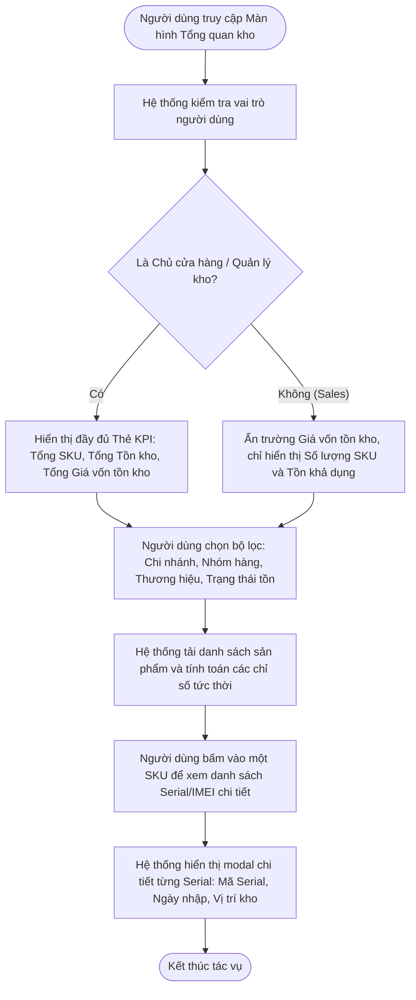
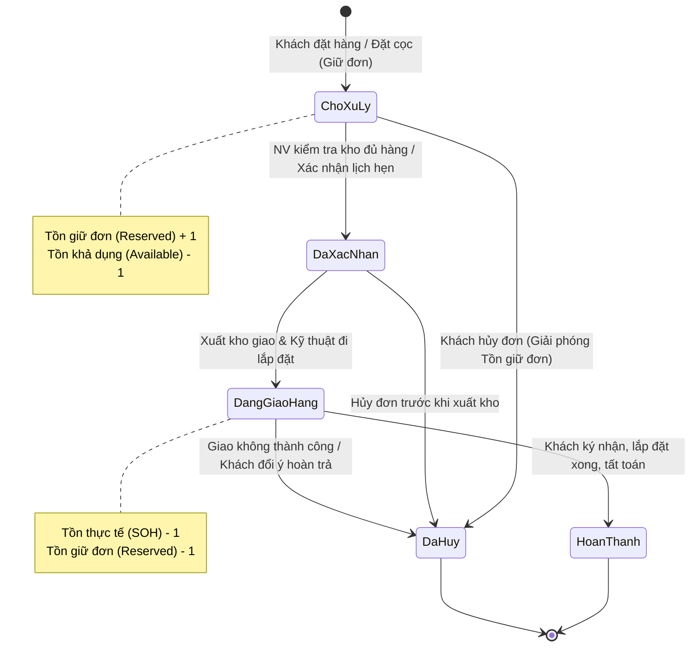

# TÀI LIỆU ĐẶC TẢ YÊU CẦU NGƯỜI SỬ DỤNG (USER REQUIREMENTS DOCUMENT - URD)
## HỆ THỐNG QUẢN LÝ KHO HÀNG ĐIỆN MÁY THÔNG MINH - STOCK SENSE
### PHÂN HỆ: TỔNG QUAN KHO (INVENTORY OVERVIEW)
#### Bao gồm: US-1.1 & US-1.2

---

## BẢNG THEO DÕI THAY ĐỔI TÀI LIỆU (DOCUMENT REVISION HISTORY)

| Phiên bản | Ngày cập nhật | Tác giả | Trạng thái | Mô tả thay đổi |
| :--- | :--- | :--- | :--- | :--- |
| **1.0.0** | 18/10/2026 | Nhóm Phân tích Nghiệp vụ (BA Team) | Dự thảo (Draft) | Khởi tạo tài liệu đặc tả URD chi tiết cho Nhóm chức năng 1: Tổng quan kho (US-1.1 & US-1.2) |

---

## 1. TỔNG QUAN & PHẠM VI (INTRODUCTION & SCOPE)

### 1.1. Bối cảnh dự án
Hệ thống **Stock Sense** là giải pháp phần mềm quản lý kho thông minh chuyên biệt cho ngành bán lẻ điện máy tại Việt Nam. Do đặc thù ngành hàng điện máy có giá trị từng sản phẩm lớn (từ vài triệu đến hàng chục triệu đồng), đa dạng chủng loại (Tivi, Tủ lạnh, Máy giặt, Điều hòa, Đồ gia dụng,...), quản lý định danh riêng theo **Serial/IMEI**, kèm theo các chính sách bán hàng linh hoạt (trả góp qua ngân hàng/công ty tài chính, đặt cọc giữ hàng, giao lắp tận nhà), việc theo dõi chính xác tài sản tồn kho và tình trạng luân chuyển dòng đơn hàng là yêu cầu sống còn.

### 1.2. Mục tiêu của phân hệ "Tổng quan kho"
Phân hệ **Tổng quan kho (Inventory Overview)** đóng vai trò là "Bảng điều khiển chỉ huy" (Dashboard), giúp Chủ doanh nghiệp, Quản lý kho và Nhân viên bán hàng:
- Nắm bắt tức thì toàn bộ giá trị tài sản lưu kho theo giá vốn thực tế và số lượng chi tiết từng danh mục/SKU.
- Phân biệt rõ ràng giữa **Tồn kho vật lý (Stock on Hand)**, **Hàng đã giữ cho đơn (Committed/Reserved Stock)**, **Hàng khả dụng để bán (Available Stock)** và **Hàng đang trên đường về kho (In-Transit / On-Order Stock)**.
- Kiểm soát tiến độ xử lý đơn hàng và cơ cấu thanh toán (Trả toàn phần vs. Trả góp) nhằm chủ động điều phối giao nhận và tối ưu hóa dòng tiền.

### 1.3. Bảng thuật ngữ viết tắt (Glossary)

| Thuật ngữ | Tên đầy đủ / Định nghĩa | Giải thích nghiệp vụ |
| :--- | :--- | :--- |
| **SKU** | Stock Keeping Unit | Mã quản lý định danh mặt hàng (VD: `TV-SN-55X80K`). |
| **Serial / IMEI** | Serial Number / IMEI | Mã số seri duy nhất gán cho từng thiết bị điện máy thực tế trong kho. |
| **SOH** | Stock On Hand | Số lượng tồn kho thực tế đang hiện diện vật lý tại kho hàng. |
| **Reserved Stock** | Committed / Reserved Stock | Số lượng hàng đã được giữ chỗ cho các đơn đặt hàng (chưa xuất hóa đơn/chưa giao). |
| **Available Stock** | Hàng khả dụng để bán | Lượng hàng còn lại có thể bán ngay: $\text{Available} = \text{SOH} - \text{Reserved}$. |
| **In-Transit Stock** | On-Order / In-Transit Stock | Lượng hàng đã đặt mua từ Nhà cung cấp hoặc điều chuyển kho đang trên đường về. |
| **COGS / Cost Price** | Cost of Goods Sold / Giá vốn | Giá nhập bình quân hoặc giá nhập của lô hàng hiện tại. |
| **Installment** | Trả góp | Hình thức khách hàng trả trước một phần hoặc 0 đồng, phần còn lại thanh toán qua công ty tài chính / thẻ tín dụng. |

---

## 2. MA TRẬN PHÂN QUYỀN & VAI TRÒ NGƯỜI DÙNG (ROLES & PERMISSIONS)

| Mã vai trò | Tên vai trò | Trách nhiệm chính trong phân hệ Tổng quan kho | Quyền hạn trên US-1.1 | Quyền hạn trên US-1.2 |
| :--- | :--- | :--- | :--- | :--- |
| **ROLE_OWNER** | Chủ cửa hàng / Giám đốc | Ra quyết định tài chính, chiến lược vốn, luân chuyển hàng | Toàn quyền (Xem giá vốn, tổng tài sản, chi tiết mọi kho) | Toàn quyền (Xem doanh số, trạng thái thanh toán, công nợ) |
| **ROLE_WH_MGR** | Quản lý kho / Thủ kho | Kiểm đếm, bảo quản, theo dõi nhập - xuất - tồn, kiểm tra Serial | Toàn quyền (Xem số lượng tồn, giá vốn, định mức min/max) | Xem tình trạng giữ đơn, hàng về để bố trí vị trí kho |
| **ROLE_SALES** | Nhân viên bán hàng / Thu ngân | Tư vấn bán lẻ, tạo đơn cọc/giữ hàng, kiểm tra tồn khả dụng để hẹn lịch giao | Xem tồn khả dụng, thông số kỹ thuật, giá bán (Không xem giá vốn) | Toàn quyền tạo/theo dõi đơn hàng, trạng thái thanh toán và hẹn ngày giao |

---

## 3. ĐẶC TẢ CHI TIẾT USER STORY US-1.1

### 3.1. Tóm tắt User Story
* **Mã User Story:** `US-1.1`
* **Tên tính năng:** Tra cứu tổng quan danh mục sản phẩm và lượng tồn kho
* **Người dùng (Actor):** Quản lý kho / Chủ cửa hàng điện máy
* **Tuyên bố yêu cầu:**
  > *Là một* Quản lý kho / Chủ cửa hàng điện máy,  
  > *Tôi muốn* xem nhanh tổng số lượng sản phẩm, số lượng tồn kho chi tiết và giá vốn tồn kho hiện tại,  
  > *Để* nắm được tổng giá trị tài sản đang đọng trong kho và có chiến lược phân bổ vốn phù hợp.

---

### 3.2. Sơ đồ luồng nghiệp vụ (Business Process Flow)



---

### 3.3. Điều kiện tiên quyết & Kết thúc (Pre-conditions & Post-conditions)
* **Điều kiện tiên quyết (Pre-conditions):**
  - Người dùng đã đăng nhập thành công vào hệ thống với tài khoản hợp lệ.
  - Dữ liệu danh mục sản phẩm (`DIM_PRODUCTS`) và dữ liệu quản lý Serial (`DIM_PRODUCT_SERIALS`) đã được khởi tạo trong hệ thống.
* **Điều kiện kết thúc (Post-conditions):**
  - Người dùng nắm bắt được số lượng tồn thực tế, số vốn đang ứ đọng trên từng nhóm sản phẩm.
  - Mọi thao tác lọc và xem chi tiết không làm thay đổi trạng thái tồn kho thực tế trong cơ sở dữ liệu.

---

### 3.4. Mô tả kịch bản thực hiện (Use Case Scenario)

#### A. Luồng chính (Happy Path)
1. **Bước 1:** Người dùng chọn menu điều hướng **"Tổng quan kho"** $\rightarrow$ Tab **"Danh mục & Tồn kho"**.
2. **Bước 2:** Hệ thống tải dữ liệu tổng hợp và hiển thị các **Thẻ chỉ số chính (Metric Cards)** tại phần đầu trang:
   - *Tổng số SKU kinh doanh:* Tổng số lượng mã sản phẩm đang kinh doanh (`is_active = 1`).
   - *Tổng lượng tồn kho thực tế (SOH):* Tổng số lượng thiết bị vật lý có trong kho.
   - *Tổng giá trị vốn tồn kho (Total Inventory Cost):* Tổng tiền vốn hàng hóa đang lưu trữ.
   - *Số lượng mặt hàng cảnh báo:* Số mặt hàng chạm ngưỡng tồn trần (Overstock) hoặc chạm ngưỡng tối thiểu (Stockout risk).
3. **Bước 3:** Hệ thống hiển thị bảng danh sách sản phẩm chi tiết kèm các bộ lọc đa chiều (Chi nhánh/Kho, Nhóm hàng cấp 1-2-3, Thương hiệu, Khoảng giá, Trạng thái cảnh báo tồn kho).
4. **Bước 4:** Người dùng áp dụng bộ lọc (ví dụ: lọc Nhóm hàng "Điều hòa", Thương hiệu "Daikin"). Bảng dữ liệu tự động làm mới trong vòng $\le 1$ giây.
5. **Bước 5:** Đối với sản phẩm quản lý theo thiết bị (quản lý theo Serial), người dùng nhấp vào biểu tượng **"Chi tiết Serial"** tại dòng sản phẩm tương ứng.
6. **Bước 6:** Hệ thống hiển thị danh sách các số Serial/IMEI thực tế đang có trạng thái `IN_STOCK`, ngày nhập kho và vị trí kệ kho tương ứng.

#### B. Luồng thay thế & Ngoại lệ (Alternative & Exception Flows)
* **AF-1.1.1 (Phân quyền bảo mật giá vốn):** Nếu người dùng là Nhân viên bán hàng (`ROLE_SALES`), hệ thống tự động ẩn thẻ KPI "Tổng giá trị vốn tồn kho" và cột "Giá vốn" trên bảng sản phẩm, thay thế bằng cột "Giá bán niêm yết".
* **EF-1.1.2 (Không có dữ liệu phù hợp bộ lọc):** Nếu người dùng áp dụng bộ lọc không trả về kết quả nào, hệ thống hiển thị thông báo thân thiện: *"Không tìm thấy sản phẩm nào phù hợp với điều kiện tìm kiếm. Vui lòng thiết lập lại bộ lọc."* kèm nút **"Xóa bộ lọc"**.
* **EF-1.1.3 (Sai lệch giữa tổng Serial và Tồn kho tổng):** Nếu phát hiện số lượng Serial ở trạng thái `IN_STOCK` không khớp với trường `stock_on_hand` của SKU, hệ thống hiển thị biểu tượng cảnh báo vàng: *"Cảnh báo lệch tồn kho vật lý và số lượng Serial - Cần kiểm kê lại"*.

---

### 3.5. Quy tắc nghiệp vụ (Business Rules - US-1.1)

* **BR-1.1.1 (Công thức tính Tổng giá vốn tồn kho):**
  $$\text{Total Capital Tied} = \sum_{i=1}^{N} \left( \text{stock\_on\_hand}_i \times \text{cost\_price}_i \right)$$
  *Trong đó:* Chỉ áp dụng tính toán trên các sản phẩm có `is_active = 1` và thuộc chi nhánh/kho được người dùng lựa chọn trong bộ lọc.
* **BR-1.1.2 (Quy tắc tính toán Tồn kho đối với mặt hàng Serial):**
  Đối với sản phẩm có cấu hình `has_serial = 1`, giá trị `stock_on_hand` của SKU phải luôn bằng đúng số lượng bản ghi có `status = 'IN_STOCK'` trong bảng `DIM_PRODUCT_SERIALS` tại cùng chi nhánh.
* **BR-1.1.3 (Phân loại trạng thái tồn kho):**
  Hệ thống tự động gán nhãn trạng thái sức khỏe tồn kho cho từng SKU:
  - **Cảnh báo: Cần nhập gấp (Stockout Warning):** Khi $\text{stock\_on\_hand} \le \text{min\_stock}$.
  - **Cảnh báo: Tồn kho quá cao (Overstock Warning):** Khi $\text{stock\_on\_hand} > \text{max\_stock}$.
  - **Tồn kho an toàn (Normal):** Khi $\text{min\_stock} < \text{stock\_on\_hand} \le \text{max\_stock}$.
* **BR-1.1.4 (Làm tròn và định dạng tiền tệ):**
  Tất cả giá trị tài chính (Giá vốn, Giá bán, Tổng tiền) phải được định dạng theo chuẩn tiền tệ Việt Nam Đồng (VNĐ), dấu phân cách hàng nghìn bằng dấu chấm (`.`), không hiển thị phần thập phân (ví dụ: `15.500.000 đ`).

---

### 3.6. Tiêu chí nghiệm thu (Acceptance Criteria - Gherkin Syntax)

```gherkin
Feature: Tra cứu tổng quan danh mục sản phẩm và lượng tồn kho (US-1.1)

  Scenario: Chủ cửa hàng xem tổng giá trị vốn tồn kho thành công
    Given Người dùng đã đăng nhập với vai trò "ROLE_OWNER"
    When Người dùng truy cập màn hình "Tổng quan kho"
    Then Hệ thống phải hiển thị thẻ KPI "Tổng giá trị vốn tồn kho" chính xác theo công thức SUM(stock_on_hand * cost_price)
    And Hiển thị thẻ "Tổng số lượng SKU" và "Tổng lượng hàng tồn kho"
    And Số liệu tài chính được định dạng theo đơn vị tiền tệ VNĐ

  Scenario: Nhân viên bán hàng bị giới hạn xem giá vốn
    Given Người dùng đăng nhập với vai trò "ROLE_SALES"
    When Người dùng truy cập màn hình "Tổng quan kho"
    Then Thẻ KPI "Tổng giá trị vốn tồn kho" và cột "Giá vốn" trên bảng sản phẩm phải được ẩn hoàn toàn
    And Người dùng chỉ nhìn thấy cột "Giá bán" và "Tồn khả dụng"

  Scenario: Lọc sản phẩm theo trạng thái cảnh báo tồn kho
    Given Người dùng đang ở màn hình danh sách sản phẩm
    When Người dùng chọn bộ lọc Trạng thái tồn kho = "Cảnh báo: Cần nhập gấp"
    Then Bảng dữ liệu chỉ hiển thị các sản phẩm có số lượng tồn kho <= ngưỡng tồn tối thiểu (min_stock)
    And Các dòng cảnh báo được làm nổi bật bằng màu cam cảnh báo
```

---

### 3.7. Từ điển dữ liệu hiển thị (Data Dictionary - US-1.1)

| Tên trường (UI Label) | Mã thuộc tính | Kiểu dữ liệu | Nguồn dữ liệu | Ràng buộc / Quy tắc hiển thị |
| :--- | :--- | :--- | :--- | :--- |
| **Mã sản phẩm** | `product_code` | Text | `DIM_PRODUCTS.product_code` | Khóa chính, hiển thị dạng liên kết bấm xem chi tiết |
| **Tên sản phẩm** | `product_name` | Text | `DIM_PRODUCTS.product_name` | Bắt buộc, hiển thị kèm hình ảnh thu nhỏ (nếu có) |
| **Nhóm hàng** | `category_path` | Text | `DIM_PRODUCTS.category_path` | Hiển thị dạng phân cấp (VD: *Điện tử > Tivi*) |
| **Thương hiệu** | `brand` | Text | `DIM_PRODUCTS.brand` | Sony, Samsung, Daikin, Panasonic,... |
| **Tồn kho vật lý** | `stock_on_hand`| Integer | `DIM_PRODUCTS.stock_on_hand` | Số nguyên $\ge 0$ |
| **Tồn an toàn (Min/Max)**| `min_stock`, `max_stock`| Integer | `DIM_PRODUCTS.min_stock / max_stock` | Ngưỡng cấu hình định mức tồn kho |
| **Giá vốn** | `cost_price` | Currency | `DIM_PRODUCTS.cost_price` | Chỉ hiển thị cho Quản lý / Chủ cửa hàng |
| **Giá bán niêm yết**| `sale_price` | Currency | `DIM_PRODUCTS.sale_price` | Giá bán lẻ đề xuất tại quầy |
| **Tổng vốn đọng** | `capital_tied` | Currency | Tính toán: `stock_on_hand * cost_price` | Chỉ hiển thị cho Quản lý / Chủ cửa hàng |
| **Trạng thái tồn kho** | `inventory_status` | Enum/Badge | Phái sinh từ `stock_on_hand` vs `min/max` | Badge màu: Xanh lá (An toàn), Đỏ (Tồn cao), Cam (Sắp hết) |

---

### 3.8. Phác thảo giao diện người dùng (UI Wireframe Concept - US-1.1)

```
+---------------------------------------------------------------------------------------------------------+
| [LOGO] STOCK SENSE - HỆ THỐNG QUẢN LÝ KHO ĐIỆN MÁY THÔNG MINH               [Chi nhánh: Kho Tổng HN v]  |
+---------------------------------------------------------------------------------------------------------+
| [Tổng quan kho]   [Cần xử lý hôm nay]   [Gợi ý xả hàng]   [Gợi ý nhập hàng]   [Khách hàng]   [Hiệu quả] |
+---------------------------------------------------------------------------------------------------------+
| TAB: [1. Danh mục & Tồn kho]   |   [2. Theo dõi Đơn hàng & Dòng hàng]                                   |
|                                                                                                         |
| +---------------------+ +---------------------+ +---------------------+ +-----------------------------+ |
| | TỔNG SỐ LƯỢNG SKU   | | TỔNG TỒN THỰC TẾ    | | TỔNG GIÁ VỐN TỒN    | | CẢNH BÁO TỒN KHO            | |
| | 128 SKU             | | 1.450 Chiếc         | | 12.850.000.000 đ    | | 12 Sắp hết  |  8 Tồn quá cao | |
| +---------------------+ +---------------------+ +---------------------+ +-----------------------------+ |
|                                                                                                         |
| [ Bộ lọc ] [Nhóm hàng: Tất cả v] [Hãng: Daikin v] [Khoảng giá: Tất cả v] [Trạng thái: Tất cả v] [Tìm: Q] |
|---------------------------------------------------------------------------------------------------------|
| Mã SKU        | Tên sản phẩm               | Hãng    | Giá vốn       | Tồn kho | Tồn khả dụng | Trạng thái |
|---------------|----------------------------|---------|---------------|---------|--------------|------------|
| ML-DK-FTKB25  | Điều hòa Daikin Inverter 1HP| Daikin  |  8.200.000 đ  |   45    |      38      | [An toàn]  |
| TV-SN-55X80K  | Tivi Sony 4K 55 inch KD    | Sony    | 12.500.000 đ  |    3    |       1      | [Cần nhập] |
| TL-SS-RT38    | Tủ lạnh Samsung Inverter   | Samsung |  9.100.000 đ  |   82    |      80      | [Tồn cao]  |
| MG-LG-FV1409  | Máy giặt LG lồng ngang 9kg | LG      |  7.600.000 đ  |   20    |      15      | [An toàn]  |
|---------------------------------------------------------------------------------------------------------|
| << Trang 1 / 12 >>                                                           [Xuất file Excel báo cáo]  |
+---------------------------------------------------------------------------------------------------------+
```

---

## 4. ĐẶC TẢ CHI TIẾT USER STORY US-1.2

### 4.1. Tóm tắt User Story
* **Mã User Story:** `US-1.2`
* **Tên tính năng:** Theo dõi trạng thái đơn hàng và dòng hàng linh hoạt
* **Người dùng (Actor):** Nhân viên bán hàng / Quản lý cửa hàng
* **Tuyên bố yêu cầu:**
  > *Là một* Nhân viên bán hàng / Quản lý cửa hàng,  
  > *Tôi muốn* thống kê và theo dõi trạng thái các đơn hàng cụ thể bao gồm: hàng đã giữ đơn, hàng đang trên đường về, và các hình thức thanh toán (trả góp hoặc trả toàn phần),  
  > *Để* chủ động giao hàng cho khách đúng hẹn và kiểm soát chính xác lượng hàng đã cam kết giao dịch.

---

### 4.2. Mô hình chuyển đổi trạng thái đơn hàng & dòng hàng (State Transition Diagram)



---

### 4.3. Phân loại dòng hàng và công thức dòng chảy kho hàng

Hệ thống quản lý phân loại 4 trạng thái dòng hàng cốt lõi:

| Loại dòng hàng | Ký hiệu | Ý nghĩa nghiệp vụ | Nguồn phát sinh | Tác động lên kinh doanh |
| :--- | :--- | :--- | :--- | :--- |
| **Tồn kho thực tế** | **SOH** | Hàng đang nằm trong kho | Bảng `DIM_PRODUCTS.stock_on_hand` | Tài sản hiện hữu |
| **Hàng đã giữ đơn** | **RES** | Hàng đã có khách đặt, cọc giữ máy chờ giao lắp | Các đơn `FACT_ORDERS` có trạng thái: `Chờ xử lý`, `Đã xác nhận` | Không được phép bán tiếp cho khách khác |
| **Hàng khả dụng để bán** | **AVL** | Số lượng thực tế có thể mở bán cho khách mới | Công thức: $\text{AVL} = \text{SOH} - \text{RES}$ | Tránh tình trạng bán vượt tồn kho (Overselling) |
| **Hàng đang trên đường về**| **INC** | Hàng đang đặt từ Hãng / Nhà cung cấp đang chuyển về | Đơn nhập hàng `PURCHASE_ORDERS` trạng thái `Đang vận chuyển` | Căn cứ hẹn lịch giao cho các đơn đặt trước |

---

### 4.4. Điều kiện tiên quyết & Kết thúc (Pre-conditions & Post-conditions)
* **Điều kiện tiên quyết (Pre-conditions):**
  - Dữ liệu đơn đặt hàng (`FACT_ORDERS`, `FACT_ORDERS_LINES`) và đơn nhập hàng (`PURCHASE_ORDERS`) được đồng bộ trong hệ thống.
  - Các hình thức thanh toán được ghi nhận chính xác theo từng đơn hàng.
* **Điều kiện kết thúc (Post-conditions):**
  - Nhân viên xác định được chính xác ngày giao hàng khả thi dựa trên hàng có sẵn hoặc hàng sắp về.
  - Tồn giữ chỗ và tồn khả dụng được tự động cập nhật ngay khi trạng thái đơn hàng thay đổi.

---

### 4.5. Mô tả kịch bản thực hiện (Use Case Scenario)

#### A. Luồng chính (Happy Path)
1. **Bước 1:** Người dùng chọn tab **"Theo dõi Đơn hàng & Dòng hàng"** trong phân hệ Tổng quan kho.
2. **Bước 2:** Hệ thống hiển thị bảng Dashboard dòng hàng tóm tắt:
   - *Số đơn chờ giao:* Tổng các đơn đang ở trạng thái `Chờ xử lý`, `Đã xác nhận`.
   - *Tổng số lượng máy đã giữ cọc:* Số thiết bị đang giữ đơn theo từng nhóm hàng.
   - *Số lượng máy đang trên đường về:* Thiết bị dự kiến cập kho trong 1-3 ngày tới.
   - *Cơ cấu thanh toán:* Tỷ lệ đơn Trả góp vs. Trả toàn phần (Tiền mặt / Chuyển khoản VietQR / Thẻ).
3. **Bước 3:** Người dùng sử dụng bộ lọc tìm kiếm đơn hàng:
   - Lọc theo **Trạng thái đơn hàng** (`Chờ xử lý`, `Đã xác nhận`, `Đang giao hàng`, `Hoàn thành`).
   - Lọc theo **Hình thức thanh toán** (`Trả toàn phần`, `Trả góp qua thẻ/CTTC`).
   - Lọc theo **Tình trạng dòng hàng** (`Đã có sẵn tại kho`, `Chờ hàng trên đường về`).
4. **Bước 4:** Người dùng chọn một đơn hàng để xem chi tiết:
   - Thông tin người mua: Tên, SĐT, Địa chỉ lắp đặt, Ghi chú giờ giao.
   - Chi tiết danh sách máy: Tên thiết bị, Số Serial đã gán tạm hoặc yêu cầu xuất kho.
   - Tình trạng thanh toán: Số tiền đã cọc/trả trước (`amount_paid`), Số tiền còn nợ (`amount_due - amount_paid`), Kênh tài chính nếu là trả góp.
5. **Bước 5:** Người dùng tiến hành cập nhật trạng thái đơn (chuyển sang `Đang giao hàng` khi thợ kỹ thuật bắt đầu chở hàng đi lắp đặt). Hệ thống ghi nhận và trừ hàng giữ kho.

#### B. Luồng thay thế & Ngoại lệ (Alternative & Exception Flows)
* **AF-1.2.1 (Khách hủy đơn hoặc đổi sang sản phẩm khác):**
  - Người dùng bấm **"Hủy đơn hàng"** và nhập lý do hủy.
  - Hệ thống tự động:
    1. Chuyển trạng thái đơn sang `Đã hủy`.
    2. Giải phóng số lượng giữ đơn của sản phẩm tương ứng ($\text{RES} = \text{RES} - \text{quantity}$).
    3. Hoàn trả lượng tồn khả dụng ($\text{AVL} = \text{AVL} + \text{quantity}$).
    4. Mở khóa số Serial đã gán tạm (nếu có).
* **AF-1.2.2 (Đơn hàng chờ hàng đang về cập kho):**
  - Đơn hàng đặt trước sản phẩm hiện có $\text{SOH} = 0$, nhưng có $\text{INC} > 0$ (hàng đang về).
  - Hệ thống hiển thị nhãn: **"Chờ nhập kho - Dự kiến về: [Ngày/Tháng]"**.
  - Khi thủ kho hoàn thành phiếu nhập hàng (`PURCHASE_ORDERS`), hệ thống tự động bắn thông báo cho nhân viên phụ trách đơn: *"Hàng SKU [Mã hàng] đã về kho, có thể điều phối giao cho đơn [Mã đơn]"*.
* **EF-1.2.3 (Hồ sơ trả góp bị từ chối):**
  - Đối với đơn hàng chọn hình thức `Trả góp`: Nếu công ty tài chính duyệt trượt hồ sơ khách hàng, nhân viên chọn thao tác **"Hồ sơ trả góp thất bại"**. Hệ thống cho phép chuyển đổi sang thanh toán toàn phần hoặc hủy đơn giữ hàng.

---

### 4.6. Quy tắc nghiệp vụ (Business Rules - US-1.2)

* **BR-1.2.1 (Nguyên tắc bảo toàn tồn kho khi đặt hàng):**
  - Khi một đơn hàng (`FACT_ORDERS`) được tạo mới ở trạng thái `Chờ xử lý` hoặc `Đã xác nhận`:
    $$\text{Reserved Stock (SKU)} = \text{Reserved Stock (SKU)} + \text{Ordered Quantity}$$
    $$\text{Available Stock (SKU)} = \text{Stock On Hand (SKU)} - \text{Reserved Stock (SKU)}$$
  - Hệ thống **chặn không cho phép** tạo đơn giữ hàng nếu $\text{Ordered Quantity} > \text{Available Stock} + \text{In-Transit Stock}$ (trừ trường hợp chủ cửa hàng duyệt đơn đặt hàng chờ hãng sản xuất).
* **BR-1.2.2 (Nguyên tắc xuất kho khi giao hàng):**
  - Khi đơn hàng chuyển trạng thái sang `Đang giao hàng` hoặc xuất hóa đơn bán buôn/bán lẻ (`FACT_INVOICES`):
    - Hệ thống trừ tồn kho thực tế: $\text{SOH} = \text{SOH} - \text{Quantity}$.
    - Hệ thống giảm lượng giữ đơn: $\text{RES} = \text{RES} - \text{Quantity}$.
    - Chuyển trạng thái các số Serial tương ứng sang `SOLD`.
* **BR-1.2.3 (Phân loại hình thức thanh toán):**
  - **Trả toàn phần (Full Payment):** Đơn hàng có `pay_installment = 0` và $\text{pay\_cash} + \text{pay\_card} + \text{pay\_transfer} \ge \text{amount\_due}$.
  - **Đặt cọc một phần:** Đơn hàng có `amount_paid < amount_due` và `amount_paid > 0`. Khách thanh toán phần còn lại khi nhận hàng và hoàn tất lắp đặt (COD).
  - **Trả góp (Installment Payment):** Đơn hàng có `pay_installment > 0`. Nhân viên phải ghi chú đơn vị tài chính đối tác (Home Credit, FE Credit, HD Saison, Mpos thẻ tín dụng) và mã phê duyệt khoản vay.
* **BR-1.2.4 (Cảnh báo đơn trễ hẹn giao hàng):**
  Nếu một đơn hàng ở trạng thái `Chờ xử lý` hoặc `Đã xác nhận` có thời gian lưu giữ vượt quá 48 giờ mà chưa xuất kho giao hoặc chưa được khách hàng xác nhận lại, hệ thống sẽ gắn nhãn cảnh báo đỏ: **"Cảnh báo: Đơn giữ hàng quá hạn - Cần xác nhận lại"** để tránh chiếm dụng tồn ảo.

---

### 4.7. Tiêu chí nghiệm thu (Acceptance Criteria - Gherkin Syntax)

```gherkin
Feature: Theo dõi trạng thái đơn hàng và dòng hàng linh hoạt (US-1.2)

  Scenario: Tạo đơn đặt hàng thành công và tự động tăng lượng giữ đơn
    Given Sản phẩm "TV-SN-55X80K" có SOH = 10 chiếc và Lượng giữ đơn = 2 chiếc
    When Nhân viên bán hàng tạo đơn đặt hàng mới số lượng = 1 chiếc trạng thái "Chờ xử lý"
    Then Lượng giữ đơn của sản phẩm phải tự động tăng thành 3 chiếc
    And Lượng tồn khả dụng để bán giảm xuống còn 7 chiếc

  Scenario: Hủy đơn đặt hàng và tự động giải phóng tồn giữ chỗ
    Given Đơn hàng "DH00125" đang giữ 2 chiếc "Điều hòa Daikin FTKB25"
    When Nhân viên chọn "Hủy đơn hàng" và điền lý do hợp lệ
    Then Trạng thái đơn hàng chuyển thành "Đã hủy"
    And Lượng giữ đơn của SKU Daikin FTKB25 tự động giảm đi 2 chiếc
    And Lượng tồn khả dụng tăng thêm 2 chiếc

  Scenario: Thống kê cơ cấu đơn hàng theo hình thức thanh toán
    Given Hệ thống có 50 đơn hàng trong ngày
    When Người dùng truy cập phân hệ "Theo dõi Đơn hàng & Dòng hàng"
    Then Hệ thống phải hiển thị chính xác tỷ lệ phân bổ: Số đơn trả toàn phần vs Số đơn trả góp
    And Cho phép lọc danh sách chỉ hiển thị các đơn trả góp đang chờ giải ngân
```

---

### 4.8. Từ điển dữ liệu hiển thị (Data Dictionary - US-1.2)

| Tên trường (UI Label) | Mã thuộc tính | Kiểu dữ liệu | Nguồn dữ liệu | Ràng buộc / Ý nghĩa |
| :--- | :--- | :--- | :--- | :--- |
| **Mã đơn hàng** | `order_code` | Text | `FACT_ORDERS.order_code` | Khóa chính, định dạng chuẩn `DHxxxxx` |
| **Thời gian đặt** | `order_time` | Datetime | `FACT_ORDERS.order_time` | Ngày giờ tiếp nhận đơn |
| **Khách hàng** | `customer_name`, `phone` | Text | `DIM_CUSTOMERS` qua `customer_code` | Tên và số điện thoại liên hệ |
| **Tổng giá trị đơn** | `total_amount` | Currency | `FACT_ORDERS.total_amount` | Giá trị đơn hàng trước chiết khấu |
| **Khách đã trả/cọc** | `amount_paid` | Currency | `FACT_ORDERS.amount_paid` | Tiền mặt/chuyển khoản đã nhận cọc |
| **Khách còn nợ** | `amount_remaining`| Currency | Tính toán: `amount_due - amount_paid` | Tiền cần thu khi giao hàng/lắp đặt |
| **Hình thức thanh toán**| `payment_type` | Enum | Dựa trên `pay_installment` & thanh toán | `Trả toàn phần`, `Trả góp`, `Đặt cọc COD` |
| **Trạng thái đơn hàng** | `order_status` | Enum/Badge | `FACT_ORDERS.status` | `Chờ xử lý`, `Đã xác nhận`, `Đang giao`, `Hoàn thành`, `Đã hủy` |
| **Tình trạng dòng hàng**| `flow_status` | Enum/Badge | Phái sinh từ SOH, Reserved, In-Transit | `Sẵn sàng giao (Có sẵn)`, `Chờ hàng đang về`, `Đã xuất kho` |
| **Hẹn ngày giao** | `delivery_schedule`| Date/Text | `FACT_ORDERS.note` | Lịch hẹn thợ kỹ thuật qua lắp đặt tại nhà |

---

### 4.9. Phác thảo giao diện người dùng (UI Wireframe Concept - US-1.2)

```
+---------------------------------------------------------------------------------------------------------+
| [LOGO] STOCK SENSE - HỆ THỐNG QUẢN LÝ KHO ĐIỆN MÁY THÔNG MINH               [Chi nhánh: Kho Tổng HN v]  |
+---------------------------------------------------------------------------------------------------------+
| TAB: [1. Danh mục & Tồn kho]   |   [2. Theo dõi Đơn hàng & Dòng hàng (*)]                               |
|                                                                                                         |
| +---------------------+ +---------------------+ +---------------------+ +-----------------------------+ |
| | ĐƠN ĐANG GIỮ HÀNG   | | MÁY ĐANG TRÊN ĐƯỜNG VỀ| | ĐƠN TRẢ GÓP       | | ĐƠN CẦN GIAO HÔM NAY        | |
| | 24 Đơn (38 thiết bị)| | 45 Máy (3 chuyến xe) | | 15 Đơn (39.5%)    | | 8 Đơn (Cần xếp kỹ thuật)    | |
| +---------------------+ +---------------------+ +---------------------+ +-----------------------------+ |
|                                                                                                         |
| [Bộ lọc] [Trạng thái đơn: Tất cả v] [Thanh toán: Tất cả v] [Dòng hàng: Tất cả v] [Tìm mã đơn/SĐT: Q ]  |
|---------------------------------------------------------------------------------------------------------|
| Mã đơn   | Khách hàng       | Thiết bị đặt mua         | Tổng tiền   | Đã cọc/trả  | Hình thức | Dòng hàng  | Trạng thái |
|----------|------------------|--------------------------|-------------|-------------|-----------|------------|------------|
| DH00102  | Anh Hoàng (C.Giấy)| Smart TV Sony 55X80K (1) | 13.500.000 đ| 13.500.000 đ| Trả đủ    | [Có sẵn kho]| [Đang giao]|
| DH00103  | Chị Mai (Đống Đa)| ĐH Daikin FTKB25 (2 bộ)  | 19.800.000 đ|  2.000.000 đ| Cọc (COD) | [Có sẵn kho]| [Đã x.nhận]|
| DH00104  | Anh Tuấn (Hà Đông)| Tủ lạnh Samsung RT38 (1) |  9.900.000 đ|          0 đ| Trả góp   | [Hàng đang về] [Chờ xử lý] |
| DH00105  | Bác Bình (Thanh X)| Máy giặt LG FV1409 (1)   |  8.500.000 đ|  8.500.000 đ| Trả đủ    | [Có sẵn kho]| [Hoàn tất] |
|---------------------------------------------------------------------------------------------------------|
| Chi tiết đơn chọn [DH00103]: Giao lúc 14h30 hôm nay. Kỹ thuật viên phụ trách: Nguyễn Văn Long (NV0003) |
| [ + Tạo đơn hàng mới ]   [ Cập nhật trạng thái ]   [ In phiếu giao hàng & lắp đặt ]                     |
+---------------------------------------------------------------------------------------------------------+
```

---

## 5. YÊU CẦU PHI CHỨC NĂNG (NON-FUNCTIONAL REQUIREMENTS - NFR)

### 5.1. Hiệu năng & Tốc độ đáp ứng (Performance)
* **NFR-PERF-01:** Thời gian phản hồi khi tải dữ liệu trang Dashboard Tổng quan kho $\le 1.5$ giây đối với tập dữ liệu quy mô $10.000$ SKU và $50.000$ đơn hàng.
* **NFR-PERF-02:** Thao tác tìm kiếm, lọc theo thuộc tính hoặc chuyển đổi tab hiển thị kết quả trong vòng $\le 800$ mili-giây.
* **NFR-PERF-03:** Số liệu tính toán tồn kho khả dụng và tồn giữ chỗ phải được cập nhật thời gian thực (Real-time hoặc độ trễ không quá 2 giây) ngay khi có giao dịch đơn hàng mới phát sinh.

### 5.2. Tính bảo mật & Phân quyền (Security & Privacy)
* **NFR-SEC-01:** Phân quyền kiểm soát truy cập dựa trên vai trò (RBAC - Role-Based Access Control): Trường "Giá vốn" (`cost_price`) và "Tổng vốn tồn kho" tuyệt đối chỉ hiển thị cho tài khoản có quyền `ROLE_OWNER` và `ROLE_WH_MGR`.
* **NFR-SEC-02:** Mọi thao tác hủy đơn hàng, thay đổi trạng thái tồn kho bất thường phải được ghi nhận vào nhật ký hệ thống (Audit Log) kèm thông tin: Người thực hiện, Thời gian thực hiện, Giá trị cũ và Giá trị mới.

### 5.3. Độ chính xác & Toàn vẹn dữ liệu (Data Integrity)
* **NFR-DATA-01:** Đảm bảo toàn vẹn tham chiếu giữa thiết bị quản lý Serial (`DIM_PRODUCT_SERIALS`), dòng chi tiết đơn hàng (`FACT_ORDERS_LINES`) và danh mục sản phẩm (`DIM_PRODUCTS`).
* **NFR-DATA-02:** Hệ thống phải áp dụng cơ chế khóa bi quan (Pessimistic Locking) hoặc kiểm soát tương tranh lạc quan (Optimistic Concurrency Control) khi nhiều nhân viên cùng giữ chỗ cho 1 chiếc máy cuối cùng trong kho nhằm chống bán âm kho (Overselling).

---

## 6. DANH SÁCH CÂU HỎI THẢO LUẬN & THÔNG TIN CẦN XÁC NHẬN THÊM (OPEN QUESTIONS FOR CLIENT)

Để hoàn thiện tài liệu URD chuẩn bị cho giai đoạn thiết kế kỹ thuật (System Design) và lập trình chi tiết, đội ngũ BA xin phép gửi đến Chủ doanh nghiệp / Đội ngũ vận hành các câu hỏi làm rõ sau:

1. **Thời gian giữ đơn tối đa (Hold Time Policy):**
   - *Hiện trạng:* Khi khách đặt cọc giữ máy hoặc làm thủ tục trả góp, hàng sẽ chuyển sang trạng thái "Hàng đã giữ đơn" (Reserved).
   - *Câu hỏi:* Cửa hàng có quy định thời hạn tối đa giữ chỗ là bao nhiêu ngày không? Sau thời hạn này (ví dụ: quá 48h hoặc 72h mà khách không nhận hàng hoặc hồ sơ trả góp chưa hoàn tất), hệ thống có tự động hủy đơn và hoàn trả hàng về trạng thái bán được (Available) hay bắt buộc phải có sự xác nhận thủ công từ người quản lý?

2. **Quy định số tiền cọc tối thiểu để được giữ đơn vật lý:**
   - *Hiện trạng:* Một số đơn hàng khách chỉ đặt miệng hoặc cọc số tiền nhỏ (ví dụ 100k - 200k).
   - *Câu hỏi:* Có cần thiết lập ràng buộc tỷ lệ cọc tối thiểu (ví dụ: tối thiểu 10% giá trị đơn hàng hoặc tối thiểu 500.000 đ) thì hệ thống mới cho phép chuyển hàng sang trạng thái "Giữ đơn (Reserved)" hay không?

3. **Cơ chế liên kết thông tin "Hàng đang trên đường về" (In-Transit):**
   - *Hiện trạng:* Hiện tại trong cấu trúc KiotViet và CSDL có bảng `PURCHASE_ORDERS` (Đơn nhập hàng).
   - *Câu hỏi:* Cửa hàng có đang sử dụng chức năng "Đơn nhập hàng" trên KiotViet để theo dõi tiến độ xe chở hàng từ hãng về kho không, hay dữ liệu hàng đang về này sẽ được lấy từ một file Excel kế hoạch nhập hàng riêng?

4. **Quản lý Serial/IMEI tại bước Đặt hàng vs Xuất hóa đơn:**
   - *Hiện trạng:* Trong ngành điện máy, khi khách đặt đơn có thể gán trước một số Serial cụ thể, hoặc chỉ giữ theo số lượng (Quantity = 1), đến lúc thợ kỹ thuật bốc hàng lên xe tải mới quét mã Serial thực tế giao cho khách.
   - *Câu hỏi:* Chủ cửa hàng mong muốn hệ thống Stock Sense cho phép quét gán Serial ngay khi tạo đơn đặt hàng hay chỉ quét gán Serial tại thời điểm xuất kho giao hàng (`Đang giao hàng`)?

---

*Tài liệu này được biên soạn bởi Đội ngũ Phân tích Nghiệp vụ (BA) dự án Stock Sense. Các ý kiến đóng góp xin vui lòng gửi về để hoàn thiện trong các phiên bản tiếp theo.*
