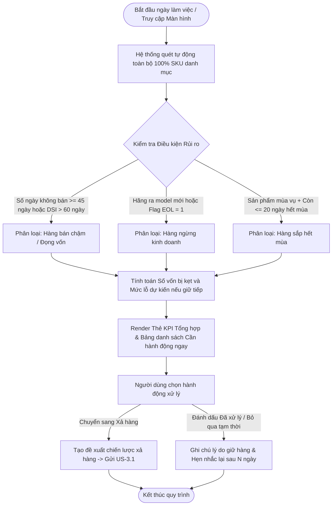
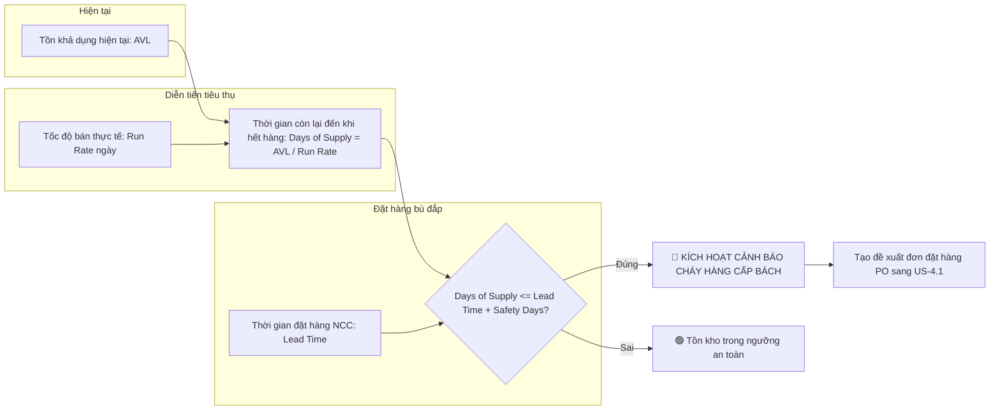

# TÀI LIỆU ĐẶC TẢ YÊU CẦU NGƯỜI SỬ DỤNG (USER REQUIREMENTS DOCUMENT - URD)
## HỆ THỐNG QUẢN LÝ KHO HÀNG ĐIỆN MÁY THÔNG MINH - STOCK SENSE
### PHÂN HỆ: CẦN XỬ LÝ HÔM NAY (ACTIONABLE DAILY ALERTS)
#### Bao gồm: US-2.1 & US-2.2

---

## BẢNG THEO DÕI THAY ĐỔI TÀI LIỆU (DOCUMENT REVISION HISTORY)

| Phiên bản | Ngày cập nhật | Tác giả | Trạng thái | Mô tả thay đổi |
| :--- | :--- | :--- | :--- | :--- |
| **1.0.0** | 08/11/2026 | Nhóm Phân tích Nghiệp vụ (BA Team) | Dự thảo (Draft) | Khởi tạo tài liệu đặc tả URD chi tiết cho Nhóm chức năng 2: Cần xử lý hôm nay (US-2.1 & US-2.2) |

---

## 1. TỔNG QUAN & PHẠM VI (INTRODUCTION & SCOPE)

### 1.1. Bối cảnh phân hệ
Trong ngành bán lẻ điện máy, hàng hóa có tốc độ biến động giá trị và suy giảm nhu cầu rất nhanh theo chu kỳ công nghệ và mùa vụ thời tiết (ví dụ: điều hòa bán chạy vào mùa hè từ tháng 4 đến tháng 8, quạt sưởi và bình nóng lạnh bán chạy vào mùa đông từ tháng 10 đến tháng 1). 
Đối với các hộ kinh doanh và cửa hàng điện máy cá thể (như Điện Máy Tuấn Hưng), chủ tiệm kiêm nhiệm nhiều vai trò nên không có thời gian rà soát hàng ngàn SKU mỗi ngày. Nếu không có hệ thống tự động sàng lọc và đưa ra các "việc cần làm ngay" (Action Items), cửa hàng sẽ đối mặt với 2 rủi ro tài chính nghiêm trọng:
1. **Ứ đọng vốn ở hàng bán chậm / hết mùa:** Hàng hóa nằm kho quá lâu bị mất giá, model mới của hãng ra mắt khiến model cũ trở thành hàng tồn chết (Dead Stock).
2. **Đứt gãy dòng tiền do cháy hàng (Stockout):** Hàng bán chạy hết đột ngột mà không có kế hoạch nhập bổ sung trước, dẫn đến mất khách hàng vào tay đối thủ và sụt giảm doanh thu.

### 1.2. Mục tiêu của phân hệ "Cần xử lý hôm nay"
Phân hệ đóng vai trò là "Trung tâm cảnh báo tác chiến hàng ngày" (Daily Action Center), giúp người quản lý:
- Tự động phát hiện và phân loại các SKU có dấu hiệu rủi ro cao: Hàng bán chậm (Slow-moving), Hàng hãng đã ngừng kinh doanh (Discontinued/EOL), Hàng trái mùa hoặc sắp kết thúc mùa vụ (End-of-Season).
- Cảnh báo sớm các mặt hàng có nguy cơ đứt hàng (Stockout Risk) dựa trên tốc độ tiêu thụ thực tế (Run-rate) và thời gian đặt hàng nhà cung cấp (Lead time).
- Giúp người quản lý ra quyết định xử lý dứt điểm chỉ trong 3-5 phút mỗi buổi sáng: Kích hoạt xả hàng, giảm giá hoặc tạo đơn đặt mua hàng bổ sung kịp thời.

### 1.3. Bảng thuật ngữ viết tắt (Glossary)

| Thuật ngữ | Tên đầy đủ / Định nghĩa | Giải thích nghiệp vụ |
| :--- | :--- | :--- |
| **DSI** | Days Sales of Inventory | Số ngày tồn kho trung bình để bán hết lượng hàng hiện tại: $\text{DSI} = \frac{\text{SOH}}{\text{Run Rate}}$. |
| **Run Rate** | Tốc độ bán bình quân ngày | Số lượng máy bán được trung bình mỗi ngày trong chu kỳ quan sát (thường là 7, 14 hoặc 30 ngày gần nhất). |
| **Dead Stock** | Tồn kho chết / Bán chậm nghiêm trọng | Các thiết bị không có bất kỳ giao dịch bán nào trong $\ge 60$ ngày hoặc $\text{DSI} > 90$ ngày. |
| **EOL / Discontinued** | End-of-Life / Ngừng sản xuất | Sản phẩm đã được hãng thông báo dừng sản xuất hoặc đã có model năm mới thay thế hoàn toàn. |
| **End-of-Season** | Sắp hết mùa vụ | Thiết bị phụ thuộc mùa thời tiết chuẩn bị bước vào giai đoạn nhu cầu thị trường giảm $\ge 70\%$. |
| **Lead Time** | Thời gian bổ sung hàng | Số ngày tính từ lúc phát lệnh đặt hàng đến khi hàng thực tế về cập kho (thường từ 2 - 5 ngày đối với đại lý điện máy). |
| **Safety Stock** | Tồn kho an toàn tối thiểu | Lượng hàng đệm cần có để đề phòng biến động đột biến: $\text{Safety Stock} = \text{Run Rate} \times \text{Safety Days}$. |

---

## 2. MA TRẬN PHÂN QUYỀN & VAI TRÒ NGƯỜI DÙNG (ROLES & PERMISSIONS)

| Mã vai trò | Tên vai trò | Trách nhiệm chính trong phân hệ Cần xử lý hôm nay | Quyền hạn trên US-2.1 (Bán chậm & Hết mùa) | Quyền hạn trên US-2.2 (Sắp cháy hàng) |
| :--- | :--- | :--- | :--- | :--- |
| **ROLE_OWNER** | Chủ cửa hàng / Giám đốc | Quyết định điều chỉnh giá xả, thanh lý hoặc duyệt kế hoạch nhập bổ sung | Toàn quyền (Xem vốn kẹt, duyệt đề xuất giảm giá, chuyển sang phân hệ Xả hàng) | Toàn quyền (Duyệt số lượng nhập, xem nhà cung cấp, duyệt PO) |
| **ROLE_WH_MGR** | Quản lý kho / Thủ kho | Kiểm tra số lượng thực tế, tình trạng máy (trưng bày, hộp móp), kiểm đếm Serial | Xem danh sách để kiểm tra vị trí lưu kho, đánh giá tình trạng ngoại quan hàng cũ | Xem danh sách để bố trí vị trí sẵn sàng đón hàng nhập bổ sung |
| **ROLE_SALES** | Nhân viên bán hàng / Thu ngân | Ưu tiên chào bán các mặt hàng được gắn cờ đẩy kho, tránh hứa hẹn hàng sắp hết | Xem danh sách SKU cần đẩy bán, chính sách hoa hồng thưởng thêm (nếu có) | Xem cảnh báo sắp hết hàng để chủ động báo khách đặt cọc trước |

---

## 3. ĐẶC TẢ CHI TIẾT USER STORY US-2.1

### 3.1. Tóm tắt User Story
* **Mã User Story:** `US-2.1`
* **Tên tính năng:** Cảnh báo hàng bán chậm, hàng ngừng bán và hàng sắp hết mùa
* **Người dùng (Actor):** Chủ cửa hàng / Nhân viên phụ trách thu mua
* **Tuyên bố yêu cầu:**
  > *Là một* Chủ cửa hàng / Nhân viên phụ trách thu mua,  
  > *Tôi muốn* hệ thống tự động chỉ ra các mặt hàng bán chậm, hàng đã ngừng kinh doanh hoặc các sản phẩm điện máy sắp hết mùa (ví dụ: máy lạnh vào mùa đông, quạt sưởi vào mùa hè),  
  > *Để* kịp thời đưa ra phương án điều chỉnh giá hoặc gom nhóm thanh lý, tránh tồn kho chết.

---

### 3.2. Sơ đồ luồng nghiệp vụ (Business Process Flow)



---

### 3.3. Điều kiện tiên quyết & Kết thúc (Pre-conditions & Post-conditions)
* **Điều kiện tiên quyết (Pre-conditions):**
  - Hệ thống đã có lịch sử bán hàng (`FACT_INVOICES`) tối thiểu 30 ngày để tính toán tốc độ bán (Run-rate).
  - Danh mục sản phẩm đã được gắn thuộc tính mùa vụ (`seasonality`: Mùa hè, Mùa đông, Quanh năm) và trạng thái vòng đời sản phẩm (`lifecycle_status`: Đang kinh doanh, Sắp ngừng, Ngừng kinh doanh).
* **Điều kiện kết thúc (Post-conditions):**
  - Người dùng nắm được danh sách chính xác các mặt hàng nguy hiểm nhất kèm số vốn đang bị "chôn chặt".
  - Có thể click một nút để chuyển toàn bộ thông tin sang **Phân hệ Gợi ý xả hàng (US-3.1)** mà không cần nhập lại dữ liệu thủ công.

---

### 3.4. Mô tả kịch bản thực hiện (Use Case Scenario)

#### A. Luồng chính (Happy Path)
1. **Bước 1:** Người dùng đăng nhập hệ thống, chọn menu **"Cần xử lý hôm nay"** $\rightarrow$ Thẻ tab **"Cảnh báo hàng chậm & Hết mùa"**.
2. **Bước 2:** Hệ thống tải dữ liệu và hiển thị 3 Thẻ chỉ số tổng quan ở phía trên:
   - *Tổng vốn kẹt ở hàng chậm:* Tổng giá trị vốn của các SKU thỏa mãn điều kiện cảnh báo.
   - *Số SKU bán chậm / Tồn chết:* Số lượng mã sản phẩm không bán được trong chu kỳ theo dõi.
   - *Số SKU sắp hết mùa:* Số lượng mã sản phẩm mùa vụ cần xả gấp trước khi sang mùa mới.
3. **Bước 3:** Hệ thống phân loại danh sách thành 3 nhóm rõ ràng với huy hiệu màu (Badge):
   - 🔴 **Tồn chết / Rất chậm:** $DSI > 90$ ngày hoặc $> 60$ ngày không có đơn bán.
   - 🟠 **Sắp hết mùa vụ:** Điều hòa/Quạt vào cuối tháng 8; Máy sưởi/Bình nóng lạnh vào cuối tháng 2.
   - 🟡 **Ngừng kinh doanh (EOL):** Hãng chuẩn bị dừng bảo hành linh kiện hoặc đã ra thế hệ mới.
4. **Bước 4:** Người dùng chọn xem một dòng sản phẩm cụ thể (ví dụ: *Điều hòa Panasonic 1.5HP Inverter* tồn 25 bộ, vốn đọng 300 triệu, đã bước sang mùa thu rét).
5. **Bước 5:** Người dùng nhấn nút hành động **"Đẩy sang Gợi ý Xả hàng"**. Hệ thống tự động chuyển thông tin sang phân hệ Xả hàng với cấu hình giảm giá đề xuất.

#### B. Luồng thay thế & Ngoại lệ (Alternative & Exception Flows)
* **AF-2.1.1 (Tạm hoãn cảnh báo):** Nếu chủ cửa hàng cố tình giữ lại một số sản phẩm (ví dụ: hàng mẫu trưng bày đại lý, hoặc giữ lại trả thưởng sau), người dùng chọn **"Giữ lại & Nhắc lại sau"**, chọn thời hạn (7 ngày, 14 ngày) và nhập lý do. Hệ thống sẽ tạm ẩn cảnh báo khỏi danh sách hôm nay.
* **EF-2.1.2 (Sản phẩm không có dữ liệu mùa vụ):** Nếu SKU chưa được cấu hình mùa vụ, hệ thống mặc định coi là sản phẩm "Quanh năm" và chỉ áp dụng tiêu chí số ngày tồn kho ($DSI$) để đánh giá bán chậm.

---

### 3.5. Quy tắc nghiệp vụ (Business Rules - US-2.1)

* **BR-2.1.1 (Công thức xác định Tốc độ bán bình quân Run-Rate):**
  $$\text{Run Rate (30d)} = \frac{\sum_{t=1}^{30} \text{Quantity Sold}_t}{30} \quad (\text{đơn vị: máy/ngày})$$
* **BR-2.1.2 (Công thức xác định Số ngày quay vòng tồn kho DSI):**
  $$\text{DSI} = \begin{cases} 
  \frac{\text{SOH}}{\text{Run Rate (30d)}}, & \text{nếu } \text{Run Rate} > 0 \\
  999, & \text{nếu } \text{Run Rate} = 0 \text{ và } \text{SOH} > 0 
  \end{cases}$$
* **BR-2.1.3 (Tiêu chí phân loại Hàng bán chậm / Tồn chết):**
  - **Mức độ 1 - Cảnh báo Chậm (Slow):** $45 < \text{DSI} \le 60$ ngày HOẶC từ 30 đến 44 ngày không có đơn phát sinh.
  - **Mức độ 2 - Tồn đọng nguy hiểm (Stagnant):** $60 < \text{DSI} \le 90$ ngày HOẶC từ 45 đến 59 ngày không có đơn phát sinh.
  - **Mức độ 3 - Tồn chết (Dead Stock):** $\text{DSI} > 90$ ngày HOẶC $\ge 60$ ngày không có bất kỳ giao dịch bán nào.
* **BR-2.1.4 (Quy tắc phát hiện Hàng sắp hết mùa End-of-Season):**
  Hệ thống đối chiếu ngày hiện tại với bảng cấu hình mùa vụ điện máy tại miền Bắc/miền Nam Việt Nam:
  - Nhóm Mùa Hè (Điều hòa, Quạt điều hòa, Tủ đông kem): Mùa cao điểm kết thúc vào **ngày 31/08**. Cảnh báo kích hoạt từ **ngày 01/08** (còn 30 ngày trước khi tắt mùa).
  - Nhóm Mùa Đông (Máy sưởi dầu, Quạt sưởi ceramic, Bình nước nóng gián tiếp): Mùa cao điểm kết thúc vào **ngày 28/02**. Cảnh báo kích hoạt từ **ngày 01/02**.
  - Nếu $\text{SOH} > (\text{Run Rate} \times \text{Số ngày còn lại của mùa})$, hệ thống tự động gán nhãn **"Sắp hết mùa - Thừa tồn dự kiến"**.

---

### 3.6. Tiêu chí nghiệm thu (Acceptance Criteria - Gherkin Syntax)

```gherkin
Feature: Cảnh báo hàng bán chậm, hàng ngừng bán và hàng sắp hết mùa (US-2.1)

  Scenario: Hệ thống cảnh báo sản phẩm không phát sinh đơn bán quá 60 ngày
    Given Sản phẩm "Tủ lạnh Side-by-side 600L" có SOH = 8 chiếc
    And Giao dịch bán hàng gần nhất của sản phẩm cách đây 65 ngày
    When Hệ thống chạy tiến trình quét dữ liệu đầu ngày
    Then Sản phẩm phải hiển thị trong nhóm "Tồn chết (Dead Stock)"
    And Hiển thị số ngày chưa bán là "65 ngày"
    And Hiển thị tổng vốn đang đọng = 8 * giá vốn của sản phẩm

  Scenario: Cảnh báo điều hòa tồn kho cao vào cuối tháng 8
    Given Ngày hiện tại của hệ thống là "15/08/2026"
    And Sản phẩm "Điều hòa Casper 9000BTU" thuộc nhóm hàng "Mùa hè" có SOH = 30 bộ
    And Tốc độ bán bình quân hiện tại là 0.5 bộ/ngày
    When Người dùng truy cập phân hệ "Cần xử lý hôm nay"
    Then Hệ thống phải gắn nhãn "Sắp hết mùa vụ" cho sản phẩm này
    And Hiển thị lượng tồn thừa dự kiến vượt quá mùa vụ = 30 - (0.5 * 16) = 22 bộ
```

---

### 3.7. Từ điển dữ liệu hiển thị (Data Dictionary - US-2.1)

| Tên trường (UI Label) | Mã thuộc tính | Kiểu dữ liệu | Nguồn dữ liệu | Ràng buộc / Ý nghĩa |
| :--- | :--- | :--- | :--- | :--- |
| **Mã sản phẩm** | `product_code` | Text | `DIM_PRODUCTS.product_code` | Mã SKU định danh |
| **Tên thiết bị** | `product_name` | Text | `DIM_PRODUCTS.product_name` | Tên đầy đủ kèm model |
| **Tồn kho (SOH)** | `stock_on_hand` | Integer | `DIM_PRODUCTS.stock_on_hand` | Số lượng máy vật lý trong kho |
| **Giá vốn** | `cost_price` | Currency | `DIM_PRODUCTS.cost_price` | Bảo mật theo vai trò (chỉ Role Owner xem được) |
| **Vốn đang kẹt** | `capital_stagnant` | Currency | Tính toán: `SOH * cost_price` | Tổng tiền vốn bị đọng |
| **Tốc độ bán ngày** | `run_rate_30d` | Decimal | Lịch sử bán 30 ngày | Số máy/ngày (lấy 2 chữ số thập phân) |
| **Số ngày tồn (DSI)** | `dsi_days` | Integer | Tính toán: `SOH / run_rate` | Số ngày dự kiến bán hết |
| **Ngày bán cuối** | `last_sale_date` | Date | `MAX(FACT_INVOICES.invoice_time)` | Ngày phát sinh đơn bán gần nhất |
| **Lý do rủi ro** | `risk_reason` | Enum/Badge | Phái sinh từ BR-2.1.3 & BR-2.1.4 | `Tồn chết > 60 ngày`, `Hết mùa hè`, `Hãng EOL` |
| **Hành động đề xuất** | `recommended_action` | Action Button | Gợi ý hệ thống | `[Đẩy sang Xả hàng]`, `[Giữ lại & Nhắc sau]` |

---

### 3.8. Phác thảo giao diện người dùng (UI Wireframe Concept - US-2.1)

```
+---------------------------------------------------------------------------------------------------------+
| [LOGO] STOCK SENSE - TRUNG TÂM CẢNH BÁO TÁC CHIẾN HÀNG NGÀY                  [Cập nhật: 08:00 Hôm nay]  |
+---------------------------------------------------------------------------------------------------------+
| TAB: [1. Cảnh báo Hàng chậm & Hết mùa (*)]   |   [2. Cảnh báo Sắp cháy hàng (Stockout)]                 |
|                                                                                                         |
| +---------------------+ +---------------------+ +---------------------+ +-----------------------------+ |
| | VỐN KẸT HÀNG CHẬM   | | SKU TỒN CHẾT (>60D) | | SKU SẮP HẾT MÙA     | | TỔNG MÃ CẦN XỬ LÝ NGAY      | |
| | 485.600.000 đ       | | 6 Sản phẩm          | | 4 Sản phẩm (Đ.Hòa)  | | 12 Mặt hàng                 | |
| +---------------------+ +---------------------+ +---------------------+ +-----------------------------+ |
|                                                                                                         |
| [Lọc Nhóm rủi ro: Tất cả v] [Ngành hàng: Tất cả v] [Sắp xếp: Vốn kẹt giảm dần v]   [Tìm kiếm SKU/Tên: Q] |
|---------------------------------------------------------------------------------------------------------|
| Mã SKU        | Tên sản phẩm               | Tồn | Vốn kẹt (đ)   | Bán cuối | DSI    | Phân loại rủi ro | Hành động           |
|---------------|----------------------------|-----|---------------|----------|--------|------------------|---------------------|
| TV-LG-OLED55  | Smart Tivi LG OLED 55C3    | 28  | 448.000.000 đ | 42 ngày  | 140 ng | 🔴 Tồn đọng nặng  | [👉 Đẩy sang Xả] [v]|
| DH-PA-1.5HP   | ĐH Panasonic Inverter 1.5HP| 25  | 300.000.000 đ | 18 ngày  | 125 ng | 🟠 Sắp hết mùa hè | [👉 Đẩy sang Xả] [v]|
| TL-SS-SBS600  | Tủ lạnh Samsung SideBySide | 16  | 192.000.000 đ | 68 ngày  | 999 ng | 🔴 Tồn chết >60d  | [👉 Đẩy sang Xả] [v]|
| QS-SN-03      | Quạt sưởi gốm Sunhouse     | 12  |  14.400.000 đ | 180 ngày | 999 ng | 🔴 Trái mùa hè    | [👉 Đẩy sang Xả] [v]|
|---------------------------------------------------------------------------------------------------------|
| [⚡ Chọn tất cả 12 SKU]   [ 👉 Chuyển toàn bộ danh sách đã chọn sang Chiến lược Xả hàng ]              |
+---------------------------------------------------------------------------------------------------------+
```

---

## 4. ĐẶC TẢ CHI TIẾT USER STORY US-2.2

### 4.1. Tóm tắt User Story
* **Mã User Story:** `US-2.2`
* **Tên tính năng:** Cảnh báo sản phẩm sắp thiếu hụt (cháy hàng)
* **Người dùng (Actor):** Nhân viên quản lý kho / Phụ trách mua hàng
* **Tuyên bố yêu cầu:**
  > *Là một* Nhân viên quản lý kho,  
  > *Tôi muốn* nhận diện ngay các sản phẩm điện máy có xu hướng sắp thiếu hụt trong kho dựa trên tốc độ bán thực tế,  
  > *Để* lập kế hoạch bổ sung hàng kịp thời, không để đứt gãy chuỗi cung ứng phục vụ khách hàng.

---

### 4.2. Sơ đồ dự báo thời điểm đứt hàng (Stockout Timeline Projection)



---

### 4.3. Phân cấp mức độ cảnh báo thiếu hụt hàng hóa

| Cấp độ cảnh báo | Biểu tượng | Điều kiện kích hoạt ($\text{Days of Supply}$) | Mức độ nguy cơ | Thời hạn hành động bắt buộc |
| :--- | :---: | :--- | :--- | :--- |
| **Cấp 1: Cháy hàng vật lý** | ⛔ | $\text{SOH} = 0$ hoặc $\text{AVL} \le 0$ | Đang mất doanh thu từng giờ, từ chối khách mua | Ngay lập tức trong 2 giờ |
| **Cấp 2: Nguy cơ tức thì** | 🔴 | $0 < \text{Days of Supply} \le \text{Lead Time}$ (thường $\le 2$ ngày) | Chắc chắn đứt hàng trước khi chuyến xe mới cập kho | Trong ngày hôm nay |
| **Cấp 3: Cần lên kế hoạch** | 🟡 | $\text{Lead Time} < \text{Days of Supply} \le \text{Lead Time} + 3$ ngày | Hàng sẽ chạm đáy an toàn trong tuần | Trong vòng 48 giờ tới |

---

### 4.4. Điều kiện tiên quyết & Kết thúc (Pre-conditions & Post-conditions)
* **Điều kiện tiên quyết (Pre-conditions):**
  - Tồn kho khả dụng ($\text{AVL} = \text{SOH} - \text{RES}$) đã được tính toán đồng bộ theo thời gian thực.
  - Mỗi nhóm nhà cung cấp đã có cấu hình thời gian giao hàng chuẩn (`lead_time_days`).
* **Điều kiện kết thúc (Post-conditions):**
  - Thủ kho và nhân viên mua hàng nhìn thấy chính xác số ngày còn lại trước khi cạn kho của từng SKU.
  - Có thể kích hoạt tạo nhanh **Yêu cầu nhập hàng (Purchase Request)** chuyển sang **Phân hệ Gợi ý nhập hàng (US-4.1)**.

---

### 4.5. Mô tả kịch bản thực hiện (Use Case Scenario)

#### A. Luồng chính (Happy Path)
1. **Bước 1:** Người dùng chọn tab **"Cảnh báo Sắp cháy hàng (Stockout)"** trong phân hệ Cần xử lý hôm nay.
2. **Bước 2:** Hệ thống hiển thị 4 Thẻ chỉ số thiếu hụt:
   - *Số SKU đã hết sạch (OOS):* Số mặt hàng có $\text{SOH} = 0$.
   - *Số SKU sắp đứt hàng trong 48h:* Số mặt hàng có $\text{Days of Supply} \le 2$ ngày.
   - *Doanh thu nguy cơ bị mất ước tính:* Dựa trên tốc độ bán $\times$ giá bán $\times$ số ngày đứt hàng.
   - *Số chuyến xe hàng đang về:* Số đơn PO đang chở hàng bù đắp trên đường.
3. **Bước 3:** Hệ thống hiển thị bảng danh sách các SKU được sắp xếp ưu tiên theo mức độ khẩn cấp (Cấp 1 $\rightarrow$ Cấp 2 $\rightarrow$ Cấp 3).
4. **Bước 4:** Đối với mỗi SKU sắp hết, hệ thống hiển thị chi tiết:
   - Tồn khả dụng hiện tại ($AVL$).
   - Số đơn khách đang chờ máy ($RES$).
   - Số lượng hàng đang trên đường về ($INC$) và ngày xe về dự kiến.
5. **Bước 5:** Nếu chưa có đơn nhập hàng bù đắp ($INC = 0$), người dùng bấm nút **"Lập đơn nhập bổ sung"** để chuyển thẳng thông tin SKU sang phân hệ Gợi ý nhập hàng (US-4.1).

#### B. Luồng thay thế & Ngoại lệ (Alternative & Exception Flows)
* **AF-2.2.1 (Hàng sắp hết nhưng đã có xe về kho hôm nay):** Nếu SKU có $\text{AVL} \le 2$ nhưng đã có đơn nhập hàng trạng thái `Đang vận chuyển` về tới trong ngày, hệ thống đổi màu badge sang **Xanh dương: "Đang về - Không lo đứt gãy"** kèm giờ xe tới dự kiến, giúp người dùng an tâm không đặt trùng đơn.
* **EF-2.2.2 (Sản phẩm mới bán, chưa đủ lịch sử tính Run-rate):** Với sản phẩm mới nhập dưới 7 ngày, hệ thống sẽ sử dụng tốc độ bán trung bình của các SKU cùng phân khúc/cùng nhóm hàng để đưa ra cảnh báo ban đầu, kèm ghi chú: *"Dự báo theo nhóm sản phẩm tương đương"*.

---

### 4.6. Quy tắc nghiệp vụ (Business Rules - US-2.2)

* **BR-2.2.1 (Công thức tính Số ngày còn lại trước khi hết hàng - Days of Supply):**
  $$\text{Days of Supply (DOS)} = \frac{\text{Available Stock (AVL)}}{\text{Run Rate (7d)}} \quad (\text{đơn vị: ngày})$$
  *Trong đó:* Ưu tiên sử dụng Run-Rate 7 ngày gần nhất để bắt kịp các đợt sốt hàng đột biến trong ngắn hạn.
* **BR-2.2.2 (Điểm đặt hàng lại tự động - Reorder Point ROP):**
  $$\text{ROP} = (\text{Run Rate} \times \text{Lead Time}) + \text{Safety Stock}$$
  - Khi $\text{Available Stock} + \text{In-Transit Stock} \le \text{ROP}$, hệ thống tự động đưa sản phẩm vào danh sách Cảnh báo cần nhập ngay.
* **BR-2.2.3 (Ước tính Doanh thu thất thoát tiềm năng - Lost Revenue Potential):**
  Nếu một sản phẩm bị cháy hàng ($\text{AVL} \le 0$) và chưa có hàng nhập về ($INC = 0$), hệ thống tính toán thiệt hại doanh thu mỗi ngày:
  $$\text{Daily Lost Revenue} = \text{Run Rate} \times \text{Sale Price}$$
  Chỉ số này được tổng hợp lên Thẻ KPI để thúc giục chủ doanh nghiệp duyệt nhập hàng nhanh chóng.

---

### 4.7. Tiêu chí nghiệm thu (Acceptance Criteria - Gherkin Syntax)

```gherkin
Feature: Cảnh báo sản phẩm sắp thiếu hụt (cháy hàng) (US-2.2)

  Scenario: Cảnh báo sản phẩm bán chạy sắp hết hàng trong 2 ngày tới
    Given Sản phẩm "Máy giặt Toshiba 9kg Inverter" có AVL = 4 chiếc
    And Tốc độ bán 7 ngày gần nhất là 2 chiếc/ngày
    And Thời gian nhập hàng từ nhà phân phối Lead Time = 3 ngày
    When Hệ thống kiểm tra điều kiện tồn kho lúc 08:00 sáng
    Then Sản phẩm phải được đưa vào danh sách cảnh báo "🔴 Nguy cơ đứt hàng tức thì"
    And Hiển thị số ngày bán còn lại DOS = 4 / 2 = 2.0 ngày (nhỏ hơn Lead Time 3 ngày)
    And Hiển thị nút gọi tắt "Lập đơn nhập bổ sung"

  Scenario: Không báo động giả nếu đã có PO đang trên đường về kho
    Given Sản phẩm "Tivi Sony 43 inch" có AVL = 1 chiếc
    And Đang có đơn nhập hàng PO-2026-008 với INC = 20 chiếc đang giao tới
    When Người dùng xem danh sách cảnh báo thiếu hàng
    Then Hệ thống phải hiển thị trạng thái "🔵 Xe đang trên đường về (20 chiếc)"
    And Không tính SKU này vào nhóm nguy cơ mất doanh thu
```

---

### 4.8. Từ điển dữ liệu hiển thị (Data Dictionary - US-2.2)

| Tên trường (UI Label) | Mã thuộc tính | Kiểu dữ liệu | Nguồn dữ liệu | Ràng buộc / Ý nghĩa |
| :--- | :--- | :--- | :--- | :--- |
| **Mã SKU** | `product_code` | Text | `DIM_PRODUCTS.product_code` | Mã sản phẩm |
| **Tên thiết bị** | `product_name` | Text | `DIM_PRODUCTS.product_name` | Tên model chi tiết |
| **Tồn khả dụng (AVL)** | `avl_stock` | Integer | Tính toán: `SOH - RES` | Lượng máy thực tế còn có thể bán |
| **Đang giữ đơn (RES)**| `res_stock` | Integer | Tổng từ các đơn giữ hàng | Số máy đã có cọc/đơn |
| **Hàng đang về (INC)** | `inc_stock` | Integer | `SUM(PURCHASE_ORDERS.quantity)` | Số máy trên xe đang chuyển về |
| **Tốc độ bán (7 ngày)**| `run_rate_7d` | Decimal | Lịch sử bán 7 ngày | Máy/ngày |
| **Ngày bán còn lại** | `days_of_supply` | Decimal | `AVL / run_rate_7d` | Số ngày trước khi cạn kho |
| **Mức độ khẩn cấp** | `urgency_level` | Enum/Badge | BR-4.3 | `⛔ Đã hết sạch`, `🔴 Đứt hàng trong 48h`, `🟡 Cần nhập` |
| **Thiệt hại dự kiến** | `estimated_lost_rev`| Currency | `run_rate * sale_price * lead_time` | Tiền doanh thu nguy cơ mất |

---

### 4.9. Phác thảo giao diện người dùng (UI Wireframe Concept - US-2.2)

```
+---------------------------------------------------------------------------------------------------------+
| [LOGO] STOCK SENSE - TRUNG TÂM CẢNH BÁO TÁC CHIẾN HÀNG NGÀY                  [Cập nhật: 08:00 Hôm nay]  |
+---------------------------------------------------------------------------------------------------------+
| TAB: [1. Cảnh báo Hàng chậm & Hết mùa]   |   [2. Cảnh báo Sắp cháy hàng (Stockout) (*)]                 |
|                                                                                                         |
| +---------------------+ +---------------------+ +---------------------+ +-----------------------------+ |
| | ĐÃ CHÁY HÀNG (OOS)  | | NGUY CƠ ĐỨT HÀNG 48H| | DOANH THU MẤT DỰ KIẾN| | ĐÃ CÓ XE BÙ ĐẮP ĐANG VỀ     | |
| | 4 Sản phẩm          | | 5 Sản phẩm          | | 42.500.000 đ / ngày | | 3 Đơn PO (47 chiếc)         | |
| +---------------------+ +---------------------+ +---------------------+ +-----------------------------+ |
|                                                                                                         |
| [Lọc Cấp độ: Tất cả v] [Hãng: Tất cả v] [Trạng thái xe về: Chưa có hàng về v]        [Tìm kiếm SKU/Tên: Q] |
|---------------------------------------------------------------------------------------------------------|
| Mã SKU        | Tên sản phẩm               | Khả dụng | Tốc độ/ngày | Còn bán | Hàng về (INC) | Mức độ cảnh báo | Hành động đề xuất   |
|---------------|----------------------------|----------|-------------|---------|---------------|-----------------|---------------------|
| DH-CS-09      | Điều hòa Casper 9000BTU    |    0     |  3.2 bộ     |  0 ngày | 15 bộ (Chiều) | 🔵 Đang về bù đắp| [Xem lộ trình xe]   |
| TV-CS-43      | Tivi Casper 43 inch FHD    |    0     |  1.5 máy    |  0 ngày |     0 bộ      | ⛔ Hết sạch - Mất k | [➕ Nhập hàng gấp]  |
| TL-AQ-180L    | Tủ lạnh Aqua 180L 2 cánh   |    0     |  1.1 máy    |  0 ngày |     0 bộ      | ⛔ Hết sạch - Mất k | [➕ Nhập hàng gấp]  |
| MG-TB-8KG     | Máy giặt Toshiba 8kg       |    2     |  1.8 máy    | 1.1 ngày|     0 bộ      | 🔴 Cháy trong 24h| [➕ Nhập hàng gấp]  |
| TV-SN-55X80K  | Tivi Sony 55 inch 4K       |    3     |  1.2 máy    | 2.5 ngày| 12 máy (Mai)  | 🟡 Chờ nhập thêm | [Xem đơn nhập PO]   |
|---------------------------------------------------------------------------------------------------------|
| [ ⚡ Tạo đề xuất nhập hàng gộp cho tất cả 4 SKU đang thiếu hụt trầm trọng ]                            |
+---------------------------------------------------------------------------------------------------------+
```

---

## 5. YÊU CẦU PHI CHỨC NĂNG (NON-FUNCTIONAL REQUIREMENTS - NFR)

### 5.1. Hiệu năng & Tốc độ đáp ứng (Performance)
* **NFR-PERF-01:** Tiến trình quét phân tích cảnh báo tự động chạy ngầm vào 06:00 sáng mỗi ngày và hoàn tất trong vòng $\le 30$ giây đối với cơ sở dữ liệu $10.000$ SKU.
* **NFR-PERF-02:** Thời gian tải bảng cảnh báo tác chiến ban ngày $\le 1.0$ giây; thời gian chuyển tab phản hồi tức thì $\le 200\text{ms}$.

### 5.2. Tính bảo mật & Phân quyền (Security & Privacy)
* **NFR-SEC-01:** Bảo vệ bí mật tài chính: Cột "Giá vốn" và "Tổng vốn kẹt" chỉ hiển thị cho tài khoản `ROLE_OWNER` và `ROLE_WH_MGR`. Tài khoản `ROLE_SALES` chỉ nhìn thấy số lượng tồn, số ngày bán chậm và gợi ý đẩy bán.
* **NFR-SEC-02:** Nhật ký thao tác (Audit Log) ghi nhận chi tiết khi người dùng bấm "Tạm hoãn cảnh báo" hoặc "Đẩy sang Xả hàng" nhằm phục vụ hậu kiểm.

### 5.3. Độ tin cậy & Tính sẵn sàng (Reliability)
* **NFR-REL-01:** Nếu mạng gián đoạn hoặc mất kết nối tới API nhà cung cấp, hệ thống phải sử dụng số liệu Lead time mặc định gần nhất trong CSDL để tính toán cảnh báo cháy hàng, không để màn hình bị treo hoặc báo lỗi crash.

---

## 6. DANH SÁCH CÂU HỎI THẢO LUẬN CHO KHÁCH HÀNG (OPEN QUESTIONS FOR CLIENT)

1. **Ngưỡng số ngày xác định hàng bán chậm (Slow-Moving Days):**
   - *Câu hỏi:* Cửa hàng mong muốn hệ thống đặt mốc mặc định bao nhiêu ngày không bán thì coi là hàng chậm? (Ví dụ: 45 ngày hay 60 ngày đối với Tivi lớn, 30 ngày đối với Phụ kiện/Đồ gia dụng nhỏ?).
2. **Quy tắc thời điểm đổi mùa giữa Miền Bắc & Miền Nam:**
   - *Câu hỏi:* Cửa hàng có áp dụng lịch mùa vụ cố định (ví dụ tháng 8 hết mùa nóng) hay cho phép người dùng tự điều chỉnh lịch mùa vụ theo diễn biến thời tiết thực tế từng năm?
3. **Cơ chế tự động gửi cảnh báo qua Zalo / Telegram:**
   - *Câu hỏi:* Chủ cửa hàng có nhu cầu nhận 1 bản tin vắn tóm tắt các cảnh báo khẩn cấp (Top 3 hàng cháy, Top 3 hàng đọng vốn) vào tin nhắn Zalo/Telegram cá nhân vào 08:00 sáng mỗi ngày không?

---
*Tài liệu URD phân hệ "Cần xử lý hôm nay" được biên soạn bởi Đội ngũ Phân tích Nghiệp vụ (BA) dự án Stock Sense.*
