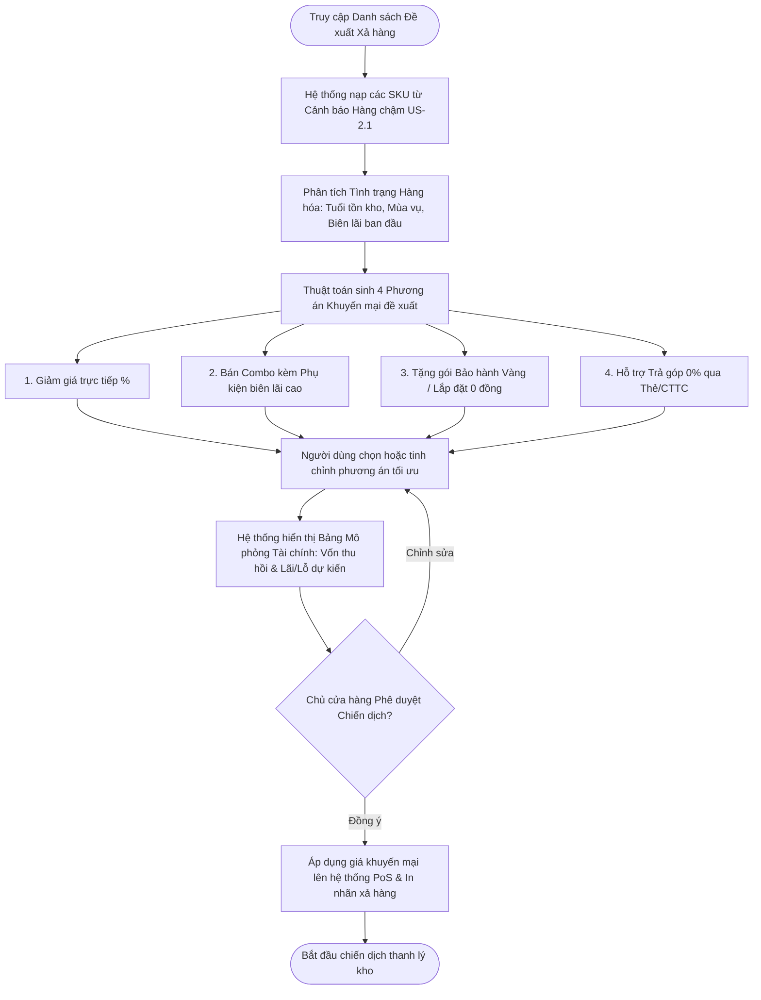
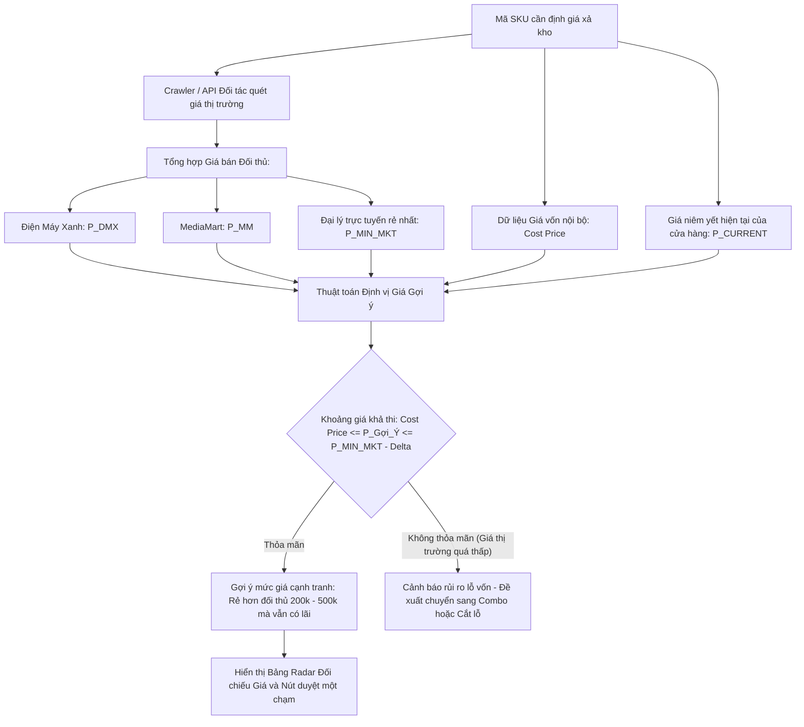

# TÀI LIỆU ĐẶC TẢ YÊU CẦU NGƯỜI SỬ DỤNG (USER REQUIREMENTS DOCUMENT - URD)
## HỆ THỐNG QUẢN LÝ KHO HÀNG ĐIỆN MÁY THÔNG MINH - STOCK SENSE
### PHÂN HỆ: GỢI Ý XẢ HÀNG (SMART CLEARANCE STRATEGY)
#### Bao gồm: US-3.1 & US-3.2

---

## BẢNG THEO DÕI THAY ĐỔI TÀI LIỆU (DOCUMENT REVISION HISTORY)

| Phiên bản | Ngày cập nhật | Tác giả | Trạng thái | Mô tả thay đổi |
| :--- | :--- | :--- | :--- | :--- |
| **1.0.0** | 08/11/2026 | Nhóm Phân tích Nghiệp vụ (BA Team) | Dự thảo (Draft) | Khởi tạo tài liệu đặc tả URD chi tiết cho Nhóm chức năng 3: Gợi ý xả hàng (US-3.1 & US-3.2) |

---

## 1. TỔNG QUAN & PHẠM VI (INTRODUCTION & SCOPE)

### 1.1. Bối cảnh nghiệp vụ
Trong kinh doanh bán lẻ điện máy, hàng hóa cồng kềnh (Tivi kích thước lớn, Tủ lạnh Side-by-Side, Máy giặt lồng ngang) chiếm diện tích kho bãi rất lớn và có chi phí lưu kho cao. Khi một thiết bị rơi vào tình trạng bán chậm hoặc chuẩn bị có model mới thay thế (EOL), việc giữ hàng lại để chờ bán đúng giá niêm yết ban đầu thường dẫn đến thiệt hại tài chính nặng nề hơn do:
- **Khấu hao công nghệ và tụt giá thị trường:** Các hãng lớn (Samsung, Sony, LG) liên tục giảm giá đề xuất cho model cũ khi ra mắt dòng mới.
- **Chi phí cơ hội của dòng vốn (Cost of Capital):** Vốn bị chôn vào 1 chiếc tivi tồn 30 triệu đồng trong 6 tháng làm mất đi cơ hội quay vòng nhập các dòng máy bán chạy ăn khách với biên lợi nhuận cao hơn.
- **Rủi ro hỏng hóc ngoại quan / lưu kho:** Hàng để lâu dễ bị ẩm mạch điện tử, móp vỏ thùng, rách tem bảo hành.

Tuy nhiên, việc xả hàng theo cảm tính (hạ giá ồ ạt hoặc giảm giá mù quáng) sẽ khiến cửa hàng bị lỗ vốn nặng nề hoặc phá vỡ cấu trúc giá. Phân hệ **Gợi ý xả hàng (Smart Clearance)** được xây dựng nhằm cung cấp giải pháp xả kho khoa học, cân bằng giữa tốc độ thu hồi vốn và tối đa hóa lợi nhuận còn lại.

### 1.2. Mục tiêu của phân hệ "Gợi ý xả hàng"
- **Đề xuất chiến lược xả hàng đa dạng (Multi-tier Clearance Tactics):** Thay vì chỉ giảm giá tiền mặt đơn thuần, hệ thống gợi ý 4 gói giải pháp linh hoạt: Giảm giá bậc thang, Bán gói Combo kèm phụ kiện biên lãi cao, Tặng gói bảo hành mở rộng/lắp đặt miễn phí, và Hỗ trợ lãi suất trả góp 0%.
- **Trí tuệ định giá đối chiếu thị trường (Market Price Intelligence):** Tự động thu thập và so sánh giá bán của các đối thủ lớn trên thị trường (Điện Máy Xanh, MediaMart, sàn TMĐT) để đưa ra mức giá thanh lý tối ưu: vừa rẻ hơn đối thủ để hút khách, vừa đảm bảo trên ngưỡng giá vốn (hoặc chạm ngưỡng cắt lỗ an toàn).
- **Mô phỏng tài chính trước khi chốt chiến dịch (Financial Impact Simulation):** Ước tính trước số tiền vốn sẽ thu hồi được và tổng lợi nhuận/thua lỗ dự kiến sau khi xả hết lượng hàng chỉ định.

### 1.3. Bảng thuật ngữ viết tắt (Glossary)

| Thuật ngữ | Tên đầy đủ / Định nghĩa | Giải thích nghiệp vụ |
| :--- | :--- | :--- |
| **Clearance Price** | Giá xả hàng đề xuất | Mức giá bán điều chỉnh nhằm kích cầu thanh lý nhanh: $P_{\text{clear}}$. |
| **Floor Price / Breakeven** | Giá sàn hòa vốn | Mức giá tối thiểu bằng giá vốn nhập kho: $P_{\text{floor}} = \text{Cost Price}$. |
| **Markdown %** | Tỷ lệ giảm giá thanh lý | Tỷ lệ phần trăm hạ giá so với giá niêm yết ban đầu: $\frac{P_{\text{old}} - P_{\text{clear}}}{P_{\text{old}}} \times 100\%$. |
| **Combo Bundling** | Bán kèm gói sản phẩm | Ghép thiết bị cần xả (lãi mỏng/hòa vốn) với phụ kiện/dịch vụ có biên lãi gộp cao (dây HDMI, giá treo tivi, ống đồng điều hòa). |
| **Recovery Capital** | Vốn lưu động thu hồi | Tổng tiền mặt thu về từ chiến dịch xả hàng để tái đầu tư vào các mặt hàng xoay vòng nhanh. |
| **Price Competitiveness**| Mức độ cạnh tranh giá | Chênh lệch giá bán của cửa hàng so với đối thủ rẻ nhất trên thị trường: $P_{\text{cửa hàng}} - P_{\text{đối thủ}}$. |

---

## 2. MA TRẬN PHÂN QUYỀN & VAI TRÒ NGƯỜI DÙNG (ROLES & PERMISSIONS)

| Mã vai trò | Tên vai trò | Trách nhiệm chính trong phân hệ Gợi ý xả hàng | Quyền hạn trên US-3.1 (Chiến lược xả) | Quyền hạn trên US-3.2 (Đối chiếu & Định giá) |
| :--- | :--- | :--- | :--- | :--- |
| **ROLE_OWNER** | Chủ cửa hàng / Giám đốc | Quyết định phê duyệt chiến dịch xả kho, chấp thuận mức giảm giá hoặc cắt lỗ | Toàn quyền (Phê duyệt chương trình, quyết định số lượng xả, xem biên lãi/lỗ) | Toàn quyền (Điều chỉnh giá gợi ý, phê duyệt giá sàn dưới vốn) |
| **ROLE_SALES** | Nhân viên kinh doanh / Bán hàng | Triển khai tư vấn combo và áp dụng mã giảm giá thanh lý cho khách | Xem danh sách hàng đang có chương trình xả, kịch bản chốt đơn combo | Xem giá bán xả và so sánh giá thị trường để thuyết phục khách mua |
| **ROLE_WH_MGR** | Quản lý kho / Thủ kho | Sắp xếp khu vực hàng thanh lý, gắn nhãn tem hàng xả kho, ưu tiên bốc hàng | Xem số lượng cần giải phóng để bố trí sắp xếp kho | Không yêu cầu quyền thao tác định giá |

---

## 3. ĐẶC TẢ CHI TIẾT USER STORY US-3.1

### 3.1. Tóm tắt User Story
* **Mã User Story:** `US-3.1`
* **Tên tính năng:** Nhận đề xuất chiến lược xả hàng thông minh
* **Người dùng (Actor):** Chủ cửa hàng điện máy
* **Tuyên bố yêu cầu:**
  > *Là một* Chủ cửa hàng điện máy,  
  > *Tôi muốn* hệ thống cung cấp danh sách sản phẩm cần xả kèm theo lý do cảnh báo cụ thể, lượng cần bán, phương án khuyến mại đề xuất và mức lãi dự kiến,  
  > *Để* cân đối giữa việc thu hồi vốn nhanh và tối ưu hóa lợi nhuận cuối cùng.

---

### 3.2. Sơ đồ luồng nghiệp vụ chiến lược xả hàng (Clearance Strategy Flowchart)



---

### 3.3. Các phương án khuyến mại đề xuất (4 Clearance Tactics)

| Mã chiến lược | Tên chiến lược | Cơ chế thực hiện | Trường hợp phù hợp nhất | Tác động tài chính |
| :--- | :--- | :--- | :--- | :--- |
| **TACTIC_DISCOUNT** | Giảm giá tiền mặt trực tiếp | Hạ giá bán niêm yết từ $5\% - 20\%$. Tạo hiệu ứng giá sốc xả kho | Hàng tồn chết lâu ngày ($>90$ ngày), model sắp EOL cần thoát vốn khẩn cấp | Biên lãi giảm mạnh, nhưng tiền mặt về ngay lập tức |
| **TACTIC_COMBO** | Bán Combo bù trừ lợi nhuận | Giữ giá thiết bị ở mức hòa vốn, ghép kèm phụ kiện/dịch vụ biên lãi $\ge 50\%$ (VD: Tivi tặng Giá treo + Dây HDMI cao cấp) | Hàng giá trị cao nhưng khó giảm giá sâu do cam kết giá sàn của Hãng | Bảo toàn lợi nhuận gộp nhờ lãi của phụ kiện bán kèm |
| **TACTIC_SERVICE** | Tặng dịch vụ gia tăng | Giữ nguyên giá bán, tặng kèm Gói công lắp đặt + Vệ sinh bảo dưỡng miễn phí 1 năm | Điều hòa nhiệt độ, Máy giặt, Máy lọc nước | Tận dụng sẵn công thợ của cửa hàng, chi phí bỏ ra thấp ($< 5\%$) |
| **TACTIC_FINANCE** | Hỗ trợ 0% Lãi suất | Cửa hàng chịu phí chuyển đổi trả góp ($2\% - 3\%$) thay cho khách | Các sản phẩm cao cấp (OLED TV, Tủ lạnh Side-by-side giá $>20$ triệu) | Kích thích khách hàng có thu nhập trung bình chốt đơn ngay |

---

### 3.4. Mô tả kịch bản thực hiện (Use Case Scenario)

#### A. Luồng chính (Happy Path)
1. **Bước 1:** Người dùng chọn menu **"Gợi ý xả hàng"** $\rightarrow$ Tab **"Chiến lược xả kho thông minh"**.
2. **Bước 2:** Hệ thống tải danh sách các sản phẩm đang được đề xuất xả hàng kèm:
   - Lý do đề xuất (ví dụ: *Tồn kho 28 chiếc, vốn đọng 448 triệu, đã 42 ngày chưa bán*).
   - Lượng cần xả mục tiêu (ví dụ: *Cần bán 20 chiếc để đưa tồn về mức an toàn 8 chiếc*).
   - Phương án khuyến mại đề xuất được hệ thống chấm điểm hiệu quả cao nhất (Best-fit).
3. **Bước 3:** Người dùng nhấp vào một SKU để xem chi tiết ma trận chiến lược.
4. **Bước 4:** Hệ thống hiển thị mô phỏng kết quả tài chính của 4 kịch bản:
   - *Kịch bản A (Giảm 10% tiền mặt):* Thu hồi 360 triệu vốn trong 15 ngày, lãi gộp còn lại 12 triệu.
   - *Kịch bản B (Combo tặng Giá treo + HDMI):* Thu hồi 380 triệu vốn trong 20 ngày, lãi gộp đạt 28 triệu.
   - *Kịch bản C (Trả góp 0%):* Thu hồi 400 triệu vốn trong 10 ngày, chi phí hỗ trợ phí 8 triệu.
5. **Bước 5:** Chủ cửa hàng chọn **Kịch bản B**, bấm nút **"Phê duyệt & Áp dụng ngay"**.
6. **Bước 6:** Hệ thống tự động cập nhật chính sách giá lên danh mục bán hàng tại quầy (PoS), sẵn sàng cho nhân viên áp dụng cho khách.

#### B. Luồng thay thế & Ngoại lệ (Alternative & Exception Flows)
* **AF-3.1.1 (Tùy chỉnh thủ công tỷ lệ giảm giá):** Chủ cửa hàng có thể tự gõ tỷ lệ giảm giá mong muốn (ví dụ giảm $12.5\%$). Hệ thống lập tức tính toán lại số tiền lãi/lỗ và cảnh báo màu đỏ nếu giá mới thấp hơn giá vốn nhập hàng.
* **EF-3.1.2 (Sản phẩm vướng cam kết giá sàn tối thiểu của Hãng - MAP Policy):** Nếu hãng sản xuất có quy định không được bán phá giá công khai dưới mức quy định, hệ thống sẽ tự động khóa phương án Giảm giá trực tiếp và chỉ cho phép chọn phương án **Combo Bán kèm** hoặc **Tặng Voucher quà tặng**.

---

### 3.5. Quy tắc nghiệp vụ (Business Rules - US-3.1)

* **BR-3.1.1 (Xác định Lượng hàng cần xả mục tiêu - Target Clearance Quantity):**
  $$\text{Clearance Quantity} = \max\left(0, \, \text{Stock On Hand} - \text{Max Safe Stock}\right)$$
  - Đối với hàng đã ngừng kinh doanh (EOL) hoặc hàng trái mùa: $\text{Clearance Quantity} = \text{Stock On Hand}$ (mục tiêu xả sạch 100%).
* **BR-3.1.2 (Công thức tính Vốn lưu động thu hồi dự kiến - Recovered Capital):**
  $$\text{Expected Recovered Capital} = \text{Clearance Quantity} \times \text{Cost Price}$$
* **BR-3.1.3 (Công thức tính Lợi nhuận gộp dự kiến sau xả kho - Projected Gross Profit):**
  $$\text{Projected Profit} = \sum \left( P_{\text{clear}} - \text{Cost Price} - \text{Promotion Cost} \right) \times \text{Clearance Quantity}$$
  *Trong đó:* $\text{Promotion Cost}$ là chi phí quà tặng combo, chi phí nhân công lắp đặt hoặc phí tài chính hỗ trợ trả góp.
* **BR-3.1.4 (Nguyên tắc cảnh báo chạm ngưỡng cắt lỗ):**
  - Nếu $P_{\text{clear}} < \text{Cost Price}$, hệ thống hiển thị hộp cảnh báo màu đỏ: **"CẢNH BÁO BÁN DƯỚI GIÁ VỐN - Dự kiến lỗ [Số tiền] đ. Bắt buộc Chủ cửa hàng (ROLE_OWNER) xác nhận duyệt"**.

---

### 3.6. Tiêu chí nghiệm thu (Acceptance Criteria - Gherkin Syntax)

```gherkin
Feature: Đề xuất chiến lược xả hàng thông minh (US-3.1)

  Scenario: Hệ thống tính toán chính xác lượng cần xả và vốn thu hồi
    Given Sản phẩm "Tivi LG OLED 55C3" có SOH = 28 chiếc
    And Ngưỡng tồn an toàn tối đa của SKU là 8 chiếc
    And Giá vốn nhập kho là 16.000.000 đ/chiếc
    When Người dùng mở phân hệ "Gợi ý xả hàng"
    Then Lượng hàng cần xả đề xuất phải bằng 28 - 8 = 20 chiếc
    And Vốn lưu động thu hồi dự kiến hiển thị là 20 * 16.000.000 = 320.000.000 đ

  Scenario: Hệ thống mô phỏng đúng kịch bản Combo phụ kiện
    Given Giá bán niêm yết của Tivi là 19.500.000 đ, Giá vốn là 16.000.000 đ
    When Chọn kịch bản "Bán Combo tặng Giá treo + Cáp HDMI" có chi phí quà tặng là 350.000 đ
    Then Lợi nhuận gộp trên mỗi máy xả được tính là (19.500.000 - 16.000.000 - 350.000) = 3.150.000 đ
    And Hiển thị trạng thái "Bảo toàn biên lợi nhuận dương"
```

---

### 3.7. Từ điển dữ liệu hiển thị (Data Dictionary - US-3.1)

| Tên trường (UI Label) | Mã thuộc tính | Kiểu dữ liệu | Nguồn dữ liệu | Ràng buộc / Ý nghĩa |
| :--- | :--- | :--- | :--- | :--- |
| **Mã SKU xả** | `product_code` | Text | `DIM_PRODUCTS.product_code` | Mã sản phẩm cần xả |
| **Tên sản phẩm** | `product_name` | Text | `DIM_PRODUCTS.product_name` | Tên thiết bị chi tiết |
| **Tồn kho hiện tại**| `stock_on_hand` | Integer | `DIM_PRODUCTS.stock_on_hand` | Lượng máy hiện có |
| **Lượng cần xả** | `clearance_qty` | Integer | Tính toán theo BR-3.1.1 | Mục tiêu giải phóng |
| **Vốn dự kiến thu** | `expected_recovery`| Currency | `clearance_qty * cost_price` | Vốn lưu động giải tỏa |
| **Chiến lược gợi ý**| `suggested_tactic` | Enum | Thuật toán phân loại | `Giảm giá trực tiếp`, `Bán Combo`, `Tặng công lắp`, `Trả góp 0%` |
| **Giá xả đề xuất** | `suggested_price` | Currency | BR-3.2 | Giá bán sau khuyến mại |
| **Lợi nhuận dự kiến**| `projected_profit`| Currency | BR-3.1.3 | Lãi/lỗ sau khi hoàn thành xả kho |
| **Trạng thái duyệt** | `approval_status` | Enum/Badge | Trạng thái chiến dịch | `Chờ duyệt`, `Đang triển khai`, `Đã hoàn thành` |

---

### 3.8. Phác thảo giao diện người dùng (UI Wireframe Concept - US-3.1)

```
+---------------------------------------------------------------------------------------------------------+
| [LOGO] STOCK SENSE - TRUNG TÂM QUẢN TRỊ XẢ KHO THÔNG MINH                                               |
+---------------------------------------------------------------------------------------------------------+
| TAB: [1. Đề xuất Chiến lược Xả kho (*)]   |   [2. So sánh Giá thị trường & Định giá Đối thủ]             |
|                                                                                                         |
| +---------------------+ +---------------------+ +---------------------+ +-----------------------------+ |
| | VỐN DỰ KIẾN THU HỒI | | LỢI NHUẬN GỘP KỲ VỌNG| | LƯỢNG MÁY CẦN XẢ    | | SỐ CHIẾN DỊCH ĐANG CHẠY     | |
| | 640.000.000 đ       | | + 48.500.000 đ      | | 42 Thiết bị         | | 2 Đang chạy | 3 Chờ duyệt   | |
| +---------------------+ +---------------------+ +---------------------+ +-----------------------------+ |
|                                                                                                         |
| Chi tiết sản phẩm đề xuất: [ Smart Tivi LG OLED 55C3 - Tồn: 28 bộ - Vốn kẹt: 448.000.000 đ ]            |
| Lý do: Hàng bán chậm (DSI = 140 ngày), model 2024 sắp ra mắt thay thế. Mục tiêu xả: 20 bộ.              |
|---------------------------------------------------------------------------------------------------------|
| Chọn phương án xả hàng:                                                                                 |
| ( ) Phương án 1: Giảm giá tiền mặt trực tiếp 10% (Giá mới: 17.550.000 đ) -> Thu vốn nhanh nhất        |
| (*) Phương án 2 (Đề xuất tối ưu): Combo Tivi + Giá treo xoay + HDMI 8K -> Lãi gộp cao nhất (+3.1tr/máy) |
| ( ) Phương án 3: Hỗ trợ 0% Lãi suất trả góp 12 tháng (Cửa hàng chịu phí 2.5%) -> Dễ chốt khách nhất    |
|                                                                                                         |
| BẢNG MÔ PHỎNG DÒNG TIỀN CHO PHƯƠNG ÁN 2:                                                                |
| - Doanh số dự kiến thu về (20 máy):  390.000.000 đ                                                      |
| - Vốn hàng hóa gốc thu hồi:         320.000.000 đ                                                      |
| - Chi phí quà tặng Combo đi kèm:      7.000.000 đ                                                      |
| - Lợi nhuận gộp thực thu:           + 63.000.000 đ (Tỷ suất lợi nhuận trên vốn: 19.6%)                  |
|---------------------------------------------------------------------------------------------------------|
| [ 💾 Lưu bản nháp ]              [ ❌ Hủy bỏ ]              [ 🚀 Phê duyệt & Áp dụng lên Quầy PoS ]     |
+---------------------------------------------------------------------------------------------------------+
```

---

## 4. ĐẶC TẢ CHI TIẾT USER STORY US-3.2

### 4.1. Tóm tắt User Story
* **Mã User Story:** `US-3.2`
* **Tên tính năng:** So sánh giá thị trường và đưa ra giá gợi ý
* **Người dùng (Actor):** Nhân viên kinh doanh / Cán bộ định giá / Chủ cửa hàng
* **Tuyên bố yêu cầu:**
  > *Là một* Nhân viên kinh doanh / Cán bộ định giá,  
  > *Tôi muốn* xem đối chiếu so sánh giá bán của sản phẩm định xả với đối thủ cạnh tranh trên thị trường kèm theo mức giá gợi ý từ hệ thống,  
  > *Để* đưa ra quyết định hạ giá bán cạnh tranh nhưng vẫn đảm bảo tính khả thi về mặt tài chính.

---

### 4.2. Sơ đồ cơ chế định giá đối chiếu thị trường (Pricing Benchmark Model)



---

### 4.3. Bảng đối chiếu cấu trúc giá thị trường điện máy

| Đối thủ tham chiếu | Vai trò thị trường | Đặc điểm giá | Độ tin cậy dữ liệu | Trọng số tham chiếu |
| :--- | :--- | :--- | :--- | :---: |
| **Điện Máy Xanh (ĐMX)** | Chuỗi siêu thị dẫn đầu | Giá niêm yết cao nhất, kèm nhiều khuyến mại và điểm bảo hành | Cao (Cập nhật hàng ngày) | 30% |
| **MediaMart / Pico** | Chuỗi điện máy truyền thống | Giá tầm trung, thường xuyên có chương trình xả kho cuối tuần | Cao | 30% |
| **Đại lý / Sàn TMĐT (Shopee Mall / Lazada Mall)** | Cạnh tranh về giá rẻ nhất | Giá bán sát đáy (thường chỉ chênh giá nhập 5% - 8%) | Trung bình | 40% |

---

### 4.4. Điều kiện tiên quyết & Kết thúc (Pre-conditions & Post-conditions)
* **Điều kiện tiên quyết (Pre-conditions):**
  - Hệ thống đã kết nối dữ liệu khảo sát giá thị trường (qua module Web Scraper định kỳ hoặc file cập nhật giá đối thủ hàng tuần).
  - Giá vốn (`cost_price`) của sản phẩm đã được xác thực trong CSDL.
* **Điều kiện kết thúc (Post-conditions):**
  - Người dùng có bức tranh toàn cảnh về mặt bằng giá thị trường.
  - Thiết lập được mức giá xả có tính sát thương cao (rẻ hơn chuỗi lớn) nhưng vẫn bảo vệ được nguồn vốn cửa hàng.

---

### 4.5. Mô tả kịch bản thực hiện (Use Case Scenario)

#### A. Luồng chính (Happy Path)
1. **Bước 1:** Người dùng chọn tab **"So sánh Giá thị trường & Định giá"** trong phân hệ Gợi ý xả hàng.
2. **Bước 2:** Chọn sản phẩm cần định giá (ví dụ: *Điều hòa Panasonic 1.5HP Inverter*).
3. **Bước 3:** Hệ thống hiển thị bảng so sánh đối đầu (Head-to-head comparison):
   - Giá hiện tại của cửa hàng Điện máy Anh Tâm: `14.200.000 đ`.
   - Giá Điện Máy Xanh đang bán: `14.890.000 đ`.
   - Giá MediaMart đang bán: `13.990.000 đ`.
   - Giá đại lý trực tuyến rẻ nhất: `13.500.000 đ`.
   - Giá vốn nhập kho của cửa hàng: `12.000.000 đ`.
4. **Bước 4:** Thuật toán tính toán và đề xuất **Mức giá gợi ý:** `13.290.000 đ` (thấp hơn MediaMart 700.000 đ và rẻ hơn đại lý rẻ nhất 210.000 đ, đồng thời vẫn lãi `1.290.000 đ/bộ`).
5. **Bước 5:** Người dùng đồng ý với mức giá gợi ý, nhấn **"Cập nhật giá xả hàng"**. Hệ thống lưu mức giá mới và áp dụng ngay lập tức.

#### B. Luồng thay thế & Ngoại lệ (Alternative & Exception Flows)
* **AF-4.2.1 (Điều chỉnh khoảng chênh lệch Delta mong muốn):** Người dùng có thể chỉnh thanh trượt: *"Tôi muốn rẻ hơn đối thủ rẻ nhất [ 100.000 đ / 200.000 đ / 500.000 đ ]"*. Hệ thống sẽ tự động nhảy số giá gợi ý tương ứng.
* **EF-4.2.2 (Giá thị trường thấp hơn cả giá vốn nhập kho):** Trường hợp đối thủ đại lý bán phá giá dưới cả giá vốn của cửa hàng (ví dụ họ xả cắt lỗ model cũ với giá `11.800.000 đ`, trong khi vốn của mình là `12.000.000 đ`), hệ thống bật đèn cảnh báo màu cam: *"Đối thủ đang bán dưới giá vốn của bạn. Khuyến nghị: Giữ giá 12.500.000 đ và tặng kèm gói vật tư ống đồng 500.000 đ để tránh lỗ tiền mặt"*.

---

### 4.6. Quy tắc nghiệp vụ (Business Rules - US-3.2)

* **BR-3.2.1 (Thuật toán xác định Mức giá gợi ý tối ưu - Recommended Clearance Price):**
  $$P_{\text{suggested}} = \max \left( \text{Cost Price} \times (1 + \text{Min Margin}), \, P_{\text{market\_min}} - \Delta \right)$$
  - Trong đó:
    - $\text{Min Margin}$: Tỷ suất lợi nhuận tối thiểu bảo vệ (mặc định $3\%$).
    - $P_{\text{market\_min}}$: Giá bán thấp nhất ghi nhận được từ đối thủ hợp lệ.
    - $\Delta$: Mức giảm tạo ưu thế cạnh tranh (mặc định $200.000$ đ đối với sản phẩm dưới 10 triệu; $500.000$ đ đối với sản phẩm trên 10 triệu).
* **BR-3.2.2 (Quy tắc làm tròn số giá bán tâm lý bán lẻ):**
  Mức giá gợi ý sau khi trừ chiết khấu phải được làm tròn theo quy ước giá tâm lý bán lẻ Việt Nam (kết thúc bằng đuôi `..90.000 đ` hoặc `..50.000 đ`). Ví dụ: tính toán ra `13.284.000 đ` sẽ được tự động làm tròn thành `13.290.000 đ`.
* **BR-3.2.3 (Chỉ số Lợi thế Cạnh tranh - Price Advantage Index):**
  $$\text{PAI} = \frac{P_{\text{market\_avg}} - P_{\text{suggested}}}{P_{\text{market\_avg}}} \times 100\%$$
  - $\text{PAI} \ge 5\%$: Đánh giá "Lợi thế cạnh tranh rất cao - Thu hút khách mạnh".
  - $0\% < \text{PAI} < 5\%$: Đánh giá "Cạnh tranh ngang bằng thị trường".
  - $\text{PAI} \le 0\%$: Đánh giá "Đắt hơn thị trường - Cần xem xét lại".

---

### 4.7. Tiêu chí nghiệm thu (Acceptance Criteria - Gherkin Syntax)

```gherkin
Feature: So sánh giá thị trường và đưa ra giá gợi ý (US-3.2)

  Scenario: Đề xuất giá xả rẻ hơn đối thủ nhưng vẫn đảm bảo có lãi
    Given Sản phẩm "Máy giặt LG lồng ngang 9kg" có Giá vốn = 7.600.000 đ
    And Giá bán tại Điện Máy Xanh là 9.490.000 đ
    And Giá đối thủ thấp nhất trên thị trường là 8.500.000 đ
    When Hệ thống tính toán giá xả hàng gợi ý với Delta = 300.000 đ
    Then Giá gợi ý hiển thị phải là 8.500.000 - 300.000 = 8.190.000 đ (làm tròn đuôi 90k)
    And Lợi nhuận trên mỗi chiếc bán ra là 8.190.000 - 7.600.000 = +590.000 đ
    And Chỉ số lợi thế cạnh tranh PAI hiển thị tích cực

  Scenario: Cảnh báo khi giá đối thủ thấp hơn giá vốn
    Given Sản phẩm có Giá vốn = 10.000.000 đ
    And Đối thủ trên sàn TMĐT đang xả kho cắt lỗ với giá 9.800.000 đ
    When Người dùng xem màn hình định giá đối chiếu
    Then Hệ thống phải cảnh báo "Đối thủ đang bán thấp hơn giá vốn nhập hàng"
    And Không tự động hạ giá gợi ý xuống dưới mức giá vốn 10.000.000 đ trừ khi được Chủ tiệm bấm xác nhận chấp nhận lỗ
```

---

### 4.8. Từ điển dữ liệu hiển thị (Data Dictionary - US-3.2)

| Tên trường (UI Label) | Mã thuộc tính | Kiểu dữ liệu | Nguồn dữ liệu | Ràng buộc / Ý nghĩa |
| :--- | :--- | :--- | :--- | :--- |
| **Mã SKU** | `product_code` | Text | `DIM_PRODUCTS.product_code` | Mã sản phẩm |
| **Giá niêm yết hiện tại**| `current_price` | Currency | `DIM_PRODUCTS.sale_price` | Giá bán cũ tại quầy |
| **Giá vốn** | `cost_price` | Currency | `DIM_PRODUCTS.cost_price` | Giá nhập kho (Bảo mật Role) |
| **Giá Điện Máy Xanh** | `price_dmx` | Currency | Dữ liệu khảo sát đối thủ | Giá chuỗi lớn |
| **Giá MediaMart** | `price_mediamart` | Currency | Dữ liệu khảo sát đối thủ | Giá chuỗi truyền thống |
| **Giá thị trường rẻ nhất**| `min_competitor_price`| Currency | `MIN(price_dmx, price_mm,...)` | Điểm tham chiếu dưới |
| **Giá xả gợi ý** | `suggested_clearance_price`| Currency | Tính toán theo BR-3.2.1 | Mức giá hệ thống khuyên bán |
| **Chênh lệch với đối thủ**| `price_difference` | Currency | `min_competitor_price - suggested` | Rẻ hơn bao nhiêu nghìn đồng |
| **Biên lãi gộp mới** | `new_gross_margin` | Percentage | `(suggested - cost) / suggested` | Tỷ lệ % lợi nhuận còn lại |

---

### 4.9. Phác thảo giao diện người dùng (UI Wireframe Concept - US-3.2)

```
+---------------------------------------------------------------------------------------------------------+
| [LOGO] STOCK SENSE - ĐỐI CHIẾU GIÁ THỊ TRƯỜNG & ĐỊNH GIÁ XẢ KHO                                          |
+---------------------------------------------------------------------------------------------------------+
| Sản phẩm đang chọn: [ ML-DK-FTKB25 - Điều hòa Daikin Inverter 1HP FTKB25 ]                              |
| Tồn kho: 45 bộ  |  Giá vốn: 8.200.000 đ  |  Giá niêm yết cũ: 10.500.000 đ                                |
|---------------------------------------------------------------------------------------------------------|
| BẢNG RADAR SO SÁNH GIÁ THỊ TRƯỜNG HIỆN TẠI (Khảo sát lúc 07:30 hôm nay):                                |
|                                                                                                         |
|   1. Điện Máy Xanh:         10.490.000 đ  (Bao công lắp)                                                |
|   2. MediaMart:              9.890.000 đ  (Chưa bao gồm vật tư)                                         |
|   3. Đại lý Điện máy Online: 9.350.000 đ  (Rẻ nhất thị trường hiện nay)                                 |
|                                                                                                         |
|   => Giá vốn cửa hàng mình:  8.200.000 đ  [Dư địa giảm tối đa: 1.150.000 đ]                            |
|---------------------------------------------------------------------------------------------------------|
| ĐỀ XUẤT ĐỊNH GIÁ XẢ KHO TỪ HỆ THỐNG:                                                                    |
|                                                                                                         |
| [ MỨC GIÁ GỢI Ý TỐI ƯU: 8.990.000 đ ]  (Đã làm tròn theo tâm lý giá lẻ)                                 |
|                                                                                                         |
| * So với Điện Máy Xanh:     Rẻ hơn 1.500.000 đ (-14.3%)  🔥 Lợi thế cạnh tranh vượt trội                |
| * So với Đại lý Online:     Rẻ hơn   360.000 đ (-3.8%)   ✅ Rẻ nhất toàn khu vực Cầu Giấy               |
| * Lợi nhuận gộp còn lại:    + 790.000 đ / bộ (Biên lãi: 8.8%)                                           |
| * Vốn thu hồi sau xả (30 bộ): 246.000.000 đ tiền mặt                                                    |
|                                                                                                         |
| Tùy chỉnh mức giá thủ công: [ 8.990.000 đ ]  [ Thanh trượt Delta: <--- [360k] ---> ]                    |
|---------------------------------------------------------------------------------------------------------|
| [ 🔄 Quét lại giá đối thủ ]    [ 📋 In bảng giá tem kệ ]    [ 🚀 Cập nhật giá mới lên hệ thống bán ]    |
+---------------------------------------------------------------------------------------------------------+
```

---

## 5. YÊU CẦU PHI CHỨC NĂNG (NON-FUNCTIONAL REQUIREMENTS - NFR)

### 5.1. Hiệu năng & Tốc độ tính toán (Performance)
* **NFR-PERF-01:** Thời gian tính toán mô phỏng dòng tiền cho 4 phương án khuyến mại phản hồi tức thì $\le 300\text{ms}$ khi người dùng thay đổi giá trị nhập liệu.
* **NFR-PERF-02:** Đồng bộ giá xả hàng mới sang phần mềm PoS bán hàng tại quầy trong vòng $\le 2$ giây sau khi Chủ tiệm phê duyệt.

### 5.2. Tính bảo mật & Kiểm soát (Security & Control)
* **NFR-SEC-01:** Phân quyền nghiêm ngặt: Chỉ tài khoản `ROLE_OWNER` mới có quyền phê duyệt các chiến dịch xả hàng có biên lợi nhuận $< 3\%$ hoặc bán dưới giá vốn.
* **NFR-SEC-02:** Mọi quyết định thay đổi giá xả kho phải được lưu trữ lịch sử kiểm toán (Audit Trail) bao gồm: Người duyệt, Giá cũ, Giá mới, Thời gian bắt đầu và kết thúc chương trình.

### 5.3. Tính chính xác dữ liệu (Data Precision)
* **NFR-DATA-01:** Giá gợi ý và số tiền doanh thu/lợi nhuận mô phỏng phải chuẩn xác tuyệt đối đến từng đồng (sai số $0\%$), không làm tròn làm lệch sổ sách kế toán.

---

## 6. DANH SÁCH CÂU HỎI THẢO LUẬN CHO KHÁCH HÀNG (OPEN QUESTIONS FOR CLIENT)

1. **Phương thức thu thập dữ liệu giá đối thủ:**
   - *Câu hỏi:* Cửa hàng hiện nay đang khảo sát giá đối thủ bằng cách nào? (Nhân viên tự đi tra cứu website rồi nhập tay vào bảng Excel hàng tuần, hay mong muốn Stock Sense tự động quét cào dữ liệu (Web Scraping) từ trang web Điện Máy Xanh / MediaMart?).
2. **Quy định về giá bán dưới giá vốn (Cắt lỗ):**
   - *Câu hỏi:* Trong trường hợp hàng tồn quá lâu bị lỗi thời hoàn toàn, chủ cửa hàng có chấp nhận mức giá bán xả thấp hơn giá vốn nhập hàng (chấp nhận lỗ tiền mặt để thu hồi phần vốn còn lại) không, hay hệ thống phải tuyệt đối chặn giá bán dưới giá vốn?
3. **In tem nhãn xả kho tại cửa hàng:**
   - *Câu hỏi:* Cửa hàng có nhu cầu in trực tiếp tem nhãn dán màu đỏ ("GIÁ XẢ KHO ĐẶC BIỆT") từ phần mềm ra máy in nhiệt tem mã vạch (Xprinter / Bixolon) để dán đè lên thùng máy trưng bày không?

---
*Tài liệu URD phân hệ "Gợi ý xả hàng" được biên soạn bởi Đội ngũ Phân tích Nghiệp vụ (BA) dự án Stock Sense.*
