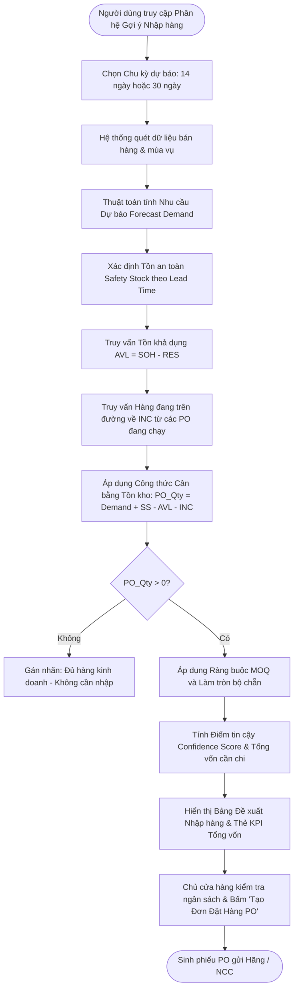

# TÀI LIỆU ĐẶC TẢ YÊU CẦU NGƯỜI SỬ DỤNG (USER REQUIREMENTS DOCUMENT - URD)
## HỆ THỐNG QUẢN LÝ KHO HÀNG ĐIỆN MÁY THÔNG MINH - STOCK SENSE
### PHÂN HỆ: GỢI Ý NHẬP HÀNG (SMART REPLENISHMENT & REORDERING)
#### Bao gồm: US-4.1

---

## BẢNG THEO DÕI THAY ĐỔI TÀI LIỆU (DOCUMENT REVISION HISTORY)

| Phiên bản | Ngày cập nhật | Tác giả | Trạng thái | Mô tả thay đổi |
| :--- | :--- | :--- | :--- | :--- |
| **1.0.0** | 08/11/2026 | Nhóm Phân tích Nghiệp vụ (BA Team) | Dự thảo (Draft) | Khởi tạo tài liệu đặc tả URD chi tiết cho Nhóm chức năng 4: Gợi ý nhập hàng (US-4.1) |

---

## 1. TỔNG QUAN & PHẠM VI (INTRODUCTION & SCOPE)

### 1.1. Bối cảnh nghiệp vụ
Trong mô hình kinh doanh cửa hàng điện máy cá thể (Sole Trader) như Điện Máy Tuấn Hưng, việc nhập hàng trước đây gần như phụ thuộc $100\%$ vào **kinh nghiệm cá nhân và trực giác chủ quan (Gut-feeling inventory bias)** hoặc chịu tác động từ **lời mời chào chiết khấu / thúc ép doanh số của nhân viên kinh doanh từ Hãng sản xuất**. Hậu quả thực tế là:
1. **Ôm hàng sai phân khúc:** Nhập quá nhiều các dòng máy cao cấp (Tivi OLED 55 - 65 inch, Tủ lạnh dung tích lớn trên 500L) vì mức chiết khấu trên từng máy hấp dẫn, nhưng nhu cầu khách địa phương thấp khiến vốn bị chôn chặt hàng trăm triệu đồng.
2. **Cháy hàng phân khúc bình dân:** Các dòng máy điều hòa 9.000 BTU giá rẻ, tivi 43 inch, máy giặt 8kg có nhu cầu cực lớn vào đầu mùa nhưng lại nhập quá dè dặt, dẫn đến hết hàng liên tục, khách bỏ sang chuỗi lớn khác mua.
3. **Quản lý dòng tiền nhập hàng (Cashflow Crunch):** Đặt hàng vượt quá khả năng thanh toán tiền mặt tức thời, dẫn đến nợ gối đầu nhà phân phối chịu lãi suất phạt.

Phân hệ **Gợi ý nhập hàng (Smart Replenishment)** được thiết kế để thay thế hoàn toàn thói quen nhập hàng cảm tính bằng **mô hình định lượng dữ liệu (Data-driven Reordering)**.

### 1.2. Mục tiêu của phân hệ "Gợi ý nhập hàng"
- **Dự báo nhu cầu khoa học (Demand Forecasting):** Kết hợp giữa tốc độ bán thực tế ngắn hạn (Run-rate 7 ngày / 30 ngày) và trọng số mùa vụ (Seasonality Factor) để tính toán chính xác nhu cầu thị trường trong chu kỳ 14 - 30 ngày tới.
- **Tính toán lượng nhập đề xuất chuẩn xác (Optimal PO Recommendation):** Áp dụng công thức dòng hàng 4 trụ cột cân bằng giữa Nhu cầu, Tồn kho an toàn, Tồn khả dụng hiện tại ($AVL$) và Lượng hàng đã đặt trước đang trên đường về ($INC$).
- **Độ tin cậy dự báo (Forecast Confidence Score):** Đánh giá mức độ chính xác và rủi ro của từng gợi ý (dựa trên phương sai bán hàng và độ ổn định của nguồn cung) để chủ tiệm tự tin ra quyết định.
- **Ràng buộc ngân sách & Quy cách đóng gói (Budget & Packaging Constraints):** Tự động làm tròn số lượng theo kiện/bộ (ví dụ: điều hòa chẵn bộ cục nóng + lạnh) và cảnh báo trần ngân sách vốn lưu động.

### 1.3. Bảng thuật ngữ viết tắt (Glossary)

| Thuật ngữ | Tên đầy đủ / Định nghĩa | Giải thích nghiệp vụ |
| :--- | :--- | :--- |
| **PO** | Purchase Order | Đơn đặt hàng gửi đến Nhà cung cấp / Hãng điện máy. |
| **Suggested PO Qty** | Lượng đặt hàng đề xuất | Số lượng thiết bị tối ưu cần đặt mua bổ sung: $Q_{\text{suggested}}$. |
| **Forecast Horizon** | Chu kỳ dự báo | Khoảng thời gian kinh doanh cần bù đắp hàng (thường là 14 ngày hoặc 30 ngày). |
| **Forecast Demand** | Nhu cầu dự báo | Tổng số lượng thiết bị dự kiến sẽ bán được trong chu kỳ tới. |
| **Lead Time (LT)** | Thời gian giao hàng | Số ngày từ lúc chốt đơn đặt hàng đến khi xe tải của hãng giao máy tới cửa hàng. |
| **Safety Stock (SS)** | Tồn kho an toàn | Lượng đệm tồn kho tối thiểu phòng ngừa biến động nhu cầu hoặc chậm trễ giao hàng. |
| **MOQ** | Minimum Order Quantity | Số lượng đặt hàng tối thiểu theo quy định của Nhà phân phối/Hãng. |
| **Confidence Score** | Điểm tin cậy dự báo | Tỷ lệ phần trăm thể hiện mức độ chính xác thống kê của thuật toán dự báo ($70\% - 99\%$). |

---

## 2. MA TRẬN PHÂN QUYỀN & VAI TRÒ NGƯỜI DÙNG (ROLES & PERMISSIONS)

| Mã vai trò | Tên vai trò | Trách nhiệm chính trong phân hệ Gợi ý nhập hàng | Quyền hạn trên US-4.1 |
| :--- | :--- | :--- | :--- |
| **ROLE_OWNER** | Chủ cửa hàng / Giám đốc | Quyết định ngân sách nhập hàng, ký duyệt đơn mua hàng (PO), thương lượng chiết khấu | Toàn quyền (Xem dự báo, điều chỉnh số lượng nhập, phê duyệt tạo đơn PO, xem tổng vốn phải chi) |
| **ROLE_WH_MGR** | Quản lý kho / Phụ trách mua | Rà soát nhu cầu, kiểm tra sức chứa mặt bằng kho, tạo phiếu đề xuất mua hàng | Xem số lượng đề xuất, kiểm tra diện tích kho còn trống, lập bản nháp đơn PO trình duyệt |
| **ROLE_SALES** | Nhân viên bán hàng | Phản ánh nhu cầu hỏi mua của khách hàng tại quầy | Không phân quyền truy cập phân hệ nhập hàng |

---

## 3. ĐẶC TẢ CHI TIẾT USER STORY US-4.1

### 3.1. Tóm tắt User Story
* **Mã User Story:** `US-4.1`
* **Tên tính năng:** Nhận đề xuất lượng nhập hàng chuẩn xác
* **Người dùng (Actor):** Phụ trách mua hàng / Chủ doanh nghiệp
* **Tuyên bố yêu cầu:**
  > *Là một* Phụ trách mua hàng / Chủ doanh nghiệp,  
  > *Tôi muốn* xem nhu cầu dự kiến của thị trường, lượng hàng có thể bán, hàng đang trên đường về, lượng nhập đề xuất và độ tin cậy cao của dự báo,  
  > *Để* tiến hành đặt hàng với nhà cung cấp với số lượng vừa đủ, không bị tồn kho dư thừa hay thiếu hụt vốn.

---

### 3.2. Sơ đồ luồng tính toán & phê duyệt nhập hàng (Replenishment Workflow)



---

### 3.3. Điều kiện tiên quyết & Kết thúc (Pre-conditions & Post-conditions)
* **Điều kiện tiên quyết (Pre-conditions):**
  - Dữ liệu bán hàng lịch sử (`FACT_INVOICES`) và dữ liệu đơn đặt hàng đang giữ (`FACT_ORDERS`) đã được cập nhật chính xác.
  - Các đơn hàng nhập từ trước (`PURCHASE_ORDERS`) được phân loại rõ ràng trạng thái: `Đang vận chuyển` hay `Đã nhập kho`.
  - Thông tin nhà cung cấp (`DIM_SUPPLIERS`) và thời gian giao hàng chuẩn (`lead_time_days`) được thiết lập đầy đủ.
* **Điều kiện kết thúc (Post-conditions):**
  - Người dùng có danh sách chính xác các mặt hàng cần nhập kèm số lượng tối ưu.
  - Một phiếu đặt mua hàng mới (`PURCHASE_ORDERS`) được khởi tạo ở trạng thái `Bản nháp (Draft)` hoặc `Đã đặt hàng (Ordered)`.
  - Lượng hàng đề xuất tự động cộng vào trường `In-Transit (INC)` sau khi PO được kích hoạt.

---

### 3.4. Mô tả kịch bản thực hiện (Use Case Scenario)

#### A. Luồng chính (Happy Path)
1. **Bước 1:** Người dùng chọn menu **"Gợi ý nhập hàng"** $\rightarrow$ Màn hình **"Đề xuất Đặt hàng Bổ sung"**.
2. **Bước 2:** Hệ thống mặc định chọn chu kỳ dự báo **14 ngày tiếp theo** và ngân sách vốn khả dụng hiện tại (ví dụ: tối đa `350.000.000 đ`).
3. **Bước 3:** Hệ thống hiển thị 4 Thẻ chỉ số tổng quan ở phía trên:
   - *Tổng số SKU cần nhập bổ sung:* Số mặt hàng có lượng thiếu hụt $> 0$.
   - *Tổng lượng máy đề xuất nhập:* Tổng số lượng thiết bị vật lý cần đặt.
   - *Tổng vốn đầu tư dự kiến:* Tổng số tiền cần chi trả cho nhà cung cấp: $\sum (Q_{\text{suggested}} \times \text{Cost Price})$.
   - *Độ tin cậy dự báo trung bình:* Điểm phần trăm độ tin cậy của thuật toán (ví dụ: $92.5\%$).
4. **Bước 4:** Hệ thống hiển thị bảng dữ liệu chi tiết các SKU cần nhập, sắp xếp theo mức độ cấp thiết và biên lợi nhuận. Mỗi dòng hiển thị đầy đủ phương trình cân bằng:
   - SKU *Điều hòa Casper 9000BTU*: Nhu cầu 14 ngày tới là $35$ bộ, Tồn an toàn $5$ bộ, Tồn khả dụng $AVL = 0$, Đang về $INC = 15$ bộ.
   - Lượng nhập đề xuất: $35 + 5 - 0 - 15 = 25$ bộ.
   - Độ tin cậy dự báo: $95\%$ (Mùa hè cao điểm, dữ liệu bán đều đặn).
   - Tổng tiền nhập: $25 \times 4.200.000 = 105.000.000$ đ.
5. **Bước 5:** Người dùng có thể điều chỉnh số lượng thủ công nếu muốn (ví dụ làm tròn lên 30 bộ để nhận thêm chiết khấu xe tải từ hãng).
6. **Bước 6:** Người dùng chọn các SKU muốn nhập, nhấn nút **"Tạo Đơn Mua Hàng (PO)"**.
7. **Bước 7:** Hệ thống gom các SKU theo từng Nhà cung cấp (Casper, Daikin, Sony) và sinh ra các đơn PO tương ứng.

#### B. Luồng thay thế & Ngoại lệ (Alternative & Exception Flows)
* **AF-4.1.1 (Vượt quá trần ngân sách vốn lưu động):** Nếu tổng giá trị nhập hàng đề xuất vượt quá ngân sách cài đặt của cửa hàng (ví dụ: đề xuất cần 450 triệu trong khi ngân sách chỉ có 300 triệu), hệ thống hiển thị thanh cảnh báo đỏ kèm tính năng **"Cắt giảm thông minh theo ưu tiên"**: Tự động ưu tiên giữ lại các SKU có biên lãi cao nhất và tốc độ xoay vòng nhanh nhất, cắt giảm số lượng của các mặt hàng giá trị lớn bán chậm.
* **AF-4.1.2 (Thay đổi chu kỳ dự báo sang 30 ngày):** Người dùng bấm chuyển sang chu kỳ **30 ngày**. Hệ thống tự động tính toán lại toàn bộ bảng đề xuất trong $\le 0.5$ giây.
* **EF-4.1.3 (Sản phẩm mùa vụ trái mùa bị gợi ý nhầm):** Nếu thuật toán phát hiện sản phẩm chuẩn bị hết mùa (ví dụ: quạt điều hòa vào giữa tháng 8), hệ thống sẽ gắn nhãn cảnh báo vàng: *"Sản phẩm sắp hết mùa - Khuyến nghị không nhập thêm hoặc chỉ nhập tối đa 3-5 ngày bán"*.

---

### 3.5. Quy tắc nghiệp vụ (Business Rules - US-4.1)

* **BR-4.1.1 (Công thức tính Nhu cầu Dự báo - Forecasted Demand):**
  $$\text{Demand}_{T} = \left( \text{Run Rate (14d)} \times W_{1} + \text{Run Rate (30d)} \times W_{2} \right) \times T \times S_{\text{factor}}$$
  - Trong đó:
    - $T$: Chu kỳ dự báo (14 hoặc 30 ngày).
    - $W_1 = 0.7$, $W_2 = 0.3$: Trọng số ưu tiên tốc độ bán gần nhất.
    - $S_{\text{factor}}$: Hệ số điều chỉnh mùa vụ ($S_{\text{factor}} = 1.3$ nếu vào mùa cao điểm; $0.7$ nếu vào cuối mùa; $1.0$ cho mặt hàng quanh năm).
* **BR-4.1.2 (Công thức tính Tồn kho An toàn - Safety Stock SS):**
  $$\text{Safety Stock} = \text{Run Rate} \times \text{Lead Time (days)} \times Z$$
  - Trong đó hệ số an toàn $Z = 1.28$ (tương đương mức độ đáp ứng dịch vụ $90\%$).
* **BR-4.1.3 (Công thức cân bằng Tồn kho tính Lượng nhập đề xuất):**
  $$Q_{\text{raw}} = \text{Demand}_{T} + \text{Safety Stock} - \text{Available Stock (AVL)} - \text{In-Transit Stock (INC)}$$
  $$Q_{\text{suggested}} = \max\left(0, \, Q_{\text{raw}}\right)$$
* **BR-4.1.4 (Quy tắc làm tròn theo Quy cách đóng gói & MOQ):**
  - Nếu sản phẩm có quy cách đóng gói (ví dụ: Điều hòa phải bán cả bộ Cục nóng + Cục lạnh; Đèn sưởi đóng thùng 4 chiếc): $Q_{\text{final}}$ được làm tròn lên bội số gần nhất của quy cách đóng gói.
  - Nếu $0 < Q_{\text{final}} < \text{MOQ}$, hệ thống tự động làm tròn lên bằng $\text{MOQ}$ kèm thông báo chú thích.
* **BR-4.1.5 (Công thức tính Điểm tin cậy dự báo - Confidence Score):**
  $$\text{Confidence Score} = \max\left(50\%, \, 100\% - (\text{CV} \times 100\%)\right)$$
  - Trong đó $\text{CV} = \frac{\sigma}{\mu}$ là hệ số biến thiên doanh số ngày trong 30 ngày qua.
  - Doanh số bán càng đều đặn thì điểm tin cậy càng cao (tiệm cận $95\% - 99\%$). Nếu doanh số thất thường lúc bán được 5 máy lúc 10 ngày không bán thì điểm tin cậy giảm về $60\% - 70\%$.

---

### 3.6. Tiêu chí nghiệm thu (Acceptance Criteria - Gherkin Syntax)

```gherkin
Feature: Nhận đề xuất lượng nhập hàng chuẩn xác (US-4.1)

  Scenario: Tính toán chính xác số lượng nhập đề xuất theo phương trình cân bằng
    Given Sản phẩm "Máy giặt Casper 8.5kg" có:
      | Nhu cầu dự báo 14 ngày (Demand) | 20 chiếc |
      | Tồn an toàn (Safety Stock)      |  4 chiếc |
      | Tồn khả dụng (AVL)              |  2 chiếc |
      | Hàng đang trên đường về (INC)   |  5 chiếc |
    When Hệ thống chạy công thức tính toán lượng nhập đề xuất
    Then Lượng nhập đề xuất Q_suggested phải bằng 20 + 4 - 2 - 5 = 17 chiếc
    And Tổng vốn nhập tương ứng được tính bằng 17 * Giá vốn

  Scenario: Không đề xuất nhập hàng nếu hàng đang về đã đủ đáp ứng nhu cầu
    Given Sản phẩm "Tivi Sony 55 inch" có:
      | Nhu cầu dự báo + Tồn an toàn | 15 chiếc |
      | Tồn khả dụng (AVL)            |  3 chiếc |
      | Hàng đang về (INC)            | 15 chiếc |
    When Hệ thống tính toán lượng nhập
    Then Lượng nhập đề xuất phải bằng 0 chiếc
    And Trạng thái SKU hiển thị "Đã đủ cơ số hàng - Không cần nhập thêm"

  Scenario: Tự động gom đơn PO theo Nhà cung cấp
    Given Người dùng chọn duyệt 5 SKU (gồm 3 SKU Daikin và 2 SKU Casper)
    When Người dùng nhấn "Tạo Đơn Đặt Hàng PO"
    Then Hệ thống phải tự động sinh ra đúng 2 đơn PO riêng biệt: 1 PO cho Daikin và 1 PO cho Casper
    And Mỗi đơn PO chứa đúng các dòng sản phẩm và số lượng tương ứng
```

---

### 3.7. Từ điển dữ liệu hiển thị (Data Dictionary - US-4.1)

| Tên trường (UI Label) | Mã thuộc tính | Kiểu dữ liệu | Nguồn dữ liệu | Ràng buộc / Ý nghĩa |
| :--- | :--- | :--- | :--- | :--- |
| **Mã SKU** | `product_code` | Text | `DIM_PRODUCTS.product_code` | Khóa chính sản phẩm |
| **Tên sản phẩm** | `product_name` | Text | `DIM_PRODUCTS.product_name` | Model và quy cách máy |
| **Nhà cung cấp** | `supplier_name` | Text | `DIM_SUPPLIERS.supplier_name` | Đơn vị giao hàng |
| **Nhu cầu dự kiến** | `forecast_demand` | Integer | Tính toán theo BR-4.1.1 | Lượng máy dự kiến bán |
| **Tồn khả dụng (AVL)** | `avl_stock` | Integer | `SOH - RES` | Hàng sẵn có bán được |
| **Hàng đang về (INC)** | `inc_stock` | Integer | `SUM(PO.qty)` | Hàng trên đường về |
| **Tồn an toàn (SS)** | `safety_stock` | Integer | Tính toán theo BR-4.1.2 | Lượng đệm an toàn |
| **Lượng nhập đề xuất** | `suggested_qty` | Integer | Tính toán theo BR-4.1.3 | Số máy cần đặt |
| **Độ tin cậy** | `confidence_pct` | Percentage | Tính toán theo BR-4.1.5 | $70\% - 99\%$ |
| **Đơn giá vốn** | `cost_price` | Currency | `DIM_PRODUCTS.cost_price` | Giá nhập dự kiến |
| **Thành tiền dự toán** | `total_cost` | Currency | `suggested_qty * cost_price` | Vốn cần chuẩn bị |

---

### 3.8. Phác thảo giao diện người dùng (UI Wireframe Concept - US-4.1)

```
+---------------------------------------------------------------------------------------------------------+
| [LOGO] STOCK SENSE - GỢI Ý NHẬP HÀNG & TỰ ĐỘNG HÓA MUA HÀNG (PO)              [Ngân sách: 350.000.000 đ]|
+---------------------------------------------------------------------------------------------------------+
| Chu kỳ dự báo: [ (*) 14 Ngày tiếp theo ]  [ ( ) 30 Ngày tiếp theo ]           [ Lọc Nhà Cung Cấp: Tất cả v] |
|                                                                                                         |
| +---------------------+ +---------------------+ +---------------------+ +-----------------------------+ |
| | SKU CẦN NHẬP BỔ SUNG| | TỔNG SỐ LƯỢNG MÁY   | | TỔNG VỐN DỰ TOÁN    | | ĐỘ TIN CẬY TRUNG BÌNH       | |
| | 6 Mặt hàng          | | 58 Thiết bị         | | 284.500.000 đ       | | 94.2% (Độ chính xác cao)    | |
| +---------------------+ +---------------------+ +---------------------+ +-----------------------------+ |
| [Thanh tiến trình ngân sách: [===============>--------] Đã dùng 284.5 tr / 350 tr (Còn dư: 65.5 tr)]    |
|---------------------------------------------------------------------------------------------------------|
| [x] Chọn | Mã SKU       | Tên sản phẩm           | Nhu cầu | Khả dụng | Đang về | Đề xuất | Đơn giá vốn   | Thành tiền    | Tin cậy |
|----------|--------------|------------------------|---------|----------|---------|---------|---------------|---------------|---------|
| [x]      | DH-CS-09     | ĐH Casper 9000BTU Invert|   35    |    0     |   15    | [ 20 ]  |  4.200.000 đ  |  84.000.000 đ |   96%   |
| [x]      | TV-CS-43     | Tivi Casper 43 inch FHD|   20    |    1     |    0    | [ 19 ]  |  4.500.000 đ  |  85.500.000 đ |   94%   |
| [x]      | TL-AQ-180L   | Tủ lạnh Aqua 180L      |   12    |    0     |    0    | [ 12 ]  |  3.800.000 đ  |  45.600.000 đ |   92%   |
| [x]      | MG-TB-8KG    | Máy giặt Toshiba 8kg   |   10    |    2     |    0    | [  8 ]  |  4.800.000 đ  |  38.400.000 đ |   95%   |
| [ ]      | TV-SN-55X80K | Tivi Sony 55 inch 4K   |    8    |    3     |   12    | [  0 ]  | 12.500.000 đ  |          0 đ  |   90%   |
|---------------------------------------------------------------------------------------------------------|
| Đang chọn 4 SKU | Tổng tiền: 253.500.000 đ | Dự kiến tạo: 3 Đơn đặt hàng PO riêng biệt                  |
| [ ➕ Thêm SKU thủ công ]   [ 🔄 Tính toán lại ]   [ 🚀 TẠO ĐƠN ĐẶT HÀNG (PO) GỬI NHÀ PHÂN PHỐI ]         |
+---------------------------------------------------------------------------------------------------------+
```

---

## 4. YÊU CẦU PHI CHỨC NĂNG (NON-FUNCTIONAL REQUIREMENTS - NFR)

### 4.1. Hiệu năng & Tốc độ đáp ứng (Performance)
* **NFR-PERF-01:** Thời gian chạy toàn bộ thuật toán tính toán lượng nhập cho toàn bộ danh mục hàng hóa $\le 1.2$ giây.
* **NFR-PERF-02:** Thao tác chuyển đổi giữa chu kỳ 14 ngày và 30 ngày hiển thị kết quả ngay tức khắc $\le 400\text{ms}$.

### 4.2. Tính bảo mật & Phân quyền (Security & Control)
* **NFR-SEC-01:** Quyền ký duyệt và ban hành đơn đặt hàng nhà cung cấp (`PURCHASE_ORDERS`) chỉ được cấp cho tài khoản `ROLE_OWNER`. Tài khoản quản lý kho chỉ có quyền tạo bản nháp đề xuất.
* **NFR-SEC-02:** Dữ liệu đơn giá vốn nhập và chiết khấu thương mại của từng hãng phải được mã hóa bảo mật, không để nhân viên bán hàng tiếp cận.

### 4.3. Tính toàn vẹn dữ liệu (Data Integrity)
* **NFR-DATA-01:** Khi đơn PO được phê duyệt sang trạng thái `Đang vận chuyển`, hệ thống phải tự động cập nhật ngay lập tức vào biến số $INC$ của bảng dòng hàng để tránh việc người khác đặt trùng lặp đơn hàng.

---

## 5. DANH SÁCH CÂU HỎI THẢO LUẬN CHO KHÁCH HÀNG (OPEN QUESTIONS FOR CLIENT)

1. **Chu kỳ đặt hàng cố định với các Hãng lớn:**
   - *Câu hỏi:* Cửa hàng thường đặt hàng theo ngày phát sinh nhu cầu (hết là đặt ngay) hay có lịch gom đơn cố định trong tuần? (Ví dụ: Casper đặt vào Thứ 2 và Thứ 5; Daikin đặt vào Thứ 4 hàng tuần?).
2. **Quy định hạn mức công nợ với Nhà phân phối:**
   - *Câu hỏi:* Cửa hàng có muốn hệ thống theo dõi hạn mức công nợ tối đa với từng hãng (ví dụ: Nợ nhà phân phối Casper tối đa 200 triệu, nợ Daikin tối đa 300 triệu) để cảnh báo khi đơn PO mới vượt hạn mức tín dụng không?
3. **Cơ chế gửi đơn PO tự động:**
   - *Câu hỏi:* Khi bấm "Tạo đơn đặt hàng PO", chủ tiệm muốn hệ thống tự động xuất file Excel theo mẫu của hãng và gửi email/Zalo thẳng cho sale phụ trách của hãng, hay chỉ lưu nội bộ trên hệ thống Stock Sense?

---
*Tài liệu URD phân hệ "Gợi ý nhập hàng" được biên soạn bởi Đội ngũ Phân tích Nghiệp vụ (BA) dự án Stock Sense.*
