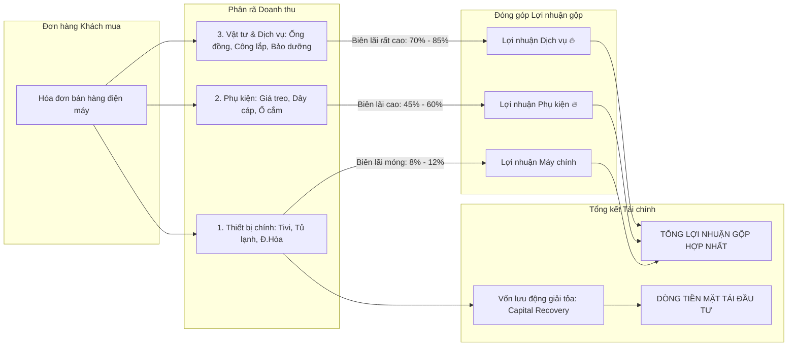

# TÀI LIỆU ĐẶC TẢ YÊU CẦU NGƯỜI SỬ DỤNG (USER REQUIREMENTS DOCUMENT - URD)
## HỆ THỐNG QUẢN LÝ KHO HÀNG ĐIỆN MÁY THÔNG MINH - STOCK SENSE
### PHÂN HỆ: HIỆU QUẢ KINH DOANH & THU HỒI VỐN (BUSINESS PERFORMANCE & CAPITAL RECOVERY)
#### Bao gồm: US-6.1

---

## BẢNG THEO DÕI THAY ĐỔI TÀI LIỆU (DOCUMENT REVISION HISTORY)

| Phiên bản | Ngày cập nhật | Tác giả | Trạng thái | Mô tả thay đổi |
| :--- | :--- | :--- | :--- | :--- |
| **1.0.0** | 08/11/2026 | Nhóm Phân tích Nghiệp vụ (BA Team) | Dự thảo (Draft) | Khởi tạo tài liệu đặc tả URD chi tiết cho Nhóm chức năng 6: Hiệu quả kinh doanh (US-6.1) |

---

## 1. TỔNG QUAN & PHẠM VI (INTRODUCTION & SCOPE)

### 1.1. Bối cảnh nghiệp vụ
Trong ngành bán lẻ điện máy, một nghịch lý kinh doanh rất phổ biến là: **"Doanh số hàng chục tỷ nhưng lợi nhuận thực tế và tiền mặt trong túi không thấy đâu"**. Nguyên nhân cốt lõi xuất phát từ cấu trúc biên lợi nhuận phân kỳ của các nhóm sản phẩm:
- **Thiết bị chính (Core Hardware):** Tivi, Tủ lạnh, Máy giặt, Điều hòa có giá trị lớn (từ 8 đến 40 triệu đồng/máy), nhưng biên lợi nhuận gộp cực mỏng (chỉ dao động từ $6\% - 12\%$). Nếu tính thêm chi phí vận chuyển, công thợ lắp đặt và rủi ro lưu kho, việc chỉ bán máy đơn thuần thường mang lại lợi nhuận rất khiêm tốn.
- **Sản phẩm & Dịch vụ bán kèm (Attach-rate Products & Services):** Phụ kiện (giá treo tivi, chân đế chống rung, dây HDMI, ổ cắm chống sét), vật tư lắp đặt (ống đồng, dây điện, át tô mát, giá đỡ cục nóng), và các gói dịch vụ gia tăng (bảo hành mở rộng, vệ sinh bảo dưỡng định kỳ) có giá trị đơn lẻ nhỏ hơn nhưng biên lợi nhuận gộp cực cao (từ $40\% - 75\%$).
- **Đánh giá hiệu quả chiến dịch xả kho:** Khi triển khai các đợt thanh lý xả kho (từ US-3.1), nếu chỉ nhìn vào việc giảm giá máy chính thì tưởng như "bán hòa vốn hoặc bán lỗ". Nhưng nếu tính tổng thể cả lượng vốn tiền mặt thu hồi được để xoay vòng cộng với lợi nhuận từ các sản phẩm phụ kiện bán kèm, chiến dịch đó lại thành công rực rỡ về mặt tài chính.

Phân hệ **Hiệu quả kinh doanh (Business Performance)** được thiết kế để mang lại cho Chủ doanh nghiệp một bức tranh tài chính toàn diện, minh bạch và chính xác đến từng đồng.

### 1.2. Mục tiêu của phân hệ "Hiệu quả kinh doanh"
- **Đo lường Vốn lưu động thực tế thu hồi (Actual Capital Recovery Tracking):** Thống kê số lượng máy tồn đã giải phóng và tổng số tiền mặt thực tế đã thu hồi về tài khoản cửa hàng sau các chương trình xử lý hàng chậm / xả kho.
- **Đo lường Doanh thu & Tỷ lệ bán kèm (Attach-Rate & Cross-sell Performance):** Phân tích chi tiết tỷ lệ gắn kèm phụ kiện trên từng đơn hàng thiết bị chính (bao nhiêu % khách mua tivi mua thêm giá treo; bao nhiêu % khách mua điều hòa mua thêm gói bảo dưỡng).
- **Phân rã đóng góp lợi nhuận (Profitability Waterfall Breakdown):** Tách bạch rõ ràng lợi nhuận đến từ: Thiết bị chính, Phụ kiện, Vật tư lắp đặt, và Tiền công kỹ thuật, giúp chủ cửa hàng biết chính xác bộ phận nào đang nuôi sống doanh nghiệp.
- **Đánh giá hiệu suất nhân sự và chiến dịch (Campaign & Staff ROI):** Đánh giá mức độ thành công của các quyết định nhập/xả hàng và tính toán tiền thưởng hoa hồng xứng đáng cho nhân viên bán hàng/kỹ thuật.

### 1.3. Bảng thuật ngữ viết tắt (Glossary)

| Thuật ngữ | Tên đầy đủ / Định nghĩa | Giải thích nghiệp vụ |
| :--- | :--- | :--- |
| **Attach Rate** | Tỷ lệ bán kèm | Tỷ lệ phần trăm đơn hàng có chứa ít nhất 1 sản phẩm bán kèm trên tổng số đơn bán thiết bị chính. |
| **Attached Revenue** | Doanh thu sản phẩm bán kèm | Tổng tiền thu được từ phụ kiện, vật tư phụ và dịch vụ đi kèm thiết bị chính. |
| **Core Revenue** | Doanh thu thiết bị chính | Doanh số thu được từ các máy chính (Tivi, Tủ lạnh, Máy giặt, Điều hòa). |
| **Capital Unlocked** | Vốn lưu động được giải phóng | Số vốn gốc đã được thu hồi thành tiền mặt từ các SKU bán chậm/xả kho: $\sum (\text{Qty Sold} \times \text{Cost Price})$. |
| **Gross Margin %** | Tỷ suất lợi nhuận gộp | $\frac{\text{Lợi nhuận gộp}}{\text{Doanh thu}} \times 100\%$. |
| **Net Cashflow Contribution**| Đóng góp dòng tiền thuần | Dòng tiền ròng thực thu sau khi đã trừ toàn bộ chi phí khuyến mại, chiết khấu và quà tặng. |

---

## 2. MA TRẬN PHÂN QUYỀN & VAI TRÒ NGƯỜI DÙNG (ROLES & PERMISSIONS)

| Mã vai trò | Tên vai trò | Trách nhiệm chính trong phân hệ Hiệu quả kinh doanh | Quyền hạn trên US-6.1 |
| :--- | :--- | :--- | :--- |
| **ROLE_OWNER** | Chủ cửa hàng / Giám đốc | Đánh giá sức khỏe tài chính, đo lường ROI chiến dịch, quyết định cơ cấu sản phẩm | Toàn quyền (Xem đầy đủ doanh thu, giá vốn, lãi gộp, vốn thu hồi, bảng lương thưởng hoa hồng) |
| **ROLE_SALES** | Nhân viên kinh doanh / Bán hàng | Nắm bắt tỷ lệ bán kèm cá nhân để nâng cao kỹ năng tư vấn | Xem doanh số bán kèm của cá nhân và mức hoa hồng đạt được (Không xem tổng tài chính cửa hàng) |
| **ROLE_WH_MGR** | Quản lý kho / Trưởng kỹ thuật | Nắm bắt số lượng vật tư phụ (dây, ống, giá treo) đã tiêu hao theo các đơn lắp đặt | Xem số lượng vật tư đã xuất bán kèm và tồn kho phụ kiện còn lại |

---

## 3. ĐẶC TẢ CHI TIẾT USER STORY US-6.1

### 3.1. Tóm tắt User Story
* **Mã User Story:** `US-6.1`
* **Tên tính năng:** Thống kê hiệu quả thu hồi vốn và doanh thu bán kèm
* **Người dùng (Actor):** Chủ doanh nghiệp điện máy
* **Tuyên bố yêu cầu:**
  > *Là một* Chủ doanh nghiệp điện máy,  
  > *Tôi muốn* theo dõi cụ thể số lượng hàng tồn đã bán được, lượng vốn thực tế đã thu hồi, và tổng doanh thu từ các sản phẩm bán kèm (phụ kiện, dịch vụ lắp đặt, bảo hành mở rộng),  
  > *Để* đánh giá chính xác hiệu quả kinh doanh của cửa hàng và đo lường sự thành công của các chương trình xả hàng/nhập hàng đã triển khai.

---

### 3.2. Sơ đồ phân tích dòng tiền và đóng góp lợi nhuận (Profitability Flow)



---

### 3.3. Các chỉ số đo lường hiệu quả cốt lõi (Core Performance Metrics)

| Nhóm chỉ số | Tên chỉ số | Công thức tính toán | Mục tiêu nghiệp vụ |
| :--- | :--- | :--- | :--- |
| **Vốn thu hồi** | **Lượng máy tồn đã xả** | $\sum \text{Quantity Sold (Clearance SKUs)}$ | Đánh giá tốc độ dọn kho giải phóng mặt bằng |
| **Vốn thu hồi** | **Tổng vốn gốc thu hồi** | $\sum \left( \text{Quantity Sold} \times \text{Cost Price} \right)$ | Đo lường lượng tiền mặt quay trở lại két |
| **Bán kèm (Cross-sell)**| **Tỷ lệ gắn kèm (Attach Rate)** | $\frac{\text{Số đơn có mua phụ kiện/dịch vụ}}{\text{Tổng số đơn thiết bị chính}} \times 100\%$ | Đo lường kỹ năng khai thác khách hàng của nhân viên |
| **Bán kèm (Cross-sell)**| **Doanh thu bán kèm bình quân / Đơn** | $\frac{\text{Tổng doanh thu bán kèm}}{\text{Tổng số đơn thiết bị chính}}$ | Mục tiêu gia tăng giá trị giỏ hàng (AOV) |
| **Lợi nhuận** | **Tỷ trọng lãi từ bán kèm** | $\frac{\text{Lợi nhuận gộp từ Phụ kiện & Dịch vụ}}{\text{Tổng lợi nhuận gộp toàn cửa hàng}} \times 100\%$ | Phản ánh chất lượng cơ cấu lợi nhuận |

---

### 3.4. Mô tả kịch bản thực hiện (Use Case Scenario)

#### A. Luồng chính (Happy Path)
1. **Bước 1:** Chủ cửa hàng chọn menu **"Hiệu quả kinh doanh"** $\rightarrow$ Báo cáo **"Thu hồi Vốn & Doanh thu Bán kèm"**.
2. **Bước 2:** Chọn khoảng thời gian đánh giá (Mặc định: *Tháng này*, hoặc chọn theo khoảng thời gian chiến dịch cụ thể: ví dụ *Chiến dịch Xả kho Đón hè 15/07 - 15/08*).
3. **Bước 3:** Hệ thống tính toán và hiển thị ngay 4 Thẻ KPI chủ lực:
   - *Tổng vốn đã thu hồi:* Hiển thị số tiền mặt gốc đã giải tỏa khỏi kho (ví dụ: `420.000.000 đ`).
   - *Số thiết bị tồn đã thanh lý:* Số máy xả thành công (ví dụ: `32 chiếc`).
   - *Doanh số sản phẩm bán kèm:* Doanh thu từ phụ kiện và vật tư phụ (ví dụ: `85.400.000 đ`).
   - *Tỷ lệ bán kèm (Attach Rate):* Tỷ lệ đơn có mua thêm phụ kiện (ví dụ: `68.5%` - vượt chuẩn ngành $50\%$).
4. **Bước 4:** Người dùng cuộn xuống xem **Biểu đồ phân rã đóng góp lợi nhuận (Waterfall Chart)**:
   - Thấy rõ: Lợi nhuận từ máy chính mang lại 28 triệu, nhưng phụ kiện bán kèm mang lại tới 38 triệu, và tiền công dịch vụ mang lại 18 triệu. Tổng lãi đạt 84 triệu.
5. **Bước 5:** Người dùng xem **Bảng chi tiết hiệu quả theo chiến dịch / nhân viên**:
   - Theo dõi chiến dịch xả hàng Tivi LG OLED 55C3: Đã xả được 18/20 máy, thu hồi 288 triệu vốn gốc, bán kèm được 15 bộ giá treo và 14 dây HDMI cao cấp, thu thêm 12.6 triệu lãi gộp từ phụ kiện.
6. **Bước 6:** Người dùng bấm nút **"Xuất báo cáo PDF / Excel"** để lưu trữ và họp tổng kết kinh doanh với đội ngũ.

#### B. Luồng thay thế & Ngoại lệ (Alternative & Exception Flows)
* **AF-6.1.1 (Lọc hiệu quả theo từng nhân viên bán hàng):** Chủ cửa hàng chọn xem nhân viên Nguyễn Văn Long: Hệ thống hiển thị Attach Rate của nhân viên này đạt $75\%$, trung bình mỗi đơn bán điều hòa bán thêm được 4.5m ống đồng và 1 bộ át tô mát, từ đó tự động tính toán mức thưởng KPI bán kèm tương ứng.
* **EF-6.1.2 (Đơn hàng bị trả lại / Đổi trả bảo hành):** Nếu khách hàng trả lại thiết bị chính trong vòng 7 ngày, hệ thống sẽ tự động trừ lùi số vốn thu hồi và điều chỉnh lại tỷ lệ Attach Rate của kỳ báo cáo tương ứng để đảm bảo số liệu chính xác tuyệt đối.

---

### 3.5. Quy tắc nghiệp vụ (Business Rules - US-6.1)

* **BR-6.1.1 (Định nghĩa và Phân loại Sản phẩm Bán kèm):**
  Một mặt hàng trong hóa đơn (`FACT_INVOICES_LINES`) được hệ thống tính là Sản phẩm Bán kèm khi thỏa mãn:
  - Thuộc nhóm hàng: `Phụ kiện điện máy` (Giá treo, Cáp tín hiệu, Ổ cắm, Chân đế, Pin điều khiển,...).
  - Hoặc thuộc nhóm hàng: `Vật tư & Dịch vụ lắp đặt` (Ống đồng, Dây điện, Ống nước thải, Công lắp đặt, Gói bảo hành mở rộng).
  - Xuất hiện trong cùng 1 mã hóa đơn (`invoice_code`) hoặc cùng mã khách hàng trong vòng 24 giờ kể từ thời điểm mua thiết bị chính.
* **BR-6.1.2 (Công thức tính Tỷ lệ Gắn kèm Attach-Rate):**
  $$\text{Attach Rate} = \frac{N_{\text{attached}}}{N_{\text{core}}} \times 100\%$$
  - Trong đó:
    - $N_{\text{core}}$: Tổng số hóa đơn có chứa ít nhất 1 thiết bị chính (Tivi, Tủ lạnh, Máy giặt, Điều hòa).
    - $N_{\text{attached}}$: Số hóa đơn chứa thiết bị chính đồng thời có ít nhất 1 sản phẩm bán kèm.
* **BR-6.1.3 (Công thức tính Vốn lưu động thực tế thu hồi):**
  $$\text{Recovered Capital} = \sum_{j \in \text{Clearance SKUs}} \left( \text{Quantity Sold}_j \times \text{Cost Price}_j \right)$$
* **BR-6.1.4 (Công thức tính Lợi nhuận gộp từ Bán kèm):**
  $$\text{Attached Gross Profit} = \sum_{k \in \text{Attached Items}} \left( \text{Line Total}_k - (\text{Quantity}_k \times \text{Cost Price}_k) \right)$$

---

### 3.6. Tiêu chí nghiệm thu (Acceptance Criteria - Gherkin Syntax)

```gherkin
Feature: Thống kê hiệu quả thu hồi vốn và doanh thu bán kèm (US-6.1)

  Scenario: Tính toán chính xác tỷ lệ Attach Rate trên hóa đơn bán lẻ
    Given Trong tháng có 100 hóa đơn mua thiết bị chính (Tivi, Máy giặt, Điều hòa)
    And Có 65 hóa đơn trong số đó có mua kèm phụ kiện (giá treo, ống đồng hoặc chân đế)
    When Người dùng truy cập phân hệ "Hiệu quả kinh doanh"
    Then Tỷ lệ bán kèm (Attach Rate) hiển thị chính xác là 65.0%
    And Đánh giá mức độ hiệu quả đạt chuẩn "Tốt (>60%)"

  Scenario: Tách bạch rõ ràng lợi nhuận giữa thiết bị chính và phụ kiện
    Given Hóa đơn HD0089 bán 1 Tivi Sony giá 15.000.000 đ (Giá vốn 13.500.000 đ)
    And Hóa đơn có bán kèm 1 Giá treo đa năng giá 600.000 đ (Giá vốn 200.000 đ)
    When Hệ thống tổng hợp báo cáo đóng góp lợi nhuận
    Then Lợi nhuận máy chính ghi nhận là 1.500.000 đ (Biên lãi: 10.0%)
    And Lợi nhuận phụ kiện bán kèm ghi nhận là 400.000 đ (Biên lãi: 66.7%)
    And Tỷ trọng lợi nhuận phụ kiện đóng góp 400.000 / 1.900.000 = 21.0% tổng lãi đơn
```

---

### 3.7. Từ điển dữ liệu hiển thị (Data Dictionary - US-6.1)

| Tên trường (UI Label) | Mã thuộc tính | Kiểu dữ liệu | Nguồn dữ liệu | Ràng buộc / Ý nghĩa |
| :--- | :--- | :--- | :--- | :--- |
| **Vốn đã thu hồi** | `total_recovered_capital`| Currency | BR-6.1.3 | Tổng tiền vốn gốc giải phóng |
| **Số máy tồn đã xả** | `cleared_units_count` | Integer | Tổng số máy xả bán được | Thiết bị vật lý |
| **Doanh số bán kèm** | `attached_revenue` | Currency | Tổng tiền từ phụ kiện & dịch vụ | Doanh thu gia tăng |
| **Lợi nhuận bán kèm** | `attached_gross_profit` | Currency | BR-6.1.4 | Tiền lãi từ phụ kiện |
| **Tỷ lệ bán kèm** | `attach_rate_pct` | Percentage | BR-6.1.2 | Chỉ số % hiệu quả tư vấn |
| **Lợi nhuận gộp toàn bộ**| `total_gross_profit` | Currency | `Core Profit + Attached Profit` | Tổng lãi thực thu |
| **Tên chiến dịch** | `campaign_name` | Text | Bảng chiến dịch xả kho | Đợt xả hàng theo dõi |
| **Nhân viên bán hàng** | `seller_name` | Text | `DIM_EMPLOYEES.employee_name` | Người phụ trách chốt đơn |

---

### 3.8. Phác thảo giao diện người dùng (UI Wireframe Concept - US-6.1)

```
+---------------------------------------------------------------------------------------------------------+
| [LOGO] STOCK SENSE - BÁO CÁO HIỆU QUẢ KINH DOANH & THU HỒI VỐN LƯU ĐỘNG                                  |
+---------------------------------------------------------------------------------------------------------+
| Thời gian: [ Tháng này v ]  [ Chiến dịch: Tất cả v ]  [ Nhân viên: Tất cả v ]   [ Xuất báo cáo Excel / PDF ] |
|                                                                                                         |
| +---------------------+ +---------------------+ +---------------------+ +-----------------------------+ |
| | VỐN GỐC ĐÃ THU HỒI  | | THIẾT BỊ XẢ THÀNH CÔNG| | DOANH SỐ BÁN KÈM   | | TỶ LỆ GẮN KÈM (ATTACH-RATE) | |
| | 420.000.000 đ       | | 32 Thiết bị         | | 85.400.000 đ        | | 68.5% (Vượt mục tiêu 60%)   | |
| | (Giải tỏa áp lực két)| | (Dọn sạch 3 SKU tồn)| | (Lãi gộp: 48.2 tr)  | | (+12% so với tháng trước)   | |
| +---------------------+ +---------------------+ +---------------------+ +-----------------------------+ |
|                                                                                                         |
| 📊 BIỂU ĐỒ PHÂN RÃ NGUỒN LỢI NHUẬN GỘP (WATERFALL PROFIT BREAKDOWN):                                     |
| [ Doanh số Máy chính: 540tr ] ----> Lãi gộp máy: + 42.0tr (Biên lãi: 7.7%)                             |
| [ Doanh số Phụ kiện:   52tr ] ----> Lãi gộp PK:  + 28.6tr (Biên lãi: 55.0% 🔥)                          |
| [ Doanh số Dịch vụ:    33tr ] ----> Lãi gộp DV:  + 24.5tr (Biên lãi: 74.2% 🔥)                          |
| ------------------------------------------------------------------------------------------------------- |
| => TỔNG LỢI NHUẬN GỘP TOÀN CỬA HÀNG: 95.100.000 đ (Trong đó Phụ kiện & Dịch vụ đóng góp 55.8% lợi nhuận) |
|---------------------------------------------------------------------------------------------------------|
| BẢNG HIỆU QUẢ BÁN KÈM THEO TỪNG NHÓM HÀNG THIẾT BỊ CHÍNH:                                               |
|---------------------------------------------------------------------------------------------------------|
| Ngành hàng chính | Số máy bán | Đơn có bán kèm | Attach Rate | Doanh thu bán kèm | Lãi gộp bán kèm | Đánh giá |
|------------------|------------|----------------|-------------|-------------------|-----------------|----------|
| Tivi (Smart TV)  |   18 máy   |    14 đơn      |    77.8%    |   22.400.000 đ    |  12.800.000 đ   | 🌟 Xuất sắc|
| Điều hòa nhiệt độ|   12 bộ    |    10 đơn      |    83.3%    |   45.200.000 đ    |  26.400.000 đ   | 🌟 Xuất sắc|
| Máy giặt lồng ng.|    8 máy   |     4 đơn      |    50.0%    |    6.800.000 đ    |   3.500.000 đ   | ⚠️ Cần đẩy|
| Tủ lạnh dung tích|    6 máy   |     2 đơn      |    33.3%    |    3.200.000 đ    |   1.800.000 đ   | ⚠️ Kém    |
|---------------------------------------------------------------------------------------------------------|
| KHUYẾN NGHỊ TỪ HỆ THỐNG: Nhóm Tủ lạnh đang có tỷ lệ bán kèm rất thấp (33%). Khuyến nghị nhân viên tư vấn |
| thêm Combo: Hộp khử mùi than hoạt tính + Khay đá silicon + Chân đế chống ẩm khi chốt đơn tủ lạnh.       |
+---------------------------------------------------------------------------------------------------------+
```

---

## 4. YÊU CẦU PHI CHỨC NĂNG (NON-FUNCTIONAL REQUIREMENTS - NFR)

### 4.1. Hiệu năng & Tốc độ tính toán (Performance)
* **NFR-PERF-01:** Thời gian tổng hợp và kết xuất biểu đồ báo cáo tài chính phân rã $\le 1.5$ giây đối với dữ liệu phát sinh trong vòng 1 năm ($50.000$ dòng hóa đơn).
* **NFR-PERF-02:** Hỗ trợ xuất dữ liệu ra định dạng Excel (.xlsx) chuẩn hóa kèm công thức toán học trong vòng $\le 3$ giây.

### 4.2. Tính bảo mật & Toàn vẹn số liệu (Security & Accuracy)
* **NFR-SEC-01:** Phân quyền nghiêm ngặt: Toàn bộ số liệu về "Lợi nhuận gộp", "Giá vốn", "Tỷ suất sinh lời" chỉ được phép hiển thị cho tài khoản `ROLE_OWNER`. Tài khoản nhân viên chỉ xem được số lượng đơn bán và tỷ lệ Attach Rate phần trăm.
* **NFR-DATA-01:** Đảm bảo tính toán khớp nối kép (Double-entry consistency): Tổng lợi nhuận gộp trên báo cáo hiệu quả phải trùng khớp 100% với số liệu trên Báo cáo kết quả kinh doanh định kỳ của hệ thống kế toán.

---

## 5. DANH SÁCH CÂU HỎI THẢO LUẬN CHO KHÁCH HÀNG (OPEN QUESTIONS FOR CLIENT)

1. **Quy định tỷ lệ hoa hồng bán kèm cho Nhân viên / Kỹ thuật viên:**
   - *Câu hỏi:* Cửa hàng hiện có áp dụng cơ chế trích thưởng phần trăm lợi nhuận từ phụ kiện và vật tư phụ cho thợ kỹ thuật lắp đặt không? (Ví dụ: Thợ bán được thêm ống đồng, giá treo thì được trích thưởng 10% - 15% lợi nhuận bán kèm đó?).
2. **Theo dõi chi phí tiếp thị & quảng cáo chiến dịch:**
   - *Câu hỏi:* Khi chạy các đợt xả hàng, cửa hàng có phát sinh chi phí quảng cáo (in tờ rơi, căng băng rôn trước cửa hàng, chạy quảng cáo Facebook địa phương) không? Nếu có, cửa hàng có muốn nhập chi phí này vào hệ thống để tính ra chỉ số ROI chiến dịch thực tế ròng không?
3. **Phân loại vật tư khuyến mại tặng kèm vs Bán kèm có thu tiền:**
   - *Câu hỏi:* Khi cửa hàng "Tặng miễn phí 3m ống đồng cho khách mua điều hòa", chi phí 3m ống đồng này sẽ được hạch toán vào chi phí khuyến mại của máy chính hay trừ vào doanh thu của nhóm vật tư?

---
*Tài liệu URD phân hệ "Hiệu quả kinh doanh" được biên soạn bởi Đội ngũ Phân tích Nghiệp vụ (BA) dự án Stock Sense.*
