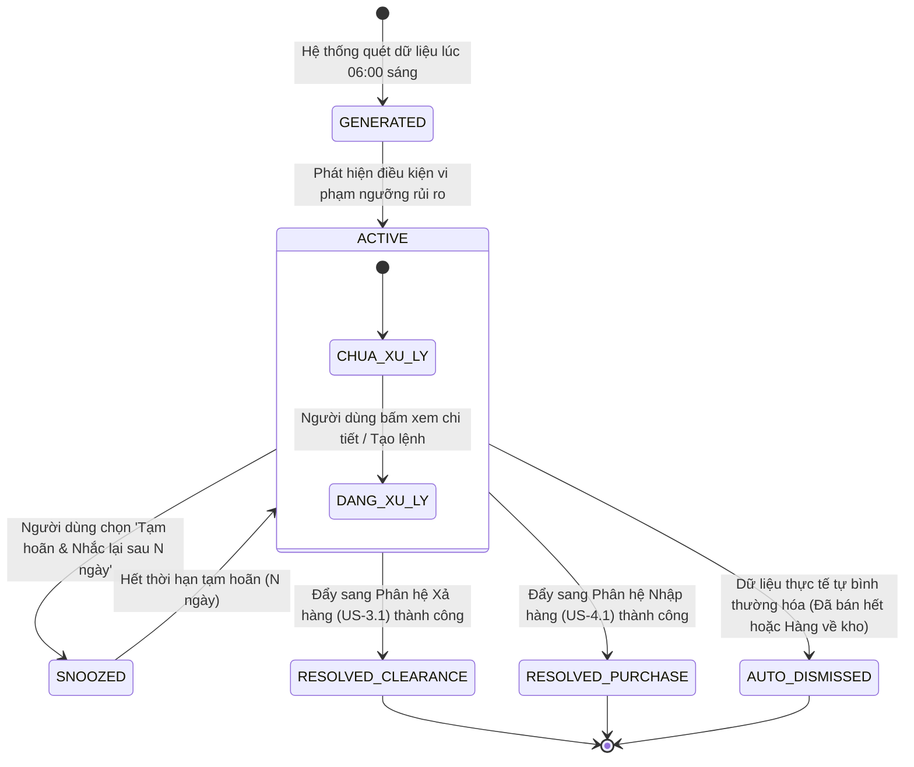

# TÀI LIỆU ĐẶC TẢ YÊU CẦU PHẦN MỀM (SOFTWARE REQUIREMENTS SPECIFICATION - SRS)
## HỆ THỐNG QUẢN LÝ KHO HÀNG ĐIỆN MÁY THÔNG MINH - STOCK SENSE
### PHÂN HỆ: CẦN XỬ LÝ HÔM NAY (ACTIONABLE DAILY ALERTS)
#### Ánh xạ nghiệp vụ từ User Stories: US-2.1 & US-2.2

---

## THÔNG TIN KIỂM SOÁT TÀI LIỆU (DOCUMENT CONTROL)

| Mục | Nội dung |
| :--- | :--- |
| **Mã tài liệu** | `SRS-MOD02-ACTIONABLE-DAILY-ALERTS` |
| **Tên sản phẩm** | Hệ thống Quản lý Kho hàng Điện máy Thông minh - **Stock Sense** |
| **Phân hệ (Module)** | Module 02: Cần xử lý hôm nay (Actionable Daily Alerts) |
| **Tài liệu tham chiếu** | [URD_02_CAN_XU_LY_HOM_NAY.md](file:///Users/doanphambaothu/Documents/gsj_project/docs/URD_02_CAN_XU_LY_HOM_NAY.md) |
| **Phiên bản** | `1.0.0` |
| **Trạng thái** | Sẵn sàng triển khai phát triển (Ready for Development) |
| **Ngày ban hành** | 08/11/2026 |
| **Tác giả** | Nhóm Phân tích Nghiệp vụ & Kiến trúc Phần mềm (BA & System Architecture Team) |

---

### BẢNG THEO DÕI THAY ĐỔI TÀI LIỆU (REVISION HISTORY)

| Phiên bản | Ngày | Người thực hiện | Tóm tắt nội dung thay đổi |
| :---: | :---: | :---: | :--- |
| **1.0.0** | 08/11/2026 | BA Team | Khởi tạo tài liệu SRS chi tiết: thuật toán sàng lọc rủi ro bán chậm/hết mùa, công thức dự báo ngày đứt hàng (Days of Supply), máy trạng thái cảnh báo tác chiến, đặc tả giao diện và ma trận kiểm thử. |

---

## 1. GIỚI THIỆU & PHẠM VI (INTRODUCTION & SCOPE)

### 1.1. Mục đích tài liệu (Purpose)
Tài liệu SRS này chuyển hóa toàn bộ các yêu cầu nghiệp vụ từ [URD_02_CAN_XU_LY_HOM_NAY.md](file:///Users/doanphambaothu/Documents/gsj_project/docs/URD_02_CAN_XU_LY_HOM_NAY.md) thành các đặc tả kỹ thuật phần mềm chi tiết phục vụ lập trình trực tiếp cho phân hệ **Cần xử lý hôm nay**:
1. Đặc tả thuật toán tính toán tốc độ tiêu thụ sản phẩm (Run-rate), số ngày tồn kho bình quân ($DSI$), và dự báo thời điểm cạn kho ($Days\,of\,Supply$).
2. Thiết lập cơ chế máy trạng thái cho các bản ghi cảnh báo (Alert Lifecycle: Kích hoạt $\rightarrow$ Đang xử lý $\rightarrow$ Tạm hoãn $\rightarrow$ Giải quyết xong).
3. Định nghĩa giao diện người dùng đặc thù (Actionable Center), cơ chế liên kết hành động 1 chạm chuyển sang **Gợi ý xả hàng (US-3.1)** hoặc **Gợi ý nhập hàng (US-4.1)**.

### 1.2. Phạm vi phân hệ (Scope of Module)
Module **Cần xử lý hôm nay** đóng vai trò là "Radar cảnh báo tác chiến", bao gồm 2 nhóm chức năng chính:
* **Nhóm 1 - Cảnh báo Hàng bán chậm, Ngừng kinh doanh & Hết mùa (US-2.1):** Tự động phát hiện các sản phẩm có nguy cơ chôn vốn: $DSI > 60$ ngày, không phát sinh đơn bán $> 45$ ngày, hàng hãng đã công bố ngừng sản xuất (EOL), hoặc các thiết bị mùa hè/mùa đông sắp hết thời vụ kinh doanh.
* **Nhóm 2 - Cảnh báo Thiếu hụt & Sắp cháy hàng (US-2.2):** Giám sát liên tục tồn khả dụng ($AVL$), đối chiếu với tốc độ bán 7 ngày và thời gian giao hàng nhà phân phối ($Lead\,Time$) để cảnh báo sớm nguy cơ đứt gãy nguồn cung trước khi hết hàng vật lý.

### 1.3. Bảng thuật ngữ chuyên ngành & Ký hiệu quy ước (Glossary & Conventions)

| Ký hiệu / Thuật ngữ | Tên đầy đủ | Định nghĩa và Công thức kỹ thuật |
| :--- | :--- | :--- |
| **Run-Rate ($RR$)** | Tốc độ bán bình quân | Số lượng thiết bị bán ra trung bình mỗi ngày trong chu kỳ $N$ ngày gần nhất. |
| **DSI** | Days Sales of Inventory | Số ngày cần thiết để giải phóng hết tồn kho vật lý hiện tại: $DSI = \frac{SOH}{RR_{30}}$. |
| **DOS** | Days of Supply | Số ngày tồn khả dụng có thể phục vụ khách hàng: $DOS = \frac{AVL}{RR_{7}}$. |
| **LT** | Lead Time | Thời gian giao hàng từ Nhà cung cấp đến kho cửa hàng (tính theo ngày). |
| **EOL** | End of Life / Discontinued | Trạng thái sản phẩm đã dừng sản xuất hoặc hãng không còn cung ứng linh kiện. |
| **Stagnant Capital** | Vốn lưu động bị ứ đọng | Tổng tiền vốn nằm trong các SKU bị cảnh báo: $\sum (SOH \times Cost\,Price)$. |
| **Lost Revenue Potential**| Doanh thu thất thoát tiềm năng | Ước tính doanh thu bị mất mỗi ngày khi sản phẩm rơi vào trạng thái cháy hàng ($AVL = 0$). |

---

## 2. MA TRẬN PHÂN QUYỀN & TÁC NHÂN HỆ THỐNG (ROLES & ACTORS)

| Mã chức năng (FR ID) | Tên chức năng kỹ thuật | Chủ cửa hàng (`ROLE_OWNER`) | Quản lý kho (`ROLE_WH_MGR`) | Nhân viên bán hàng (`ROLE_SALES`) |
| :--- | :--- | :---: | :---: | :---: |
| **FR-ACT-01** | Bảng chỉ số tác chiến đầu ngày | **Xem đầy đủ** (kèm Vốn kẹt) | **Xem đầy đủ** (kèm Vốn kẹt) | **Che giấu trường Vốn kẹt** |
| **FR-ACT-02** | Giám sát & Lọc hàng chậm/EOL/Hết mùa | **Toàn quyền** | **Xem & Kiểm tra vị trí kho** | **Xem để tư vấn xả hàng** |
| **FR-ACT-03** | Chuyển hàng chậm sang Gợi ý Xả hàng | **Toàn quyền thực thi** | **Không áp dụng** | **Đề xuất lên Quản lý** |
| **FR-ACT-04** | Tạm hoãn cảnh báo (Snooze Alert) | **Toàn quyền thực thi** | **Toàn quyền thực thi** | **Không có quyền** |
| **FR-ACT-05** | Giám sát cảnh báo sắp cháy hàng | **Toàn quyền** | **Toàn quyền** | **Xem để hẹn trước lịch khách** |
| **FR-ACT-06** | Tạo nhanh Đề xuất nhập bổ sung (PO) | **Toàn quyền thực thi** | **Tạo bản nháp đề xuất** | **Không có quyền** |

---

## 3. MÔ HÌNH TRẠNG THÁI & DÒNG CHẢY NGHIỆP VỤ (STATE MACHINE & BUSINESS FLOWS)

### 3.1. Sơ đồ máy trạng thái Cảnh báo Tác chiến (Alert Lifecycle State Machine)



---

## 4. ĐẶC TẢ YÊU CẦU CHỨC NĂNG CHI TIẾT (FUNCTIONAL REQUIREMENTS)

---

### PHÂN HỆ CON 1: CẢNH BÁO HÀNG BÁN CHẬM & HẾT MÙA (ÁNH XẠ US-2.1)

#### 4.1. FR-ACT-01: Bảng điều khiển chỉ số tác chiến rủi ro tồn kho
* **Mô tả chức năng:** Kết xuất tổng hợp số lượng SKU rủi ro và đo lường lượng vốn đang bị chôn chặt tại thời điểm truy cập.
* **Đầu vào (Inputs):** Chi nhánh được chọn (`branch_code`), Dữ liệu bán hàng 60 ngày gần nhất.
* **Thuật toán xử lý (Processing Logic):**
  1. Tính tốc độ bán trung bình 30 ngày cho từng SKU:
     $$RR_{30, i} = \frac{\sum_{d=1}^{30} Quantity_{d, i}}{30}$$
  2. Tính số ngày tồn kho lý thuyết $DSI_i$:
     $$DSI_i = \begin{cases} \frac{SOH_i}{RR_{30, i}}, & \text{nếu } RR_{30, i} > 0 \\ 999, & \text{nếu } RR_{30, i} = 0 \text{ và } SOH_i > 0 \end{cases}$$
  3. Lọc danh sách SKU thỏa mãn ít nhất một trong 3 điều kiện rủi ro:
     - **Điều kiện Chậm/Tồn chết:** $DSI_i > 60$ HOẶC $\text{Ngày hiện tại} - \text{Ngày bán cuối} \ge 45$.
     - **Điều kiện Ngừng kinh doanh:** `lifecycle_status = 'EOL'` hoặc `is_discontinued = 1`.
     - **Điều kiện Hết mùa:** Thuộc nhóm hàng mùa hè/mùa đông và thời gian còn lại của mùa vụ $\le 30$ ngày trong khi $SOH_i > (RR_{30, i} \times \text{Số ngày còn lại})$.
  4. Tính tổng vốn bị ứ đọng:
     $$\text{Total Stagnant Capital} = \sum_{k \in \text{Risk SKUs}} \left( SOH_k \times Cost\,Price_k \right)$$
* **Đầu ra (Outputs):**
  - Thẻ 1: Tổng vốn kẹt ở hàng chậm (VNĐ).
  - Thẻ 2: Số SKU tồn chết ($DSI > 90$ ngày hoặc $>60$ ngày không bán).
  - Thẻ 3: Số SKU sắp hết mùa vụ.
  - Thẻ 4: Tổng số SKU cần xử lý gấp hôm nay.

---

#### 4.2. FR-ACT-02: Bộ lọc đa chiều & Danh mục cảnh báo hàng chậm
* **Mô tả chức năng:** Trực quan hóa danh sách các mặt hàng gặp vấn đề tồn kho với phân loại màu sắc và thông tin chi tiết phục vụ ra quyết định.
* **Đặc tả hiển thị bảng dữ liệu:**
  - Cột `Phân loại rủi ro`: Badge đỏ rực `[🔴 Tồn chết]`, Badge cam `[🟠 Sắp hết mùa]`, Badge vàng `[🟡 Hãng EOL]`.
  - Cột `Số ngày chưa bán`: Đếm số ngày kể từ `MAX(invoice_time)` đến hiện tại.
  - Cột `DSI`: Số ngày quay vòng kho ước tính.
  - Cột `Vốn kẹt`: $SOH \times Cost\,Price$. (Ẩn/Mã hóa thành `****** đ` với `ROLE_SALES`).
  - Hỗ trợ bộ lọc nhanh: Lọc theo Nhóm rủi ro, Lọc theo Nhóm hàng, Sắp xếp theo Vốn kẹt giảm dần.

---

#### 4.3. FR-ACT-03: Điều hướng tác chiến chuyển sang Phân hệ Xả hàng (US-3.1)
* **Mô tả chức năng:** Cho phép người dùng chuyển nhanh 1 SKU hoặc chọn nhiều SKU cùng lúc sang **Phân hệ Gợi ý xả hàng** để thiết lập chương trình thanh lý.
* **Quy trình xử lý:**
  1. Khi người dùng click nút `[👉 Đẩy sang Xả hàng]` tại dòng SKU:
  2. Hệ thống đóng gói Payload gồm: `product_code`, `product_name`, `SOH`, `cost_price`, `sale_price`, `dsi_days`, `suggested_clearance_qty`.
  3. Mở giao diện tạo chiến dịch xả hàng của US-3.1 và điền sẵn các thông tin đề xuất.
  4. Cập nhật trạng thái bản ghi cảnh báo sang `RESOLVED_CLEARANCE`.

---

#### 4.4. FR-ACT-04: Cơ chế Tạm hoãn cảnh báo (Snooze Alert Engine)
* **Mô tả chức năng:** Cho phép Quản lý tạm ẩn một cảnh báo nếu có lý do chính đáng (ví dụ: máy làm hàng mẫu trưng bày).
* **Đầu vào:** `snooze_days` (7 ngày, 14 ngày, 30 ngày), `reason` (bắt buộc nhập $\ge 10$ ký tự).
* **Quy trình:** Chuyển trạng thái cảnh báo sang `SNOOZED`, ghi nhận người thực hiện và thời hạn tái kích hoạt. Cảnh báo sẽ tự động nổi lại vào 06:00 sáng ngày hết hạn tạm hoãn.

---

### PHÂN HỆ CON 2: CẢNH BÁO THIẾU HỤT & SẮP CHÁY HÀNG (ÁNH XẠ US-2.2)

#### 4.5. FR-ACT-05: Thuật toán dự báo ngày đứt hàng (Days of Supply Engine)
* **Mô tả chức năng:** Dự báo chính xác thời điểm kho sẽ hết sạch hàng dựa trên tốc độ tiêu thụ ngắn hạn 7 ngày gần nhất.
* **Quy trình xử lý & Thuật toán:**
  1. Tính tốc độ bán bình quân 7 ngày gần nhất (bắt kịp các biến động ngắn hạn):
     $$RR_{7, i} = \frac{\sum_{d=1}^{7} Quantity_{d, i}}{7}$$
  2. Tính số ngày bán còn lại trước khi cạn kho vật lý ($DOS_i$):
     $$DOS_i = \begin{cases} \frac{AVL_i}{RR_{7, i}}, & \text{nếu } RR_{7, i} > 0 \\ 999, & \text{nếu } RR_{7, i} = 0 \end{cases}$$
  3. Phân cấp mức độ nguy cơ thiếu hụt:
     - **Cấp 1 - ⛔ Đã hết sạch hàng (Stockout):** Khi $AVL_i \le 0$.
     - **Cấp 2 - 🔴 Nguy cơ đứt hàng tức thì:** Khi $0 < DOS_i \le Lead\,Time_i$ (Hàng sẽ hết trước khi đơn đặt hàng mới kịp cập kho).
     - **Cấp 3 - 🟡 Cần lên kế hoạch nhập:** Khi $Lead\,Time_i < DOS_i \le Lead\,Time_i + 3$ ngày.
  4. Ước tính Doanh thu thất thoát tiềm năng mỗi ngày (Lost Revenue Potential):
     $$\text{Daily Lost Revenue}_i = RR_{7, i} \times Sale\,Price_i$$

---

#### 4.6. FR-ACT-06: Khử báo động giả qua kiểm tra đường ống vận chuyển (In-Transit Reconciliation)
* **Mô tả chức năng:** Tự động đối chiếu với các đơn nhập hàng (`PURCHASE_ORDERS`) đang trên đường về kho ($INC > 0$) để không gây hoang mang cho người vận hành.
* **Quy tắc xử lý:**
  - Nếu SKU thỏa mãn điều kiện Cấp 1 hoặc Cấp 2, NHƯNG đang có đơn nhập hàng ở trạng thái `Đang vận chuyển` với số lượng $INC > 0$:
  - Hệ thống tự động chuyển phân loại hiển thị sang: **🔵 Đang trên đường về (In-Transit)** kèm thông tin: Mã đơn PO, Số lượng sắp về, Ngày giờ dự kiến xe tải đến kho.
  - Không cộng dồn SKU này vào chỉ số "Doanh thu mất dự kiến".

---

#### 4.7. FR-ACT-07: Khởi tạo nhanh Đề xuất đặt hàng bổ sung (PO Trigger)
* **Mô tả chức năng:** Cho phép người dùng chuyển thẳng SKU đang thiếu hụt sang **Phân hệ Gợi ý nhập hàng (US-4.1)** với số lượng bù đắp được tính toán tự động.
* **Công thức số lượng đề xuất sơ bộ:**
  $$PO\_Draft\_Qty = \max\left(0, \, (RR_{7} \times (Lead\,Time + 14)) - AVL - INC\right)$$
  Bấm nút `[➕ Nhập hàng gấp]` sẽ tự động mở màn hình lập đơn PO trong US-4.1 với tham số truyền sẵn.

---

## 5. ĐẶC TẢ GIAO DIỆN & TƯƠNG TÁC NGƯỜI DÙNG (UI/UX SPECIFICATIONS)

### 5.1. Bố cục tổng thể phân hệ Cần xử lý hôm nay
Màn hình được thiết kế với 2 Tab tác chiến chuyên biệt:
- **Tab 1: Cảnh báo Hàng chậm & Hết mùa (US-2.1)**
- **Tab 2: Cảnh báo Sắp cháy hàng (US-2.2)**

```
========================================================================================================================
[🏪 ĐIỆN MÁY STOCK SENSE]   | Phân hệ: CẦN XỬ LÝ HÔM NAY (DAILY ACTIONS)             [Cập nhật dữ liệu: 08:00 Sáng nay]
========================================================================================================================
+--------------------------+ +--------------------------+ +--------------------------+ +-------------------------------+
| VỐN KẸT Ở HÀNG CHẬM      | | SKU TỒN CHẾT (>60 NGÀY)  | | SKU SẮP HẾT MÙA VỤ       | | MẶT HÀNG CHÁY HÀNG (OOS)      |
| 485.600.000 đ            | | 6 Sản phẩm               | | 4 Sản phẩm (Điều hòa)    | | 4 Sản phẩm                    |
| (Cần giải phóng vốn)     | | (Không bán được đơn nào) | | (Hết cao điểm trong 20d) | | (Mất ~42.5 tr doanh thu/ngày) |
+--------------------------+ +--------------------------+ +--------------------------+ +-------------------------------+

[ TAB 1: Cảnh báo Hàng chậm & Hết mùa (*) ]   |   [ TAB 2: Cảnh báo Sắp cháy hàng (Stockout) ]
------------------------------------------------------------------------------------------------------------------------
[🔍 Tìm SKU, Tên model...] [Nhóm rủi ro: Tất cả v] [Hãng: Tất cả v] [Sắp xếp: Vốn kẹt giảm dần v]
------------------------------------------------------------------------------------------------------------------------
DANH MỤC HÀNG CẦN XẢ KHO / ĐIỀU CHỈNH GIÁ:
+---------------+-----------------------------+-----+--------------+----------+-------+------------------+------------------+
| Mã SKU        | Tên thiết bị                | SOH | Vốn kẹt (đ)  | Bán cuối | DSI   | Phân loại rủi ro | Hành động gợi ý  |
+---------------+-----------------------------+-----+--------------+----------+-------+------------------+------------------+
| TV-LG-OLED55  | Smart Tivi LG OLED 55C3     |  28 |  448.000.000 | 42 ngày  | 140 ng| 🔴 Tồn đọng nặng | [👉 Đẩy sang Xả] |
| DH-PA-1.5HP   | ĐH Panasonic Inverter 1.5HP |  25 |  300.000.000 | 18 ngày  | 125 ng| 🟠 Sắp hết mùa hè| [👉 Đẩy sang Xả] |
| TL-SS-SBS600  | Tủ lạnh Samsung SideBySide  |  16 |  192.000.000 | 68 ngày  | 999 ng| 🔴 Tồn chết >60d | [👉 Đẩy sang Xả] |
| QS-SN-03      | Quạt sưởi gốm Sunhouse      |  12 |   14.400.000 | 180 ngày | 999 ng| 🔴 Trái mùa hè   | [👉 Đẩy sang Xả] |
+---------------+-----------------------------+-----+--------------+----------+-------+------------------+------------------+
[ ⚡ Chọn tất cả ]   [ 👉 Chuyển toàn bộ danh sách đã chọn sang Chiến lược Xả hàng (US-3.1) ]
========================================================================================================================
```

---

### 5.2. Hộp thoại chức năng: Tạm hoãn cảnh báo (`MDL-ALERT-SNOOZE`)
```
+------------------------------------------------------------------------------------+
| ⏰ TẠM HOÃN CẢNH BÁO TỒN KHO - SKU: TV-LG-OLED55                                    |
+------------------------------------------------------------------------------------+
| Tên sản phẩm: Smart Tivi LG OLED 55C3 - Tồn: 28 bộ (Vốn kẹt: 448.000.000 đ)         |
| Lý do cảnh báo hiện tại: DSI = 140 ngày, không bán được đơn nào trong 42 ngày qua   |
|                                                                                    |
| [*] Thời hạn tạm hoãn cảnh báo:                                                    |
|     ( ) 07 Ngày (Nhắc lại vào 15/11/2026)                                          |
|     (*) 14 Ngày (Nhắc lại vào 22/11/2026)                                          |
|     ( ) 30 Ngày (Nhắc lại vào 08/12/2026)                                          |
|                                                                                    |
| [*] Lý do tạm hoãn bắt buộc (Ghi rõ căn cứ):                                       |
|     [ Đang giữ 5 máy để chạy chương trình tài trợ bốc thăm trúng thưởng Black     ] |
|     [ Friday cuối tháng của cửa hàng. Chưa xả ngay bây giờ.                       ] |
+------------------------------------------------------------------------------------+
| [ Hủy bỏ ]                                                  [ Xác nhận tạm hoãn ]  |
+------------------------------------------------------------------------------------+
```

---

## 6. MA TRẬN XỬ LÝ NGOẠI LỆ & MÃ LỖI (EXCEPTION MATRIX)

| Mã lỗi | Tên lỗi kỹ thuật | Nguyên nhân phát sinh | Hành vi xử lý hệ thống |
| :--- | :--- | :--- | :--- |
| **`ERR_ACT_001`** | Thiếu lịch sử bán hàng | SKU mới nhập dưới 7 ngày, chưa đủ dữ liệu tính Run-rate. | Sử dụng tốc độ bán trung bình của nhóm hàng cấp 2 thay thế; hiển thị ghi chú: *"Dự báo theo ngành hàng"*. |
| **`ERR_ACT_002`** | Không có thông tin Lead Time | Nhà cung cấp chưa được thiết lập thời gian giao hàng chuẩn. | Mặc định gán $Lead\,Time = 3$ ngày (chuẩn ngành điện máy miền Bắc). |
| **`ERR_ACT_003`** | Tạm hoãn thiếu lý do | Người dùng bấm xác nhận tạm hoãn nhưng để trống lý do. | Chặn lưu, viền đỏ trường nhập và hiển thị lỗi: *"Vui lòng nhập lý do tạm hoãn tối thiểu 10 ký tự."* |

---

## 7. TIÊU CHÍ NGHIỆM THU KIỂM THỬ (ACCEPTANCE CRITERIA - BDD/GHERKIN)

```gherkin
Feature: Cảnh báo hàng chậm, hết mùa và sắp cháy hàng (Module 02)

  Scenario: Tự động phát hiện và gắn nhãn hàng tồn chết trên 60 ngày
    Given Sản phẩm "TL-SS-SBS600" có SOH = 16 chiếc
    And Ngày phát sinh hóa đơn bán hàng gần nhất là cách đây 68 ngày
    When Hệ thống chạy tiến trình quét dữ liệu tác chiến đầu ngày
    Then Sản phẩm phải hiển thị trong Tab 1 với nhãn "🔴 Tồn chết >60d"
    And Số ngày chưa bán hiển thị chính xác là "68 ngày"
    And Nút "👉 Đẩy sang Xả" ở trạng thái sẵn sàng click

  Scenario: Tự động phát hiện nguy cơ đứt hàng trước khi chuyến xe kịp về
    Given Sản phẩm "MG-TB-8KG" có AVL = 2 chiếc
    And Tốc độ bán bình quân 7 ngày là 1.8 chiếc/ngày
    And Nhà cung cấp có Lead Time = 3 ngày
    And Hiện tại không có đơn nhập hàng nào đang vận chuyển (INC = 0)
    When Người dùng truy cập Tab "Cảnh báo Sắp cháy hàng"
    Then Sản phẩm phải nằm trong nhóm "🔴 Nguy cơ đứt hàng tức thì"
    And Số ngày bán còn lại hiển thị DOS = 2 / 1.8 = 1.1 ngày (< 3 ngày Lead Time)
    And Hiển thị nút "➕ Nhập hàng gấp"
```

---

## 8. MA TRẬN TRUY VẾT YÊU CẦU (TRACEABILITY MATRIX)

| Mã URD | Mã FR SRS | Bảng dữ liệu / View CSDL | Quy tắc nghiệp vụ | Mã Test Case |
| :--- | :--- | :--- | :--- | :--- |
| **US-2.1** | `FR-ACT-01` (Dashboard Vốn kẹt) | `DIM_PRODUCTS`, `FACT_INVOICES` | `BR-2.1.1`, `BR-2.1.2` | `TC-ACT-01` |
| **US-2.1** | `FR-ACT-02` (Phân loại Hàng chậm/Mùa) | `DIM_PRODUCTS.seasonality` | `BR-2.1.3`, `BR-2.1.4` | `TC-ACT-02` |
| **US-2.1** | `FR-ACT-03` (Đẩy sang Xả hàng) | Payload transfer to Module 03 | `BR-3.1.1` | `TC-ACT-03` |
| **US-2.1** | `FR-ACT-04` (Tạm hoãn cảnh báo) | `SYS_ALERT_SNOOZE_LOG` | `BR-ACT-04.1` | `TC-ACT-04` |
| **US-2.2** | `FR-ACT-05` (Dự báo cháy hàng DOS) | `FACT_INVOICES`, `DIM_PRODUCTS` | `BR-2.2.1`, `BR-2.2.2` | `TC-ACT-05` |
| **US-2.2** | `FR-ACT-06` (Khử báo động giả qua INC)| `PURCHASE_ORDERS`, `PO_ITEMS` | `BR-2.2.3` | `TC-ACT-06` |
| **US-2.2** | `FR-ACT-07` (Tạo nhanh PO đề xuất) | Payload transfer to Module 04 | `BR-4.1.3` | `TC-ACT-07` |

---
*Tài liệu Đặc tả Yêu cầu Phần mềm (SRS) Phân hệ Cần xử lý hôm nay - Stock Sense System.*
