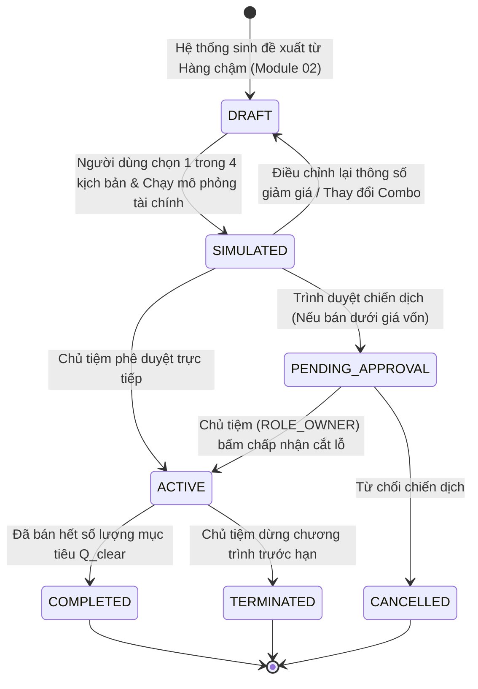

# TÀI LIỆU ĐẶC TẢ YÊU CẦU PHẦN MỀM (SOFTWARE REQUIREMENTS SPECIFICATION - SRS)
## HỆ THỐNG QUẢN LÝ KHO HÀNG ĐIỆN MÁY THÔNG MINH - STOCK SENSE
### PHÂN HỆ: GỢI Ý XẢ HÀNG & ĐỊNH GIÁ CẠNH TRANH (SMART CLEARANCE & MARKET PRICING)
#### Ánh xạ nghiệp vụ từ User Stories: US-3.1 & US-3.2

---

## THÔNG TIN KIỂM SOÁT TÀI LIỆU (DOCUMENT CONTROL)

| Mục | Nội dung |
| :--- | :--- |
| **Mã tài liệu** | `SRS-MOD03-SMART-CLEARANCE-STRATEGY` |
| **Tên sản phẩm** | Hệ thống Quản lý Kho hàng Điện máy Thông minh - **Stock Sense** |
| **Phân hệ (Module)** | Module 03: Gợi ý xả hàng (Smart Clearance Strategy) |
| **Tài liệu tham chiếu** | [URD_03_GOI_Y_XA_HANG.md](file:///Users/doanphambaothu/Documents/gsj_project/docs/URD_03_GOI_Y_XA_HANG.md) |
| **Phiên bản** | `1.0.0` |
| **Trạng thái** | Sẵn sàng triển khai phát triển (Ready for Development) |
| **Ngày ban hành** | 08/11/2026 |
| **Tác giả** | Nhóm Phân tích Nghiệp vụ & Kiến trúc Phần mềm (BA & System Architecture Team) |

---

### BẢNG THEO DÕI THAY ĐỔI TÀI LIỆU (REVISION HISTORY)

| Phiên bản | Ngày | Người thực hiện | Tóm tắt nội dung thay đổi |
| :---: | :---: | :---: | :--- |
| **1.0.0** | 08/11/2026 | BA Team | Khởi tạo tài liệu SRS chi tiết: thuật toán sinh 4 kịch bản xả kho, mô hình đối chiếu giá thị trường, công thức tính giá sàn bảo vệ vốn, giao diện mô phỏng dòng tiền và ma trận truy vết. |

---

## 1. GIỚI THIỆU & PHẠM VI (INTRODUCTION & SCOPE)

### 1.1. Mục đích tài liệu (Purpose)
Tài liệu SRS này chuyển hóa toàn bộ các yêu cầu từ [URD_03_GOI_Y_XA_HANG.md](file:///Users/doanphambaothu/Documents/gsj_project/docs/URD_03_GOI_Y_XA_HANG.md) thành các đặc tả kỹ thuật phần mềm chi tiết phục vụ lập trình trực tiếp cho phân hệ **Gợi ý xả hàng**:
1. Định nghĩa thuật toán tính toán Lượng hàng cần xả mục tiêu và Động cơ sinh 4 kịch bản khuyến mại linh hoạt (Giảm giá trực tiếp, Combo phụ kiện, Tặng dịch vụ lắp đặt, Hỗ trợ trả góp 0%).
2. Đặc tả công cụ Mô phỏng tài chính trước chiến dịch (Financial Simulation Engine), tính toán chính xác số vốn thu hồi và biên lợi nhuận/thua lỗ dự kiến.
3. Thiết lập cơ chế định giá đối chiếu thị trường (Market Price Benchmark) tự động so sánh giá với các chuỗi siêu thị lớn để đưa ra mức giá xả cạnh tranh nhất mà vẫn bảo vệ an toàn nguồn vốn.

### 1.2. Phạm vi phân hệ (Scope of Module)
Module **Gợi ý xả hàng** đóng vai trò là "Cỗ máy tối ưu hóa thanh lý tồn kho", bao gồm 2 nhóm chức năng chính:
* **Nhóm 1 - Đề xuất Chiến lược Xả hàng Thông minh (US-3.1):** Tiếp nhận các SKU bán chậm/hết mùa từ Module 02, tính toán lượng máy cần thanh lý để đưa tồn kho về mức an toàn, sinh các phương án khuyến mại tối ưu và mô phỏng dòng tiền thu hồi.
* **Nhóm 2 - So sánh Giá thị trường & Định giá Đối thủ (US-3.2):** Bảng radar đối chiếu giá bán với Điện Máy Xanh, MediaMart và các đại lý bán lẻ trực tuyến, áp dụng quy tắc làm tròn giá tâm lý bán lẻ (`..90.000 đ`) và chỉ số lợi thế cạnh tranh ($PAI$).

### 1.3. Bảng thuật ngữ chuyên ngành & Ký hiệu quy ước (Glossary & Conventions)

| Ký hiệu / Thuật ngữ | Tên đầy đủ | Định nghĩa và Quy chuẩn kỹ thuật |
| :--- | :--- | :--- |
| **$P_{\text{clear}}$** | Clearance Price | Mức giá bán thanh lý đề xuất sau khi áp dụng chiến lược xả kho. |
| **$P_{\text{floor}}$** | Floor Price / Break-even | Giá sàn tối thiểu bằng đúng giá vốn nhập kho ($Cost\,Price$). |
| **$Q_{\text{clear}}$** | Clearance Target Quantity | Số lượng thiết bị mục tiêu cần giải phóng khỏi kho hàng. |
| **Recovered Capital** | Vốn lưu động thu hồi | Tiền mặt gốc quay về két: $Q_{\text{clear}} \times Cost\,Price$. |
| **Combo Bundling** | Bán gói sản phẩm bù trừ | Ghép thiết bị chính giá thấp với phụ kiện biên lợi nhuận cao ($\ge 50\%$). |
| **MAP Policy** | Minimum Advertised Price | Chính sách cam kết giá bán công khai tối thiểu của Hãng sản xuất. |
| **PAI** | Price Advantage Index | Chỉ số đo lường mức độ rẻ hơn của cửa hàng so với đối thủ trung bình (%). |

---

## 2. MA TRẬN PHÂN QUYỀN & TÁC NHÂN HỆ THỐNG (ROLES & ACTORS)

| Mã chức năng (FR ID) | Tên chức năng kỹ thuật | Chủ cửa hàng (`ROLE_OWNER`) | Quản lý kho (`ROLE_WH_MGR`) | Nhân viên bán hàng (`ROLE_SALES`) |
| :--- | :--- | :---: | :---: | :---: |
| **FR-CLR-01** | Xem Dashboard Tổng vốn xả & Lợi nhuận dự kiến | **Toàn quyền** | **Không xem lãi/vốn** | **Không xem lãi/vốn** |
| **FR-CLR-02** | Xem & Lựa chọn 4 Kịch bản Khuyến mại | **Toàn quyền** | **Không áp dụng** | **Xem kịch bản để tư vấn** |
| **FR-CLR-03** | Mô phỏng dòng tiền & Tùy chỉnh mức giảm giá | **Toàn quyền thực thi** | **Không có quyền** | **Không có quyền** |
| **FR-CLR-04** | Phê duyệt chiến dịch xả kho | **Duyệt tối cao** | **Không có quyền** | **Không có quyền** |
| **FR-CLR-05** | Đối chiếu giá thị trường (ĐMX, MediaMart) | **Toàn quyền** | **Xem tham khảo** | **Xem để thuyết phục khách** |
| **FR-CLR-06** | Áp dụng giá xả lên Quầy PoS & In tem kệ | **Toàn quyền** | **In tem nhãn dán kho** | **Sử dụng giá mới chốt đơn** |

---

## 3. MÔ HÌNH TRẠNG THÁI & DÒNG CHẢY NGHIỆP VỤ (STATE MACHINE & BUSINESS FLOWS)

### 3.1. Sơ đồ máy trạng thái Chiến dịch Xả hàng (Clearance Campaign State Machine)



---

## 4. ĐẶC TẢ YÊU CẦU CHỨC NĂNG CHI TIẾT (FUNCTIONAL REQUIREMENTS)

---

### PHÂN HỆ CON 1: ĐỀ XUẤT CHIẾN LƯỢC XẢ HÀNG THÔNG MINH (ÁNH XẠ US-3.1)

#### 4.1. FR-CLR-01: Tính toán Lượng hàng xả mục tiêu và Vốn thu hồi
* **Mô tả chức năng:** Tự động xác định số lượng thiết bị cần xả để đưa tồn kho về mức an toàn và tính toán tổng số tiền vốn sẽ được giải phóng.
* **Thuật toán tính Lượng hàng cần xả ($Q_{\text{clear}}$):**
  $$Q_{\text{clear}, i} = \begin{cases} SOH_i, & \text{nếu sản phẩm là Hàng EOL hoặc Trái mùa} \\ \max\left(0, \, SOH_i - max\_stock_i\right), & \text{nếu sản phẩm là Hàng đọng vốn thông thường} \end{cases}$$
* **Thuật toán tính Vốn lưu động thu hồi dự kiến:**
  $$\text{Expected Recovery Capital} = \sum_{i=1}^{K} \left( Q_{\text{clear}, i} \times cost\_price_i \right)$$
* **Đầu ra (Outputs):** Hiển thị khối Thẻ KPI: *Tổng vốn dự kiến thu hồi*, *Tổng số lượng máy cần xả*, *Lợi nhuận gộp kỳ vọng*.

---

#### 4.2. FR-CLR-02: Động cơ sinh 4 Kịch bản Khuyến mại (Multi-tier Tactic Engine)
* **Mô tả chức năng:** Thuật toán tự động sinh và đánh giá 4 phương án khuyến mại phù hợp cho từng SKU cụ thể.
* **Chi tiết 4 phương án:**
  1. **Phương án 1 - Giảm giá trực tiếp (Direct Markdown):**
     - Giảm giá từ $8\% - 15\%$ so với giá niêm yết cũ:
       $$P_{\text{tactic1}} = \max\left(cost\_price, \, sale\_price \times (1 - \text{Markdown\%})\right)$$
     - Ưu điểm: Tốc độ xả nhanh nhất, khách hàng thích tiền tươi.
  2. **Phương án 2 - Bán Combo phụ kiện biên lãi cao (Accessory Bundling - Tối ưu nhất):**
     - Giữ nguyên giá máy hoặc giảm nhẹ $5\%$, tặng kèm gói phụ kiện biên lãi gộp $\ge 50\%$ (ví dụ: Giá treo tivi xoay + Dây HDMI mạ vàng; hoặc Chân đế cao su chống rung máy giặt).
     - Chi phí quà tặng: $Cost_{\text{gift}}$.
     - Lợi nhuận máy combo:
       $$\text{Profit}_{\text{tactic2}} = P_{\text{combo}} - cost\_price - Cost_{\text{gift}}$$
     - Ưu điểm: Bảo toàn lợi nhuận gộp dương, không phá giá máy chính.
  3. **Phương án 3 - Tặng gói Dịch vụ kỹ thuật & Bảo dưỡng tại nhà:**
     - Tặng gói: 1 năm bảo dưỡng vệ sinh định kỳ miễn phí (áp dụng cho Điều hòa, Máy giặt) hoặc Miễn phí toàn bộ công thợ lắp đặt.
     - Chi phí nội bộ: Tính theo công thợ ($150.000$ đ/máy), không tốn vốn mua hàng.
  4. **Phương án 4 - Hỗ trợ Trả góp 0% lãi suất (Financing Subsidy):**
     - Cửa hàng đứng ra thanh toán phí chuyển đổi trả góp qua thẻ tín dụng ($2.5\% - 3.0\%$ giá trị đơn) thay cho khách hàng. Phù hợp cho Tivi OLED/Tủ lạnh dung tích lớn trên 20 triệu.
* **Đánh giá Best-fit:** Hệ thống tự động chấm điểm và đánh dấu nhãn `[⭐ Đề xuất tối ưu]` cho phương án mang lại lợi nhuận gộp cao nhất.

---

#### 4.3. FR-CLR-03: Công cụ Mô phỏng Tài chính dòng tiền (Financial Simulator)
* **Mô tả chức năng:** Cho phép người dùng chọn kịch bản hoặc gõ tỷ lệ giảm giá tùy ý, hệ thống tự động tính toán lại bảng dự toán tài chính tức thời trong $\le 200\text{ms}$.
* **Công thức mô phỏng tài chính:**
  $$\text{Doanh thu dự kiến} = Q_{\text{clear}} \times P_{\text{clear}}$$
  $$\text{Tổng vốn hàng gốc} = Q_{\text{clear}} \times cost\_price$$
  $$\text{Chi phí khuyến mại / Quà tặng} = Q_{\text{clear}} \times Cost_{\text{promo}}$$
  $$\text{Lợi nhuận gộp thuần} = \text{Doanh thu dự kiến} - \text{Tổng vốn hàng gốc} - \text{Chi phí khuyến mại}$$
  $$\text{Tỷ suất sinh lời trên vốn (ROI)} = \frac{\text{Lợi nhuận gộp thuần}}{\text{Tổng vốn hàng gốc}} \times 100\%$$
* **Cảnh báo an toàn vốn (Capital Protection Alert):**
  - Nếu $\text{Lợi nhuận gộp thuần} < 0$: Bật khung cảnh báo viền đỏ rực: *"CẢNH BÁO: Kịch bản này dự kiến làm lỗ [Số tiền] đ. Bắt buộc tài khoản ROLE_OWNER phê duyệt!"*.

---

#### 4.4. FR-CLR-04: Phê duyệt & Kích hoạt chiến dịch xả kho
* **Mô tả chức năng:** Lưu chiến dịch vào CSDL, tự động đồng bộ giá bán khuyến mại mới xuống màn hình bán hàng PoS và chuyển trạng thái các cảnh báo trong Module 02 sang `RESOLVED_CLEARANCE`.

---

### PHÂN HỆ CON 2: SO SÁNH GIÁ THỊ TRƯỜNG & ĐỊNH GIÁ ĐỐI THỦ (ÁNH XẠ US-3.2)

#### 4.5. FR-CLR-05: Radar đối chiếu giá đối thủ thị trường
* **Mô tả chức năng:** Trực quan hóa giá bán của sản phẩm tại 3 đối thủ tham chiếu chính:
  1. Chuỗi siêu thị Điện Máy Xanh ($P_{\text{DMX}}$).
  2. Chuỗi siêu thị MediaMart / Pico ($P_{\text{MM}}$).
  3. Giá thấp nhất của các đại lý bán lẻ trực tuyến / Shopee Mall ($P_{\text{Online\_Min}}$).
* **Đặc tả hiển thị:**
  - Bảng so sánh kèm thời điểm quét giá (Timestamp).
  - Vạch giá vốn nhập kho của cửa hàng để người dùng thấy rõ dư địa giảm giá khả dụng.

---

#### 4.6. FR-CLR-06: Thuật toán định giá xả hàng gợi ý tối ưu
* **Mô tả chức năng:** Tính toán mức giá bán vừa đủ rẻ để đánh bại đối thủ, vừa đảm bảo biên lợi nhuận tối thiểu.
* **Công thức xác định giá gợi ý:**
  $$P_{\text{suggested}} = \max\left(cost\_price \times (1 + Margin_{\text{min}}), \, P_{\text{Online\_Min}} - \Delta\right)$$
  - Với:
    - $Margin_{\text{min}} = 3\%$ (Biên lợi nhuận tối thiểu bảo vệ).
    - $\Delta = 200.000$ đ (nếu giá máy $< 10$ triệu); $\Delta = 500.000$ đ (nếu giá máy $\ge 10$ triệu).
* **Quy tắc làm tròn số giá tâm lý bán lẻ (Psychological Pricing Rule):**
  - Giá gợi ý sau tính toán được làm tròn lên mốc kết thúc bằng đuôi `..90.000 đ` hoặc `..50.000 đ` gần nhất.
  - Ví dụ: Tính ra `17.532.000 đ` $\rightarrow$ Làm tròn thành `17.550.000 đ`. Tính ra `8.981.000 đ` $\rightarrow$ Làm tròn thành `8.990.000 đ`.
* **Chỉ số Lợi thế Cạnh tranh ($PAI$):**
  $$PAI = \frac{\text{Giá trung bình thị trường} - P_{\text{suggested}}}{\text{Giá trung bình thị trường}} \times 100\%$$
  - Nếu $PAI \ge 5\%$: Gắn badge xanh lá `🔥 Lợi thế cạnh tranh vượt trội`.

---

## 5. ĐẶC TẢ GIAO DIỆN & TƯƠNG TÁC NGƯỜI DÙNG (UI/UX SPECIFICATIONS)

### 5.1. Màn hình Tab 1: Đề xuất Chiến lược Xả kho (Wireframe & Component Specs)

```
========================================================================================================================
[🏪 ĐIỆN MÁY STOCK SENSE]   | Phân hệ: GỢI Ý XẢ HÀNG & MÔ PHỎNG DÒNG TIỀN             [Chi nhánh: Kho Tổng Cầu Giấy v]
========================================================================================================================
+--------------------------+ +--------------------------+ +--------------------------+ +-------------------------------+
| VỐN DỰ KIẾN THU HỒI      | | LỢI NHUẬN GỘP KỲ VỌNG    | | LƯỢNG MÁY CẦN XẢ        | | SỐ CHIẾN DỊCH ĐANG CHẠY       |
| 640.000.000 đ            | | + 48.500.000 đ           | | 42 Thiết bị (3 SKU)      | | 2 Đang chạy | 3 Chờ duyệt     |
| (Tiền mặt quay về két)   | | (Biên lãi thuần: 7.6%)   | | (Dọn sạch diện tích kho) | | (Chiến dịch Black Friday)     |
+--------------------------+ +--------------------------+ +--------------------------+ +-------------------------------+

[ TAB 1: Đề xuất Chiến lược Xả kho (*) ]   |   [ TAB 2: So sánh Giá thị trường & Định giá Đối thủ ]
------------------------------------------------------------------------------------------------------------------------
ĐANG CHỌN SẢN PHẨM: [ Smart Tivi LG OLED 55C3 - Mã: TV-LG-OLED55 ]
* Tồn kho thực tế: 28 bộ  |  Vốn kẹt: 448.000.000 đ  |  Giá vốn: 16.000.000 đ  |  Giá niêm yết: 19.500.000 đ
* Lý do xả kho: Hàng bán chậm (DSI = 140 ngày, 42 ngày chưa bán). Mục tiêu xả: 20 bộ (Giữ lại 8 bộ an toàn).
------------------------------------------------------------------------------------------------------------------------
LỰA CHỌN PHƯƠNG ÁN XẢ KHO:
( ) Phương án 1: Giảm giá tiền mặt 10% trực tiếp (Giá xả: 17.550.000 đ)  --> [Thu vốn nhanh nhất - Lãi 1.55tr/máy]
(*) Phương án 2 (⭐ ĐỀ XUẤT TỐI ƯU): Bán Combo Tivi + Giá treo xoay + Dây HDMI 8K --> [Lãi cao nhất: +3.15tr/máy]
( ) Phương án 3: Hỗ trợ 0% Lãi suất trả góp 12 tháng (Cửa hàng chịu phí 2.5%)     --> [Dễ chốt khách phân khúc cao cấp]

BẢNG DỰ TOÁN MÔ PHỎNG DÒNG TIỀN (PHƯƠNG ÁN 2 - XẢ 20 MÁY):
* Tổng tiền khách thanh toán (Doanh thu dự kiến):   390.000.000 đ
* Tổng vốn hàng hóa gốc thu hồi về két:             320.000.000 đ  (16.000.000 đ x 20)
* Chi phí gói quà tặng Combo phụ kiện đi kèm:         7.000.000 đ  (350.000 đ x 20)
------------------------------------------------------------------------------------------------------------------------
=> LỢI NHUẬN GỘP THỰC THU SAU CHIẾN DỊCH:         + 63.000.000 đ  (Tỷ suất sinh lời trên vốn: 19.6%)
------------------------------------------------------------------------------------------------------------------------
[ 💾 Lưu bản nháp ]                  [ ❌ Hủy bỏ ]                  [ 🚀 PHÊ DUYỆT & ÁP DỤNG NGAY LÊN QUẦY BÁN HÀNG ]
========================================================================================================================
```

---

### 5.2. Màn hình Tab 2: So sánh Giá thị trường & Định giá Đối thủ (Wireframe)

```
========================================================================================================================
[ TAB 1: Đề xuất Chiến lược Xả kho ]   |   [ TAB 2: So sánh Giá thị trường & Định giá Đối thủ (*) ]
------------------------------------------------------------------------------------------------------------------------
Sản phẩm khảo sát: [ ML-DK-FTKB25 - Điều hòa Daikin Inverter 1HP ]  |  Giá vốn: 8.200.000 đ  |  Giá niêm yết: 10.490.000 đ
------------------------------------------------------------------------------------------------------------------------
BẢNG RADAR ĐỐI ĐẦU GIÁ THỊ TRƯỜNG (Cập nhật lúc 07:30 Sáng nay):
+-------------------------------+------------------+-----------------------+--------------------------------------------+
| Kênh / Đối thủ tham chiếu     | Giá bán hiện tại | Chênh lệch với mình   | Ghi chú chính sách khuyến mại đối thủ      |
+-------------------------------+------------------+-----------------------+--------------------------------------------+
| 1. Điện Máy Xanh (ĐMX)        |    10.490.000 đ  | Bằng giá niêm yết     | Bao công lắp đặt + Tặng 1 năm bảo hành     |
| 2. MediaMart                  |     9.890.000 đ  | Rẻ hơn 600.000 đ      | Chưa bao gồm vật tư ống đồng               |
| 3. Đại lý Điện máy Online     |     9.350.000 đ  | Rẻ hơn 1.140.000 đ    | Giá bán online tại kho, tự vận chuyển      |
| 4. Giá vốn cửa hàng Tuấn Hưng |     8.200.000 đ  | Ngưỡng sàn hòa vốn    | Dư địa giảm tối đa: 1.150.000 đ để có lãi |
+-------------------------------+------------------+-----------------------+--------------------------------------------+

KẾT QUẢ TÍNH TOÁN GIÁ GỢI Ý TỪ HỆ THỐNG:
[ MỨC GIÁ GỢI Ý TỐI ƯU: 8.990.000 đ ]  (Đã làm tròn theo tâm lý giá lẻ)
* So với Điện Máy Xanh:  Rẻ hơn 1.500.000 đ (-14.3%)  🔥 Lợi thế cạnh tranh vượt trội
* So với Đại lý Online:  Rẻ hơn   360.000 đ (-3.8%)   ✅ Giá rẻ nhất thị trường khu vực
* Lợi nhuận gộp còn lại: + 790.000 đ / bộ (Biên lãi: 8.8%)
------------------------------------------------------------------------------------------------------------------------
[ 🔄 Quét lại giá đối thủ ]         [ 🖨️ In tem kệ giá xả đỏ ]         [ 🚀 CẬP NHẬT GIÁ BÁN MỚI LÊN HỆ THỐNG POS ]
========================================================================================================================
```

---

## 6. MA TRẬN XỬ LÝ NGOẠI LỆ & MÃ LỖI (EXCEPTION MATRIX)

| Mã lỗi | Tên lỗi kỹ thuật | Nguyên nhân phát sinh | Hành vi xử lý hệ thống |
| :--- | :--- | :--- | :--- |
| **`ERR_CLR_001`** | Bán dưới giá vốn trái phép | Nhân viên không phải `ROLE_OWNER` tự ý giảm giá dưới giá vốn. | Chặn lưu chiến dịch; Báo lỗi: *"Chỉ Chủ cửa hàng mới có quyền phê duyệt mức giá bán dưới giá vốn."* |
| **`ERR_CLR_002`** | Vi phạm cam kết giá sàn MAP | Hãng có quy định giá bán tối thiểu, giá xả đề xuất vi phạm MAP. | Cảnh báo vi phạm chính sách hãng; Tự động khóa kịch bản Giảm giá trực tiếp và gợi ý chuyển sang kịch bản Bán Combo phụ kiện. |
| **`ERR_CLR_003`** | Mất kết nối dữ liệu đối thủ | Hệ thống cào giá đối thủ không truy cập được website đối thủ. | Sử dụng dữ liệu giá đối thủ của ngày gần nhất; hiển thị nhãn: *"Dữ liệu tham chiếu cách đây N ngày"*. |

---

## 7. TIÊU CHÍ NGHIỆM THU KIỂM THỬ (ACCEPTANCE CRITERIA - BDD/GHERKIN)

```gherkin
Feature: Đề xuất chiến lược xả hàng và định giá thị trường (Module 03)

  Scenario: Tính toán chính xác mô phỏng dòng tiền kịch bản Combo phụ kiện
    Given Sản phẩm "TV-LG-OLED55" có Giá vốn = 16.000.000 đ và Giá xả Combo = 19.500.000 đ
    And Gói phụ kiện tặng kèm có chi phí gốc = 350.000 đ
    And Mục tiêu xả kho = 20 chiếc
    When Hệ thống chạy tính toán mô phỏng dòng tiền
    Then Vốn thu hồi hiển thị là 20 * 16.000.000 = 320.000.000 đ
    And Lợi nhuận gộp thực thu hiển thị là 20 * (19.500.000 - 16.000.000 - 350.000) = 63.000.000 đ
    And Tỷ suất sinh lời hiển thị là (63.000.000 / 320.000.000) * 100 = 19.6%

  Scenario: Tính giá gợi ý rẻ hơn đối thủ và làm tròn số tâm lý đuôi 90k
    Given Giá đối thủ online rẻ nhất của Điều hòa Daikin là 9.350.000 đ
    And Giá vốn của cửa hàng là 8.200.000 đ
    And Mức giảm chênh lệch Delta là 360.000 đ
    When Hệ thống tính giá gợi ý
    Then Giá thô trước làm tròn là 9.350.000 - 360.000 = 8.990.000 đ
    And Hệ thống làm tròn đúng mốc kết thúc bằng đuôi "8.990.000 đ"
    And Lợi nhuận trên mỗi bộ bán ra là 8.990.000 - 8.200.000 = +790.000 đ
```

---

## 8. MA TRẬN TRUY VẾT YÊU CẦU (TRACEABILITY MATRIX)

| Mã URD | Mã FR SRS | Bảng dữ liệu / View CSDL | Quy tắc nghiệp vụ | Mã Test Case |
| :--- | :--- | :--- | :--- | :--- |
| **US-3.1** | `FR-CLR-01` (Tính lượng xả & Vốn thu) | `DIM_PRODUCTS` | `BR-3.1.1`, `BR-3.1.2` | `TC-CLR-01` |
| **US-3.1** | `FR-CLR-02` (4 Kịch bản Khuyến mại) | `FACT_PROMOTIONS_TACTICS` | `BR-3.1.3` | `TC-CLR-02` |
| **US-3.1** | `FR-CLR-03` (Mô phỏng Tài chính) | In-memory Simulator Service | `BR-3.1.4` | `TC-CLR-03` |
| **US-3.1** | `FR-CLR-04` (Duyệt & Đồng bộ PoS) | `DIM_PRODUCTS.sale_price` | `BR-CLR-04.1` | `TC-CLR-04` |
| **US-3.2** | `FR-CLR-05` (Radar giá đối thủ) | `EXT_MARKET_PRICES` | `BR-3.2.1` | `TC-CLR-05` |
| **US-3.2** | `FR-CLR-06` (Định giá & Làm tròn số) | Calculation Service | `BR-3.2.2`, `BR-3.2.3` | `TC-CLR-06` |

---
*Tài liệu Đặc tả Yêu cầu Phần mềm (SRS) Phân hệ Gợi ý xả hàng - Stock Sense System.*
