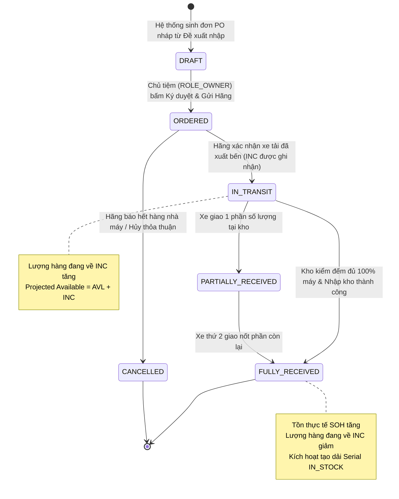

# TÀI LIỆU ĐẶC TẢ YÊU CẦU PHẦN MỀM (SOFTWARE REQUIREMENTS SPECIFICATION - SRS)
## HỆ THỐNG QUẢN LÝ KHO HÀNG ĐIỆN MÁY THÔNG MINH - STOCK SENSE
### PHÂN HỆ: GỢI Ý NHẬP HÀNG & TỰ ĐỘNG HÓA ĐẶT HÀNG (SMART REPLENISHMENT & PO GENERATOR)
#### Ánh xạ nghiệp vụ từ User Stories: US-4.1

---

## THÔNG TIN KIỂM SOÁT TÀI LIỆU (DOCUMENT CONTROL)

| Mục | Nội dung |
| :--- | :--- |
| **Mã tài liệu** | `SRS-MOD04-SMART-REPLENISHMENT` |
| **Tên sản phẩm** | Hệ thống Quản lý Kho hàng Điện máy Thông minh - **Stock Sense** |
| **Phân hệ (Module)** | Module 04: Gợi ý nhập hàng (Smart Replenishment) |
| **Tài liệu tham chiếu** | [URD_04_GOI_Y_NHAP_HANG.md](file:///Users/doanphambaothu/Documents/gsj_project/docs/URD_04_GOI_Y_NHAP_HANG.md) |
| **Phiên bản** | `1.0.0` |
| **Trạng thái** | Sẵn sàng triển khai phát triển (Ready for Development) |
| **Ngày ban hành** | 08/11/2026 |
| **Tác giả** | Nhóm Phân tích Nghiệp vụ & Kiến trúc Phần mềm (BA & System Architecture Team) |

---

### BẢNG THEO DÕI THAY ĐỔI TÀI LIỆU (REVISION HISTORY)

| Phiên bản | Ngày | Người thực hiện | Tóm tắt nội dung thay đổi |
| :---: | :---: | :---: | :--- |
| **1.0.0** | 08/11/2026 | BA Team | Khởi tạo tài liệu SRS chi tiết: thuật toán dự báo nhu cầu thích ứng mùa vụ, công thức cân bằng tồn kho 4 trụ cột, cơ chế ràng buộc quy cách đóng gói/ngân sách vốn, và module tự động gom PO theo nhà phân phối. |

---

## 1. GIỚI THIỆU & PHẠM VI (INTRODUCTION & SCOPE)

### 1.1. Mục đích tài liệu (Purpose)
Tài liệu SRS này chuyển hóa toàn bộ các yêu cầu từ [URD_04_GOI_Y_NHAP_HANG.md](file:///Users/doanphambaothu/Documents/gsj_project/docs/URD_04_GOI_Y_NHAP_HANG.md) thành các đặc tả kỹ thuật phần mềm chi tiết phục vụ lập trình trực tiếp cho phân hệ **Gợi ý nhập hàng**:
1. Xây dựng thuật toán dự báo nhu cầu thị trường ($Demand_T$) kết hợp trọng số tốc độ bán ngắn hạn (14 ngày), trung hạn (30 ngày) và hệ số điều chỉnh mùa vụ ($S_{\text{factor}}$).
2. Hiện thực hóa phương trình cân bằng tồn kho để tính toán số lượng nhập đề xuất chính xác, tránh hiện tượng nhập thừa gây chôn vốn hoặc nhập thiếu gây đứt hàng.
3. Thiết lập cơ chế kiểm soát trần ngân sách vốn lưu động và quy tắc đóng gói theo bộ chẵn/kiện hàng (MOQ).
4. Đặc tả module gom đơn và tự động khởi tạo đơn mua hàng (`PURCHASE_ORDERS`) phân tách theo từng Hãng/Nhà phân phối.

### 1.2. Phạm vi phân hệ (Scope of Module)
Module **Gợi ý nhập hàng** giải quyết bài toán cốt lõi của hoạt động mua hàng (Procurement), bao gồm:
* **Tính toán nhu cầu dự báo đa chu kỳ:** Hỗ trợ 2 chu kỳ lập kế hoạch nhập hàng: Chu kỳ ngắn hạn **14 ngày** (xoay vòng nhanh) và Chu kỳ trung hạn **30 ngày** (nhập hàng gộp tháng).
* **Đánh giá Độ tin cậy dự báo (Confidence Score):** Thống kê mức độ phân tán dữ liệu doanh số để đưa ra điểm số tin cậy cho từng SKU ($70\% - 99\%$).
* **Tự động gom đơn PO:** Gom hàng chục SKU đề xuất thành các đơn đặt hàng riêng biệt gửi đến Casper, Daikin, Panasonic, Sony, Samsung.

### 1.3. Bảng thuật ngữ chuyên ngành & Ký hiệu quy ước (Glossary & Conventions)

| Ký hiệu / Thuật ngữ | Tên đầy đủ | Định nghĩa và Công thức kỹ thuật |
| :--- | :--- | :--- |
| **$Q_{\text{suggested}}$** | Suggested Reorder Quantity | Số lượng máy đề xuất cần đặt mua từ nhà cung cấp. |
| **$Demand_T$** | Forecasted Demand | Nhu cầu tiêu thụ dự kiến của khách hàng trong chu kỳ $T$ ngày tới. |
| **$SS$** | Safety Stock | Mức tồn kho đệm an toàn để chống sốc nhu cầu và trễ hạn giao xe. |
| **$AVL$** | Available Stock | Lượng tồn kho sẵn sàng bán tại thời điểm tính toán: $SOH - RES$. |
| **$INC$** | In-Transit Stock | Lượng hàng đã đặt trước đang trên xe tải vận chuyển về kho. |
| **MOQ** | Minimum Order Quantity | Số lượng tối thiểu trên 1 đơn hàng theo chính sách của nhà phân phối. |
| **Budget Cap** | Trần ngân sách nhập hàng | Hạn mức tiền mặt tối đa chủ cửa hàng cho phép giải ngân trong đợt nhập. |

---

## 2. MA TRẬN PHÂN QUYỀN & TÁC NHÂN HỆ THỐNG (ROLES & ACTORS)

| Mã chức năng (FR ID) | Tên chức năng kỹ thuật | Chủ cửa hàng (`ROLE_OWNER`) | Quản lý kho (`ROLE_WH_MGR`) | Nhân viên bán hàng (`ROLE_SALES`) |
| :--- | :--- | :---: | :---: | :---: |
| **FR-REP-01** | Xem Dashboard Nhu cầu nhập & Trần ngân sách | **Toàn quyền** | **Xem số lượng máy** | **Không có quyền** |
| **FR-REP-02** | Chọn chu kỳ dự báo (14 ngày vs 30 ngày) | **Toàn quyền thực thi** | **Toàn quyền thực thi** | **Không có quyền** |
| **FR-REP-03** | Tùy chỉnh số lượng nhập & Ràng buộc đóng gói | **Toàn quyền thực thi** | **Đề xuất chỉnh sửa** | **Không có quyền** |
| **FR-REP-04** | Phê duyệt & Tự động tạo Đơn mua hàng PO | **Toàn quyền ký duyệt** | **Tạo bản nháp PO** | **Không có quyền** |
| **FR-REP-05** | Quản lý tiến độ đơn nhập PO & Cập nhật $INC$ | **Toàn quyền** | **Toàn quyền thực thi** | **Xem ngày hàng về** |

---

## 3. MÔ HÌNH TRẠNG THÁI & DÒNG CHẢY NGHIỆP VỤ (STATE MACHINE & BUSINESS FLOWS)

### 3.1. Sơ đồ máy trạng thái Đơn mua hàng Nhà cung cấp (Purchase Order Lifecycle)



---

## 4. ĐẶC TẢ YÊU CẦU CHỨC NĂNG CHI TIẾT (FUNCTIONAL REQUIREMENTS)

#### 4.1. FR-REP-01: Động cơ Dự báo Nhu cầu Tiêu thụ Thích ứng (Adaptive Demand Forecasting)
* **Mô tả chức năng:** Tính toán nhu cầu dự kiến của từng SKU trong chu kỳ $T$ ngày ($T = 14$ hoặc $T = 30$).
* **Thuật toán dự báo nhu cầu ($Demand_T$):**
  $$Demand_{T, i} = \left( RR_{14, i} \times 0.70 + RR_{30, i} \times 0.30 \right) \times T \times S_{\text{factor}, i}$$
  - Trong đó:
    - $RR_{14, i}$: Tốc độ bán bình quân ngày trong 14 ngày gần nhất (phản ánh nhịp bán hiện tại).
    - $RR_{30, i}$: Tốc độ bán bình quân ngày trong 30 ngày gần nhất (độ ổn định nền).
    - $S_{\text{factor}, i}$: Hệ số mùa vụ được xác định từ ngày hiện tại và bảng cấu hình:
      + Vào mùa cao điểm (ví dụ: Điều hòa từ tháng 5 đến tháng 7): $S_{\text{factor}} = 1.30$.
      + Sắp hết mùa vụ (ví dụ: Điều hòa từ tháng 8): $S_{\text{factor}} = 0.60$.
      + Hàng bán quanh năm (Tivi, Máy giặt, Nồi cơm): $S_{\text{factor}} = 1.00$.

---

#### 4.2. FR-REP-02: Động cơ Tính Tồn kho An toàn Thích ứng (Adaptive Safety Stock)
* **Mô tả chức năng:** Xác định mức tồn kho tối thiểu dự phòng cho từng SKU dựa trên thời gian giao hàng của nhà cung cấp ($Lead\,Time$).
* **Công thức toán học:**
  $$Safety\,Stock_i = \text{ROUND\_UP}\left( RR_{14, i} \times Lead\,Time_i \times Z \right)$$
  - Với hệ số mức độ phục vụ $Z = 1.28$ (tương đương cam kết không đứt hàng đạt $90\%$).
  - Giá trị $Safety\,Stock$ tối thiểu là $1$ chiếc đối với mặt hàng kinh doanh thường xuyên.

---

#### 4.3. FR-REP-03: Phương trình Cân bằng Tồn kho tính Lượng nhập đề xuất
* **Mô tả chức năng:** Áp dụng phương trình dòng hàng 4 trụ cột để tính toán lượng máy thô cần nhập:
  $$Q_{\text{raw}, i} = Demand_{T, i} + Safety\,Stock_i - AVL_i - INC_i$$
  $$Q_{\text{suggested}, i} = \max\left(0, \, Q_{\text{raw}, i}\right)$$
  - Nếu $Q_{\text{raw}, i} \le 0$: Hệ thống đánh dấu trạng thái: **"Đủ hàng kinh doanh - Không cần nhập thêm"** ($Q_{\text{suggested}} = 0$).

---

#### 4.4. FR-REP-04: Đánh giá Điểm tin cậy Dự báo (Forecast Confidence Score)
* **Mô tả chức năng:** Đo lường độ tin cậy của con số dự báo dựa trên hệ số biến thiên doanh số ngày trong quá khứ ($CV$).
* **Công thức xác định Điểm tin cậy:**
  $$\sigma_i = \sqrt{\frac{1}{30} \sum_{d=1}^{30} \left( Quantity_{d, i} - RR_{30, i} \right)^2}$$
  $$CV_i = \frac{\sigma_i}{RR_{30, i} + 0.001}$$
  $$\text{Confidence Score}_i = \min\left(99\%, \, \max\left(50\%, \, 100\% - (CV_i \times 40\%)\right)\right)$$
  - Hiển thị trực quan:
    - $\ge 90\%$: Màu xanh lá cây `[95% - Độ chính xác cao]`.
    - $75\% - 89\%$: Màu vàng `[80% - Khá ổn định]`.
    - $< 75\%$: Màu cam `[68% - Nhu cầu biến động mạnh]`.

---

#### 4.5. FR-REP-05: Ràng buộc Quy cách Đóng gói (MOQ) & Kiểm soát Trần Ngân sách
* **Mô tả chức năng:** Tự động điều chỉnh số lượng đề xuất theo quy chuẩn đóng gói của nhà máy và bảo vệ hạn mức vốn tiền mặt.
* **Quy tắc làm tròn:**
  - Đối với Điều hòa nhiệt độ: Số lượng cục nóng và cục lạnh phải luôn bằng nhau và là bội số chẵn của 1 bộ.
  - Đối với SKU có quy định đóng thùng (ví dụ: Quạt điện đóng thùng 4 chiếc): Làm tròn lên bội số của 4.
  - Nếu $0 < Q_{\text{suggested}} < MOQ_i$: Làm tròn lên bằng $MOQ_i$.
* **Cơ chế Kiểm soát Trần Ngân sách (Budget Cap):**
  - Người dùng cấu hình trần ngân sách: $B_{\text{cap}}$ (ví dụ: `350.000.000 đ`).
  - Hệ thống tính tổng tiền dự toán: $\sum (Q_{\text{suggested}} \times Cost\,Price)$.
  - Nếu vượt trần, hiển thị thanh cảnh báo đỏ và cung cấp tính năng **"Tự động cân đối ngân sách"**: Cắt giảm bớt các SKU có biên lãi mỏng, ưu tiên giữ lại các SKU có vòng quay cao nhất.

---

#### 4.6. FR-REP-06: Động cơ Gom Đơn PO theo Nhà Cung Cấp (PO Auto-Grouping Engine)
* **Mô tả chức năng:** Tự động gom các dòng sản phẩm đã được chọn nhập theo từng Nhà cung cấp/Hãng tương ứng và khởi tạo các bản ghi trong `PURCHASE_ORDERS` và `PO_ITEMS`.
* **Đầu ra:** Mỗi đơn PO được sinh ra với mã `PO-YYYY-xxxx`, trạng thái `Chờ duyệt` hoặc `Đã đặt`, sẵn sàng xuất file Excel/PDF để gửi cho đại diện bán hàng của Hãng.

---

## 5. ĐẶC TẢ GIAO DIỆN & TƯƠNG TÁC NGƯỜI DÙNG (UI/UX SPECIFICATIONS)

### 5.1. Màn hình Đề xuất Nhập hàng & Cân bằng Ngân sách (Wireframe)

```
========================================================================================================================
[🏪 ĐIỆN MÁY STOCK SENSE]   | Phân hệ: GỢI Ý NHẬP HÀNG (SMART REPLENISHMENT)        [Trần ngân sách: 350.000.000 đ]
========================================================================================================================
Chu kỳ dự báo: [ (*) 14 Ngày tiếp theo ]  [ ( ) 30 Ngày tiếp theo ]           [ Lọc Nhà Cung Cấp: Tất cả v]
+--------------------------+ +--------------------------+ +--------------------------+ +-------------------------------+
| SKU CẦN NHẬP BỔ SUNG     | | TỔNG SỐ LƯỢNG MÁY        | | TỔNG VỐN DỰ TOÁN         | | ĐỘ TIN CẬY DỰ BÁO TRUNG BÌNH  |
| 5 Mặt hàng               | | 60 Thiết bị              | | 253.500.000 đ            | | 94.6% (Độ chính xác cao)      |
| (Thiếu hàng trong 14 ngày)| | (Casper, Aqua, Toshiba)  | | (Đã dùng 72.4% ngân sách)| | (Dữ liệu bán hàng ổn định)    |
+--------------------------+ +--------------------------+ +--------------------------+ +-------------------------------+
Tiến độ giải ngân ngân sách: [=========================>---------] Đã dùng: 253.5 tr / 350 tr (Còn dư: 96.5 tr)

------------------------------------------------------------------------------------------------------------------------
BẢNG ĐỀ XUẤT ĐẶT HÀNG BỔ SUNG (THEO PHƯƠNG TRÌNH DÒNG HÀNG 4 TRỤ CỘT):
+---+---------------+--------------------------+---------+----------+---------+---------+--------------+--------------+-----+
| C | Mã SKU        | Tên thiết bị             | Nhu cầu | Khả dụng | Đang về | Đề xuất | Đơn giá vốn  | Thành tiền   | Tin |
+---+---------------+--------------------------+---------+----------+---------+---------+--------------+--------------+-----+
|[x]| DH-CS-09      | ĐH Casper 9000BTU Invert |    35   |     0    |    15   | [ 20 ]  |  4.200.000 đ |  84.000.000 đ| 96% |
|[x]| TV-CS-43      | Tivi Casper 43 inch FHD  |    20   |     1    |     0   | [ 19 ]  |  4.500.000 đ |  85.500.000 đ| 94% |
|[x]| TL-AQ-180L    | Tủ lạnh Aqua 180L        |    12   |     0    |     0   | [ 12 ]  |  3.800.000 đ |  45.600.000 đ| 92% |
|[x]| MG-TB-8KG     | Máy giặt Toshiba 8kg     |    10   |     2    |     0   | [  8 ]  |  4.800.000 đ |  38.400.000 đ| 95% |
|[ ]| TV-SN-55X80K  | Tivi Sony 55 inch 4K     |     8   |     3    |    12   | [  0 ]  | 12.500.000 đ |          0 đ | 90% |
+---+---------------+--------------------------+---------+----------+---------+---------+--------------+--------------+-----+
Đang chọn: 4 SKU | Tổng số: 59 chiếc | Tổng tiền: 253.500.000 đ | Gom thành: 3 Đơn đặt hàng PO riêng biệt
------------------------------------------------------------------------------------------------------------------------
[ ➕ Thêm SKU thủ công ]   [ 🔄 Tính toán lại ]   [ 🚀 TẠO ĐƠN ĐẶT HÀNG (PO) VÀ GỬI NHÀ PHÂN PHỐI ]
========================================================================================================================
```

---

### 5.2. Modal xem trước đơn PO gom nhóm (`MDL-PO-PREVIEW`)
```
+------------------------------------------------------------------------------------+
| 📑 XÁC NHẬN TẠO CÁC ĐƠN MUA HÀNG (PO) PHÂN TÁCH THEO HÃNG                          |
+------------------------------------------------------------------------------------+
| Hệ thống đã tự động gom 4 SKU được chọn thành 3 đơn đặt hàng PO:                   |
|                                                                                    |
| ĐƠN PO 1: Gửi Công ty TNHH Casper Việt Nam (Hà Nội)                                |
| - DH-CS-09: 20 bộ x 4.200.000 đ = 84.000.000 đ                                     |
| - TV-CS-43: 19 máy x 4.500.000 đ = 85.500.000 đ                                    |
| => Tổng PO 1: 39 thiết bị | Trị giá: 169.500.000 đ (Đạt tiêu chuẩn 1 chuyến xe tải)|
|                                                                                    |
| ĐƠN PO 2: Gửi Nhà phân phối Aqua Việt Nam                                          |
| - TL-AQ-180L: 12 máy x 3.800.000 đ = 45.600.000 đ                                  |
| => Tổng PO 2: 12 thiết bị | Trị giá: 45.600.000 đ                                  |
|                                                                                    |
| ĐƠN PO 3: Gửi Đại lý Cấp 1 Toshiba                                                 |
| - MG-TB-8KG: 8 máy x 4.800.000 đ = 38.400.000 đ                                    |
| => Tổng PO 3: 8 thiết bị | Trị giá: 38.400.000 đ                                   |
+------------------------------------------------------------------------------------+
| [ Hủy bỏ ]                        [ 📥 Xuất 3 File Excel ]   [ 🚀 Ký duyệt & Lưu ] |
+------------------------------------------------------------------------------------+
```

---

## 6. MA TRẬN XỬ LÝ NGOẠI LỆ & MÃ LỖI (EXCEPTION MATRIX)

| Mã lỗi | Tên lỗi kỹ thuật | Nguyên nhân phát sinh | Hành vi xử lý hệ thống |
| :--- | :--- | :--- | :--- |
| **`ERR_REP_001`** | Vượt trần ngân sách vốn | Tổng tiền các SKU chọn nhập lớn hơn $B_{\text{cap}}$. | Hiển thị cảnh báo vàng: *"Vượt ngân sách [Số tiền] đ. Bạn có muốn tăng hạn mức hay tự động cắt giảm?"*. |
| **`ERR_REP_002`** | Vi phạm số lượng đặt tối thiểu | Người dùng gõ số lượng nhỏ hơn $MOQ$ của hãng. | Tự động làm tròn lên bằng $MOQ$ và hiển thị tooltip giải thích. |
| **`ERR_REP_003`** | Đặt trùng SKU đang có PO | SKU đã có đơn PO đang chạy trên đường đủ bù nhu cầu. | Gợi ý giữ nguyên số lượng $= 0$ để tránh ứ đọng vốn kép. |

---

## 7. TIÊU CHÍ NGHIỆM THU KIỂM THỬ (ACCEPTANCE CRITERIA - BDD/GHERKIN)

```gherkin
Feature: Gợi ý nhập hàng và tạo đơn PO tự động (Module 04)

  Scenario: Tính chính xác lượng nhập theo công thức cân bằng dòng hàng
    Given Sản phẩm "DH-CS-09" có:
      | Nhu cầu dự báo 14 ngày | 35 bộ |
      | Tồn an toàn (Safety Stock) | 0 bộ |
      | Tồn khả dụng (AVL) | 0 bộ |
      | Hàng đang về (INC) | 15 bộ |
    When Hệ thống tính toán lượng đề xuất nhập
    Then Lượng nhập đề xuất hiển thị Q_suggested = 35 + 0 - 0 - 15 = 20 bộ
    And Thành tiền vốn dự kiến = 20 * 4.200.000 = 84.000.000 đ

  Scenario: Tự động gom đơn PO theo từng nhà cung cấp
    Given Người dùng chọn 4 SKU thuộc 3 nhà cung cấp khác nhau
    When Bấm nút "Tạo đơn đặt hàng PO"
    Then Hệ thống phải tạo ra đúng 3 bản ghi đơn mua hàng mới trong bảng PURCHASE_ORDERS
    And Mỗi bản ghi có mã PO duy nhất và đúng mã nhà cung cấp
```

---

## 8. MA TRẬN TRUY VẾT YÊU CẦU (TRACEABILITY MATRIX)

| Mã URD | Mã FR SRS | Bảng dữ liệu / View CSDL | Quy tắc nghiệp vụ | Mã Test Case |
| :--- | :--- | :--- | :--- | :--- |
| **US-4.1** | `FR-REP-01` (Dự báo nhu cầu) | `FACT_INVOICES`, `DIM_PRODUCTS` | `BR-4.1.1` | `TC-REP-01` |
| **US-4.1** | `FR-REP-02` (Tồn an toàn thích ứng) | `DIM_PRODUCTS`, `DIM_SUPPLIERS` | `BR-4.1.2` | `TC-REP-02` |
| **US-4.1** | `FR-REP-03` (Công thức cân bằng tồn) | `VW_INVENTORY_FLOW_OVERVIEW` | `BR-4.1.3` | `TC-REP-03` |
| **US-4.1** | `FR-REP-04` (Điểm tin cậy dự báo) | Historical Variance Calculation | `BR-4.1.5` | `TC-REP-04` |
| **US-4.1** | `FR-REP-05` (Ràng buộc MOQ/Ngân sách) | `DIM_PRODUCTS.min_order_qty` | `BR-4.1.4` | `TC-REP-05` |
| **US-4.1** | `FR-REP-06` (Tự động gom đơn PO) | `PURCHASE_ORDERS`, `PO_ITEMS` | `BR-REP-06.1` | `TC-REP-06` |

---
*Tài liệu Đặc tả Yêu cầu Phần mềm (SRS) Phân hệ Gợi ý nhập hàng - Stock Sense System.*
