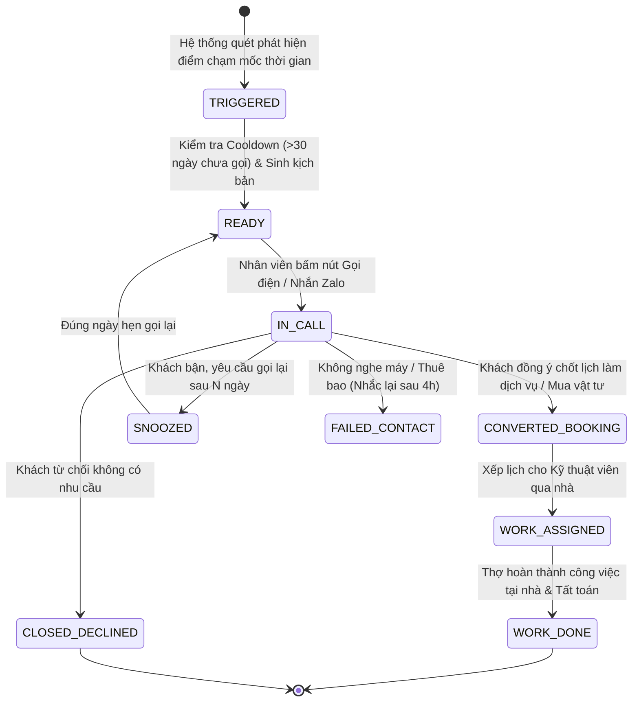

# TÀI LIỆU ĐẶC TẢ YÊU CẦU PHẦN MỀM (SOFTWARE REQUIREMENTS SPECIFICATION - SRS)
## HỆ THỐNG QUẢN LÝ KHO HÀNG ĐIỆN MÁY THÔNG MINH - STOCK SENSE
### PHÂN HỆ: KHÁCH HÀNG CẦN CHĂM SÓC & QUẢN TRỊ QUAN HỆ KHÁCH HÀNG (CUSTOMER RETENTION & SMART CRM)
#### Ánh xạ nghiệp vụ từ User Stories: US-5.1

---

## THÔNG TIN KIỂM SOÁT TÀI LIỆU (DOCUMENT CONTROL)

| Mục | Nội dung |
| :--- | :--- |
| **Mã tài liệu** | `SRS-MOD05-SMART-CUSTOMER-RETENTION` |
| **Tên sản phẩm** | Hệ thống Quản lý Kho hàng Điện máy Thông minh - **Stock Sense** |
| **Phân hệ (Module)** | Module 05: Khách hàng cần chăm sóc (Smart Customer Retention & CRM) |
| **Tài liệu tham chiếu** | [URD_05_KHACH_HANG_CAN_CHAM_SOC.md](file:///Users/doanphambaothu/Documents/gsj_project/docs/URD_05_KHACH_HANG_CAN_CHAM_SOC.md) |
| **Phiên bản** | `1.0.0` |
| **Trạng thái** | Sẵn sàng triển khai phát triển (Ready for Development) |
| **Ngày ban hành** | 08/11/2026 |
| **Tác giả** | Nhóm Phân tích Nghiệp vụ & Kiến trúc Phần mềm (BA & System Architecture Team) |

---

### BẢNG THEO DÕI THAY ĐỔI TÀI LIỆU (REVISION HISTORY)

| Phiên bản | Ngày | Người thực hiện | Tóm tắt nội dung thay đổi |
| :---: | :---: | :---: | :--- |
| **1.0.0** | 08/11/2026 | BA Team | Khởi tạo tài liệu SRS chi tiết: thuật toán quét 5 điểm chạm kích hoạt chăm sóc (Care Triggers), cơ chế sinh kịch bản tư vấn tự động, máy trạng thái tác vụ CSKH, quy tắc chống spam và ma trận kiểm thử. |

---

## 1. GIỚI THIỆU & PHẠM VI (INTRODUCTION & SCOPE)

### 1.1. Mục đích tài liệu (Purpose)
Tài liệu SRS này chuyển hóa toàn bộ các yêu cầu từ [URD_05_KHACH_HANG_CAN_CHAM_SOC.md](file:///Users/doanphambaothu/Documents/gsj_project/docs/URD_05_KHACH_HANG_CAN_CHAM_SOC.md) thành các đặc tả kỹ thuật phần mềm chi tiết phục vụ lập trình trực tiếp cho phân hệ **Khách hàng cần chăm sóc**:
1. Đặc tả thuật toán quét dữ liệu lịch sử mua hàng (`FACT_INVOICES`) và bảo hành (`FACT_WARRANTIES`) để tự động nhận diện 5 điểm chạm chăm sóc định kỳ (Bảo dưỡng điều hòa, Thay lõi lọc nước, Hết hạn bảo hành, Chu kỳ nâng cấp máy, Bán chéo phụ kiện).
2. Xây dựng công cụ tự động sinh kịch bản tư vấn thoại (Call Script) và mẫu tin nhắn Zalo ZNS cá nhân hóa cho từng khách hàng cụ thể.
3. Thiết lập máy trạng thái quản trị tương tác (CRM Interaction Lifecycle) từ lúc hệ thống gợi ý đến khi chốt lịch kỹ thuật viên phục vụ tại nhà.
4. Áp dụng quy tắc kiểm soát chống làm phiền (Spam Prevention) ngăn chặn liên hệ trùng lặp trong vòng 30 ngày.

### 1.2. Phạm vi phân hệ (Scope of Module)
Module **Khách hàng cần chăm sóc** tập trung vào việc gia tăng giá trị trọn đời của khách hàng (Customer Lifetime Value - CLV) tại cửa hàng điện máy cá thể:
* **Trung tâm Điều phối CSKH Hàng ngày:** Hiển thị danh sách khách hàng được sắp xếp theo điểm ưu tiên ($Priority\,Score$), tích hợp nút bấm quay số nhanh (`tel:`) và gửi tin nhắn Zalo.
* **Đặt lịch dịch vụ kỹ thuật tại nhà:** Tự động tạo phiếu lịch hẹn cho thợ kỹ thuật khi khách hàng đồng ý bảo dưỡng máy hoặc thay lõi lọc nước.
* **Tạo nhanh đơn bán vật tư/phụ kiện:** Chuyển đổi trực tiếp các sản phẩm bán thêm sang hệ thống PoS.

### 1.3. Bảng thuật ngữ chuyên ngành & Ký hiệu quy ước (Glossary & Conventions)

| Ký hiệu / Thuật ngữ | Tên đầy đủ | Định nghĩa và Quy chuẩn kỹ thuật |
| :--- | :--- | :--- |
| **Care Trigger** | Điểm chạm kích hoạt chăm sóc | Sự kiện hoặc ngưỡng thời gian kích hoạt tác vụ liên hệ khách hàng. |
| **CLV** | Customer Lifetime Value | Tổng giá trị lợi nhuận mà một khách hàng mang lại cho cửa hàng qua thời gian. |
| **Priority Score** | Điểm số ưu tiên chăm sóc | Điểm trọng số ($0 - 100$) xác định thứ tự ưu tiên gọi điện cho khách hàng mỗi sáng. |
| **Zalo ZNS** | Zalo Notification Service | Dịch vụ gửi tin nhắn chăm sóc khách hàng tự động qua tài khoản Zalo Official Account. |
| **Cooldown Period** | Thời gian làm nguội chống spam | Khoảng thời gian bắt buộc không được gọi lại khách hàng ($30$ ngày) kể từ lần gọi gần nhất. |
| **Cross-sell / Up-sell**| Bán chéo / Bán nâng cấp | Bán thêm phụ kiện đi kèm hoặc tư vấn khách đổi từ máy cũ lên dòng máy cao cấp hơn. |

---

## 2. MA TRẬN PHÂN QUYỀN & TÁC NHÂN HỆ THỐNG (ROLES & ACTORS)

| Mã chức năng (FR ID) | Tên chức năng kỹ thuật | Chủ cửa hàng (`ROLE_OWNER`) | Nhân viên CSKH / Bán lẻ (`ROLE_SALES`) | Quản lý kho / Kỹ thuật (`ROLE_WH_MGR`) |
| :--- | :--- | :---: | :---: | :---: |
| **FR-CRM-01** | Bảng chỉ số khách cần chăm sóc hôm nay | **Xem toàn bộ** | **Xem danh sách được giao** | **Không có quyền** |
| **FR-CRM-02** | Xem kịch bản tư vấn thoại & Mẫu tin nhắn Zalo | **Xem & Cấu hình mẫu** | **Sử dụng để gọi/nhắn** | **Không áp dụng** |
| **FR-CRM-03** | Ghi nhận kết quả cuộc gọi & Lịch sử tương tác | **Toàn quyền giám sát** | **Toàn quyền ghi nhận** | **Xem ghi chú kỹ thuật** |
| **FR-CRM-04** | Đặt lịch hẹn Kỹ thuật viên qua nhà làm dịch vụ | **Toàn quyền** | **Tạo lịch hẹn khách** | **Tiếp nhận & Xếp thợ** |
| **FR-CRM-05** | Tạo nhanh Đơn hàng Bán vật tư / Phụ kiện | **Toàn quyền** | **Tạo đơn tại quầy PoS** | **Xuất kho vật tư** |

---

## 3. MÔ HÌNH TRẠNG THÁI & DÒNG CHẢY NGHIỆP VỤ (STATE MACHINE & BUSINESS FLOWS)

### 3.1. Sơ đồ máy trạng thái Tác vụ Chăm sóc Khách hàng (Care Task Lifecycle)



---

## 4. ĐẶC TẢ YÊU CẦU CHỨC NĂNG CHI TIẾT (FUNCTIONAL REQUIREMENTS)

#### 4.1. FR-CRM-01: Động cơ Nhận diện 5 Điểm chạm Chăm sóc Định kỳ (Care Triggers Engine)
* **Mô tả chức năng:** Quét tự động hàng ngày toàn bộ dữ liệu lịch sử hóa đơn (`FACT_INVOICES_LINES`) và bảo hành (`FACT_WARRANTIES`) để phát hiện các cơ hội liên hệ.
* **Logic phát hiện 5 nhóm trigger:**
  1. **Trigger 1 - Bảo dưỡng Điều hòa nhiệt độ:**
     - Điều kiện: Sản phẩm thuộc nhóm `Điều hòa`, ngày mua từ $150 - 210$ ngày trước (khoảng 5-7 tháng), HOẶC hiện tại là tháng 3-4 (chuẩn bị đón mùa hè).
     - Gán nhãn: `❄️ Đến hạn bảo dưỡng trước hè`.
  2. **Trigger 2 - Thay lõi lọc nước:**
     - Điều kiện: Sản phẩm thuộc nhóm `Máy lọc nước`, ngày mua hoặc ngày thay lõi lần cuối cách đây từ $90 - 180$ ngày (3-6 tháng).
     - Gán nhãn: `💧 Đến hạn thay lõi lọc số 1, 2, 3`.
  3. **Trigger 3 - Hết hạn Bảo hành Hãng:**
     - Điều kiện: Bản ghi `FACT_WARRANTIES` có $0 < (\text{warranty\_end\_date} - \text{Ngày hiện tại}) \le 30$ ngày.
     - Gán nhãn: `🛡️ Sắp hết hạn bảo hành Hãng`.
  4. **Trigger 4 - Chu kỳ Nâng cấp máy mới (Up-selling):**
     - Điều kiện: Khách mua Tivi LED hoặc Tủ lạnh nhỏ từ $\ge 36$ tháng trước (3-5 năm), khách thuộc nhóm phân khúc chi tiêu cao (RFM VIP/Loyal).
     - Gán nhãn: `📺 Chu kỳ nâng cấp màn hình lớn/đổi mới`.
  5. **Trigger 5 - Bán chéo Phụ kiện sau giao máy (Cross-selling):**
     - Điều kiện: Hóa đơn bán thiết bị chính vừa hoàn thành từ $3 - 7$ ngày trước, nhưng đơn chưa có phụ kiện đi kèm (chưa mua giá treo hoặc dây HDMI).
     - Gán nhãn: `🔌 Tư vấn phụ kiện & Thăm hỏi sau lắp`.

---

#### 4.2. FR-CRM-02: Thuật toán Chấm điểm Ưu tiên Chăm sóc (Care Priority Scoring)
* **Mô tả chức năng:** Chấm điểm và sắp xếp thứ tự khách hàng cần gọi mỗi sáng để nhân viên ưu tiên chăm sóc khách VIP và khách có xác suất chốt đơn cao nhất.
* **Công thức chấm điểm ưu tiên:**
  $$\text{Priority Score} = (\text{Monetary Score} \times 0.40) + (\text{Trigger Urgency} \times 0.40) + (\text{Recency Score} \times 0.20)$$
  - Trong đó:
    - $\text{Monetary Score}$: Khách chi tiêu $> 30$ triệu = 100 điểm; $> 15$ triệu = 80 điểm; $< 15$ triệu = 50 điểm.
    - $\text{Trigger Urgency}$: Lõi lọc nước tắc / Điều hòa quá bẩn = 100 điểm; Hết bảo hành = 80 điểm; Nâng cấp máy = 60 điểm.
  - Phân loại trực quan:
    - $\ge 80$ điểm: Badge đỏ `🔴 Ưu tiên cao (Khách VIP)`.
    - $60 - 79$ điểm: Badge vàng `🟡 Ưu tiên vừa`.
    - $< 60$ điểm: Badge xanh `🟢 Thông thường`.

---

#### 4.3. FR-CRM-03: Trình tạo Kịch bản Tư vấn Thoại & Mẫu Zalo ZNS Cá nhân hóa
* **Mô tả chức năng:** Tự động sinh nội dung lời thoại gợi ý hiển thị ngay trên màn hình để nhân viên đọc trực tiếp khi khách nghe máy.
* **Quy tắc sinh nội dung cá nhân hóa:**
  - Tự động thay thế các biến số: `{Danh_xưng}`, `{Tên_khách}`, `{Tên_thiết_bị}`, `{Thời_gian_đã_mua}`, `{Ưu_đãi_áp_dụng}`.
  - Cung cấp nút `[💬 Nhắn tin Zalo ZNS]` để đẩy tin nhắn qua API Zalo Official Account của cửa hàng chỉ với 1 cú click.

---

#### 4.4. FR-CRM-04: Cơ chế Chống Làm phiền Khách hàng (Anti-Spam & Cooldown Engine)
* **Mô tả chức năng:** Đảm bảo không làm phiền hoặc gây khó chịu cho khách hàng.
* **Quy tắc chặn nghiêm ngặt (BR-CRM-04.1):**
  - Nếu khách hàng đã phát sinh tương tác (cuộc gọi hoặc tin nhắn) trong vòng **30 ngày gần nhất**:
  - Hệ thống tự động ẩn khách khỏi danh sách gọi hàng ngày, chuyển vào trạng thái `COOLDOWN`.
  - Ngoại lệ duy nhất: Khi khách hàng chủ động đặt lịch hẹn gọi lại đúng ngày hôm nay.

---

#### 4.5. FR-CRM-05: Ghi nhận Nhật ký Cuộc gọi & Đặt lịch Kỹ thuật viên tại nhà
* **Mô tả chức năng:** Cho phép nhân viên ghi nhận kết quả tương tác ngay trên giao diện:
  1. **Trường hợp 1 - Khách đồng ý chốt lịch:** Mở modal chọn Ngày/Giờ hẹn, chọn Kỹ thuật viên phụ trách, hệ thống tự động sinh bản ghi công việc (`FACT_SERVICE_APPOINTMENTS`).
  2. **Trường hợp 2 - Khách bận, hẹn lại:** Chọn số ngày lùi lịch (1 ngày, 3 ngày, 7 ngày), hệ thống tạo thông báo nhắc việc đúng ngày hẹn.
  3. **Trường hợp 3 - Từ chối:** Ghi nhận lý do (Đã tự làm, Không có nhu cầu) và kết thúc chu kỳ chăm sóc.

---

## 5. ĐẶC TẢ GIAO DIỆN & TƯƠNG TÁC NGƯỜI DÙNG (UI/UX SPECIFICATIONS)

### 5.1. Màn hình Trung tâm CSKH & Tác chiến Điểm chạm Vàng (Wireframe)

```
========================================================================================================================
[🏪 ĐIỆN MÁY STOCK SENSE]   | Phân hệ: TRUNG TÂM CHĂM SÓC KHÁCH HÀNG & CRM            [Hôm nay: 18 Khách cần liên hệ]
========================================================================================================================
+--------------------------+ +--------------------------+ +--------------------------+ +-------------------------------+
| CẦN LIÊN HỆ HÔM NAY      | | HẠN BẢO DƯỠNG ĐIỀU HÒA   | | THAY LÕI LỌC NƯỚC RO     | | DOANH SỐ CSKH THÁNG NÀY       |
| 18 Khách hàng            | | 8 Khách (Trước mùa hè)   | | 6 Khách (Lõi 1, 2, 3)    | | 24.600.000 đ                  |
| (Đã gọi: 7 | Còn lại: 11)| | (Nhu cầu xịt rửa cao)    | | (Tắc bẩn sau 6 tháng)    | | (Tiền công thợ + Bán vật tư)  |
+--------------------------+ +--------------------------+ +--------------------------+ +-------------------------------+

Bộ lọc: [ Trigger: Tất cả v] [ Trạng thái: Chưa gọi v] [ Ưu tiên: Cao v] [🔍 Tìm Tên, SĐT, Thiết bị...]
------------------------------------------------------------------------------------------------------------------------
DANH SÁCH KHÁCH HÀNG CẦN CHĂM SÓC:
+-------------------+-------------+--------------------------+------------+--------------------+---------+------------------+
| Khách hàng        | SĐT         | Thiết bị đã mua          | Ngày mua   | Lý do chăm sóc     | Ưu tiên | Thao tác nhanh   |
+-------------------+-------------+--------------------------+------------+--------------------+---------+------------------+
| Chị Mai (Đống Đa) | 0912.345.xx*| ĐH Daikin FTKB25 (2 bộ)  | 08/05/2026 | ❄️ Đến hạn bảo dưỡng| 🔴 Cao  | [📞 Gọi] [💬 Zalo]|
| Anh Tuấn (Hà Đông)| 0988.765.xx*| Máy lọc nước Karofi 9 lõi| 12/07/2026 | 💧 Thay lõi 1, 2, 3| 🔴 Cao  | [📞 Gọi] [💬 Zalo]|
| Bác Bình (Thanh X)| 0903.112.xx*| Smart Tivi Sony 55X80K   | 20/11/2024 | 🛡️ Sắp hết bảo hành| 🟡 Vừa  | [📞 Gọi] [💬 Zalo]|
| Anh Hoàng (C.Giấy)| 0977.888.xx*| Tủ lạnh Sharp SideBySide | 15/10/2021 | 📺 Đổi đời máy 5n  | 🟡 Vừa  | [📞 Gọi] [💬 Zalo]|
+-------------------+-------------+--------------------------+------------+--------------------+---------+------------------+

KHUNG TƯ VẤN CUỘC GỌI [Đang chọn: Chị Mai - SĐT: 0912.345.892]:
* Lời thoại gợi ý: "Dạ em chào chị Mai, em là nhân viên kỹ thuật Điện Máy Anh Tâm 108 Cầu Giấy ạ. Đợt hè năm ngoái nhà
  mình có lắp 2 bộ Daikin Inverter bên em. Sắp vào mùa nóng mới, bên em đang có ưu đãi vệ sinh xịt dàn lạnh và kiểm tra gas
  tại nhà cho khách quen chỉ 150k/máy. Em xin phép xếp thợ qua làm cho nhà mình vào chiều mai nhé?"
------------------------------------------------------------------------------------------------------------------------
Ghi nhận kết quả cuộc gọi:
(*) Khách đồng ý chốt lịch: [ Ngày: 09/11/2026 v ] [ Giờ: 15:30 v ] [ Thợ: Nguyễn Tuấn Long (NV0003) v ]
( ) Khách bận, hẹn gọi lại sau [ 2 ] ngày
( ) Không nghe máy (Tự động nhắc lại sau 4 tiếng)
( ) Khách từ chối (Đã tự làm / Không có nhu cầu)

[ 💾 LƯU NHẬT KÝ & LÊN LỊCH THỢ ]       [ 💬 GỬI TIN NHẮN ZALO ZNS ]       [ ➕ TẠO ĐƠN BÁN VẬT TƯ / PHỤ KIỆN ]
========================================================================================================================
```

---

## 6. MA TRẬN XỬ LÝ NGOẠI LỆ & MÃ LỖI (EXCEPTION MATRIX)

| Mã lỗi | Tên lỗi kỹ thuật | Nguyên nhân phát sinh | Hành vi xử lý hệ thống |
| :--- | :--- | :--- | :--- |
| **`ERR_CRM_001`** | Vi phạm Cooldown 30 ngày | Cố gắng thêm khách hàng vào danh sách gọi khi vừa liên hệ tuần trước. | Chặn hiển thị; Thông báo: *"Khách hàng vừa được chăm sóc cách đây N ngày. Vui lòng không làm phiền trước ngày [DD/MM]"*. |
| **`ERR_CRM_002`** | Trùng lịch Kỹ thuật viên | Xếp 2 lịch hẹn tại nhà cho cùng 1 thợ kỹ thuật trong cùng khung giờ. | Cảnh báo trùng lịch: *"Thợ [Tên thợ] đã có lịch lúc 15h30 tại Ba Đình. Vui lòng chọn thợ khác hoặc dời giờ"*. |
| **`ERR_CRM_003`** | Lỗi kết nối Zalo ZNS | API Zalo OA hết hạn mức hoặc sai số điện thoại. | Ghi nhận lỗi gửi tin; Cho phép nhân viên chuyển sang gọi điện trực tiếp. |

---

## 7. TIÊU CHÍ NGHIỆM THU KIỂM THỬ (ACCEPTANCE CRITERIA - BDD/GHERKIN)

```gherkin
Feature: Quản lý khách hàng cần chăm sóc và kích hoạt điểm chạm (Module 05)

  Scenario: Tự động kích hoạt điểm chạm bảo dưỡng điều hòa sau 6 tháng
    Given Khách hàng "Chị Mai" mua Điều hòa Daikin vào ngày "08/05/2026"
    And Ngày hiện tại là "08/11/2026" (đúng 6 tháng = 184 ngày)
    When Hệ thống chạy tiến trình quét điểm chạm chăm sóc
    Then Khách hàng "Chị Mai" phải xuất hiện trong danh sách "Cần liên hệ hôm nay"
    And Lý do chăm sóc hiển thị "❄️ Đến hạn bảo dưỡng trước hè"
    And Kịch bản gợi ý thoại hiển thị đúng tên "chị Mai" và model "Daikin Inverter"

  Scenario: Chốt lịch hẹn dịch vụ thành công và sinh bản ghi công việc
    Given Nhân viên đang mở khung cuộc gọi của khách hàng "Chị Mai"
    When Nhân viên chọn "Khách đồng ý chốt lịch", chọn thợ "Nguyễn Tuấn Long" lúc "15:30 ngày 09/11/2026"
    And Nhấn "Lưu nhật ký & Lên lịch thợ"
    Then Hệ thống tạo mới một bản ghi lịch hẹn trong FACT_SERVICE_APPOINTMENTS
    And Trạng thái chăm sóc của khách hàng chuyển sang "CONVERTED_BOOKING"
```

---

## 8. MA TRẬN TRUY VẾT YÊU CẦU (TRACEABILITY MATRIX)

| Mã URD | Mã FR SRS | Bảng dữ liệu / View CSDL | Quy tắc nghiệp vụ | Mã Test Case |
| :--- | :--- | :--- | :--- | :--- |
| **US-5.1** | `FR-CRM-01` (5 Điểm chạm Care Trigger) | `FACT_INVOICES`, `FACT_WARRANTIES` | `BR-5.1.2`, `BR-5.1.3` | `TC-CRM-01` |
| **US-5.1** | `FR-CRM-02` (Chấm điểm ưu tiên Priority)| Calculation Service | `BR-5.1.4` | `TC-CRM-02` |
| **US-5.1** | `FR-CRM-03` (Sinh kịch bản thoại/Zalo) | Script Template Engine | `BR-5.1.1` | `TC-CRM-03` |
| **US-5.1** | `FR-CRM-04` (Chống spam Cooldown 30d) | `SYS_CRM_INTERACTION_LOG` | `BR-CRM-04.1` | `TC-CRM-04` |
| **US-5.1** | `FR-CRM-05` (Ghi nhận kết quả & Đặt lịch)| `FACT_SERVICE_APPOINTMENTS` | `BR-CRM-05.1` | `TC-CRM-05` |

---
*Tài liệu Đặc tả Yêu cầu Phần mềm (SRS) Phân hệ Khách hàng cần chăm sóc - Stock Sense System.*
