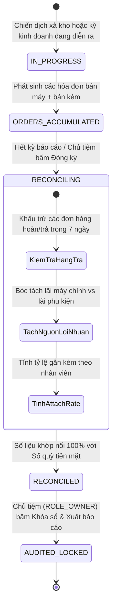

# TÀI LIỆU ĐẶC TẢ YÊU CẦU PHẦN MỀM (SOFTWARE REQUIREMENTS SPECIFICATION - SRS)
## HỆ THỐNG QUẢN LÝ KHO HÀNG ĐIỆN MÁY THÔNG MINH - STOCK SENSE
### PHÂN HỆ: HIỆU QUẢ KINH DOANH & THU HỒI VỐN LƯU ĐỘNG (BUSINESS PERFORMANCE & CAPITAL RECOVERY)
#### Ánh xạ nghiệp vụ từ User Stories: US-6.1

---

## THÔNG TIN KIỂM SOÁT TÀI LIỆU (DOCUMENT CONTROL)

| Mục | Nội dung |
| :--- | :--- |
| **Mã tài liệu** | `SRS-MOD06-BUSINESS-PERFORMANCE-CAPITAL-RECOVERY` |
| **Tên sản phẩm** | Hệ thống Quản lý Kho hàng Điện máy Thông minh - **Stock Sense** |
| **Phân hệ (Module)** | Module 06: Hiệu quả kinh doanh (Business Performance) |
| **Tài liệu tham chiếu** | [URD_06_HIEU_QUA_KINH_DOANH.md](file:///Users/doanphambaothu/Documents/gsj_project/docs/URD_06_HIEU_QUA_KINH_DOANH.md) |
| **Phiên bản** | `1.0.0` |
| **Trạng thái** | Sẵn sàng triển khai phát triển (Ready for Development) |
| **Ngày ban hành** | 08/11/2026 |
| **Tác giả** | Nhóm Phân tích Nghiệp vụ & Kiến trúc Phần mềm (BA & System Architecture Team) |

---

### BẢNG THEO DÕI THAY ĐỔI TÀI LIỆU (REVISION HISTORY)

| Phiên bản | Ngày | Người thực hiện | Tóm tắt nội dung thay đổi |
| :---: | :---: | :---: | :--- |
| **1.0.0** | 08/11/2026 | BA Team | Khởi tạo tài liệu SRS chi tiết: thuật toán bóc tách lợi nhuận Thác nước (Waterfall), công thức tính tỷ lệ gắn kèm Attach-Rate, cơ chế đo lường dòng tiền vốn thực tế thu hồi, và bảng tính hoa hồng bán kèm nhân viên. |

---

## 1. GIỚI THIỆU & PHẠM VI (INTRODUCTION & SCOPE)

### 1.1. Mục đích tài liệu (Purpose)
Tài liệu SRS này chuyển hóa toàn bộ các yêu cầu từ [URD_06_HIEU_QUA_KINH_DOANH.md](file:///Users/doanphambaothu/Documents/gsj_project/docs/URD_06_HIEU_QUA_KINH_DOANH.md) thành các đặc tả kỹ thuật phần mềm chi tiết phục vụ lập trình trực tiếp cho phân hệ **Hiệu quả kinh doanh & Thu hồi vốn**:
1. Định nghĩa công thức tính toán lượng Vốn lưu động thực tế được giải phóng sau các chiến dịch xả kho.
2. Xây dựng công cụ phân tích Tỷ lệ Gắn kèm (Attach-Rate Analytics) đo lường chính xác hiệu quả bán chéo phụ kiện và vật tư trên từng đơn hàng thiết bị chính.
3. Thiết lập biểu đồ Thác nước Lợi nhuận (Waterfall Profit Breakdown) chứng minh vai trò cứu cánh lợi nhuận của nhóm phụ kiện biên lãi cao ($40\% - 60\%$) bù đắp cho thiết bị chính biên lãi mỏng ($8\% - 12\%$).
4. Bảng tính hoa hồng tự động theo hiệu suất bán kèm thúc đẩy đội ngũ bán hàng và kỹ thuật viên lắp đặt.

### 1.2. Phạm vi phân hệ (Scope of Module)
Module **Hiệu quả kinh doanh** đóng vai trò là "Bảng cân đối tài chính tác chiến" của Chủ doanh nghiệp điện máy:
* **Đo lường Vốn thu hồi (Capital Recovery Tracking):** Bóc tách chính xác bao nhiêu tiền mặt gốc đã quay lại tài khoản từ các mặt hàng tồn kho lâu ngày.
* **Phân tích Cấu trúc Giỏ hàng & Bán kèm:** Đánh giá Attach-rate theo từng ngành hàng chính (Tivi, Điều hòa, Máy giặt, Tủ lạnh).
* **Đánh giá Hiệu quả Nhân sự:** Xếp hạng nhân viên bán lẻ và kỹ thuật viên lắp đặt dựa trên khả năng bán gia tăng giá trị đơn hàng.

### 1.3. Bảng thuật ngữ chuyên ngành & Ký hiệu quy ước (Glossary & Conventions)

| Ký hiệu / Thuật ngữ | Tên đầy đủ | Định nghĩa và Công thức kỹ thuật |
| :--- | :--- | :--- |
| **Attach Rate ($AR$)** | Tỷ lệ gắn kèm sản phẩm | Tỷ lệ % đơn hàng thiết bị chính có phát sinh mua kèm phụ kiện/dịch vụ. |
| **Core Hardware** | Thiết bị điện máy chính | Tivi, Tủ lạnh, Máy giặt, Điều hòa (giá trị cao, biên lãi gộp $8\% - 12\%$). |
| **Attached Items** | Sản phẩm & Dịch vụ bán kèm | Giá treo tivi, Dây HDMI, Chân đế máy giặt, Ống đồng, Công lắp, Bảo dưỡng (biên lãi $40\% - 75\%$). |
| **Recovered Working Capital** | Vốn lưu động thu hồi | Số tiền vốn gốc được giải phóng thành tiền mặt: $\sum (Q_{\text{sold}} \times Cost\,Price)$. |
| **Waterfall Breakdown** | Phân rã dạng Thác nước | Kỹ thuật trực quan hóa từng khoản doanh thu và chi phí cấu thành nên lợi nhuận gộp cuối cùng. |
| **Cross-sell Margin** | Biên lợi nhuận bán chéo | Tỷ trọng lợi nhuận từ phụ kiện trên tổng lợi nhuận gộp toàn đơn hàng (%). |

---

## 2. MA TRẬN PHÂN QUYỀN & TÁC NHÂN HỆ THỐNG (ROLES & ACTORS)

| Mã chức năng (FR ID) | Tên chức năng kỹ thuật | Chủ cửa hàng (`ROLE_OWNER`) | Nhân viên bán lẻ (`ROLE_SALES`) | Trưởng kỹ thuật (`ROLE_WH_MGR`) |
| :--- | :--- | :---: | :---: | :---: |
| **FR-PRF-01** | Bảng KPI Tổng vốn thu hồi & Lợi nhuận gộp | **Toàn quyền xem đầy đủ** | **Không có quyền** | **Không có quyền** |
| **FR-PRF-02** | Phân tích Tỷ lệ Gắn kèm (Attach-Rate) | **Xem toàn bộ cửa hàng** | **Xem chỉ số của cá nhân** | **Xem vật tư kỹ thuật** |
| **FR-PRF-03** | Biểu đồ Thác nước phân rã Lợi nhuận gộp | **Toàn quyền xem** | **Không có quyền** | **Không có quyền** |
| **FR-PRF-04** | Đánh giá Hiệu quả Chiến dịch Xả kho (ROI) | **Toàn quyền** | **Không áp dụng** | **Không áp dụng** |
| **FR-PRF-05** | Bảng xếp hạng Nhân viên & Tính hoa hồng | **Toàn quyền & Phê duyệt** | **Xem mức thưởng cá nhân** | **Xem mức thưởng kỹ thuật** |
| **FR-PRF-06** | Kết xuất Báo cáo Tài chính Excel / PDF | **Toàn quyền xuất** | **Không có quyền** | **Không có quyền** |

---

## 3. MÔ HÌNH TRẠNG THÁI & DÒNG CHẢY NGHIỆP VỤ (STATE MACHINE & BUSINESS FLOWS)

### 3.1. Sơ đồ chu trình Đóng kỳ & Quyết toán Hiệu quả Chiến dịch (Financial Reconciliation Cycle)



---

## 4. ĐẶC TẢ YÊU CẦU CHỨC NĂNG CHI TIẾT (FUNCTIONAL REQUIREMENTS)

#### 4.1. FR-PRF-01: Bảng điều khiển KPI Vốn thu hồi & Dòng tiền ròng thực tế
* **Mô tả chức năng:** Thống kê khối lượng tiền mặt gốc đã được thu hồi và lợi nhuận thực tế đạt được trong kỳ quan sát.
* **Thuật toán tính Tổng vốn lưu động thu hồi:**
  $$\text{Total Recovered Capital} = \sum_{j \in \text{Hóa đơn thuộc kỳ}} \left( Quantity_{j} \times Cost\,Price_{j} \right)$$
  - Phân tách rõ: Vốn thu hồi từ các SKU trong danh mục Xả hàng (Module 03) và Vốn quay vòng từ hàng bán thông thường.
* **Thuật toán tính Tổng lợi nhuận gộp toàn cửa hàng:**
  $$\text{Total Gross Profit} = \sum_{k} \left( Line\,Total_k - (Quantity_k \times Cost\,Price_k) \right)$$
* **Đầu ra (Outputs):**
  - Thẻ 1: Tổng vốn gốc đã thu hồi về két (VNĐ).
  - Thẻ 2: Số thiết bị xả thành công (Chiếc / Bộ).
  - Thẻ 3: Doanh số sản phẩm bán kèm (Phụ kiện & Dịch vụ).
  - Thẻ 4: Tỷ lệ gắn kèm toàn cửa hàng ($Attach\,Rate\,\%$) kèm so sánh với tháng trước.

---

#### 4.2. FR-PRF-02: Động cơ Phân tích Tỷ lệ Gắn kèm (Attach-Rate Engine)
* **Mô tả chức năng:** Tự động quét các dòng hóa đơn (`FACT_INVOICES_LINES`) để xác định tỷ lệ đơn hàng có bán kèm phụ kiện hoặc dịch vụ kỹ thuật.
* **Công thức toán học:**
  $$Attach\,Rate = \frac{N_{\text{attached}}}{N_{\text{core}}} \times 100\%$$
  - Trong đó:
    - $N_{\text{core}}$: Số lượng hóa đơn có chứa ít nhất 1 sản phẩm thuộc nhóm `Tivi`, `Tủ lạnh`, `Máy giặt`, `Điều hòa`.
    - $N_{\text{attached}}$: Số lượng hóa đơn trong nhóm $N_{\text{core}}$ có xuất hiện ít nhất 1 sản phẩm thuộc nhóm `Phụ kiện điện máy` hoặc `Vật tư & Dịch vụ lắp đặt`.
* **Phân loại đánh giá hiệu suất:**
  - $AR \ge 70\%$: 🌟 Đạt chuẩn Xuất sắc (Chuẩn bán lẻ hàng đầu).
  - $50\% \le AR < 70\%$: ✅ Đạt yêu cầu.
  - $AR < 50\%$: ⚠️ Yếu kém - Nhân viên chưa chịu tư vấn phụ kiện.

---

#### 4.3. FR-PRF-03: Biểu đồ Thác nước Phân rã Lợi nhuận gộp (Profitability Waterfall Engine)
* **Mô tả chức năng:** Bóc tách trực quan cấu trúc tạo ra lợi nhuận của toàn bộ cửa hàng, chứng minh rõ phụ kiện bán kèm đóng góp bao nhiêu phần trăm vào tổng thu nhập.
* **Cấu trúc phân rã 4 thành phần:**
  1. **Thành phần 1 - Lãi gộp từ Máy chính:**
     $$Profit_{\text{core}} = \sum \left( Line\,Total_{\text{core}} - (Qty_{\text{core}} \times Cost_{\text{core}}) \right) \quad (\text{Biên lãi: } 7\% - 10\%)$$
  2. **Thành phần 2 - Lãi gộp từ Phụ kiện (Giá treo, Dây cáp, Chân đế):**
     $$Profit_{\text{acc}} = \sum \left( Line\,Total_{\text{acc}} - (Qty_{\text{acc}} \times Cost_{\text{acc}}) \right) \quad (\text{Biên lãi: } 50\% - 65\%)$$
  3. **Thành phần 3 - Lãi gộp từ Vật tư & Dịch vụ lắp đặt (Ống đồng, Bảo dưỡng):**
     $$Profit_{\text{srv}} = \sum \left( Line\,Total_{\text{srv}} - (Qty_{\text{srv}} \times Cost_{\text{srv}}) \right) \quad (\text{Biên lãi: } 70\% - 85\%)$$
  4. **Thành phần 4 - Trừ chi phí khuyến mại / Quà tặng chiến dịch:**
     $$\text{Chi phí khuyến mại} = \sum Cost_{\text{promo}}$$
* **Kết quả hợp nhất:**
  $$\text{Lợi nhuận gộp hợp nhất} = Profit_{\text{core}} + Profit_{\text{acc}} + Profit_{\text{srv}} - \text{Chi phí khuyến mại}$$

---

#### 4.4. FR-PRF-04: Bảng Xếp hạng Nhân viên & Tính Hoa hồng Bán kèm (Staff Incentive Calculator)
* **Mô tả chức năng:** Tự động tính toán mức tiền thưởng hoa hồng cho nhân viên bán hàng và kỹ thuật viên dựa trên doanh số phụ kiện bán kèm.
* **Công thức tính hoa hồng bán kèm:**
  $$\text{Tiền thưởng hoa hồng}_e = Profit_{\text{acc}, e} \times 15\% + Profit_{\text{srv}, e} \times 20\%$$
  - Thúc đẩy kỹ thuật viên tận tâm tư vấn thêm phụ kiện chất lượng cho khách khi đến lắp máy tại nhà.

---

#### 4.5. FR-PRF-05: Kết xuất Báo cáo Quản trị Đa định dạng (Excel / PDF Export)
* **Mô tả chức năng:** Xuất báo cáo tài chính tổng hợp ra file Excel (.xlsx) gồm đầy đủ công thức và đồ thị Waterfall, sẵn sàng phục vụ báo cáo thuế hoặc họp tổng kết kinh doanh.

---

## 5. ĐẶC TẢ GIAO DIỆN & TƯƠNG TÁC NGƯỜI DÙNG (UI/UX SPECIFICATIONS)

### 5.1. Màn hình Báo cáo Hiệu quả Kinh doanh & Thác nước Lợi nhuận (Wireframe)

```
========================================================================================================================
[🏪 ĐIỆN MÁY STOCK SENSE]   | Phân hệ: HIỆU QUẢ KINH DOANH & THU HỒI VỐN LƯU ĐỘNG      [Kỳ đánh giá: Tháng 10/2026 v]
========================================================================================================================
+--------------------------+ +--------------------------+ +--------------------------+ +-------------------------------+
| VỐN GỐC ĐÃ THU HỒI VỀ KÉT| | THIẾT BỊ XẢ THÀNH CÔNG   | | DOANH SỐ BÁN KÈM (PK+DV) | | TỶ LỆ GẮN KÈM (ATTACH-RATE)   |
| 420.000.000 đ            | | 32 Thiết bị              | | 85.400.000 đ             | | 68.5% (Vượt chuẩn ngành 60%)  |
| (Giải tỏa 74.9% vốn đọng)| | (Dọn sạch 3 SKU tồn kho) | | (Lãi gộp: 48.200.000 đ)  | | (+12.5% so với tháng trước)   |
+--------------------------+ +--------------------------+ +--------------------------+ +-------------------------------+

------------------------------------------------------------------------------------------------------------------------
📊 BIỂU ĐỒ THÁC NƯỚC PHÂN RÃ NGUỒN LỢI NHUẬN GỘP (WATERFALL PROFIT BREAKDOWN):
[+] Lãi gộp từ Máy chính (Tivi, Tủ lạnh, Điều hòa):   42.000.000 đ  (Doanh số máy: 540tr - Biên lãi: 7.7%)
[+] Lãi gộp từ Phụ kiện (Giá treo, Cáp HDMI, Ổ cắm):   28.600.000 đ  (Doanh số PK:   52tr - Biên lãi: 55.0% 🔥)
[+] Lãi gộp từ Dịch vụ & Vật tư (Ống đồng, Bảo dưỡng): 24.500.000 đ  (Doanh số DV:   33tr - Biên lãi: 74.2% 🔥)
------------------------------------------------------------------------------------------------------------------------
=> TỔNG LỢI NHUẬN GỘP TOÀN CỬA HÀNG:                  95.100.000 đ
   (Trong đó: Phụ kiện & Dịch vụ đóng góp 53.1 triệu, chiếm 55.8% TỔNG LỢI NHUẬN TOÀN CỬA HÀNG!)
------------------------------------------------------------------------------------------------------------------------
BẢNG CHI TIẾT TỶ LỆ BÁN KÈM THEO NGÀNH HÀNG:
+-------------------+-------------+----------------+-------------+--------------------+------------------+-------------+
| Ngành hàng chính  | Số máy bán  | Đơn có bán kèm | Attach Rate | Doanh thu bán kèm  | Lãi gộp bán kèm  | Đánh giá    |
+-------------------+-------------+----------------+-------------+--------------------+------------------+-------------+
| Tivi (Smart TV)   |   18 máy    |    14 đơn      |    77.8%    |   22.400.000 đ     |   12.800.000 đ   | 🌟 Xuất sắc |
| Điều hòa nhiệt độ |   12 bộ     |    10 đơn      |    83.3%    |   45.200.000 đ     |   26.400.000 đ   | 🌟 Xuất sắc |
| Máy giặt lồng ng. |    8 máy    |     4 đơn      |    50.0%    |    6.800.000 đ     |    3.500.000 đ   | ⚠️ Cần đẩy  |
| Tủ lạnh dung tích |    6 máy    |     2 đơn      |    33.3%    |    3.200.000 đ     |    1.800.000 đ   | ⚠️ Yếu kém  |
+-------------------+-------------+----------------+-------------+--------------------+------------------+-------------+
[BẢNG HOA HỒNG NHÂN VIÊN] Nguyễn Tuấn Long (Kỹ thuật): Bán kèm 18.5tr -> Hoa hồng: 2.775.000 đ [Duyệt chi hoa hồng]
------------------------------------------------------------------------------------------------------------------------
[ 📥 XUẤT BÁO CÁO TÀI CHÍNH EXCEL (.XLSX) ]                [ 🖨️ IN BẢNG BÁO CÁO GIÁM ĐỐC (PDF) ]
========================================================================================================================
```

---

## 6. MA TRẬN XỬ LÝ NGOẠI LỆ & MÃ LỖI (EXCEPTION MATRIX)

| Mã lỗi | Tên lỗi kỹ thuật | Nguyên nhân phát sinh | Hành vi xử lý hệ thống |
| :--- | :--- | :--- | :--- |
| **`ERR_PRF_001`** | Hóa đơn bị hủy sau đóng kỳ | Khách trả hàng sau khi kỳ báo cáo tháng trước đã đóng. | Không sửa dữ liệu cũ; Tự động tạo bản ghi điều chỉnh âm (Credit Adjustment) vào kỳ báo cáo hiện tại. |
| **`ERR_PRF_002`** | Không có hóa đơn thiết bị chính | Đơn hàng chỉ mua riêng phụ kiện (mua lẻ dây cáp). | Tính doanh thu vào nhóm phụ kiện nhưng không tính vào mẫu số $N_{\text{core}}$ của Attach-rate. |
| **`ERR_PRF_003`** | Lệch giá vốn lịch sử | Giá vốn sản phẩm bị thay đổi sau thời điểm xuất bán. | Sử dụng giá vốn lịch sử tại thời điểm lập hóa đơn (`FACT_INVOICES_LINES.cost_price`), không lấy giá vốn hiện tại. |

---

## 7. TIÊU CHÍ NGHIỆM THU KIỂM THỬ (ACCEPTANCE CRITERIA - BDD/GHERKIN)

```gherkin
Feature: Thống kê hiệu quả thu hồi vốn và tỷ lệ bán kèm (Module 06)

  Scenario: Tính chính xác tỷ lệ Attach Rate toàn cửa hàng
    Given Trong tháng có 40 hóa đơn bán thiết bị chính (Tivi, Máy giặt, Điều hòa)
    And Trong đó có 30 hóa đơn có mua kèm ít nhất 1 phụ kiện hoặc vật tư
    When Hệ thống tính toán chỉ số Attach Rate
    Then Tỷ lệ Attach Rate hiển thị chính xác là (30 / 40) * 100 = 75.0%
    And Badge đánh giá hiển thị "🌟 Xuất sắc"

  Scenario: Phân rã lợi nhuận gộp chứng minh phụ kiện chiếm trên 50% tổng lãi
    Given Lãi gộp từ máy chính là 40.000.000 đ
    And Lãi gộp từ phụ kiện và dịch vụ là 60.000.000 đ
    When Hệ thống kết xuất biểu đồ Thác nước (Waterfall)
    Then Tổng lợi nhuận gộp hiển thị là 100.000.000 đ
    And Tỷ trọng đóng góp của phụ kiện và dịch vụ hiển thị chính xác là 60.0%
```

---

## 8. MA TRẬN TRUY VẾT YÊU CẦU (TRACEABILITY MATRIX)

| Mã URD | Mã FR SRS | Bảng dữ liệu / View CSDL | Quy tắc nghiệp vụ | Mã Test Case |
| :--- | :--- | :--- | :--- | :--- |
| **US-6.1** | `FR-PRF-01` (Vốn thu hồi thực tế) | `FACT_INVOICES`, `FACT_INVOICES_LINES` | `BR-6.1.3` | `TC-PRF-01` |
| **US-6.1** | `FR-PRF-02` (Động cơ Attach Rate) | `FACT_INVOICES_LINES`, `DIM_PRODUCTS` | `BR-6.1.1`, `BR-6.1.2` | `TC-PRF-02` |
| **US-6.1** | `FR-PRF-03` (Thác nước Lợi nhuận) | Aggregated Financial Service | `BR-6.1.4` | `TC-PRF-03` |
| **US-6.1** | `FR-PRF-04` (Hoa hồng Nhân sự) | `DIM_EMPLOYEES`, Incentive Calculator | `BR-PRF-04.1` | `TC-PRF-04` |
| **US-6.1** | `FR-PRF-05` (Xuất báo cáo Excel/PDF) | Report Export Service | `BR-PRF-05.1` | `TC-PRF-05` |

---
*Tài liệu Đặc tả Yêu cầu Phần mềm (SRS) Phân hệ Hiệu quả kinh doanh - Stock Sense System.*
